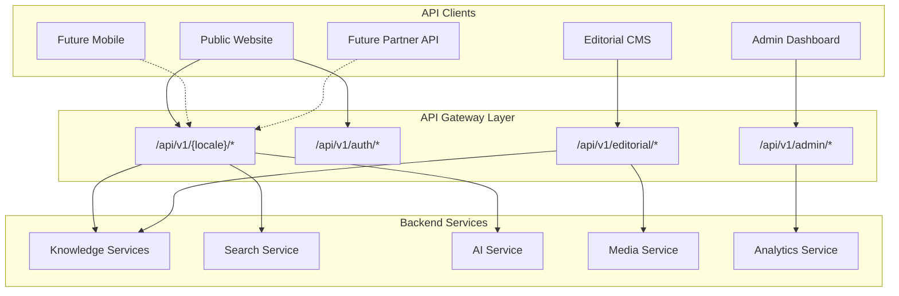
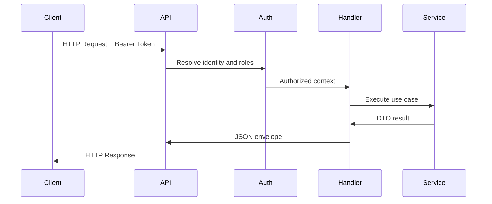
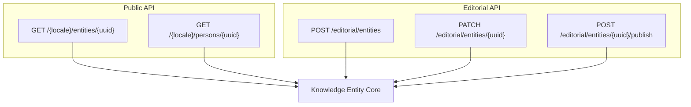
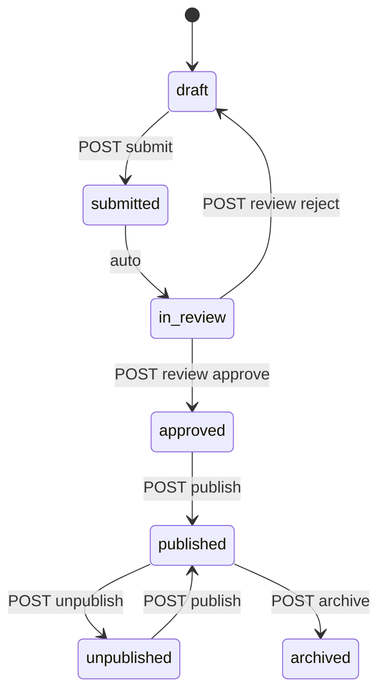
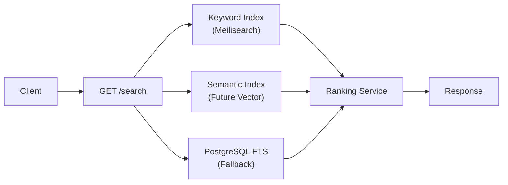
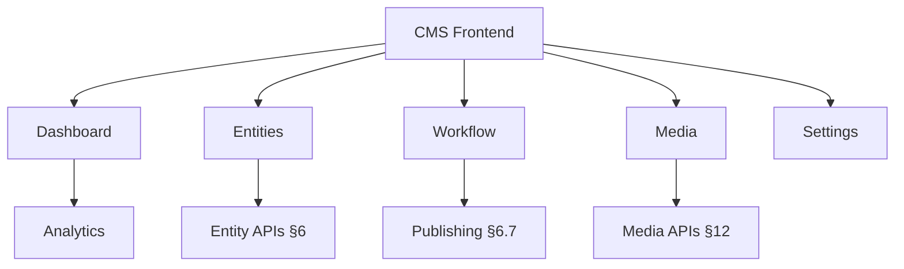
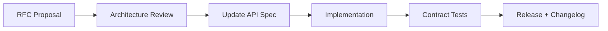

# API Specification

# ويكي العالمية — Wiki World

**Document Version:** 1.0  
**Status:** Authoritative API Contract  
**Date:** July 7, 2026  
**Classification:** Internal — Engineering, Frontend, Mobile, Partners  
**API Version:** v1  
**Document Type:** Conceptual API Specification (No Code / No OpenAPI File)

---

## Document Control

| Field | Value |
|-------|-------|
| Product Name (Arabic) | ويكي العالمية |
| Product Name (English) | Wiki World |
| Document Owner | Lead API Architect |
| Governing References | [PRD.md](./PRD.md), [KNOWLEDGE_DOMAIN_BLUEPRINT.md](./KNOWLEDGE_DOMAIN_BLUEPRINT.md), [DATABASE_DESIGN.md](./DATABASE_DESIGN.md), [BACKEND_ARCHITECTURE.md](./BACKEND_ARCHITECTURE.md) |
| Base URL (production) | `https://api.wikiworld.example` |
| Content Type | `application/json` (unless noted) |

### Revision History

| Version | Date | Author | Changes |
|---------|------|--------|---------|
| 1.0 | 2026-07-07 | API Architecture | Initial complete API specification |

### Alignment Statement

This document is the **single API contract** for Wiki World. It must not contradict prior architecture documents. Internal BIGINT identifiers never appear in API requests or responses — **UUID only**.

---

## Table of Contents

1. [API Philosophy](#1-api-philosophy)
2. [API Overview](#2-api-overview)
3. [Authentication](#3-authentication)
4. [Authorization](#4-authorization)
5. [Resource Design](#5-resource-design)
6. [Entity APIs](#6-entity-apis)
7. [Quran APIs](#7-quran-apis)
8. [Ahlulbayt APIs](#8-ahlulbayt-apis)
9. [Search APIs](#9-search-apis)
10. [AI APIs](#10-ai-apis)
11. [CMS APIs](#11-cms-apis)
12. [Media APIs](#12-media-apis)
13. [Localization APIs](#13-localization-apis)
14. [SEO APIs](#14-seo-apis)
15. [Analytics APIs](#15-analytics-apis)
16. [Error Handling](#16-error-handling)
17. [Response Standards](#17-response-standards)
18. [API Security](#18-api-security)
19. [Future APIs](#19-future-apis)
20. [API Governance](#20-api-governance)
- [Appendix A: Standard Response Schemas](#appendix-a-standard-response-schemas)
- [Appendix B: Error Code Registry](#appendix-b-error-code-registry)
- [Appendix C: Complete Endpoint Index](#appendix-c-complete-endpoint-index)
- [Appendix D: API Decision Log](#appendix-d-api-decision-log)
- [Appendix E: Relationship Type Registry](#appendix-e-relationship-type-registry)
- [Appendix F: Entity Type Registry](#appendix-f-entity-type-registry)

---

# 1. API Philosophy

## 1.1 Purpose of This API

The Wiki World API exposes a **resource-oriented REST interface** over an Entity-First Knowledge Graph. It serves:

- **Public consumers** — website, future mobile apps
- **Registered users** — personalization (bookmarks, history, AI chat)
- **Editorial consumers** — CMS for editor-only publishing
- **Administrative consumers** — platform operations
- **Future external developers** — read-only institutional API (Phase 2)

## 1.2 REST Philosophy

| Principle | Wiki World Application |
|-----------|------------------------|
| **Resources as nouns** | `persons`, `articles`, `verses` — not `getPerson` |
| **HTTP verbs as actions** | GET read, POST create, PATCH update, DELETE remove |
| **Stateless** | Every request self-contained; session/token carries auth |
| **Uniform interface** | Consistent envelope, errors, pagination across all surfaces |
| **Cacheable reads** | Public GET supports ETag, Cache-Control |
| **Layered system** | CDN → API → services; clients unaware of internals |

**Non-RESTful exceptions (documented):**
- `POST /editorial/entities/{uuid}/publish` — state transition action
- `POST /ai/chat` — streaming RPC-style for AI
- `GET /quran/verses/{surah}:{ayah}` — compound key in path

## 1.3 Resource-First Architecture

The API mirrors the Knowledge Domain Blueprint: **entities are primary**, articles are presentation.

| API Pattern | Blueprint Mapping |
|-------------|-------------------|
| `/persons/{uuid}` | Person entity public view |
| `/articles/{uuid}` | Article composed presentation |
| `/entities/{uuid}/relationships` | Graph traversal |
| `/sources/{uuid}` | Bibliographic Source entity |
| `/editorial/entities/{uuid}` | Full editorial aggregate |

## 1.4 Naming Conventions

| Element | Convention | Example |
|---------|------------|---------|
| Base path | `/api/v1` | — |
| Locale segment | ISO 639-1 | `/api/v1/ar/...` |
| Resources | plural, kebab-case | `saved-searches` |
| Path parameters | `{uuid}`, `{surah}`, `{ayah}` | `/persons/{uuid}` |
| Query parameters | snake_case | `filter[entity_type]` |
| JSON fields | snake_case | `published_at`, `meta_title` |
| Enums | snake_case strings | `workflow_state: "published"` |
| Dates | ISO 8601 UTC | `2026-07-07T10:30:00Z` |
| Public IDs | UUID v7 | `550e8400-e29b-41d4-a716-446655440000` |

## 1.5 Versioning Strategy

| Rule | Detail |
|------|--------|
| URL version | `/api/v1/` mandatory prefix |
| Breaking change | New major version `/api/v2/` |
| Deprecation window | Minimum 12 months notice |
| Additive change | Same version; new optional JSON fields |
| Sunset header | `Sunset: Sat, 01 Jan 2028 00:00:00 GMT` on deprecated endpoints |

## 1.6 Consistency Rules

| Rule ID | Rule |
|---------|------|
| API-C01 | All successful single-resource responses use `{ "data": { ... } }` |
| API-C02 | All collection responses use `{ "data": [ ... ], "meta": { "pagination": ... } }` |
| API-C03 | All errors use `{ "error": { ... }, "meta": { "request_id": ... } }` |
| API-C04 | Locale in path determines response language; `Accept-Language` is fallback only |
| API-C05 | Never expose draft content on public surface |
| API-C06 | Never expose internal integer IDs |
| API-C07 | All write endpoints require `Content-Type: application/json` |
| API-C08 | Idempotency-Key header supported on publish and bookmark POST |
| API-C09 | Cursor and offset pagination never mixed on same endpoint |
| API-C10 | Include parameter depth maximum: 2 levels |

## 1.7 API Surfaces Summary

| Surface | Base Path | Write Access |
|---------|-----------|--------------|
| Public | `/api/v1/{locale}/` | Auth, bookmarks, AI only |
| Auth | `/api/v1/auth/` | Registration, login |
| Account | `/api/v1/me/` | User preferences |
| Editorial (CMS) | `/api/v1/editorial/` | Editor workflows |
| Admin | `/api/v1/admin/` | Platform admin |
| Internal | `/api/v1/internal/` | Service-to-service (future) |
| Health | `/health/` | None |

---

# 2. API Overview

## 2.1 Architecture Diagram



## 2.2 Public API

**Purpose:** Read published knowledge; optional registered user features.

| Capability | Auth |
|------------|------|
| Browse entities by type | Guest |
| Search knowledge | Guest |
| Quran navigation | Guest |
| Ahlulbayt module | Guest |
| Timeline | Guest |
| AI assistant (rate limited) | Guest / Registered |
| Bookmarks, history | Registered |
| SEO assets (sitemap, robots) | Guest |

## 2.3 CMS API (Editorial)

**Purpose:** Editor-only content management. No public access.

| Capability | Role |
|------------|------|
| Create/edit drafts | Editor |
| Submit for review | Editor |
| Approve/reject | Senior Editor |
| Publish/unpublish | Senior Editor |
| Media upload | Editor |
| Preview public render | Editor |
| AI flag resolution | Senior Editor |

## 2.4 Admin API

**Purpose:** Platform configuration and observability.

| Capability | Role |
|------------|------|
| User/role management | Admin |
| Site settings | Admin |
| Feature toggles | Admin |
| Analytics dashboards | Admin |
| Audit logs | Admin |
| Search zero-result reports | Admin |

## 2.5 Internal API

**Purpose:** Service-to-service operations (MVP: minimal).

| Endpoint | Use |
|----------|-----|
| `/internal/health/detailed` | Orchestrator health |
| `/internal/reindex` | Admin-triggered bulk reindex (protected) |

Not exposed publicly. Requires internal service token.

## 2.6 Future External API

**Purpose:** Read-only institutional access (Phase 2).

- Separate base path: `/api/v1/partner/`
- API key authentication with scoped abilities
- Rate limits per client
- Entity read + search only — no write

## 2.7 Request Flow



---

# 3. Authentication

## 3.1 Authentication Surfaces

| Surface | Methods |
|---------|---------|
| Guest | No credentials; optional session cookie for analytics |
| Registered | Bearer token (Sanctum) or session cookie |
| Editorial | Bearer token + editorial role |
| Admin | Bearer token + admin role + MFA for Super Admin |

## 3.2 Registration

**POST** `/api/v1/auth/register`

| Field | Type | Required | Validation |
|-------|------|----------|------------|
| email | string | yes | Valid email, unique |
| password | string | yes | Min 12 chars, complexity rules |
| password_confirmation | string | yes | Must match |
| preferred_locale | string | no | `ar` or `en` |

**Response:** `201 Created` — `{ "data": { "user": UserSummary, "message": "verification_sent" } }`

**Permissions:** Guest only.

## 3.3 Login

**POST** `/api/v1/auth/login`

| Field | Type | Required |
|-------|------|----------|
| email | string | yes |
| password | string | yes |
| device_name | string | no |

**Response:** `200 OK`

```json
{
  "data": {
    "token": "1|...",
    "token_type": "Bearer",
    "expires_at": null,
    "user": { "uuid": "...", "email": "...", "roles": ["editor"] }
  }
}
```

**Errors:** `401 INVALID_CREDENTIALS`, `423 ACCOUNT_LOCKED` (after 5 failures)

## 3.4 Logout

**POST** `/api/v1/auth/logout`

**Auth:** Required. Revokes current token.

**Response:** `204 No Content`

## 3.5 Email Verification

**GET** `/api/v1/auth/verify-email/{id}/{hash}`

**Response:** `302 Redirect` to frontend success page, or `200` for API-only clients.

## 3.6 Password Reset

**POST** `/api/v1/auth/forgot-password` — sends reset email  
**POST** `/api/v1/auth/reset-password` — accepts token, email, new password

## 3.7 Token Strategy

| Attribute | Value |
|-----------|-------|
| Type | Laravel Sanctum personal access token |
| Header | `Authorization: Bearer {token}` |
| SPA | Cookie-based session for first-party frontend (CSRF protected) |
| Abilities | Scoped: `read`, `account`, `editorial`, `admin` |
| Rotation | On password change, all tokens revoked |

## 3.8 Session Strategy (First-Party Web)

| Attribute | Value |
|-----------|-------|
| Cookie | HttpOnly, Secure, SameSite=Lax |
| Lifetime | 30 days (registered), 8 hours (editorial) |
| CSRF | `X-XSRF-TOKEN` header on state-changing requests |

## 3.9 MFA (Admin)

**POST** `/api/v1/auth/mfa/challenge` — submit TOTP after login  
**POST** `/api/v1/auth/mfa/enable` — enroll (Admin+)  
Required before admin API access for Admin and Super Admin roles.

## 3.10 Future API Keys

**Phase 2:** `X-API-Key` header for partner read API. Keys stored hashed; scoped to `partner:read`.

## 3.11 OAuth Readiness

Architecture reserves `user_oauth_identities` (future table). MVP: email/password only. OAuth providers: Google, Apple (per PRD open decisions).

---

# 4. Authorization

## 4.1 Role Matrix

| Role | Public Read | Account Write | Editorial | Publish | Admin |
|------|-------------|---------------|-----------|---------|-------|
| Guest | Yes | No | No | No | No |
| Registered | Yes | Yes | No | No | No |
| Editor | Yes | Yes | Yes (domain) | No | No |
| Senior Editor | Yes | Yes | Yes | Yes | No |
| Admin | Yes | Yes | Yes | Yes | Yes |
| Super Admin | Yes | Yes | Yes | Yes | Yes + user mgmt |

## 4.2 Permission Codes

| Code | Applies To |
|------|------------|
| `entity.view.published` | Public GET |
| `entity.view.draft` | Editorial GET |
| `entity.create` | POST editorial entities |
| `entity.update` | PATCH editorial entities |
| `entity.submit` | POST submit |
| `entity.publish` | POST publish |
| `entity.unpublish` | POST unpublish |
| `review.approve` | POST review |
| `media.upload` | POST media |
| `ai.flag.resolve` | PATCH ai-flags |
| `user.manage` | Admin users |
| `settings.manage` | Admin settings |
| `analytics.view` | Admin analytics |
| `audit.view` | Admin audit |

## 4.3 Domain Permissions

Editors scoped via `editor_domain_scopes`: `quran`, `ahlulbayt`, `general`, `books_sources`.

| Action | Rule |
|--------|------|
| Create entity in domain | Requires matching scope |
| Edit entity in domain | Requires matching scope |
| Link to entity outside domain | Allowed (read + link only) |
| Publish | Senior Editor — any domain |

## 4.4 Ownership Rules

| Resource | Rule |
|----------|------|
| Draft | Creator can edit until submitted |
| Submission | Only submitter can withdraw |
| Bookmark | User owns own bookmarks |
| AI conversation | User owns own conversations |

## 4.5 Publishing Permissions

| Endpoint | Minimum Role |
|----------|--------------|
| POST submit | Editor |
| POST review | Senior Editor |
| POST publish | Senior Editor |
| POST unpublish | Senior Editor |
| POST archive | Senior Editor |

## 4.6 Policy Evaluation Order

1. Maintenance mode check  
2. Authentication resolution  
3. Role/permission check  
4. Domain scope check (editorial)  
5. Resource ownership check  
6. Workflow state check  

---

# 5. Resource Design

This section defines every API resource. Each resource follows a standard documentation template.

**Standard template fields:** Purpose, Endpoints, Methods, Permissions, Request validation, Response shape, Errors, Pagination, Filtering, Future compatibility.

---

## 5.1 Users

| Attribute | Value |
|-----------|-------|
| **Purpose** | Registered account identity and preferences |
| **Public resource** | No — account surface only |

### Endpoints

| Method | Path | Description |
|--------|------|-------------|
| GET | `/api/v1/me` | Current user profile |
| PATCH | `/api/v1/me` | Update preferences |
| DELETE | `/api/v1/me` | Delete account (anonymize) |

### Permissions

| Endpoint | Auth |
|----------|------|
| All | Registered Bearer token |

### PATCH Validation

| Field | Type | Rules |
|-------|------|-------|
| display_name | string | max 255 |
| preferred_locale | string | `ar`, `en` |

### Response Shape (GET /me)

```json
{
  "data": {
    "uuid": "550e8400-e29b-41d4-a716-446655440000",
    "email": "user@example.com",
    "email_verified": true,
    "display_name": "Fatima",
    "preferred_locale": "ar",
    "roles": ["registered"],
    "created_at": "2026-01-15T08:00:00Z"
  }
}
```

### Errors

`401 UNAUTHENTICATED`, `422 VALIDATION_FAILED`

---

## 5.2 Roles & Permissions (Admin)

| Attribute | Value |
|-----------|-------|
| **Purpose** | RBAC management |
| **Surface** | Admin API only |

### Endpoints

| Method | Path | Description |
|--------|------|-------------|
| GET | `/api/v1/admin/roles` | List roles |
| GET | `/api/v1/admin/permissions` | List permissions |
| POST | `/api/v1/admin/users/{uuid}/roles` | Assign role |
| DELETE | `/api/v1/admin/users/{uuid}/roles/{role}` | Remove role |
| GET | `/api/v1/admin/users/{uuid}/domain-scopes` | List editor domains |
| PUT | `/api/v1/admin/users/{uuid}/domain-scopes` | Set domain scopes |

### Permissions

`user.manage` — Admin+

---

## 5.3 Articles

| Attribute | Value |
|-----------|-------|
| **Purpose** | Public read of published article presentation |
| **Entity type** | `article` |

### Public Endpoints

| Method | Path | Description |
|--------|------|-------------|
| GET | `/api/v1/{locale}/articles` | List published articles |
| GET | `/api/v1/{locale}/articles/{uuid}` | Single article with blocks |

### Permissions

| Endpoint | Auth |
|----------|------|
| GET list | Guest |
| GET single | Guest (published only) |

### Query Parameters (List)

| Param | Type | Description |
|-------|------|-------------|
| `filter[category]` | string | Category slug |
| `filter[tag]` | string | Tag slug |
| `filter[module]` | string | Module filter |
| `sort` | string | `-published_at`, `title` |
| `page`, `per_page` | int | Pagination |
| `include` | string | `sources`, `related_entities` |

### Response Shape (Single)

```json
{
  "data": {
    "uuid": "...",
    "type": "article",
    "title": "...",
    "slug": "...",
    "summary": "...",
    "locale": "ar",
    "direction": "rtl",
    "workflow_state": "published",
    "published_at": "...",
    "reading_time_minutes": 8,
    "table_of_contents": [{ "id": "s1", "title": "...", "level": 2 }],
    "blocks": [{ "type": "paragraph", "content": "..." }],
    "citations": [{ "reference_uuid": "...", "source": { "uuid": "...", "title": "..." } }],
    "related_entities": [{ "uuid": "...", "type": "person", "title": "..." }],
    "seo": { "meta_title": "...", "meta_description": "...", "canonical_url": "..." }
  },
  "links": { "self": "..." }
}
```

### Errors

`404 NOT_FOUND` (draft or missing)

---

## 5.4 Persons

| Method | Path | Description |
|--------|------|-------------|
| GET | `/api/v1/{locale}/persons` | Browse persons |
| GET | `/api/v1/{locale}/persons/{uuid}` | Person profile |

### Response Fields (Single)

`uuid`, `type`, `title`, `slug`, `summary`, `infobox` (dates, titles, lineage), `biography_blocks`, `relationships_summary`, `sources`, `related_entities`, `seo`

### Filters

`filter[is_masum]`, `filter[generation]`, `filter[module]=ahlulbayt`

---

## 5.5 Books

| Method | Path | Description |
|--------|------|-------------|
| GET | `/api/v1/{locale}/books` | Library catalog |
| GET | `/api/v1/{locale}/books/{uuid}` | Book metadata |
| GET | `/api/v1/{locale}/books/{uuid}/chapters` | Chapter list |
| GET | `/api/v1/{locale}/books/{uuid}/chapters/{slug}` | Chapter content |

---

## 5.6 Sources

| Method | Path | Description |
|--------|------|-------------|
| GET | `/api/v1/{locale}/sources/{uuid}` | Bibliographic detail |

### Response Fields

`uuid`, `title`, `authors`, `source_type`, `reliability_tier`, `publication_year`, `publisher`, `usage_count`, `citation_formats` (apa, bibtex_plain), `linked_entities_count`

---

## 5.7 Events

| Method | Path | Description |
|--------|------|-------------|
| GET | `/api/v1/{locale}/events` | List events |
| GET | `/api/v1/{locale}/events/{uuid}` | Event detail |

### Filters

`filter[era]`, `filter[date_from]`, `filter[date_to]`, `filter[person]={uuid}`

---

## 5.8 Places

| Method | Path | Description |
|--------|------|-------------|
| GET | `/api/v1/{locale}/places` | List places |
| GET | `/api/v1/{locale}/places/{uuid}` | Place detail |

---

## 5.9 Concepts

| Method | Path | Description |
|--------|------|-------------|
| GET | `/api/v1/{locale}/concepts` | Browse concepts |
| GET | `/api/v1/{locale}/concepts/{uuid}` | Concept definition |

### Response Fields

`arabic_term`, `concept_category`, `definition_blocks`, `related_concepts`, `related_verses`, `sources`

---

## 5.10 Categories

| Method | Path | Description |
|--------|------|-------------|
| GET | `/api/v1/{locale}/categories` | Category tree |
| GET | `/api/v1/{locale}/categories/{slug}/entities` | Entities in category |

---

## 5.11 Tags

| Method | Path | Description |
|--------|------|-------------|
| GET | `/api/v1/{locale}/tags` | Tag list |
| GET | `/api/v1/{locale}/tags/{slug}/entities` | Tagged entities |

---

## 5.12 Collections

| Method | Path | Description |
|--------|------|-------------|
| GET | `/api/v1/{locale}/collections/{slug}` | Editorial collection |
| GET | `/api/v1/{locale}/collections/featured` | Homepage featured |

---

## 5.13 Timeline

| Method | Path | Description |
|--------|------|-------------|
| GET | `/api/v1/{locale}/timeline` | Chronological events |

### Query Parameters

| Param | Description |
|-------|-------------|
| `filter[era]` | Era code |
| `filter[person]` | Person UUID |
| `filter[module]` | `ahlulbayt`, etc. |
| `date_from`, `date_to` | Hijri year range |
| `cursor` | Cursor pagination token |
| `limit` | Max 50 |

### Response

```json
{
  "data": [
    {
      "uuid": "...",
      "type": "event",
      "title": "...",
      "start_date_hijri": "61",
      "era": "imamate_1",
      "place": { "uuid": "...", "title": "..." }
    }
  ],
  "meta": { "pagination": { "next_cursor": "...", "has_more": true } }
}
```

---

## 5.14 Media (Public)

| Method | Path | Description |
|--------|------|-------------|
| GET | `/api/v1/media/{uuid}` | Media metadata (public assets only) |

Binary delivery via CDN URL in response — not through API body.

---

## 5.15 Search

See Section 9.

---

## 5.16 AI

See Section 10.

---

## 5.17 Account: Bookmarks

| Method | Path | Description |
|--------|------|-------------|
| GET | `/api/v1/me/bookmarks` | List bookmarks |
| POST | `/api/v1/me/bookmarks` | Add bookmark |
| DELETE | `/api/v1/me/bookmarks/{entity_uuid}` | Remove |

### POST Body

`{ "entity_uuid": "..." }` — max 500 per user.

---

## 5.18 Account: Reading History

| Method | Path | Description |
|--------|------|-------------|
| GET | `/api/v1/me/history` | Recent views |
| DELETE | `/api/v1/me/history` | Clear all |

---

## 5.19 Account: Saved Searches

| Method | Path | Description |
|--------|------|-------------|
| GET | `/api/v1/me/saved-searches` | List |
| POST | `/api/v1/me/saved-searches` | Save |
| DELETE | `/api/v1/me/saved-searches/{uuid}` | Delete |

---

## 5.20 Settings (Admin)

| Method | Path | Description |
|--------|------|-------------|
| GET | `/api/v1/admin/settings` | All settings |
| PATCH | `/api/v1/admin/settings` | Update settings |
| GET | `/api/v1/admin/feature-toggles` | List toggles |
| PATCH | `/api/v1/admin/feature-toggles/{key}` | Toggle feature |

---

## 5.21 Analytics (Admin / Editorial)

See Section 15.

---

## 5.22 Notifications

| Attribute | Value |
|-----------|-------|
| **Purpose** | Email triggers only in MVP — no in-app notification API |
| **Future** | `GET /api/v1/me/notifications` |

---

## 5.23 Audit (Admin)

| Method | Path | Description |
|--------|------|-------------|
| GET | `/api/v1/admin/audit-logs` | Filterable audit log |

### Filters

`filter[user]`, `filter[action]`, `filter[date_from]`, `filter[auditable_type]`

---

## 5.24 Localization (Public)

| Method | Path | Description |
|--------|------|-------------|
| GET | `/api/v1/locales` | Supported languages (no locale prefix) |

---

## 5.25 Entities (Generic Public)

| Method | Path | Description |
|--------|------|-------------|
| GET | `/api/v1/{locale}/entities/{uuid}` | Resolve any published entity by UUID |
| GET | `/api/v1/{locale}/entities/{uuid}/relationships` | Graph connections |

Returns type-specific view based on entity type registry.

---
# 6. Entity APIs

The Entity API is the **canonical editorial and public contract** for all knowledge objects in the Knowledge Graph. Type-specific public routes (`/persons`, `/articles`, etc.) are **projections** of the same underlying entity; editorial operations always go through `/editorial/entities`.

## 6.1 Entity Model in the API

| Concept | API Representation |
|---------|-------------------|
| Entity | `uuid`, `type`, `workflow_state`, `localizations[]` |
| Localization | Per-locale title, slug, summary, blocks |
| Profile | Type-specific fields in `profile` object |
| Relationship | Directed edge with `relationship_type` code |
| Reference | Citation to a source with locator |
| Version | Immutable snapshot of entity at point in time |



---

## 6.2 Entity CRUD (Editorial)

### 6.2.1 Create Entity

**POST** `/api/v1/editorial/entities`

| Permission | `entity.create` + domain scope |
|------------|-------------------------------|

**Request Body**

```json
{
  "entity_type": "person",
  "domain": "ahlulbayt",
  "locale": "ar",
  "title": "الإمام علي بن أبي طالب (ع)",
  "slug": "imam-ali",
  "summary": "...",
  "profile": {
    "birth_date_hijri": "23",
    "death_date_hijri": "40",
    "is_masum": true,
    "generation": 1
  },
  "blocks": [{ "type": "paragraph", "content": "..." }]
}
```

**Validation**

| Field | Rules |
|-------|-------|
| entity_type | Required; must be creatable type (not `verse`) |
| domain | Required; must match editor scope |
| locale | Required; `ar` or `en` |
| title | Required; max 500 |
| slug | Optional; auto-generated; unique per locale |
| profile | Type-specific schema validation |

**Response:** `201 Created` with full editorial entity view.

**Errors:** `403 FORBIDDEN` (domain), `422 VALIDATION_FAILED`, `409 SLUG_CONFLICT`

### 6.2.2 Read Entity (Editorial)

**GET** `/api/v1/editorial/entities/{uuid}`

| Permission | `entity.view.draft` + domain scope |
|------------|-----------------------------------|

Returns all workflow states including drafts. Includes `workflow_history`, `assigned_reviewer`, `source_completeness_score`.

**Query:** `?locale=ar` (default editor preferred locale)

### 6.2.3 Update Entity

**PATCH** `/api/v1/editorial/entities/{uuid}`

| Permission | `entity.update` + domain scope |
|------------|--------------------------------|

Partial update. Creates new version row on every successful save.

**Idempotency:** `Idempotency-Key` header recommended for autosave.

**Errors:** `409 WORKFLOW_CONFLICT` if entity is `in_review` and editor lacks review permission.

### 6.2.4 Delete Entity (Soft)

**DELETE** `/api/v1/editorial/entities/{uuid}`

| Permission | Senior Editor+ |
|------------|----------------|

Soft-deletes entity. Unpublishes if currently published. Returns `204 No Content`.

---

## 6.3 Relationships

### 6.3.1 List Relationships (Public)

**GET** `/api/v1/{locale}/entities/{uuid}/relationships`

| Permission | Guest |
|------------|-------|

**Query Parameters**

| Param | Description |
|-------|-------------|
| `filter[type]` | Relationship type code |
| `filter[direction]` | `outgoing`, `incoming`, `both` |
| `filter[target_type]` | Entity type filter |
| `include` | `target_entity` (default true) |

**Response**

```json
{
  "data": [
    {
      "uuid": "...",
      "relationship_type": "participated_in",
      "direction": "outgoing",
      "target": {
        "uuid": "...",
        "type": "event",
        "title": "...",
        "slug": "..."
      },
      "metadata": { "role": "leader" },
      "source_count": 2
    }
  ],
  "meta": { "total": 12 }
}
```

### 6.3.2 Manage Relationships (Editorial)

| Method | Path | Description |
|--------|------|-------------|
| GET | `/api/v1/editorial/entities/{uuid}/relationships` | All relationships including draft targets |
| POST | `/api/v1/editorial/entities/{uuid}/relationships` | Create relationship |
| PATCH | `/api/v1/editorial/entities/{uuid}/relationships/{rel_uuid}` | Update metadata |
| DELETE | `/api/v1/editorial/entities/{uuid}/relationships/{rel_uuid}` | Remove |

**POST Body**

```json
{
  "target_entity_uuid": "...",
  "relationship_type": "related_to",
  "metadata": {},
  "source_uuids": ["..."]
}
```

**Validation:** Both entities must exist; relationship type must be allowed for source/target types; at least one source required for publishable relationships.

---

## 6.4 References (Citations)

### 6.4.1 Public References

Included in entity detail via `include=references` or embedded in article/person responses.

### 6.4.2 Editorial References

| Method | Path | Description |
|--------|------|-------------|
| GET | `/api/v1/editorial/entities/{uuid}/references` | List citations |
| POST | `/api/v1/editorial/entities/{uuid}/references` | Add citation |
| PATCH | `/api/v1/editorial/entities/{uuid}/references/{ref_uuid}` | Update locator |
| DELETE | `/api/v1/editorial/entities/{uuid}/references/{ref_uuid}` | Remove |

**POST Body**

```json
{
  "source_uuid": "...",
  "locator": "vol. 2, p. 145",
  "quote_excerpt": "...",
  "reliability_note": null
}
```

---

## 6.5 Aliases

| Method | Path | Description |
|--------|------|-------------|
| GET | `/api/v1/{locale}/entities/{uuid}/aliases` | Public alternate names |
| GET | `/api/v1/editorial/entities/{uuid}/aliases` | Editorial list |
| POST | `/api/v1/editorial/entities/{uuid}/aliases` | Add alias |
| DELETE | `/api/v1/editorial/entities/{uuid}/aliases/{alias_uuid}` | Remove |

**Alias fields:** `text`, `locale`, `alias_type` (`alternate_name`, `transliteration`, `honorific`, `historical`)

Public search indexes aliases; alias resolution redirects handled by SEO layer.

---

## 6.6 Localization

### 6.6.1 Add Localization

**POST** `/api/v1/editorial/entities/{uuid}/localizations`

Creates a new locale variant linked to same entity.

**Body:** `{ "locale": "en", "title": "...", "slug": "...", "blocks": [...] }`

### 6.6.2 Update Localization

**PATCH** `/api/v1/editorial/entities/{uuid}/localizations/{locale}`

### 6.6.3 Localization Status

Each localization has independent `workflow_state`. Entity is publicly visible in locale only when localization is `published`.

**GET** `/api/v1/editorial/entities/{uuid}/localizations` — lists all locales with state.

---

## 6.7 Publishing Workflow



| Method | Path | Permission | Description |
|--------|------|------------|-------------|
| POST | `/editorial/entities/{uuid}/submit` | Editor | Submit for review |
| POST | `/editorial/submissions/{id}/review` | Senior Editor | Approve/reject |
| POST | `/editorial/entities/{uuid}/publish` | Senior Editor | Publish |
| POST | `/editorial/entities/{uuid}/unpublish` | Senior Editor | Unpublish |
| POST | `/editorial/entities/{uuid}/archive` | Senior Editor | Archive |

**Submit validation checklist (422 if failed):**

- Minimum one primary source reference
- Title and summary present
- Slug unique
- Required profile fields complete for type
- No broken internal links

**Review body:** `{ "decision": "approve" | "reject", "notes": "..." }`

---

## 6.8 History & Versioning

| Method | Path | Description |
|--------|------|-------------|
| GET | `/api/v1/editorial/entities/{uuid}/versions` | Version list |
| GET | `/api/v1/editorial/entities/{uuid}/versions/{version}` | Version snapshot |
| POST | `/api/v1/editorial/entities/{uuid}/versions/{version}/restore` | Restore (creates new version) |
| GET | `/api/v1/editorial/entities/{uuid}/audit-trail` | Field-level change log |

**Version response:** Full entity snapshot at version N including blocks, profile, relationships at that point.

**Public:** No version history exposed. Only current published state.

---

## 6.9 Preview

**GET** `/api/v1/editorial/entities/{uuid}/preview?locale=ar`

Returns public-shaped response for draft/review entities. Requires `entity.view.draft`. Used by CMS preview pane.

---

## 6.10 Entity List (Editorial)

**GET** `/api/v1/editorial/entities`

| Filter | Description |
|--------|-------------|
| `filter[type]` | Entity type |
| `filter[workflow_state]` | Workflow state |
| `filter[domain]` | Knowledge domain |
| `filter[assigned_to]` | Reviewer UUID |
| `filter[created_by]` | Author UUID |
| `q` | Title search |
| `sort` | `-updated_at`, `title`, `workflow_state` |

---

# 7. Quran APIs

The Quran module treats scripture as **immutable canonical text** with editorial apparatus (translations, tafsir, topics) layered on top.

## 7.1 Design Principles

| Principle | API Behavior |
|-----------|--------------|
| Immutable text | No editorial POST/PATCH on verse Arabic text |
| Compound keys | `/quran/verses/{surah}:{ayah}` accepted alongside UUID |
| Apparatus is editorial | Translations/tafsir follow entity workflow |
| Cross-linking | Verses link to concepts, persons, events |

---

## 7.2 Surahs

| Method | Path | Description |
|--------|------|-------------|
| GET | `/api/v1/{locale}/quran/surahs` | Surah index (114) |
| GET | `/api/v1/{locale}/quran/surahs/{number}` | Surah detail |

**Surah list response fields:** `number`, `name_ar`, `name_transliterated`, `name_translated`, `revelation_type`, `verse_count`, `juz_numbers`

**Surah detail includes:** `bismillah`, `verses_preview` (first 3), `related_topics`, `statistics`

---

## 7.3 Verses

| Method | Path | Description |
|--------|------|-------------|
| GET | `/api/v1/{locale}/quran/verses/{surah}:{ayah}` | Single ayah |
| GET | `/api/v1/{locale}/quran/surahs/{number}/verses` | All ayahs in surah |

**Verse response**

```json
{
  "data": {
    "uuid": "...",
    "surah": 2,
    "ayah": 255,
    "reference": "2:255",
    "text_uthmani": "...",
    "text_simple": "...",
    "juz": 3,
    "hizb": 5,
    "page": 42,
    "sajdah": false,
    "translations": [
      { "locale": "en", "text": "...", "translator": "...", "source_uuid": "..." }
    ],
    "related_entities": [
      { "uuid": "...", "type": "concept", "title": "..." }
    ],
    "cross_references": [
      { "surah": 3, "ayah": 18, "relationship": "thematic" }
    ]
  }
}
```

**Note:** `text_uthmani` always Arabic regardless of locale path.

---

## 7.4 Translations

| Method | Path | Description |
|--------|------|-------------|
| GET | `/api/v1/{locale}/quran/translations` | Available translation sources |
| GET | `/api/v1/{locale}/quran/verses/{surah}:{ayah}/translations` | All translations for ayah |

**Query:** `filter[translator]={source_uuid}`

Editorial management via `/editorial/entities` with `entity_type: translation_profile`.

---

## 7.5 Tafsir

| Method | Path | Description |
|--------|------|-------------|
| GET | `/api/v1/{locale}/quran/verses/{surah}:{ayah}/tafsir` | Tafsir excerpts |
| GET | `/api/v1/{locale}/quran/tafsir/{source_uuid}/verses/{surah}:{ayah}` | Specific tafsir work |

**Response fields:** `excerpt`, `source`, `scholar`, `reliability_tier`, `full_text_available` (link to book chapter if applicable)

**Editorial:** Tafsir profiles created as entities linked to verse via `commentary_on` relationship.

---

## 7.6 Topics

| Method | Path | Description |
|--------|------|-------------|
| GET | `/api/v1/{locale}/quran/topics` | Thematic index |
| GET | `/api/v1/{locale}/quran/topics/{slug}` | Topic with related verses |

**Topic response:** `title`, `description`, `verse_count`, `verses` (paginated), `related_concepts`

---

## 7.7 Quran Search

| Method | Path | Description |
|--------|------|-------------|
| GET | `/api/v1/{locale}/quran/search` | Quran-scoped search |

**Query Parameters**

| Param | Description |
|-------|-------------|
| `q` | Search query (required) |
| `scope` | `text`, `translation`, `tafsir`, `all` |
| `surah` | Limit to surah number |
| `page`, `per_page` | Pagination |

---

## 7.8 Cross References

| Method | Path | Description |
|--------|------|-------------|
| GET | `/api/v1/{locale}/quran/verses/{surah}:{ayah}/cross-references` | Thematic/lexical links |

**Relationship types:** `thematic`, `repetition`, `clarification`, `narrative_parallel`

---

## 7.9 Quran Module Landing

**GET** `/api/v1/{locale}/quran`

Returns module home data: `featured_surahs`, `featured_topics`, `reading_plans` (future), `statistics`.

---

# 8. Ahlulbayt APIs

Dedicated endpoints for the Ahlulbayt module — a **curated projection** of person, event, and timeline entities within domain `ahlulbayt`.

## 8.1 Module Landing

**GET** `/api/v1/{locale}/ahlulbayt`

```json
{
  "data": {
    "title": "...",
    "intro_blocks": [...],
    "featured_persons": [...],
    "featured_events": [...],
    "timeline_preview": [...],
    "collections": [...]
  }
}
```

---

## 8.2 Browse

**GET** `/api/v1/{locale}/ahlulbayt/browse`

| Filter | Description |
|--------|-------------|
| `filter[type]` | `person`, `event`, `place` |
| `filter[generation]` | 1–14 (Imam generations) |
| `filter[is_masum]` | boolean |
| `filter[era]` | Era code |
| `q` | Name search |
| `sort` | `name`, `-importance` |

---

## 8.3 Persons (Ahlulbayt)

Uses `/api/v1/{locale}/persons` with `filter[module]=ahlulbayt` or dedicated:

**GET** `/api/v1/{locale}/ahlulbayt/persons`  
**GET** `/api/v1/{locale}/ahlulbayt/persons/{uuid}`

**Extended profile fields:** `kunya`, `titles`, `birth_place`, `death_place`, `burial_place`, `father`, `mother`, `spouses`, `children`, `succession_order`, `is_masum`, `is_imam`, `imam_number`, `dua_links`

---

## 8.4 Events

**GET** `/api/v1/{locale}/ahlulbayt/events`  
**GET** `/api/v1/{locale}/ahlulbayt/events/{uuid}`

**Extended fields:** `participants`, `significance`, `commemoration_date`, `related_verses`

---

## 8.5 Genealogy

**GET** `/api/v1/{locale}/ahlulbayt/genealogy`

Returns tree structure for Prophet (SA) → Imams (AS).

**Query:** `root={person_uuid}`, `depth={n}` (max 5)

```json
{
  "data": {
    "root": { "uuid": "...", "title": "..." },
    "nodes": [
      { "uuid": "...", "title": "...", "parent_uuid": "...", "generation": 1 }
    ],
    "edges": [{ "from": "...", "to": "...", "type": "child_of" }]
  }
}
```

**GET** `/api/v1/{locale}/ahlulbayt/persons/{uuid}/lineage` — Ancestors and descendants.

---

## 8.6 Relationships (Ahlulbayt)

**GET** `/api/v1/{locale}/ahlulbayt/persons/{uuid}/relationships`

Filtered relationship view: `family`, `companions`, `students`, `opponents` groupings.

---

## 8.7 Timeline

**GET** `/api/v1/{locale}/ahlulbayt/timeline`

Ahlulbayt-scoped timeline. Same contract as global timeline with `filter[module]=ahlulbayt` default.

| Param | Description |
|-------|-------------|
| `era` | `prophetic`, `khilafah`, `imamate_1` … `imamate_12`, `occultation` |
| `person` | Filter by person UUID |
| `cursor` | Cursor pagination |

---

## 8.8 Sources & Books (Ahlulbayt)

**GET** `/api/v1/{locale}/ahlulbayt/sources` — Key biographical sources  
**GET** `/api/v1/{locale}/ahlulbayt/books` — Recommended reading list

Both are filtered catalog views of global `/sources` and `/books`.

---

# 9. Search APIs

## 9.1 Architecture



---

## 9.2 Global Knowledge Search

**GET** `/api/v1/{locale}/search`

| Param | Type | Description |
|-------|------|-------------|
| `q` | string | Query (required, min 2 chars) |
| `filter[type]` | string | Entity type(s), comma-separated |
| `filter[module]` | string | `quran`, `ahlulbayt`, `general` |
| `filter[date_from]` | string | Hijri year |
| `filter[date_to]` | string | Hijri year |
| `page` | int | Page number |
| `per_page` | int | Max 50 |

**Response**

```json
{
  "data": [
    {
      "uuid": "...",
      "type": "person",
      "title": "...",
      "slug": "...",
      "summary": "...",
      "highlight": { "title": "...", "summary": "..." },
      "score": 0.92,
      "module": "ahlulbayt"
    }
  ],
  "meta": {
    "query": "...",
    "total": 142,
    "took_ms": 45,
    "pagination": { "page": 1, "per_page": 20, "last_page": 8 },
    "facets": {
      "type": [{ "value": "person", "count": 45 }],
      "module": [{ "value": "ahlulbayt", "count": 67 }]
    }
  }
}
```

---

## 9.3 Autocomplete / Suggestions

**GET** `/api/v1/{locale}/search/suggestions`

| Param | Description |
|-------|-------------|
| `q` | Partial query (min 1 char) |
| `limit` | Max 10 |

**Response:** `{ "data": [{ "text": "...", "type": "person", "uuid": "..." }] }`

---

## 9.4 Entity Search

**GET** `/api/v1/{locale}/search/entities`

Editorial entity picker search. Requires editorial auth.

| Param | Description |
|-------|-------------|
| `q` | Query |
| `filter[type]` | Entity type |
| `filter[workflow_state]` | Include drafts |

---

## 9.5 Semantic Search (Future)

**GET** `/api/v1/{locale}/search/semantic`

| Param | Description |
|-------|-------------|
| `q` | Natural language query |
| `limit` | Max 20 |

**Feature flag:** `semantic_search_enabled`. Falls back to keyword search when disabled.

**Response adds:** `match_type: "semantic"`, `similarity_score`

---

## 9.6 Related Results

**GET** `/api/v1/{locale}/search/related/{entity_uuid}`

Returns entities related by graph proximity and co-occurrence in corpus.

---

## 9.7 Ranking Rules

| Signal | Weight |
|--------|--------|
| Title exact match | Highest |
| Alias match | High |
| Summary/body match | Medium |
| Popularity (views) | Low boost |
| Module relevance | Contextual |
| Locale match | Required filter |

**Tie-breaking:** `published_at` desc, then `title` asc.

---

## 9.8 Zero-Results Logging

Failed searches logged for editorial review. Admin endpoint: **GET** `/api/v1/admin/search/zero-results`

---

# 10. AI APIs

## 10.1 Design Principles

| Principle | Requirement |
|-----------|-------------|
| RAG-only | Answers grounded in published corpus |
| Mandatory citations | Every factual claim has `citations[]` |
| No fatwa | Disclaimer on all responses |
| Rate limited | Per PRD: 10/hr anon, 50/hr registered |
| Human review | Flagging pipeline for problematic answers |

---

## 10.2 Ask AI (Chat)

**POST** `/api/v1/ai/chat`

| Auth | Optional (higher limits when registered) |
|------|----------------------------------------|

**Request**

```json
{
  "message": "What is the significance of Ghadir Khumm?",
  "locale": "en",
  "conversation_uuid": null,
  "context_entity_uuid": null
}
```

**Response (non-streaming)**

```json
{
  "data": {
    "conversation_uuid": "...",
    "message_uuid": "...",
    "answer": "...",
    "citations": [
      {
        "entity_uuid": "...",
        "entity_type": "event",
        "title": "Event of Ghadir Khumm",
        "excerpt": "...",
        "source_uuid": "...",
        "confidence": 0.89
      }
    ],
    "disclaimer": "This is educational content, not a religious ruling.",
    "related_entities": [{ "uuid": "...", "type": "person", "title": "..." }]
  },
  "meta": { "model": "gpt-4o", "tokens_used": 1250 }
}
```

**Streaming:** `Accept: text/event-stream` — Server-Sent Events with `delta`, `citation`, `done` event types.

**Errors:** `429 RATE_LIMIT_EXCEEDED`, `422 INSUFFICIENT_CORPUS` (no relevant sources), `503 AI_UNAVAILABLE`

---

## 10.3 Conversations

| Method | Path | Description |
|--------|------|-------------|
| GET | `/api/v1/me/ai/conversations` | User's conversations |
| GET | `/api/v1/me/ai/conversations/{uuid}` | Conversation with messages |
| DELETE | `/api/v1/me/ai/conversations/{uuid}` | Delete conversation |

Guest conversations are session-scoped and not persisted.

---

## 10.4 Recommendations

**GET** `/api/v1/{locale}/ai/recommendations`

| Param | Description |
|-------|-------------|
| `entity_uuid` | Context entity |
| `limit` | Max 10 |

Returns reading recommendations based on graph + engagement signals.

---

## 10.5 Summaries

**GET** `/api/v1/{locale}/ai/summaries/{entity_uuid}`

Pre-generated or on-demand entity summary. Cached 24h.

**Response:** `{ "summary": "...", "citations": [...], "generated_at": "..." }`

On-demand generation requires registered auth and counts against AI rate limit.

---

## 10.6 Related Content (AI-ranked)

**GET** `/api/v1/{locale}/ai/related/{entity_uuid}`

Semantic similarity + graph hybrid ranking. Distinct from search related (Section 9.6).

---

## 10.7 Citation APIs

**POST** `/api/v1/ai/citations/verify`

Validates that cited entities exist and are published. Internal/editorial use.

**GET** `/api/v1/{locale}/entities/{uuid}/citation-formats`

Returns formatted citations (APA, Chicago, custom Islamic) for an entity.

---

## 10.8 AI Flags (Editorial)

| Method | Path | Description |
|--------|------|-------------|
| GET | `/api/v1/editorial/ai-flags` | Flagged AI responses |
| PATCH | `/api/v1/editorial/ai-flags/{uuid}` | Resolve flag |

**PATCH body:** `{ "status": "resolved", "resolution_notes": "...", "action": "corpus_gap" | "model_error" | "dismissed" }`

---

## 10.9 Future AI Extensions

| Feature | Endpoint (reserved) |
|---------|---------------------|
| Voice query | `POST /ai/voice` |
| Study mode | `POST /ai/study-session` |
| Comparative tafsir | `GET /ai/quran/compare` |
| Institution API | `POST /partner/v1/ai/query` |

---
# 11. CMS APIs

The CMS API (`/api/v1/editorial/`) serves the editorial frontend. It composes entity, media, workflow, and analytics endpoints into dashboard-oriented operations.

## 11.1 Architecture



---

## 11.2 Dashboard

**GET** `/api/v1/editorial/dashboard`

| Permission | Editor+ |
|------------|---------|

**Response**

```json
{
  "data": {
    "my_drafts": { "count": 5, "recent": [...] },
    "pending_reviews": { "count": 3, "items": [...] },
    "recently_published": [...],
    "assigned_to_me": [...],
    "domain_stats": {
      "ahlulbayt": { "published": 120, "draft": 8 },
      "quran": { "published": 6236, "draft": 2 }
    },
    "alerts": [
      { "type": "source_gap", "entity_uuid": "...", "message": "..." }
    ]
  }
}
```

Scoped by editor domain permissions.

---

## 11.3 Drafts

**GET** `/api/v1/editorial/drafts`

Shortcut for `GET /editorial/entities?filter[workflow_state]=draft&filter[created_by]=me`

| Param | Description |
|-------|-------------|
| `sort` | `-updated_at` (default) |
| `filter[type]` | Entity type |

---

## 11.4 Publishing Queue

| Method | Path | Description |
|--------|------|-------------|
| GET | `/api/v1/editorial/submissions` | All submissions |
| GET | `/api/v1/editorial/submissions?filter[state]=in_review` | Review queue |
| POST | `/api/v1/editorial/submissions/{id}/review` | Approve/reject |

**Submission object:** `id`, `entity_uuid`, `entity_type`, `title`, `submitted_by`, `submitted_at`, `workflow_state`, `checklist_status`, `source_count`

---

## 11.5 Workflow Actions

See Section 6.7. CMS UI maps buttons to:

| UI Action | API Call |
|-----------|----------|
| Save draft | `PATCH /editorial/entities/{uuid}` |
| Submit for review | `POST /editorial/entities/{uuid}/submit` |
| Approve | `POST /editorial/submissions/{id}/review` |
| Publish | `POST /editorial/entities/{uuid}/publish` |
| Unpublish | `POST /editorial/entities/{uuid}/unpublish` |
| Preview | `GET /editorial/entities/{uuid}/preview` |

---

## 11.6 Media (CMS)

See Section 12. CMS uses:

- `POST /editorial/media` — upload
- `GET /editorial/media` — library browse
- `PATCH /editorial/media/{uuid}` — metadata edit

---

## 11.7 Review & Approval

**GET** `/api/v1/editorial/reviews/history?entity_uuid={uuid}`

Returns review decisions with reviewer, timestamp, notes.

**Checklist endpoint**

**GET** `/api/v1/editorial/entities/{uuid}/publish-readiness`

Returns boolean checklist:

```json
{
  "data": {
    "ready": false,
    "checks": [
      { "code": "min_sources", "passed": true, "required": 1, "actual": 3 },
      { "code": "title_present", "passed": true },
      { "code": "slug_unique", "passed": false, "message": "Slug conflict with ..." }
    ]
  }
}
```

---

## 11.8 History

**GET** `/api/v1/editorial/activity`

Recent editorial activity feed (user's domain).

| Param | Description |
|-------|-------------|
| `filter[user]` | Filter by user |
| `filter[action]` | `created`, `updated`, `published` |
| `limit` | Max 50 |

---

## 11.9 CMS Settings (Editorial)

**GET** `/api/v1/editorial/settings`

Read-only editorial config: allowed entity types per domain, block types, checklist rules, slug patterns.

---

# 12. Media APIs

## 12.1 Overview

| Surface | Purpose |
|---------|---------|
| Public | Read metadata + CDN URLs for published assets |
| Editorial | Upload, manage, attach to entities |
| Admin | Storage quotas, cleanup |

Binary files are **never** returned inline in JSON — only URLs.

---

## 12.2 Upload

**POST** `/api/v1/editorial/media`

| Permission | `media.upload` |
|------------|----------------|

**Content-Type:** `multipart/form-data`

| Field | Rules |
|-------|-------|
| file | Required; max 20MB (images), 100MB (documents) |
| alt_text | Optional |
| locale | Optional |
| entity_uuid | Optional; attach on upload |

**Response:** `201 Created`

```json
{
  "data": {
    "uuid": "...",
    "filename": "image.jpg",
    "mime_type": "image/jpeg",
    "size_bytes": 245000,
    "status": "processing",
    "variants": [],
    "url": null,
    "created_at": "..."
  }
}
```

Processing is async; poll `GET /editorial/media/{uuid}` until `status: ready`.

---

## 12.3 Replace

**POST** `/api/v1/editorial/media/{uuid}/replace`

Same multipart contract. Creates new version; old variant URLs remain valid for 30 days (CDN cache).

---

## 12.4 Delete

**DELETE** `/api/v1/editorial/media/{uuid}`

Soft-delete if referenced by published entity (returns `409 MEDIA_IN_USE`). Hard-delete if unreferenced.

---

## 12.5 Optimization

Optimization runs automatically on upload:

| Variant | Max Width | Format |
|---------|-----------|--------|
| thumbnail | 150px | WebP |
| small | 400px | WebP |
| medium | 800px | WebP |
| large | 1600px | WebP |
| original | — | Preserved |

**GET** `/api/v1/editorial/media/{uuid}` returns all variant URLs when ready.

---

## 12.6 Metadata

**PATCH** `/api/v1/editorial/media/{uuid}`

| Field | Type |
|-------|------|
| alt_text | string |
| caption | string |
| credit | string |
| locale | string |
| tags | string[] |

---

## 12.7 Media Library

**GET** `/api/v1/editorial/media`

| Filter | Description |
|--------|-------------|
| `filter[type]` | `image`, `document`, `audio` |
| `filter[status]` | `processing`, `ready`, `failed` |
| `q` | Filename search |
| `sort` | `-created_at` |

---

## 12.8 Attach to Entity

| Method | Path | Description |
|--------|------|-------------|
| POST | `/editorial/entities/{uuid}/media` | Attach |
| DELETE | `/editorial/entities/{uuid}/media/{media_uuid}` | Detach |
| PATCH | `/editorial/entities/{uuid}/media/{media_uuid}` | Set role (featured, inline) |

---

## 12.9 Signed URLs

**POST** `/api/v1/editorial/media/{uuid}/signed-url`

Returns time-limited URL for private draft assets.

| Param | Default |
|-------|---------|
| `expires_in` | 3600 seconds |

Public published assets use permanent CDN URLs — no signing required.

---

## 12.10 Public Media

**GET** `/api/v1/media/{uuid}`

Returns metadata and public CDN URLs only for assets attached to published entities.

---

# 13. Localization APIs

## 13.1 Supported Locales

**GET** `/api/v1/locales`

No locale prefix. Returns platform-supported languages.

```json
{
  "data": [
    { "code": "ar", "name": "العربية", "direction": "rtl", "is_primary": true },
    { "code": "en", "name": "English", "direction": "ltr", "is_primary": false }
  ],
  "meta": { "default": "ar", "fallback_chain": { "en": "ar" } }
}
```

---

## 13.2 Content Translations

Entity localizations managed via Section 6.6. Public content served from `/{locale}/` path — no separate translation endpoint for reads.

**GET** `/api/v1/{locale}/entities/{uuid}/available-locales`

Returns which locales have published content for this entity.

```json
{
  "data": [
    { "locale": "ar", "slug": "...", "url": "..." },
    { "locale": "en", "slug": "...", "url": "..." }
  ]
}
```

---

## 13.3 Localized Slugs

Slugs are unique per `(entity, locale)`. Public URLs:

| Pattern | Example |
|---------|---------|
| `/{locale}/{type}/{slug}` | `/ar/persons/imam-ali` |
| `/{locale}/articles/{slug}` | `/en/articles/event-of-ghadir` |

**GET** `/api/v1/{locale}/resolve-slug?path=persons/imam-ali`

Resolves slug to entity UUID. Used by frontend router. Returns `404` if slug not found in locale (no silent fallback).

---

## 13.4 Fallback Behavior

| Scenario | Behavior |
|----------|----------|
| Entity exists in `ar` only | `en` request returns `404` or `meta.fallback` if configured |
| Field-level fallback | Not supported — locale is content-level |
| UI strings | Frontend i18n — not API |
| SEO | `hreflang` links via SEO API |

**Response header:** `Content-Language: ar`

**Optional meta field:** `"fallback": { "locale": "ar", "reason": "translation_unavailable" }` — only when `Accept-Fallback: true` header sent.

---

## 13.5 Translation Management (Editorial)

| Method | Path | Description |
|--------|------|-------------|
| GET | `/api/v1/editorial/translations/queue` | Entities missing `en` locale |
| GET | `/api/v1/editorial/translations/stats` | Coverage by type/domain |

---

## 13.6 RTL & Direction

All responses include `direction: "rtl" | "ltr"` on localized content objects. Numbers and dates formatted per locale conventions in response.

---

# 14. SEO APIs

## 14.1 Entity SEO Metadata

Embedded in all public entity responses under `seo` key:

```json
{
  "seo": {
    "meta_title": "...",
    "meta_description": "...",
    "canonical_url": "https://wikiworld.example/ar/persons/imam-ali",
    "og_title": "...",
    "og_description": "...",
    "og_image": "https://cdn.../image.jpg",
    "hreflang": [
      { "locale": "ar", "url": "..." },
      { "locale": "en", "url": "..." }
    ],
    "robots": "index, follow",
    "structured_data": { "@type": "Person", ... }
  }
}
```

---

## 14.2 SEO Management (Editorial)

| Method | Path | Description |
|--------|------|-------------|
| GET | `/api/v1/editorial/entities/{uuid}/seo` | SEO fields |
| PATCH | `/api/v1/editorial/entities/{uuid}/seo` | Override meta |

**PATCH fields:** `meta_title`, `meta_description`, `canonical_override`, `robots`, `og_image_uuid`

Auto-generated fields computed if not overridden.

---

## 14.3 Sitemap

**GET** `/api/v1/sitemap.xml`  
**GET** `/api/v1/sitemap-{locale}.xml`

No locale prefix. Returns XML sitemap index and per-locale URL sets.

| Sitemap | Contents |
|---------|----------|
| Index | References locale sitemaps |
| Per-locale | All published entities, articles, topics |

**Headers:** `Cache-Control: public, max-age=3600`

---

## 14.4 Robots

**GET** `/api/v1/robots.txt`

```
User-agent: *
Allow: /
Disallow: /api/
Sitemap: https://wikiworld.example/api/v1/sitemap.xml
```

Admin can override via settings.

---

## 14.5 Canonical URLs

Canonical URL always absolute. Computed from primary locale unless `canonical_override` set.

**Rule:** Cross-locale duplicate content points canonical to primary locale (`ar`) version.

---

## 14.6 Structured Data

JSON-LD generated per entity type:

| Type | Schema.org Type |
|------|-----------------|
| person | Person |
| article | Article |
| book | Book |
| event | Event |
| place | Place |
| verse | CreativeWork (custom extension) |

Available in `seo.structured_data` on entity responses.

---

## 14.7 Redirects (Admin)

| Method | Path | Description |
|--------|------|-------------|
| GET | `/api/v1/admin/redirects` | List redirects |
| POST | `/api/v1/admin/redirects` | Create 301/302 |
| DELETE | `/api/v1/admin/redirects/{id}` | Remove |

**POST body:** `{ "from_path": "/ar/old-slug", "to_path": "/ar/new-slug", "status": 301 }`

Slug changes on publish auto-create redirects when configured.

---

# 15. Analytics APIs

## 15.1 Design Principles

| Principle | Detail |
|-----------|--------|
| Privacy | No PII in analytics; aggregated counts |
| Async ingestion | View events accepted via `POST` — processed in queue |
| Role-gated | Editorial sees domain stats; Admin sees platform stats |
| No real-time | Dashboard data up to 15-minute delay |

---

## 15.2 View Tracking (Public)

**POST** `/api/v1/analytics/views`

Fire-and-forget. No auth required.

```json
{
  "entity_uuid": "...",
  "locale": "ar",
  "referrer": "search",
  "session_id": "anonymous-hash"
}
```

**Response:** `202 Accepted` (empty body)

Rate limited: 30/min per session.

---

## 15.3 Popular Content

**GET** `/api/v1/{locale}/analytics/popular`

| Param | Description |
|-------|-------------|
| `period` | `7d`, `30d`, `90d` (default `30d`) |
| `filter[type]` | Entity type |
| `limit` | Max 20 |

Public endpoint for "most read" widgets.

---

## 15.4 Trending

**GET** `/api/v1/{locale}/analytics/trending`

Velocity-based ranking (views growth rate). Updated hourly.

---

## 15.5 Reading Statistics (Account)

**GET** `/api/v1/me/reading-stats`

Registered users only.

```json
{
  "data": {
    "total_articles_read": 45,
    "total_reading_minutes": 320,
    "favorite_modules": ["ahlulbayt", "quran"],
    "reading_streak_days": 7
  }
}
```

---

## 15.6 Search Analytics (Admin)

**GET** `/api/v1/admin/analytics/search`

| Metric | Description |
|--------|-------------|
| top_queries | Most frequent searches |
| zero_results | Queries with no results |
| click_through | Search → entity click rate |

**Query:** `period`, `filter[locale]`

---

## 15.7 AI Analytics (Admin)

**GET** `/api/v1/admin/analytics/ai`

| Metric | Description |
|--------|-------------|
| queries_total | AI chat volume |
| citation_rate | % answers with citations |
| flag_rate | % flagged responses |
| corpus_miss_rate | % insufficient corpus |
| avg_tokens | Token usage |

---

## 15.8 Editorial Analytics

**GET** `/api/v1/editorial/analytics`

| Metric | Description |
|--------|-------------|
| published_count | By period, type, domain |
| review_turnaround | Avg hours in review |
| source_completeness | Avg sources per entity |
| editor_activity | Actions per editor |

Scoped to editor's domain permissions.

---

## 15.9 Platform Analytics (Admin)

**GET** `/api/v1/admin/analytics/overview`

```json
{
  "data": {
    "period": "30d",
    "page_views": 125000,
    "unique_visitors": 45000,
    "registered_users": 3200,
    "entities_published": 450,
    "ai_queries": 8900,
    "search_queries": 34000,
    "top_content": [...],
    "top_searches": [...]
  }
}
```

---

## 15.10 Entity Analytics (Editorial)

**GET** `/api/v1/editorial/entities/{uuid}/analytics`

Views, referrers, search impressions for single entity.

---
# 16. Error Handling

## 16.1 Error Envelope

All errors use a consistent JSON structure:

```json
{
  "error": {
    "code": "VALIDATION_FAILED",
    "message": "The given data was invalid.",
    "details": {
      "title": ["The title field is required."],
      "slug": ["The slug has already been taken."]
    }
  },
  "meta": {
    "request_id": "req_abc123xyz",
    "timestamp": "2026-07-07T11:00:00Z"
  }
}
```

---

## 16.2 HTTP Status Codes

| Status | Usage | When |
|--------|-------|------|
| 400 | Bad Request | Malformed JSON, invalid query syntax |
| 401 | Unauthenticated | Missing or invalid token |
| 403 | Forbidden | Valid auth but insufficient permission |
| 404 | Not Found | Resource missing or not published |
| 405 | Method Not Allowed | Verb not supported on resource |
| 409 | Conflict | Workflow state conflict, slug conflict, idempotency replay |
| 422 | Unprocessable Entity | Business rule violation |
| 429 | Too Many Requests | Rate limit exceeded |
| 500 | Internal Server Error | Unexpected server failure |
| 503 | Service Unavailable | Maintenance mode, AI/search down |

---

## 16.3 Business Errors

| Code | HTTP | Description |
|------|------|-------------|
| `WORKFLOW_CONFLICT` | 409 | Invalid state transition |
| `SLUG_CONFLICT` | 409 | Slug already exists |
| `PUBLISH_CHECKLIST_FAILED` | 422 | Pre-publish validation failed |
| `INSUFFICIENT_SOURCES` | 422 | Minimum source requirement not met |
| `DOMAIN_FORBIDDEN` | 403 | Editor lacks domain scope |
| `MEDIA_IN_USE` | 409 | Cannot delete referenced media |
| `INSUFFICIENT_CORPUS` | 422 | AI cannot answer from corpus |
| `AI_UNAVAILABLE` | 503 | LLM provider unreachable |
| `MAINTENANCE_MODE` | 503 | Platform in maintenance |

---

## 16.4 Validation Errors

| Code | HTTP | Description |
|------|------|-------------|
| `VALIDATION_FAILED` | 400 | Field validation failed |
| `INVALID_LOCALE` | 400 | Unsupported locale in path |
| `INVALID_ENTITY_TYPE` | 400 | Unknown entity type |
| `INVALID_RELATIONSHIP` | 422 | Relationship not allowed for types |

`error.details` contains field → messages map.

---

## 16.5 Permission Errors

| Code | HTTP | Message Pattern |
|------|------|-----------------|
| `UNAUTHENTICATED` | 401 | Authentication required |
| `FORBIDDEN` | 403 | You do not have permission to perform this action |
| `EMAIL_NOT_VERIFIED` | 403 | Email verification required |
| `MFA_REQUIRED` | 403 | Multi-factor authentication required |

---

## 16.6 Rate Limits

**429 response:**

```json
{
  "error": {
    "code": "RATE_LIMIT_EXCEEDED",
    "message": "Too many requests. Please retry after 60 seconds.",
    "details": { "retry_after": 60, "limit": 120, "window": "1 minute" }
  },
  "meta": { "request_id": "..." }
}
```

**Headers (all responses):**

| Header | Description |
|--------|-------------|
| `X-RateLimit-Limit` | Max requests in window |
| `X-RateLimit-Remaining` | Remaining requests |
| `X-RateLimit-Reset` | Unix timestamp when window resets |
| `Retry-After` | Seconds (only on 429) |

---

## 16.7 Problem Details (Future)

Wiki World v1 uses the custom envelope above. v2 may adopt [RFC 9457](https://www.rfc-editor.org/rfc/rfc9457) `application/problem+json` in parallel during migration period.

---

# 17. Response Standards

## 17.1 JSON Conventions

| Rule | Standard |
|------|----------|
| Key casing | `snake_case` |
| Identifiers | UUID strings only in public API |
| Booleans | `true` / `false` — never 0/1 |
| Nulls | Explicit `null` for absent optional fields |
| Dates | ISO 8601 UTC: `2026-07-07T11:00:00Z` |
| Hijri dates | String or structured: `{ "year": 40, "month": 2, "day": 21 }` |
| Enums | Lowercase snake_case strings |

---

## 17.2 Success Envelope

### Single Resource

```json
{
  "data": { ... },
  "meta": { "request_id": "..." },
  "links": {
    "self": "https://api.wikiworld.example/api/v1/ar/persons/uuid"
  }
}
```

### Collection

```json
{
  "data": [ ... ],
  "meta": {
    "request_id": "...",
    "pagination": {
      "total": 142,
      "page": 1,
      "per_page": 20,
      "last_page": 8
    }
  },
  "links": {
    "self": "...",
    "first": "...",
    "last": "...",
    "prev": null,
    "next": "..."
  }
}
```

### Cursor Collection

```json
{
  "data": [ ... ],
  "meta": {
    "pagination": {
      "next_cursor": "eyJ...",
      "prev_cursor": null,
      "has_more": true
    }
  }
}
```

---

## 17.3 Metadata

| Field | Location | Description |
|-------|----------|-------------|
| `request_id` | `meta` | Correlation ID — include in support requests |
| `pagination` | `meta` | Page or cursor info |
| `locale` | `meta` | Resolved content locale |
| `took_ms` | `meta` | Search/processing time |
| `cache` | `meta` | `hit`, `miss`, `bypass` (optional) |

---

## 17.4 Sparse Fieldsets

**Query:** `fields[person]=uuid,title,slug` — return only specified fields.

**Query:** `include=relationships,sources,seo` — eager-load related data.

Include depth max: 2 levels.

---

## 17.5 Warnings

Non-fatal issues returned alongside success:

```json
{
  "data": { ... },
  "warnings": [
    { "code": "PARTIAL_LOCALE", "message": "English translation unavailable; showing Arabic." }
  ]
}
```

Only when `Accept-Warnings: true` header present (opt-in).

---

## 17.6 Links (HATEOAS-lite)

| Link | Description |
|------|-------------|
| `self` | Current resource |
| `next` / `prev` | Pagination |
| `alternate` | Other locale versions |
| `related` | Related entity collection |

Full hypermedia is not a goal — links aid pagination and locale switching.

---

## 17.7 Caching Headers (Public GET)

| Header | Value |
|--------|-------|
| `ETag` | Content hash |
| `Cache-Control` | `public, max-age=300` (entities), `max-age=3600` (indexes) |
| `Vary` | `Accept-Language, Authorization` |

**Conditional:** `If-None-Match` → `304 Not Modified`

---

# 18. API Security

## 18.1 Authentication Security

| Control | Implementation |
|---------|----------------|
| Password hashing | bcrypt (cost 12) |
| Token storage | Hashed in database |
| Session fixation | Regenerate on login |
| Brute force | 5 attempts / 15 min lockout |
| MFA | TOTP for Admin+ |

---

## 18.2 Authorization Security

- Every editorial/admin endpoint checks role + permission + domain scope
- Public API never leaks draft content (returns 404, not 403)
- Horizontal privilege: users cannot access other users' bookmarks/conversations

---

## 18.3 Rate Limiting

See Section 16.6 and BACKEND_ARCHITECTURE §6.8.

| Class | Limit |
|-------|-------|
| Public read | 120/min/IP |
| Auth login | 5/15min/email |
| Registration | 3/hour/IP |
| AI chat | 10/hr anon, 50/hr registered |
| Editorial write | 60/min/user |
| Media upload | 20/hour/user |
| Analytics POST | 30/min/session |

---

## 18.4 Input Validation

| Layer | Responsibility |
|-------|----------------|
| Syntax | JSON schema, type coercion |
| Field rules | Length, format, enum |
| Business rules | Workflow, domain, sources |
| Content safety | HTML sanitization on blocks |

**Block content:** Whitelist tags (`p`, `strong`, `em`, `a`, `ul`, `ol`, `li`, `h2`, `h3`, `blockquote`, `cite`). Strip scripts, iframes, event handlers.

---

## 18.5 Output Sanitization

- No internal IDs (BIGINT) in responses
- No stack traces in production errors
- No email addresses of other users
- Draft notes/review comments never on public API

---

## 18.6 CORS

| Origin | Policy |
|--------|--------|
| `wikiworld.example` | Allow all methods |
| `cms.wikiworld.example` | Allow all methods + credentials |
| Partner domains | Whitelist via admin settings (future) |
| Other | Deny |

**Headers:** `Access-Control-Allow-Origin`, `Access-Control-Allow-Credentials`, `Access-Control-Expose-Headers: X-RateLimit-*`

---

## 18.7 Security Headers

| Header | Value |
|--------|-------|
| `X-Content-Type-Options` | `nosniff` |
| `X-Frame-Options` | `DENY` |
| `Strict-Transport-Security` | `max-age=31536000; includeSubDomains` |
| `Content-Security-Policy` | Restrictive for API (JSON only) |
| `Referrer-Policy` | `strict-origin-when-cross-origin` |

---

## 18.8 Audit Logging

All state-changing editorial and admin actions logged:

| Field | Description |
|-------|-------------|
| `user_uuid` | Actor |
| `action` | `entity.published`, `user.role_assigned`, etc. |
| `auditable_type` | Resource type |
| `auditable_uuid` | Resource ID |
| `changes` | Before/after diff (sanitized) |
| `ip_address` | Request IP (hashed after 90 days) |
| `request_id` | Correlation |

**Retention:** 2 years minimum.

---

## 18.9 Idempotency

State-changing POST endpoints accept `Idempotency-Key` header:

| Endpoint | Supported |
|----------|-----------|
| `POST /editorial/entities` | Yes |
| `POST /editorial/entities/{uuid}/publish` | Yes |
| `POST /me/bookmarks` | Yes |
| `POST /ai/chat` | No (each message unique) |

Replay within 24h returns original response with `X-Idempotent-Replayed: true`.

---

# 19. Future APIs

## 19.1 Public Developer API (Phase 2)

| Attribute | Value |
|-----------|-------|
| Base path | `/api/partner/v1/` |
| Auth | API key (`X-API-Key`) |
| Scope | Read-only published corpus |
| Rate limit | 1000/day per key |

**Resources:** entities, articles, persons, quran verses, search (keyword only)

**Not included:** AI, editorial, user data, analytics

---

## 19.2 Institution API

For hawza, universities, mosques:

| Feature | Endpoint |
|---------|----------|
| Bulk export | `GET /partner/v1/export/{type}` |
| Custom collections | `GET /partner/v1/collections/{id}` |
| Citation API | `GET /partner/v1/citations/{uuid}` |
| Embeds | `GET /partner/v1/embed/{uuid}` |

Requires institutional agreement and API key with `institution` scope.

---

## 19.3 Partner API

Content partners (publishers) may sync sources:

| Method | Path | Description |
|--------|------|-------------|
| POST | `/partner/v1/sources` | Register bibliographic source |
| GET | `/partner/v1/usage` | How their sources are cited |

Write access limited to `source` entity type.

---

## 19.4 Webhook Support (Phase 3)

| Event | Payload |
|-------|---------|
| `entity.published` | Entity UUID, type, locale |
| `entity.updated` | Entity UUID, changed fields |
| `search.zero_results` | Query, locale |

**POST** to partner-registered URLs with HMAC signature.

---

## 19.5 GraphQL Read Layer (Future)

| Attribute | Value |
|-----------|-------|
| Endpoint | `/graphql` |
| Scope | Read-only; mirrors REST public resources |
| Auth | Same as REST |

GraphQL is a **read convenience layer** — REST remains canonical contract.

---

## 19.6 Mobile Support

Mobile apps consume same Public + Account + AI APIs. Additional considerations:

| Feature | API Support |
|---------|-------------|
| Offline packs | `GET /api/v1/{locale}/offline/manifest` (future) |
| Push notifications | `POST /api/v1/me/devices` (future) |
| Deep links | Slug resolution API (§13.3) |
| Biometric unlock | Client-side — no API change |

---

# 20. API Governance

## 20.1 Versioning Policy

| Rule | Detail |
|------|--------|
| Current version | v1 |
| Breaking change | Requires v2 |
| Additive change | Allowed in v1 (new optional fields, new endpoints) |
| Deprecation notice | Minimum 6 months before removal |
| Sunset | 12 months support for deprecated version |

**Breaking changes include:** Removing fields, changing field types, changing URL structure, changing auth requirements.

**Non-breaking:** Adding fields, adding endpoints, adding enum values, adding optional query params.

---

## 20.2 Deprecation Process

1. Mark endpoint/field `deprecated` in documentation
2. Add `Deprecation: true` response header
3. Add `Sunset: {date}` header
4. Log usage metrics
5. Notify integrators via changelog
6. Remove after sunset period

---

## 20.3 Compatibility Rules

| Rule ID | Rule |
|---------|------|
| API-C01 | Clients must ignore unknown JSON fields |
| API-C02 | Servers must not remove required fields without version bump |
| API-C03 | Enum values may expand; clients must handle unknown values |
| API-C04 | Pagination defaults must remain stable within version |
| API-C05 | Error codes are stable; messages may change |

---

## 20.4 Documentation

| Artifact | Owner | Update Trigger |
|----------|-------|----------------|
| This specification | API Architect | Any contract change |
| Changelog | API Architect | Every release |
| Postman collection | Engineering | Generated from spec (manual MVP) |
| OpenAPI (future) | Engineering | Phase 2 — generated, not authoritative |

This Markdown document is **authoritative** over generated artifacts.

---

## 20.5 Testing Requirements

| Test Type | Requirement |
|-----------|-------------|
| Contract tests | Every endpoint has request/response fixture |
| Permission tests | Every editorial endpoint tested per role |
| Corpus safety | Assert draft never appears on public API |
| Rate limit tests | Verify 429 at threshold |
| Idempotency tests | Replay returns same response |
| Locale tests | Content isolation per locale path |

---

## 20.6 Monitoring

| Metric | Alert Threshold |
|--------|-----------------|
| Error rate (5xx) | > 1% over 5 min |
| P95 latency (public read) | > 500ms |
| P95 latency (AI) | > 10s |
| Rate limit hit rate | > 10% of requests |
| Auth failure rate | > 5% of logins |
| Search zero-result rate | > 30% (editorial review) |

**Request tracing:** `X-Request-Id` echoed in response; propagated through services.

---

## 20.7 Change Management



| Change Type | Approval Required |
|-------------|-------------------|
| Additive | Tech lead |
| Breaking | Architecture board + 6mo notice |
| Security | Immediate (with changelog) |

---

# Appendix A: Standard Response Schemas

## A.1 Entity (Public)

| Field | Type | Required | Description |
|-------|------|----------|-------------|
| uuid | string | Yes | Public identifier |
| type | string | Yes | Entity type code |
| title | string | Yes | Localized title |
| slug | string | Yes | URL slug |
| summary | string | No | Short description |
| locale | string | Yes | Content locale |
| direction | string | Yes | `rtl` or `ltr` |
| workflow_state | string | Yes | Always `published` on public |
| published_at | string | Yes | ISO 8601 |
| updated_at | string | Yes | ISO 8601 |
| profile | object | No | Type-specific fields |
| blocks | array | No | Content blocks |
| seo | object | Yes | SEO metadata |
| links | object | No | HATEOAS links |

## A.2 Entity (Editorial)

Extends public schema with:

| Field | Type | Description |
|-------|------|-------------|
| workflow_state | string | Any valid state |
| created_by | object | Author user |
| assigned_reviewer | object | Reviewer user |
| source_count | integer | Citation count |
| version | integer | Current version number |
| localizations | array | All locale states |
| publish_readiness | object | Checklist summary |

## A.3 Content Block

| Field | Type | Description |
|-------|------|-------------|
| id | string | Block identifier |
| type | string | `paragraph`, `heading`, `quote`, `list`, `image`, `embed`, `callout` |
| content | string/object | Type-dependent payload |
| metadata | object | Optional styling, anchors |

## A.4 Relationship

| Field | Type | Description |
|-------|------|-------------|
| uuid | string | Relationship ID |
| relationship_type | string | Type code |
| direction | string | `outgoing`, `incoming` |
| target | object | Target entity summary |
| metadata | object | Edge metadata |
| source_count | integer | Supporting sources |

## A.5 Citation

| Field | Type | Description |
|-------|------|-------------|
| uuid | string | Reference ID |
| source | object | Source entity summary |
| locator | string | Page, volume, etc. |
| quote_excerpt | string | Quoted text |
| reliability_note | string | Editorial note |

## A.6 User (Account)

| Field | Type | Description |
|-------|------|-------------|
| uuid | string | User ID |
| email | string | Email address |
| email_verified | boolean | Verification status |
| display_name | string | Display name |
| preferred_locale | string | `ar` or `en` |
| roles | array | Role codes |
| created_at | string | ISO 8601 |

## A.7 AI Message

| Field | Type | Description |
|-------|------|-------------|
| message_uuid | string | Message ID |
| role | string | `user`, `assistant` |
| content | string | Message text |
| citations | array | Citation objects |
| created_at | string | ISO 8601 |

## A.8 Media Asset

| Field | Type | Description |
|-------|------|-------------|
| uuid | string | Media ID |
| filename | string | Original filename |
| mime_type | string | MIME type |
| size_bytes | integer | File size |
| status | string | `processing`, `ready`, `failed` |
| alt_text | string | Accessibility text |
| variants | array | `{ name, url, width, height }` |
| url | string | Primary URL (when ready) |

---

# Appendix B: Error Code Registry

| Code | HTTP | Category |
|------|------|----------|
| `VALIDATION_FAILED` | 400 | Validation |
| `INVALID_LOCALE` | 400 | Validation |
| `INVALID_ENTITY_TYPE` | 400 | Validation |
| `UNAUTHENTICATED` | 401 | Auth |
| `EMAIL_NOT_VERIFIED` | 403 | Auth |
| `MFA_REQUIRED` | 403 | Auth |
| `FORBIDDEN` | 403 | Auth |
| `DOMAIN_FORBIDDEN` | 403 | Auth |
| `NOT_FOUND` | 404 | Resource |
| `METHOD_NOT_ALLOWED` | 405 | Request |
| `WORKFLOW_CONFLICT` | 409 | Business |
| `SLUG_CONFLICT` | 409 | Business |
| `MEDIA_IN_USE` | 409 | Business |
| `PUBLISH_CHECKLIST_FAILED` | 422 | Business |
| `INSUFFICIENT_SOURCES` | 422 | Business |
| `INVALID_RELATIONSHIP` | 422 | Business |
| `INSUFFICIENT_CORPUS` | 422 | AI |
| `RATE_LIMIT_EXCEEDED` | 429 | Rate limit |
| `INTERNAL_ERROR` | 500 | Server |
| `AI_UNAVAILABLE` | 503 | Server |
| `MAINTENANCE_MODE` | 503 | Server |

---

# Appendix C: Complete Endpoint Index

## C.1 Auth (`/api/v1/auth/`)

| Method | Path |
|--------|------|
| POST | `/auth/register` |
| POST | `/auth/login` |
| POST | `/auth/logout` |
| GET | `/auth/verify-email` |
| POST | `/auth/forgot-password` |
| POST | `/auth/reset-password` |
| POST | `/auth/mfa/challenge` |
| POST | `/auth/mfa/enable` |

## C.2 Account (`/api/v1/me/`)

| Method | Path |
|--------|------|
| GET | `/me` |
| PATCH | `/me` |
| DELETE | `/me` |
| GET | `/me/bookmarks` |
| POST | `/me/bookmarks` |
| DELETE | `/me/bookmarks/{entity_uuid}` |
| GET | `/me/history` |
| DELETE | `/me/history` |
| GET | `/me/saved-searches` |
| POST | `/me/saved-searches` |
| DELETE | `/me/saved-searches/{uuid}` |
| GET | `/me/ai/conversations` |
| GET | `/me/ai/conversations/{uuid}` |
| DELETE | `/me/ai/conversations/{uuid}` |
| GET | `/me/reading-stats` |

## C.3 Public Read (`/api/v1/{locale}/`)

| Method | Path |
|--------|------|
| GET | `/{locale}/entities/{uuid}` |
| GET | `/{locale}/entities/{uuid}/relationships` |
| GET | `/{locale}/entities/{uuid}/aliases` |
| GET | `/{locale}/entities/{uuid}/available-locales` |
| GET | `/{locale}/articles` |
| GET | `/{locale}/articles/{uuid}` |
| GET | `/{locale}/persons` |
| GET | `/{locale}/persons/{uuid}` |
| GET | `/{locale}/books` |
| GET | `/{locale}/books/{uuid}` |
| GET | `/{locale}/books/{uuid}/chapters` |
| GET | `/{locale}/books/{uuid}/chapters/{slug}` |
| GET | `/{locale}/sources/{uuid}` |
| GET | `/{locale}/events` |
| GET | `/{locale}/events/{uuid}` |
| GET | `/{locale}/places` |
| GET | `/{locale}/places/{uuid}` |
| GET | `/{locale}/concepts` |
| GET | `/{locale}/concepts/{uuid}` |
| GET | `/{locale}/categories` |
| GET | `/{locale}/categories/{slug}/entities` |
| GET | `/{locale}/tags` |
| GET | `/{locale}/tags/{slug}/entities` |
| GET | `/{locale}/collections/{slug}` |
| GET | `/{locale}/collections/featured` |
| GET | `/{locale}/timeline` |
| GET | `/{locale}/resolve-slug` |

## C.4 Quran (`/api/v1/{locale}/quran/`)

| Method | Path |
|--------|------|
| GET | `/{locale}/quran` |
| GET | `/{locale}/quran/surahs` |
| GET | `/{locale}/quran/surahs/{number}` |
| GET | `/{locale}/quran/surahs/{number}/verses` |
| GET | `/{locale}/quran/verses/{surah}:{ayah}` |
| GET | `/{locale}/quran/translations` |
| GET | `/{locale}/quran/verses/{surah}:{ayah}/translations` |
| GET | `/{locale}/quran/verses/{surah}:{ayah}/tafsir` |
| GET | `/{locale}/quran/tafsir/{source_uuid}/verses/{surah}:{ayah}` |
| GET | `/{locale}/quran/topics` |
| GET | `/{locale}/quran/topics/{slug}` |
| GET | `/{locale}/quran/search` |
| GET | `/{locale}/quran/verses/{surah}:{ayah}/cross-references` |

## C.5 Ahlulbayt (`/api/v1/{locale}/ahlulbayt/`)

| Method | Path |
|--------|------|
| GET | `/{locale}/ahlulbayt` |
| GET | `/{locale}/ahlulbayt/browse` |
| GET | `/{locale}/ahlulbayt/persons` |
| GET | `/{locale}/ahlulbayt/persons/{uuid}` |
| GET | `/{locale}/ahlulbayt/persons/{uuid}/lineage` |
| GET | `/{locale}/ahlulbayt/persons/{uuid}/relationships` |
| GET | `/{locale}/ahlulbayt/events` |
| GET | `/{locale}/ahlulbayt/events/{uuid}` |
| GET | `/{locale}/ahlulbayt/genealogy` |
| GET | `/{locale}/ahlulbayt/timeline` |
| GET | `/{locale}/ahlulbayt/sources` |
| GET | `/{locale}/ahlulbayt/books` |

## C.6 Search & AI

| Method | Path |
|--------|------|
| GET | `/{locale}/search` |
| GET | `/{locale}/search/suggestions` |
| GET | `/{locale}/search/related/{entity_uuid}` |
| GET | `/{locale}/search/semantic` |
| POST | `/ai/chat` |
| GET | `/{locale}/ai/recommendations` |
| GET | `/{locale}/ai/summaries/{entity_uuid}` |
| GET | `/{locale}/ai/related/{entity_uuid}` |
| POST | `/ai/citations/verify` |
| GET | `/{locale}/entities/{uuid}/citation-formats` |

## C.7 Analytics (Public/Account)

| Method | Path |
|--------|------|
| POST | `/analytics/views` |
| GET | `/{locale}/analytics/popular` |
| GET | `/{locale}/analytics/trending` |

## C.8 SEO (No locale prefix)

| Method | Path |
|--------|------|
| GET | `/sitemap.xml` |
| GET | `/sitemap-{locale}.xml` |
| GET | `/robots.txt` |

## C.9 Localization

| Method | Path |
|--------|------|
| GET | `/locales` |
| GET | `/media/{uuid}` |

## C.10 Editorial (`/api/v1/editorial/`)

| Method | Path |
|--------|------|
| GET | `/editorial/dashboard` |
| GET | `/editorial/drafts` |
| GET | `/editorial/entities` |
| POST | `/editorial/entities` |
| GET | `/editorial/entities/{uuid}` |
| PATCH | `/editorial/entities/{uuid}` |
| DELETE | `/editorial/entities/{uuid}` |
| GET | `/editorial/entities/{uuid}/preview` |
| GET | `/editorial/entities/{uuid}/versions` |
| GET | `/editorial/entities/{uuid}/versions/{version}` |
| POST | `/editorial/entities/{uuid}/versions/{version}/restore` |
| GET | `/editorial/entities/{uuid}/audit-trail` |
| POST | `/editorial/entities/{uuid}/submit` |
| POST | `/editorial/entities/{uuid}/publish` |
| POST | `/editorial/entities/{uuid}/unpublish` |
| POST | `/editorial/entities/{uuid}/archive` |
| GET | `/editorial/entities/{uuid}/relationships` |
| POST | `/editorial/entities/{uuid}/relationships` |
| PATCH | `/editorial/entities/{uuid}/relationships/{rel_uuid}` |
| DELETE | `/editorial/entities/{uuid}/relationships/{rel_uuid}` |
| GET | `/editorial/entities/{uuid}/references` |
| POST | `/editorial/entities/{uuid}/references` |
| PATCH | `/editorial/entities/{uuid}/references/{ref_uuid}` |
| DELETE | `/editorial/entities/{uuid}/references/{ref_uuid}` |
| GET | `/editorial/entities/{uuid}/aliases` |
| POST | `/editorial/entities/{uuid}/aliases` |
| DELETE | `/editorial/entities/{uuid}/aliases/{alias_uuid}` |
| GET | `/editorial/entities/{uuid}/localizations` |
| POST | `/editorial/entities/{uuid}/localizations` |
| PATCH | `/editorial/entities/{uuid}/localizations/{locale}` |
| GET | `/editorial/entities/{uuid}/seo` |
| PATCH | `/editorial/entities/{uuid}/seo` |
| GET | `/editorial/entities/{uuid}/publish-readiness` |
| GET | `/editorial/entities/{uuid}/analytics` |
| POST | `/editorial/entities/{uuid}/media` |
| DELETE | `/editorial/entities/{uuid}/media/{media_uuid}` |
| GET | `/editorial/submissions` |
| POST | `/editorial/submissions/{id}/review` |
| GET | `/editorial/reviews/history` |
| GET | `/editorial/activity` |
| GET | `/editorial/settings` |
| GET | `/editorial/analytics` |
| GET | `/editorial/translations/queue` |
| GET | `/editorial/translations/stats` |
| GET | `/editorial/search/entities` |
| GET | `/editorial/media` |
| POST | `/editorial/media` |
| GET | `/editorial/media/{uuid}` |
| PATCH | `/editorial/media/{uuid}` |
| DELETE | `/editorial/media/{uuid}` |
| POST | `/editorial/media/{uuid}/replace` |
| POST | `/editorial/media/{uuid}/signed-url` |
| GET | `/editorial/ai-flags` |
| PATCH | `/editorial/ai-flags/{uuid}` |

## C.11 Admin (`/api/v1/admin/`)

| Method | Path |
|--------|------|
| GET | `/admin/users` |
| POST | `/admin/users` |
| PATCH | `/admin/users/{uuid}` |
| GET | `/admin/roles` |
| GET | `/admin/permissions` |
| POST | `/admin/users/{uuid}/roles` |
| DELETE | `/admin/users/{uuid}/roles/{role}` |
| GET | `/admin/users/{uuid}/domain-scopes` |
| PUT | `/admin/users/{uuid}/domain-scopes` |
| GET | `/admin/settings` |
| PATCH | `/admin/settings` |
| GET | `/admin/feature-toggles` |
| PATCH | `/admin/feature-toggles/{key}` |
| GET | `/admin/analytics/overview` |
| GET | `/admin/analytics/search` |
| GET | `/admin/analytics/ai` |
| GET | `/admin/audit-logs` |
| GET | `/admin/search/zero-results` |
| GET | `/admin/redirects` |
| POST | `/admin/redirects` |
| DELETE | `/admin/redirects/{id}` |

## C.12 Health (Internal)

| Method | Path |
|--------|------|
| GET | `/health` |
| GET | `/health/ready` |

---

# Appendix D: API Decision Log

| ID | Decision | Rationale | Date |
|----|----------|-----------|------|
| API-D01 | Locale in URL path | Cacheable, explicit, CDN-friendly | 2026-07-07 |
| API-D02 | UUID-only public IDs | Security, merge-friendly, DB-agnostic | 2026-07-07 |
| API-D03 | Editorial namespace separation | Clear auth boundary, CMS isolation | 2026-07-07 |
| API-D04 | Draft returns 404 on public API | No information leakage | 2026-07-07 |
| API-D05 | Compound key for Quran verses | User-ergonomic `{surah}:{ayah}` | 2026-07-07 |
| API-D06 | AI streaming via SSE | Standard, proxy-friendly | 2026-07-07 |
| API-D07 | Markdown spec authoritative over OpenAPI | Contract-first human review | 2026-07-07 |
| API-D08 | Cursor pagination for timeline | Stable performance on large sets | 2026-07-07 |
| API-D09 | View analytics via fire-and-forget POST | Avoid blocking page loads | 2026-07-07 |
| API-D10 | Idempotency keys on publish | Safe retry for CMS | 2026-07-07 |
| API-D11 | No GraphQL in MVP | REST sufficient; GraphQL reserved | 2026-07-07 |
| API-D12 | snake_case JSON | Consistency with DB and Laravel conventions | 2026-07-07 |
| API-D13 | Separate Ahlulbayt module routes | Module UX without duplicating entity model | 2026-07-07 |
| API-D14 | SEO data embedded in entity responses | Reduce round-trips for frontend | 2026-07-07 |
| API-D15 | Partner API deferred to Phase 2 | Focus MVP on first-party consumers | 2026-07-07 |

---

# Appendix E: Relationship Type Registry

Relationship types are stable codes used in `relationship_type` fields. Source and target types define valid combinations.

| Code | Label (EN) | Label (AR) | Source Type | Target Type | Bidirectional |
|------|------------|------------|-------------|-------------|---------------|
| `participated_in` | participated in | شارك في | person | event | Yes (`involved`) |
| `involved` | involved | شارك | event | person | Inverse of above |
| `child_of` | child of | ابن/ابنة | person | person | Yes (`parent_of`) |
| `parent_of` | parent of | والد/والدة | person | person | Inverse of above |
| `spouse_of` | spouse of | زوج/زوجة | person | person | Symmetric |
| `related_to` | related to | مرتبط بـ | entity | entity | No |
| `occurred_at` | occurred at | وقع في | event | place | No |
| `located_in` | located in | يقع في | place | place | No |
| `authored_by` | authored by | ألّفه | book, article | person | No |
| `cites` | cites | يستشهد بـ | article, entity | source | No |
| `mentions` | mentions | يذكر | article, tafsir | person, concept, verse | No |
| `commentary_on` | commentary on | تفسير لـ | tafsir | verse | No |
| `belongs_to` | belongs to | ينتمي إلى | verse | surah | Implicit inverse |
| `defines` | defines | يعرّف | concept | concept | No |
| `theme_of` | theme of | موضوع | topic | verse | No |
| `successor_of` | successor of | خلف لـ | person | person | No |
| `teacher_of` | teacher of | أستاذ لـ | person | person | Yes (`student_of`) |
| `member_of` | member of | عضو في | person | organization | No |

**API validation:** `POST /editorial/entities/{uuid}/relationships` returns `422 INVALID_RELATIONSHIP` if the type is not allowed for the given source/target types.

---

# Appendix F: Entity Type Registry

| Type Code | Public Route | Creatable (Editorial) | Domain Default | Notes |
|-----------|--------------|----------------------|----------------|-------|
| `article` | `/articles/{uuid}` | Yes | general | Presentation layer |
| `person` | `/persons/{uuid}` | Yes | ahlulbayt | Biographical profiles |
| `event` | `/events/{uuid}` | Yes | ahlulbayt | Historical events |
| `place` | `/places/{uuid}` | Yes | general | Geographic entities |
| `concept` | `/concepts/{uuid}` | Yes | general | Terminology definitions |
| `book` | `/books/{uuid}` | Yes | books_sources | Bibliographic works |
| `source` | `/sources/{uuid}` | Yes | books_sources | Citation sources |
| `organization` | — (via `/entities/{uuid}`) | Yes | general | Institutions |
| `verse` | `/quran/verses/{s}:{a}` | No | quran | Seeded corpus only |
| `surah` | `/quran/surahs/{n}` | No | quran | Seeded corpus only |
| `translation_profile` | — | Yes | quran | Translation apparatus |
| `tafsir_profile` | — | Yes | quran | Commentary apparatus |
| `topic` | `/quran/topics/{slug}` | Yes | quran | Thematic index |
| `collection` | `/collections/{slug}` | Yes | general | Editorial collections |

**Profile schemas:** Each type has a `profile` object with type-specific fields defined in [KNOWLEDGE_DOMAIN_BLUEPRINT.md](./KNOWLEDGE_DOMAIN_BLUEPRINT.md) and [DATABASE_DESIGN.md](./DATABASE_DESIGN.md).

---

**End of Document**

*ويكي العالمية — Wiki World API Specification v1.0*  
*Governing references: [PRD.md](./PRD.md), [KNOWLEDGE_DOMAIN_BLUEPRINT.md](./KNOWLEDGE_DOMAIN_BLUEPRINT.md), [DATABASE_DESIGN.md](./DATABASE_DESIGN.md), [BACKEND_ARCHITECTURE.md](./BACKEND_ARCHITECTURE.md)*
