# Backend Architecture Document

# ويكي العالمية — Wiki World

**Document Version:** 1.0  
**Status:** Authoritative Backend Architecture Reference  
**Date:** July 7, 2026  
**Classification:** Internal — Engineering & Architecture  
**Document Type:** Conceptual Backend Architecture (No Code / No Framework Syntax)

---

## Document Control

| Field | Value |
|-------|-------|
| Product Name (Arabic) | ويكي العالمية |
| Product Name (English) | Wiki World |
| Document Owner | Chief Software Architect |
| Governing References | [PRD.md](./PRD.md), [KNOWLEDGE_DOMAIN_BLUEPRINT.md](./KNOWLEDGE_DOMAIN_BLUEPRINT.md), [DATABASE_DESIGN.md](./DATABASE_DESIGN.md), PROJECT_CONSTITUTION.md (when published) |
| Target Stack | Laravel 12, PHP 8.4+, PostgreSQL, Redis, Docker, S3, OpenAI, Meilisearch (future), Vector Search (future) |

### Revision History

| Version | Date | Author | Changes |
|---------|------|--------|---------|
| 1.0 | 2026-07-07 | Backend Architecture | Initial complete backend architecture |

### Alignment Statement

This document defines **how** the Wiki World backend is built. It must not contradict the PRD, Knowledge Domain Blueprint, or Database Design. Where this document specifies application structure, the Database Design governs persistence. A senior backend team should implement without making unresolved architectural decisions.

---

## Table of Contents

1. [Architecture Overview](#1-architecture-overview)
2. [Module Architecture](#2-module-architecture)
3. [Domain Layer](#3-domain-layer)
4. [Application Layer](#4-application-layer)
5. [Infrastructure Layer](#5-infrastructure-layer)
6. [API Layer](#6-api-layer)
7. [Authentication Architecture](#7-authentication-architecture)
8. [Authorization](#8-authorization)
9. [Editorial Workflow](#9-editorial-workflow)
10. [Event System](#10-event-system)
11. [Queue Architecture](#11-queue-architecture)
12. [Search Architecture](#12-search-architecture)
13. [AI Architecture](#13-ai-architecture)
14. [File Storage](#14-file-storage)
15. [Caching Strategy](#15-caching-strategy)
16. [Logging & Monitoring](#16-logging--monitoring)
17. [Security Architecture](#17-security-architecture)
18. [Performance Strategy](#18-performance-strategy)
19. [Testing Strategy](#19-testing-strategy)
20. [Deployment Readiness](#20-deployment-readiness)
- [Appendix A: Module Dependency Matrix](#appendix-a-module-dependency-matrix)
- [Appendix B: Event Catalog](#appendix-b-event-catalog)
- [Appendix C: Queue Job Catalog](#appendix-c-queue-job-catalog)
- [Appendix D: Architecture Decision Log](#appendix-d-architecture-decision-log)
- [Appendix E: Public API Resource Map](#appendix-e-public-api-resource-map-conceptual)
- [Appendix F: Infrastructure Adapter Catalog](#appendix-f-infrastructure-adapter-catalog)

---

# 1. Architecture Overview

## 1.1 Purpose

The Wiki World backend is a **modular monolith** that exposes a public knowledge API, an editorial CMS API, and an administration API — all backed by a single Entity-First Knowledge Graph in PostgreSQL. It orchestrates publishing workflow, search indexing, AI retrieval, media processing, and analytics through an event-driven, queue-backed architecture.

## 1.2 Why Modular Monolith

| Alternative | Why Not (for MVP) | Wiki World Choice |
|-------------|-------------------|-------------------|
| Microservices | Operational overhead; small team; tight transactional publish | Modular monolith with clear module boundaries |
| Classic layered MVC only | Business rules leak into controllers; modules entangle | Clean Architecture + DDD modules |
| Document-centric CMS | Contradicts entity-first blueprint | Knowledge module as core domain |

**Extraction path:** Each bounded context module (Quran, Search, AI) communicates via domain events and interfaces — enabling future extraction to services without rewrite.

## 1.3 Architectural Style

| Pattern | Application in Wiki World |
|---------|---------------------------|
| **Clean Architecture** | Domain at center; infrastructure and API as adapters |
| **Domain-Driven Design** | Bounded contexts per module; ubiquitous language from Blueprint |
| **CQRS (selective)** | Commands for publish/workflow; queries for search/analytics/public read |
| **Event-Driven** | Publish triggers async indexing, AI chunking, SEO, notifications |
| **Repository Pattern** | Only at infrastructure boundary for complex aggregates — not every table |
| **SOLID** | Interface segregation per module gateway; dependency injection throughout |

## 1.4 Layer Model

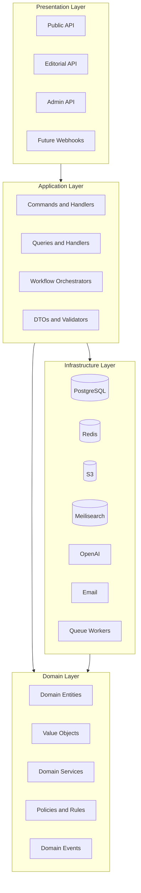

## 1.5 Request Lifecycle (Conceptual)

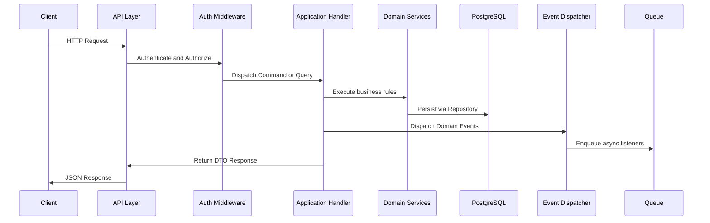

## 1.6 Deployment Topology

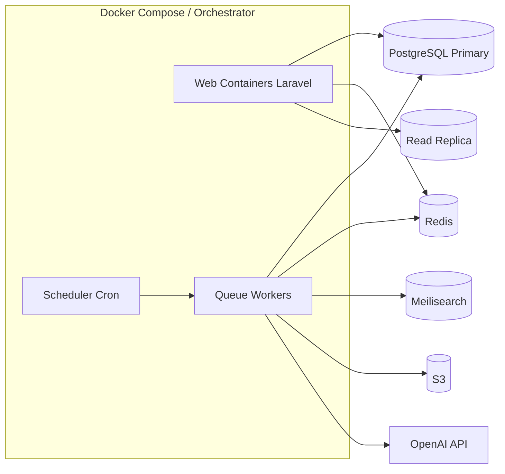

## 1.7 Core Architectural Decisions

| ID | Decision | Rationale |
|----|----------|-----------|
| BA-01 | Modular monolith | Team size, transactional publish, future extraction |
| BA-02 | Entity aggregate root | `KnowledgeEntity` wraps DB `entities` + profile — aligns with Blueprint |
| BA-03 | Publish as atomic command | Single transaction; async denormalization via events |
| BA-04 | Sanctum for API tokens | Laravel-native; session + token dual mode |
| BA-05 | Event-driven side effects | Search, AI, SEO decoupled from publish handler |
| BA-06 | Feature modules not technical layers | Quran, Ahlulbayt, Search as vertical slices |
| BA-07 | No repository for every table | Eloquent directly in simple CRUD; repositories for Knowledge aggregate |
| BA-08 | OpenAI via infrastructure adapter | Swappable provider interface |
| BA-09 | Meilisearch via gateway interface | PG FTS fallback when unavailable |
| BA-10 | Redis for cache, queue, rate limits | Single ops surface; proven Laravel integration |

## 1.8 Non-Goals (Backend)

- Microservices in MVP
- Public write API (Phase 2 read API only)
- Real-time WebSocket collaboration
- Multi-tenant institutional isolation (Phase 3)
- Custom graph database engine

---

# 2. Module Architecture

## 2.1 Module Catalog Overview

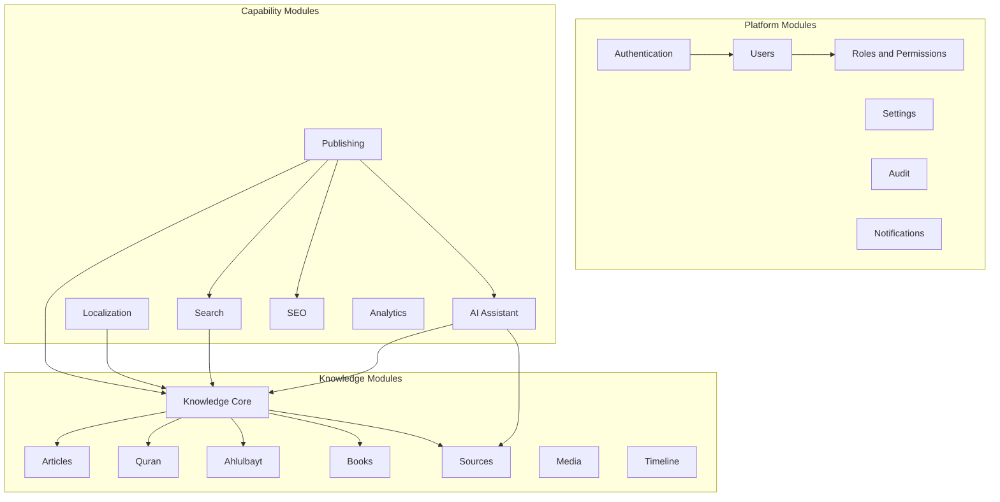

---

## 2.2 Authentication Module

| Attribute | Definition |
|-----------|------------|
| **Responsibilities** | Login, logout, registration, password reset, email verification, session management, Sanctum token issuance |
| **Dependencies** | Users module, Notifications (email), Redis (sessions/rate limits) |
| **Public interfaces** | `AuthenticationService`, `SessionManager`, `TokenIssuer` |
| **Internal components** | Credential validator, lockout tracker, verification token generator |
| **Future expansion** | MFA enrollment and challenge (MVP: required for Admin per PRD) |

---

## 2.3 Users Module

| Attribute | Definition |
|-----------|------------|
| **Responsibilities** | User CRUD, profile preferences, bookmarks, reading history, saved searches, account deletion |
| **Dependencies** | Authentication, Localization (language preference), Knowledge Core (bookmark targets) |
| **Public interfaces** | `UserService`, `BookmarkService`, `ReadingHistoryService` |
| **Internal components** | User repository, preference store, history trimmer (200 item limit) |
| **Future expansion** | OAuth identity linking, institutional user profiles |

---

## 2.4 Roles & Permissions Module

| Attribute | Definition |
|-----------|------------|
| **Responsibilities** | Role assignment, permission resolution, editor domain scoping |
| **Dependencies** | Users, Audit |
| **Public interfaces** | `AuthorizationService`, `RoleResolver`, `DomainScopeChecker` |
| **Internal components** | RBAC cache, permission matrix loader |
| **Roles (MVP)** | Visitor (implicit), Registered Visitor, Editor, Senior Editor, Admin, Super Admin |

---

## 2.5 Knowledge Core Module

| Attribute | Definition |
|-----------|------------|
| **Responsibilities** | Entity identity lifecycle, type resolution, relationship management, reference integrity, graph traversal, orphan validation |
| **Dependencies** | Publishing, Localization, Sources, Audit |
| **Public interfaces** | `EntityService`, `RelationshipService`, `ReferenceService`, `GraphTraversalService` |
| **Internal components** | Entity aggregate repository, relationship validator, duplicate detector, type registry |
| **Future expansion** | Graph merge tooling, bulk import pipeline |

**Central module** — all knowledge types flow through Knowledge Core.

---

## 2.6 Articles Module

| Attribute | Definition |
|-----------|------------|
| **Responsibilities** | Composed narrative content, block editor persistence, TOC generation, reading time calculation |
| **Dependencies** | Knowledge Core, Sources (references), Media, Publishing |
| **Public interfaces** | `ArticleService`, `ContentBlockService` |
| **Internal components** | Block serializer, citation linker, entity mention resolver |
| **Note** | Article is presentation layer — delegates identity to Knowledge Core |

---

## 2.7 Quran Module

| Attribute | Definition |
|-----------|------------|
| **Responsibilities** | Surah/verse navigation, canonical text serving, translation/tafsir apparatus, verse cross-links, Quran-scoped search |
| **Dependencies** | Knowledge Core, Sources, Localization, Search |
| **Public interfaces** | `QuranNavigationService`, `VerseService`, `TafsirService` |
| **Internal components** | Verse resolver (surah:ayah), immutable text guard, apparatus loader |
| **Constraints** | No AI-generated tafsir; text updates require advisory override |

---

## 2.8 Ahlulbayt Module

| Attribute | Definition |
|-----------|------------|
| **Responsibilities** | Ma'sumin profiles, lineage presentation, generation browse, relationship visualization data, honorific enforcement |
| **Dependencies** | Knowledge Core (Person), Timeline, Sources |
| **Public interfaces** | `AhlulbaytBrowseService`, `LineageService` |
| **Internal components** | Ma'sumin registry, generation filter, senior review gate |
| **Constraints** | 100% bilingual required before publish; senior review mandatory |

---

## 2.9 Books Module

| Attribute | Definition |
|-----------|------------|
| **Responsibilities** | Book metadata, chapter structure, online reading, copyright enforcement |
| **Dependencies** | Knowledge Core, Sources, Media, Articles (chapter content) |
| **Public interfaces** | `BookService`, `ChapterService` |
| **Internal components** | Chapter ordering, license validator |

---

## 2.10 Sources Module

| Attribute | Definition |
|-----------|------------|
| **Responsibilities** | Bibliographic metadata, reliability tiers, usage counting, citation formatting |
| **Dependencies** | Knowledge Core, References |
| **Public interfaces** | `SourceService`, `CitationFormatter`, `UsageCounter` |
| **Internal components** | Tier validator, duplicate source detector |

---

## 2.11 Media Module

| Attribute | Definition |
|-----------|------------|
| **Responsibilities** | Upload orchestration, S3 storage, variant generation, license metadata, entity attachment |
| **Dependencies** | Knowledge Core, File Storage infrastructure |
| **Public interfaces** | `MediaUploadService`, `MediaAttachmentService` |
| **Internal components** | Variant processor (queued), alt-text enforcer, license checker |

---

## 2.12 Timeline Module

| Attribute | Definition |
|-----------|------------|
| **Responsibilities** | Chronological event queries, era filtering, Hijri date presentation — **read-only view module** |
| **Dependencies** | Knowledge Core (Event entities) |
| **Public interfaces** | `TimelineQueryService` |
| **Internal components** | Date range filter, era mapper, virtualization cursor |
| **Note** | No persistence — queries Event aggregate |

---

## 2.13 Search Module

| Attribute | Definition |
|-----------|------------|
| **Responsibilities** | Query processing, facet resolution, suggestion serving, document sync, analytics logging, ranking |
| **Dependencies** | Knowledge Core, Localization, Analytics |
| **Public interfaces** | `SearchService`, `SearchIndexGateway`, `SuggestionService` |
| **Internal components** | Query normalizer (Arabic morphology), facet builder, sync orchestrator |
| **Future expansion** | Vector similarity gateway, Meilisearch semantic |

---

## 2.14 AI Module

| Attribute | Definition |
|-----------|------------|
| **Responsibilities** | RAG pipeline, conversation management, citation attachment, refusal logic, rate limiting, flag handling |
| **Dependencies** | Knowledge Core, Sources, Search, OpenAI adapter |
| **Public interfaces** | `AIAssistantService`, `RAGPipeline`, `CitationEngine`, `ConversationService` |
| **Internal components** | Context builder, prompt builder, response validator, chunk retriever |
| **Constraints** | Published corpus only; citations mandatory; no fatwa |

---

## 2.15 Localization Module

| Attribute | Definition |
|-----------|------------|
| **Responsibilities** | Locale resolution, fallback chains, translation status, slug management, RTL/LTR metadata |
| **Dependencies** | Knowledge Core, Settings |
| **Public interfaces** | `LocaleResolver`, `TranslationService`, `SlugService` |
| **Internal components** | Fallback resolver, hreflang builder |

---

## 2.16 Publishing Module

| Attribute | Definition |
|-----------|------------|
| **Responsibilities** | Workflow state machine, submission/review, publish/unpublish, version snapshots, rollback, checklist enforcement |
| **Dependencies** | Knowledge Core, Audit, Notifications, all content modules |
| **Public interfaces** | `PublishingWorkflowService`, `VersionService`, `EditorialChecklistValidator` |
| **Internal components** | State machine, publish transaction orchestrator, integrity gate |

---

## 2.17 Analytics Module

| Attribute | Definition |
|-----------|------------|
| **Responsibilities** | Event ingestion, aggregation, dashboard queries, zero-result reports, popularity rollups |
| **Dependencies** | Knowledge Core, Search, Users |
| **Public interfaces** | `AnalyticsCollector`, `AnalyticsQueryService` |
| **Internal components** | Event normalizer, daily rollup job, PII scrubber |

---

## 2.18 SEO Module

| Attribute | Definition |
|-----------|------------|
| **Responsibilities** | Sitemap generation, structured data cache, redirect management, robots rules, meta resolution |
| **Dependencies** | Knowledge Core, Localization, Publishing events |
| **Public interfaces** | `SitemapService`, `StructuredDataService`, `RedirectService` |
| **Internal components** | JSON-LD builder, sitemap XML generator |

---

## 2.19 Settings Module

| Attribute | Definition |
|-----------|------------|
| **Responsibilities** | Site settings, feature toggles, editorial policy documents |
| **Dependencies** | Audit |
| **Public interfaces** | `SettingsService`, `FeatureToggleService` |
| **Internal components** | Settings cache (Redis), toggle evaluator |

---

## 2.20 Audit Module

| Attribute | Definition |
|-----------|------------|
| **Responsibilities** | Append-only audit log, action recording, audit queries for admin |
| **Dependencies** | Users |
| **Public interfaces** | `AuditLogger`, `AuditQueryService` |
| **Internal components** | Audit event listener, partition-aware writer |

---

## 2.21 Notifications Module

| Attribute | Definition |
|-----------|------------|
| **Responsibilities** | Email notifications for editorial workflow, password reset, verification |
| **Dependencies** | Users, Publishing events |
| **Public interfaces** | `NotificationDispatcher` |
| **Internal components** | Template renderer, queue-backed mailer |
| **MVP scope** | Email only; no push/in-app |

---

## 2.22 Future Modules (Registered)

| Module | Responsibilities | Reuses |
|--------|------------------|--------|
| Hadith | Isnad chains, hadith grading | Knowledge Core, Sources, Person |
| Fiqh | Archival rulings presentation | Concepts, Sources |
| Public API | Read-only institutional API | All query services |
| Institutional | Partner portals, contributor scopes | Users, Collections |

---

# 3. Domain Layer

## 3.1 Domain Layer Purpose

The domain layer contains **pure business logic** — no HTTP, no database, no framework. It expresses Wiki World rules from the Knowledge Blueprint and PRD.

## 3.2 Domain Entities (Conceptual)

Domain entities map to database aggregates but are **not** ORM models:

| Domain Entity | Aggregate Root | Description |
|---------------|----------------|-------------|
| `KnowledgeEntity` | Yes | Universal identity + workflow state |
| `Person` | extends KnowledgeEntity | Biographical node |
| `Event` | extends KnowledgeEntity | Historical occurrence |
| `Place` | extends KnowledgeEntity | Geographic node |
| `Concept` | extends KnowledgeEntity | Theological term |
| `Source` | extends KnowledgeEntity | Bibliographic reference |
| `Book` | extends KnowledgeEntity | Published work |
| `Article` | extends KnowledgeEntity | Composed presentation |
| `Verse` | extends KnowledgeEntity | Quranic ayah |
| `Reference` | No (entity) | Citation link — value-rich entity |
| `Relationship` | No | Typed graph edge |
| `User` | Yes | Platform identity (separate bounded context) |
| `EditorialSubmission` | Yes | Workflow aggregate |

## 3.3 Value Objects

| Value Object | Purpose | Validation |
|--------------|---------|------------|
| `EntityUuid` | Public identifier | UUID v7 format |
| `WorkflowState` | Publish state enum | Valid transitions only |
| `Locale` | Language code | Registered in languages |
| `Slug` | URL segment | Unique per locale+type; NFC normalized |
| `HijriDate` | Islamic date | Precision: year/month/day |
| `ReliabilityTier` | Source tier 1–5 | Range check |
| `SourceType` | Bibliographic category | Enum |
| `BlockContent` | Structured block payload | Schema per block_type |
| `CitationPinpoint` | Page/volume reference | Optional components |
| `SurahAyahReference` | 2:255 format | Valid surah/ayah range |
| `Honorific` | AS, S, etc. | Style guide rules |
| `DomainScope` | Editor domain | quran, ahlulbayt, general, books_sources |

## 3.4 Domain Services

| Service | Responsibility |
|---------|----------------|
| `PublishIntegrityValidator` | Minimum sources, orphan checks, reference resolution |
| `RelationshipValidator` | Allowed type pairs, cycle detection for taxonomy |
| `DuplicateEntityDetector` | Person/source/place deduplication signals |
| `GraphTraversalService` | Bounded BFS for explore connections and AI |
| `HonorificEnforcer` | Ahlulbayt presentation rules |
| `CorpusEligibilityChecker` | Published + not deleted = AI/search eligible |
| `FallbackLocaleResolver` | Translation fallback chain |
| `CitationIntegrityChecker` | Reference → published source |

## 3.5 Domain Policies

| Policy | Rule |
|--------|------|
| `PublishPolicy` | Who can transition workflow states |
| `SourceTierPolicy` | Doctrinal claims require tier 4+ |
| `QuranImmutabilityPolicy` | Verse text changes forbidden without override |
| `AhlulbaytReviewPolicy` | Senior review required for Ma'sumin |
| `AIPolicy` | Refusal conditions for fatwa, out-of-corpus |
| `RateLimitPolicy` | AI queries per role |

## 3.6 Specifications

Composable query predicates for domain rules:

| Specification | Tests |
|---------------|-------|
| `IsPublished` | workflow_state = published, not deleted |
| `HasMinimumSources` | count(references) >= type minimum |
| `IsOrphanEvent` | no person/place relationship |
| `IsBilingualComplete` | ar + en localizations published |
| `IsCorpusEligible` | IsPublished AND indexable |

## 3.7 Factories

| Factory | Creates |
|---------|---------|
| `KnowledgeEntityFactory` | New entity by type with defaults |
| `ReferenceFactory` | Citation from block or claim |
| `RelationshipFactory` | Validated edge with metadata |
| `EditorialSubmissionFactory` | Submission from draft version |
| `SearchDocumentFactory` | Denormalized index document from aggregate |

## 3.8 Aggregates and Boundaries

| Aggregate | Root | Consistency Boundary |
|-----------|------|---------------------|
| Knowledge Entity | `KnowledgeEntity` | Entity + profile + localizations + blocks + relationships + references |
| Editorial Workflow | `EditorialSubmission` | Submission + reviews + comments |
| User Account | `User` | User + preferences + bookmarks |
| Media Asset | `MediaAsset` | File + variants + licenses + metadata |
| AI Conversation | `Conversation` | Conversation + messages + citation links |

**Cross-aggregate rule:** Reference always points to Source aggregate by ID — validated at publish boundary.

## 3.9 Business Rules (Domain)

| ID | Rule |
|----|------|
| BR-D01 | Entity type immutable after creation |
| BR-D02 | Publish requires PublishIntegrityValidator pass |
| BR-D03 | AI may never mutate knowledge graph |
| BR-D04 | Soft-deleted entities excluded from corpus |
| BR-D05 | Relationship bidirectionality exposed in queries |
| BR-D06 | Slug change creates redirect domain event |
| BR-D07 | Unpublish deactivates search and AI chunks |
| BR-D08 | Editor cannot approve own submission (unless Senior Editor self-publish policy) |

---

# 4. Application Layer

## 4.1 Application Layer Purpose

Orchestrates use cases: receives commands/queries from API, invokes domain services, manages transactions, dispatches events, returns DTOs.

## 4.2 Command / Query Separation

| Side | Examples | Characteristics |
|------|----------|-----------------|
| **Commands** | PublishEntity, CreateDraft, SubmitForReview, AttachRelationship | Mutate state; transactional; emit events |
| **Queries** | GetEntityBySlug, SearchKnowledge, GetTimeline, GetAIResponse | Read-only; cacheable; no side effects |

CQRS is **pragmatic** — separate handlers and read models where beneficial (Search, Analytics, Timeline); shared database, not separate stores.

## 4.3 Use Case Catalog (MVP)

### Public Commands

| Use Case | Command | Authorization |
|----------|---------|---------------|
| Register account | `RegisterUser` | Guest |
| Bookmark entity | `AddBookmark` | Registered |
| Save search | `SaveSearch` | Registered |
| Ask AI | `SubmitAIQuery` | Guest (rate limited) / Registered |

### Editorial Commands

| Use Case | Command | Authorization |
|----------|---------|---------------|
| Create draft | `CreateEntityDraft` | Editor (domain scoped) |
| Save draft | `SaveEntityDraft` | Editor (owner or domain) |
| Submit for review | `SubmitEntityForReview` | Editor |
| Approve/reject | `ReviewSubmission` | Senior Editor |
| Publish | `PublishEntity` | Senior Editor |
| Unpublish | `UnpublishEntity` | Senior Editor |
| Rollback version | `RollbackEntityVersion` | Senior Editor |

### Admin Commands

| Use Case | Command | Authorization |
|----------|---------|---------------|
| Invite editor | `InviteUser` | Admin |
| Assign role | `AssignRole` | Admin |
| Toggle feature | `SetFeatureToggle` | Admin |
| Maintenance mode | `SetMaintenanceMode` | Admin |

### Public Queries

| Use Case | Query |
|----------|-------|
| Browse entity | `GetEntityPublicView` |
| Explore connections | `GetEntityRelationships` |
| Search | `SearchKnowledge` |
| Quran navigation | `GetSurah`, `GetVerse` |
| Timeline | `GetTimelineEvents` |
| Sitemap | `GetSitemapPage` |

## 4.4 DTOs (Data Transfer Objects)

| DTO Category | Purpose |
|--------------|---------|
| `EntityPublicDTO` | Public API response — localized, corpus-safe |
| `EntityEditorialDTO` | CMS — includes workflow, versions, checklist |
| `SearchResultDTO` | Results + facets + suggestions |
| `AIResponseDTO` | Answer + citations + follow-ups |
| `TimelineEventDTO` | Chronological item |
| `UserProfileDTO` | Account + preferences |
| `AuditEntryDTO` | Admin audit log row |

DTOs are **stable API contracts** — decoupled from database shape.

## 4.5 Validation

| Layer | Responsibility |
|-------|----------------|
| **Input validation** | Format, required fields, types (Application) |
| **Business validation** | Domain services and policies (Domain) |
| **Integrity validation** | PublishIntegrityValidator at publish (Domain) |
| **Authorization** | Policies before handler execution (Application) |

## 4.6 Transactions

| Operation | Transaction Scope |
|-----------|-------------------|
| Save draft | Entity aggregate only |
| Publish | Entity + workflow + version + publish_event + reference counts |
| Merge entities | Multi-aggregate — single transaction with audit |
| AI query | Read-only DB; write conversation separately |
| Search index sync | **Outside** publish transaction — eventual consistency via queue |

## 4.7 Authorization in Application Layer

Every command/query handler invokes `AuthorizationService` before domain execution. Failures return standardized 403 — never silent degradation.

## 4.8 Workflow Orchestration

`PublishingWorkflowService` implements state machine from Database Design Section 7.1. Invalid transitions throw domain exceptions — not caught silently.

## 4.9 Application Service Catalog

| Service | Responsibility |
|---------|----------------|
| `EntityCommandService` | Create, save, delete drafts |
| `PublishingWorkflowService` | State transitions |
| `RelationshipCommandService` | Attach/detach edges |
| `ReferenceCommandService` | Citation CRUD |
| `EntityQueryService` | Public and editorial reads |
| `SearchQueryService` | Search orchestration |
| `TimelineQueryService` | Chronological reads |
| `AIAssistantService` | RAG pipeline orchestration |
| `MediaUploadOrchestrator` | Upload + attach flow |
| `UserAccountService` | Registration, preferences |
| `AnalyticsQueryService` | Dashboard aggregations |
| `AdminSettingsService` | Settings and toggles |

## 4.10 Handler Pattern

Each command/query has one handler: authorize → validate → load aggregate → domain logic → persist → dispatch events → return DTO.

## 4.11 Error Handling Strategy

Domain exceptions map to HTTP: Validation 400, Authorization 403, NotFound 404, Workflow 409, Integrity 422, RateLimit 429, Maintenance 503.

---
# 5. Infrastructure Layer

## 5.1 Infrastructure Purpose

Adapters implementing domain/application interfaces: persistence, cache, storage, email, queues, search, AI, logging.

## 5.2 Database Access

| Pattern | Usage |
|---------|-------|
| **Eloquent ORM** | Primary persistence; maps to Database Design tables |
| **Repository (selective)** | `KnowledgeEntityRepository`, `PublishingRepository` for complex aggregates |
| **Query objects** | Timeline, Analytics, Search read models |
| **Transactions** | Application-level database transaction wrapper |
| **Read replica** | Analytics and search sync connections |

**Mapping:** Infrastructure models ≠ domain entities. Mappers translate between layers.

## 5.3 Cache (Redis)

| Usage | Details |
|-------|---------|
| Session store | Laravel session driver |
| Cache store | Entity public views, settings, RBAC |
| Queue backend | Primary queue driver |
| Rate limiting | AI, login, search |
| Distributed locks | Publish deduplication, sitemap generation |

## 5.4 Object Storage (S3)

| Adapter | Responsibility |
|---------|----------------|
| `S3StorageGateway` | Upload, delete, signed URL generation |
| Path convention | Per Database Design Section 19.6 |
| CDN | CloudFront or equivalent in front of S3 |

## 5.5 Email

| Adapter | Use |
|---------|-----|
| `MailGateway` | SMTP/SES transactional email |
| Templates | Verification, password reset, editorial notifications |
| Queue | All mail sent via queue |

## 5.6 Queue Infrastructure

| Component | Role |
|-----------|------|
| Redis queues | Default job backend |
| Horizon (optional) | Queue monitoring dashboard |
| Failed job table | Dead letter persistence |
| Scheduler | Cron-triggered jobs |

## 5.7 Search Gateway

| Implementation | Phase |
|----------------|-------|
| `MeilisearchGateway` | Primary when deployed |
| `PostgresFTSGateway` | Fallback read path |
| `SearchDocumentRepository` | Sync source from PostgreSQL |

Interface: `SearchIndexGateway` with `index`, `delete`, `search` methods.

## 5.8 AI Gateway

| Implementation | Role |
|----------------|------|
| `OpenAIGateway` | Chat completions, embeddings |
| Interface | `LLMProviderGateway`, `EmbeddingProviderGateway` |
| Config | Model selection via site_settings |

## 5.9 Logging

| Channel | Destination |
|---------|-------------|
| Application | Structured JSON → stdout / log aggregator |
| Audit | PostgreSQL audit_logs |
| Security | Dedicated channel with alerting |
| AI | Prompt/response metadata (no PII in prompts log) |

## 5.10 Configuration

| Source | Content |
|--------|---------|
| Environment variables | Secrets, connection strings |
| `site_settings` table | Runtime toggles |
| Config files | Static defaults only |

---

# 6. API Layer

## 6.1 API Design Philosophy

| Principle | Application |
|-----------|-------------|
| **Resource-oriented** | Entities as resources; sub-resources for relationships, localizations |
| **Locale-first** | Locale in path prefix: `/api/v1/{locale}/...` |
| **Read-heavy optimization** | Public GET cacheable; ETags where appropriate |
| **Editorial separation** | `/api/v1/editorial/...` namespace |
| **Admin separation** | `/api/v1/admin/...` namespace |
| **Idempotent writes** | Publish, bookmark use idempotency keys where needed |

## 6.2 API Surfaces

| Surface | Audience | Auth |
|---------|----------|------|
| Public API | Visitors, registered users | Optional Sanctum |
| Editorial API | Editors, senior editors | Required Sanctum + role |
| Admin API | Admins | Required Sanctum + MFA for Super Admin |
| Health API | Infrastructure | Internal token |

## 6.3 Versioning Strategy

| Strategy | Detail |
|----------|--------|
| URL versioning | `/api/v1/` prefix |
| Breaking changes | Increment to v2; v1 maintained 12 months |
| Additive changes | Same version; new optional fields |

## 6.4 Naming Standards

| Element | Convention |
|---------|------------|
| Resources | Plural kebab-case: `persons`, `articles` |
| IDs in path | UUID for public: `/persons/{uuid}` |
| Actions | POST sub-resource: `/editorial/submissions/{id}/approve` |
| Query params | snake_case: `entity_type`, `date_from` |
| Locale | Path segment: `ar`, `en` |

## 6.5 Error Responses

Standard envelope:

| Field | Description |
|-------|-------------|
| `error.code` | Machine-readable: `VALIDATION_FAILED`, `NOT_FOUND`, `FORBIDDEN` |
| `error.message` | Human-readable localized message |
| `error.details` | Field-level validation errors |
| `meta.request_id` | Correlation ID |

| HTTP Status | Usage |
|-------------|-------|
| 400 | Validation failure |
| 401 | Unauthenticated |
| 403 | Unauthorized |
| 404 | Entity not found or not published |
| 409 | Workflow conflict (e.g., invalid state transition) |
| 422 | Business rule violation (e.g., insufficient sources) |
| 429 | Rate limit exceeded |
| 503 | Maintenance mode |

## 6.6 Pagination

| Parameter | Default | Max |
|-----------|---------|-----|
| `page` | 1 | — |
| `per_page` | 20 | 100 |
| Response | `data`, `meta.pagination` (total, page, per_page, last_page) | |

Cursor pagination for Timeline and reading history.

## 6.7 Filtering and Sorting

| Feature | Format |
|---------|--------|
| Filters | `filter[entity_type]=person&filter[module]=ahlulbayt` |
| Sort | `sort=-published_at,title` |
| Include | `include=relationships,sources` (sparse fieldsets) |
| Search | `q=` query parameter on search endpoint |

## 6.8 Rate Limiting

| Endpoint class | Limit |
|----------------|-------|
| Public read | 120/min per IP |
| AI query | 10/hr anon, 50/hr registered (PRD) |
| Auth attempts | 5/15min per email |
| Editorial write | 60/min per user |

Headers: `X-RateLimit-Remaining`, `Retry-After`.

## 6.9 Response Standards

| Rule | Detail |
|------|--------|
| JSON only | `Content-Type: application/json` |
| Localized fields | Return content in requested locale |
| Timestamps | ISO 8601 UTC |
| UUIDs | Public identifiers only in responses — never internal BIGINT |
| Corpus safety | Never expose draft content on public API |
| Citations | AI responses include `citations[]` with entity/source UUIDs |

---

# 7. Authentication Architecture

## 7.1 Identity Types

| Type | Storage | Use |
|------|---------|-----|
| Guest | No record | Anonymous browsing |
| Registered Visitor | users + session/token | Personalization |
| Editorial User | users + roles | CMS access |
| Admin | users + roles + MFA | Platform admin |

## 7.2 Session Strategy (Web)

| Attribute | Value |
|-----------|-------|
| Driver | Redis |
| Lifetime | 30 days registered; 8 hours editorial |
| Cookie | HttpOnly, Secure, SameSite=Lax |
| Regeneration | On login privilege elevation |

## 7.3 Token Strategy (API)

| Attribute | Value |
|-----------|-------|
| Package | Laravel Sanctum |
| Token types | SPA session cookies (first-party) + personal access tokens (future API) |
| Abilities | Scoped per token: `read`, `editorial`, `admin` |
| Storage | Token hash in `personal_access_tokens` |

**Why Sanctum over JWT:** First-party SPA + future API on same app; Laravel-native; session + token unified.

## 7.4 Registration Flow

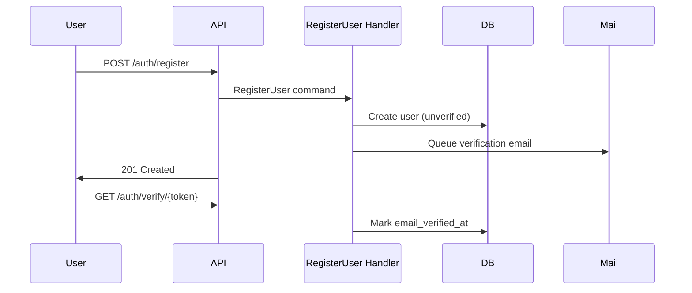

## 7.5 Password Reset

Token-based reset via email; tokens single-use with expiry; rate limited.

## 7.6 Email Verification

Required before bookmarks and AI chat history per PRD optional account features.

## 7.7 MFA (MVP)

| Role | MFA |
|------|-----|
| Admin, Super Admin | Required (PRD NFR-SEC-004) |
| Editorial | Optional MVP; recommended |
| Registered | Not required |

TOTP via `mfa_credentials` table; challenge on login for admin roles.

## 7.8 Logout and Token Revocation

Logout invalidates session and revokes current token. Admin can revoke all user tokens.

---

# 8. Authorization

## 8.1 RBAC Model

Roles compose permissions. Effective permissions = union of all role permissions + domain scopes.

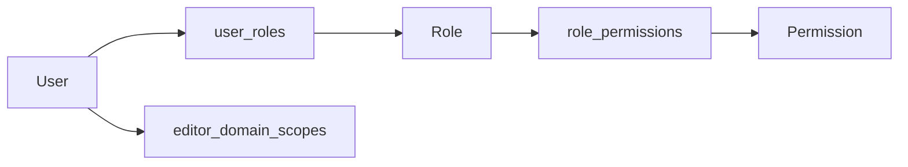

## 8.2 Policy-Based Authorization

| Resource | Policy checks |
|----------|---------------|
| Entity | view (public if published), update (editor+domain), publish (senior editor) |
| Submission | review (senior editor), withdraw (submitter) |
| User | manage (admin) |
| Settings | manage (admin) |
| AI flag | resolve (senior editor) |

## 8.3 Permission Codes (MVP)

| Code | Description |
|------|-------------|
| `entity.view.draft` | View unpublished entities |
| `entity.create` | Create drafts in scoped domain |
| `entity.update` | Edit drafts in scoped domain |
| `entity.submit` | Submit for review |
| `entity.publish` | Publish to public corpus |
| `entity.unpublish` | Remove from public |
| `review.approve` | Approve submissions |
| `user.manage` | CRUD users and roles |
| `settings.manage` | Site settings and toggles |
| `analytics.view` | Dashboard access |
| `audit.view` | Audit log access |

## 8.4 Domain Permissions

Editors with `editor_domain_scopes` limited to `quran` can create/edit Quran entities only. Cross-domain **linking** allowed; cross-domain **editing** denied.

## 8.5 Ownership Rules

| Rule | Detail |
|------|--------|
| Draft creator | Can edit own drafts |
| Senior editor | Can edit any draft in any assigned domain |
| Submit lock | After submit, editor cannot edit until withdrawn or changes requested |

## 8.6 Publishing Rules

| Action | Required role/permission |
|--------|-------------------------|
| Submit | `entity.submit` + domain scope |
| Approve | `review.approve` |
| Publish | `entity.publish` |
| Override source minimum | `entity.publish` + audit reason |

---

# 9. Editorial Workflow

## 9.1 Workflow Architecture

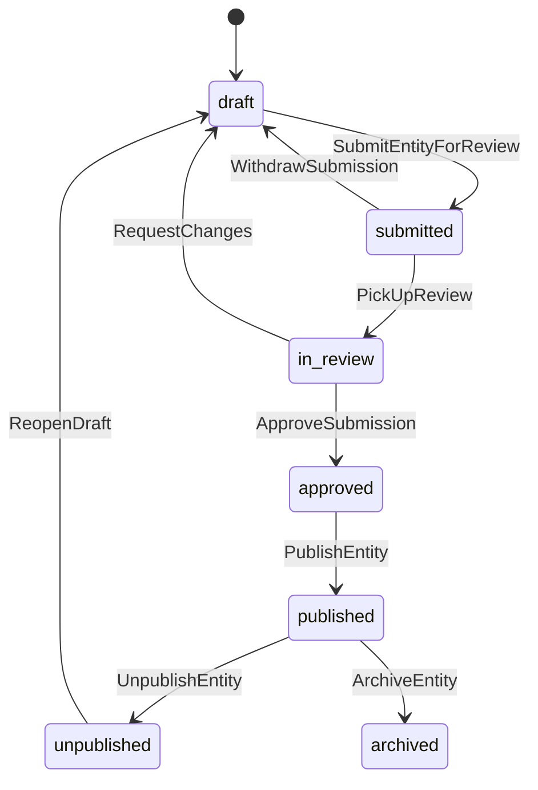

## 9.2 Handler Responsibilities

| Handler | Actions |
|---------|---------|
| `CreateEntityDraftHandler` | New entity + profile + default localization |
| `SaveEntityDraftHandler` | Persist blocks, relationships, references; create version |
| `SubmitEntityForReviewHandler` | Run checklist validator; create submission |
| `ReviewSubmissionHandler` | Record review decision; transition state |
| `PublishEntityHandler` | Integrity validation; transaction; emit `EntityPublished` |
| `UnpublishEntityHandler` | Deactivate corpus; emit `EntityUnpublished` |
| `RollbackEntityVersionHandler` | Restore snapshot as new draft |

## 9.3 Checklist Enforcement

`EditorialChecklistValidator` verifies before submit:

- Minimum sources attached
- Minimum entity links
- Media metadata complete
- SEO fields populated
- Honorifics applied (Ahlulbayt)
- Bilingual review flag (if applicable)

## 9.4 Notifications

| Event | Recipient | Channel |
|-------|-----------|---------|
| Submission created | Senior editors in domain | Email |
| Changes requested | Submitting editor | Email |
| Published | Submitting editor | Email |
| AI flag opened | Senior editors | Email |

## 9.5 Audit Integration

Every workflow transition → `AuditLogger` with old/new workflow_state.

## 9.6 Rollback

Rollback creates new draft from `entity_versions.snapshot` — does not silent-restore published state. Requires re-publish.

---

# 10. Event System

## 10.1 Event Architecture

Domain events decouple side effects from command handlers. Events are **past tense** facts.

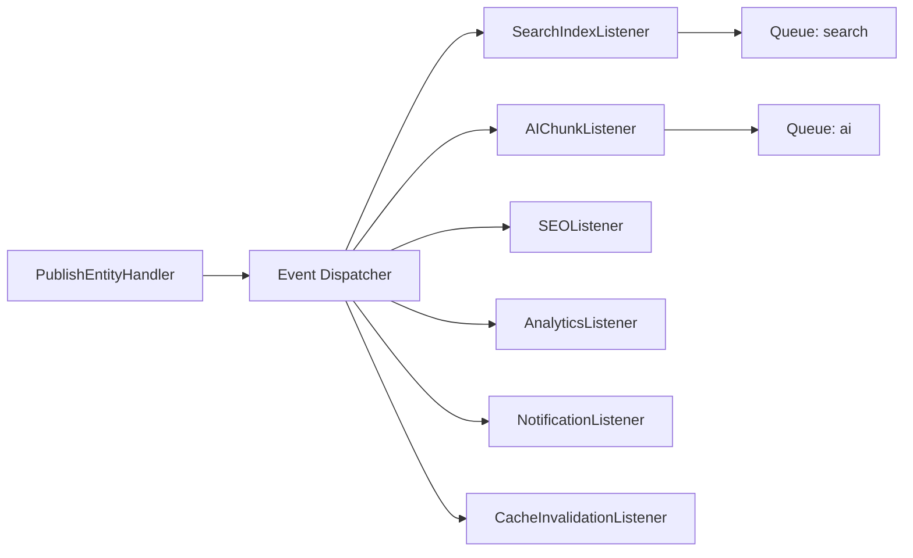

## 10.2 Domain Events (MVP Catalog)

| Event | Payload | Listeners |
|-------|---------|-----------|
| `EntityCreated` | entity_uuid, type | Audit |
| `EntityDraftSaved` | entity_uuid, version_id | — |
| `EntitySubmittedForReview` | entity_uuid, submission_id | Notification, Audit |
| `EntityReviewCompleted` | entity_uuid, decision | Notification, Audit |
| `EntityPublished` | entity_uuid, locale_ids[] | Search, AI, SEO, Cache, Analytics |
| `EntityUnpublished` | entity_uuid | Search, AI, SEO, Cache |
| `EntityArchived` | entity_uuid | Search, SEO, Audit |
| `RelationshipCreated` | source_uuid, target_uuid, type | Cache (optional) |
| `RelationshipRemoved` | edge_id | Cache |
| `ReferenceAttached` | reference_id, source_uuid | Source usage counter |
| `MediaUploaded` | media_uuid | Variant processing job |
| `MediaVariantsGenerated` | media_uuid | Cache |
| `TranslationPublished` | entity_uuid, locale | Search, SEO, hreflang |
| `SlugChanged` | entity_uuid, old_slug, locale | Redirect creation |
| `AIResponseGenerated` | conversation_id, message_id | Analytics |
| `AIResponseFlagged` | flag_id | Notification |
| `UserRegistered` | user_uuid | Email verification |
| `SearchIndexed` | entity_uuid | — (completion metric) |

## 10.3 Event Flow Rules

| Rule | Detail |
|------|--------|
| Sync vs async | Publish transaction commits before events dispatch |
| Listener failure | Retry via queue; never rollback publish |
| Ordering | No guaranteed order across listeners |
| Idempotency | Listeners must be idempotent (re-index safe) |

## 10.4 Future Events

| Event | Module |
|-------|--------|
| `HadithChainValidated` | Hadith |
| `InstitutionalContentSubmitted` | Institutional |
| `EmbeddingRegenerated` | AI |

---
# 11. Queue Architecture

## 11.1 Queue Design Principles

| Principle | Application |
|-----------|-------------|
| **Offload slow work** | Search, AI, media, email never block HTTP |
| **Priority separation** | Critical vs default vs low queues |
| **Idempotent jobs** | Safe to retry |
| **Dead letter** | Failed jobs table + alerting |
| **Horizon monitoring** | Visibility into throughput and failures |

## 11.2 Queue Topology

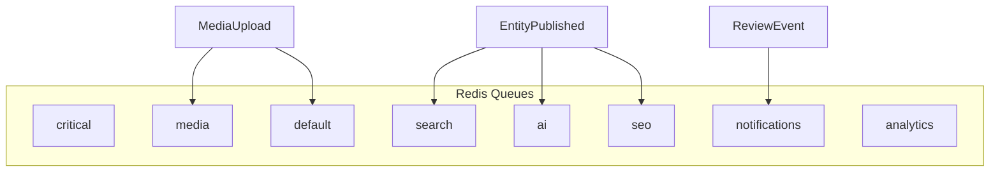

## 11.3 Job Catalog

| Job | Queue | Priority | Retries | Timeout |
|-----|-------|----------|---------|---------|
| SyncSearchDocument | search | high | 3 | 60s |
| RegenerateAiChunks | ai | high | 3 | 300s |
| GenerateEmbeddings | ai | low | 3 | 600s |
| UpdateSitemap | seo | medium | 3 | 120s |
| RegenerateStructuredData | seo | medium | 3 | 60s |
| ProcessMediaVariants | media | medium | 3 | 180s |
| SendEditorialNotification | notifications | medium | 5 | 30s |
| SendVerificationEmail | notifications | high | 5 | 30s |
| RecordAnalyticsEvent | analytics | low | 2 | 15s |
| RefreshPopularityRollup | analytics | low | 2 | 300s |
| RunIntegrityScan | default | low | 1 | 600s |
| TrimReadingHistory | default | low | 1 | 120s |

## 11.4 Retry and Backoff

| Setting | Value |
|---------|-------|
| Default retries | 3 |
| Backoff | Exponential: 30s, 120s, 600s |
| Max exceptions | Log and move to failed_jobs |
| Timeout | Per-job configuration |

## 11.5 Dead Letter Handling

Failed jobs stored in `failed_jobs` table. Admin dashboard (Horizon) for retry/delete. Alert on repeated failures for search/AI jobs.

## 11.6 Scheduler Jobs

| Scheduled | Frequency |
|-----------|-----------|
| RefreshMaterializedViews | Daily 02:00 |
| IntegrityScan | Daily 03:00 |
| PartitionMaintenance | Monthly |
| SitemapFullRegenerate | Weekly |
| SearchSyncHealthCheck | Hourly |
| TrimOldAnalyticsPartitions | Monthly |

---

# 12. Search Architecture (Backend)

## 12.1 Backend Responsibilities

| Responsibility | Component |
|----------------|-----------|
| Query normalization | `SearchQueryNormalizer` — Arabic morphology |
| Facet resolution | `FacetResolver` — maps filters to DB/Meili |
| Index sync | `SearchIndexSyncJob` — from `search_documents` |
| Suggestion serving | `SuggestionService` — from `search_suggestions` + live |
| Analytics logging | `SearchAnalyticsListener` — query + click logs |
| Ranking signals | Popularity from `entity_popularity_daily` |

## 12.2 Search Flow

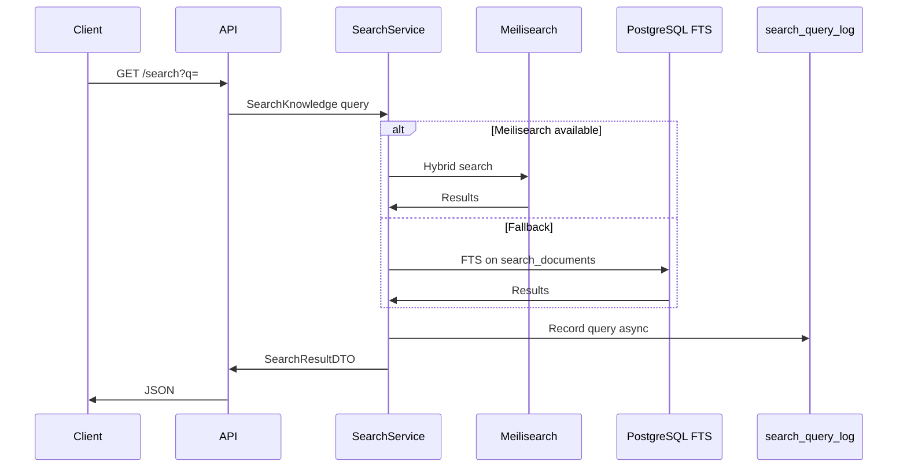

## 12.3 Index Sync Pipeline

Triggered by `EntityPublished`, `EntityUnpublished`, `TranslationPublished`:

1. `SearchDocumentFactory` builds denormalized document  
2. Upsert `search_documents` in PostgreSQL  
3. `SearchIndexSyncJob` pushes to Meilisearch  
4. Emit `SearchIndexed` on success  

## 12.4 Entity Search

Structured filters applied via `search_documents.facets` JSONB — no separate index.

## 12.5 Future Vector Search

| Component | Role |
|-----------|------|
| `EmbeddingGenerationJob` | Populate `ai_embeddings` |
| `VectorSearchGateway` | Similarity query interface |
| Hybrid ranker | Merge keyword + vector scores |

---

# 13. AI Architecture

## 13.1 RAG Pipeline Overview

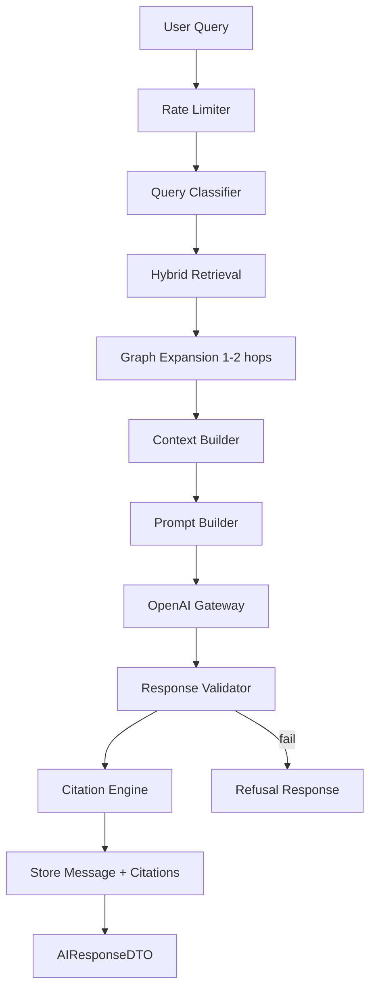

## 13.2 Component Responsibilities

| Component | Responsibility |
|-----------|----------------|
| `QueryClassifier` | Detect fatwa requests, out-of-scope, language |
| `ChunkRetriever` | Fetch `ai_chunks` by semantic + keyword |
| `GraphExpansionService` | 1–2 hop `entity_relationships` traversal |
| `ContextBuilder` | Assemble token-budgeted context from chunks + sources |
| `PromptBuilder` | System prompt: corpus-only, citation required, Ja'fari scope disclaimer |
| `OpenAIGateway` | Streaming completion |
| `ResponseValidator` | Verify claims map to retrieved references |
| `CitationEngine` | Attach `ai_citation_links` to message segments |
| `RefusalHandler` | Standard declination with search suggestions |

## 13.3 Hallucination Prevention

| Layer | Mechanism |
|-------|-----------|
| Retrieval | Published `ai_chunks` only |
| Prompt | Explicit "no source, no claim" instruction |
| Post-validation | Segment-to-reference alignment check |
| Refusal | Low retrieval confidence → decline |
| Human loop | `AIResponseFlagged` → editorial review |

## 13.4 Conversation History

Registered users: `ai_conversations` + `ai_messages` persisted. Anonymous: no persistence (optional session cache in Redis only).

## 13.5 Rate Limiting

Redis counters per user_id or IP hash. Enforced in `AIAssistantService` before pipeline execution.

## 13.6 Chunk Lifecycle

| Trigger | Action |
|---------|--------|
| `EntityPublished` | `RegenerateAiChunks` job |
| `EntityUnpublished` | Set `is_corpus_active = false` |
| Version change | Invalidate old chunks; regenerate |

## 13.7 Future AI Extensions

| Feature | Architecture |
|---------|--------------|
| Multi-turn research | Store retrieved entity IDs in message metadata |
| Comparative sources | Expand context with multiple Source tiers |
| Embedding cache | `ai_embeddings` with pgvector |
| Quality scoring | `ai_chunks.quality_score` from feedback |

---

# 14. File Storage

## 14.1 Storage Architecture

| Type | Flow |
|------|------|
| Upload | API → temp validation → S3 → `media_files` record |
| Variants | Queue job generates thumbnails/WebP |
| Serve | CDN URL or signed URL for private docs |
| Delete | Soft-delete metadata; S3 lifecycle rules for bytes |

## 14.2 Image Processing

| Variant | When |
|---------|------|
| thumbnail | On upload (queued) |
| webp | On upload (queued) |
| medium, large | On upload (queued) |
| og | On entity publish if primary image |

## 14.3 Documents

PDF stored on S3; metadata in `media_files`; viewer via signed URL or CDN.

## 14.4 Audio (Quran)

Licensed audio files; streaming via CDN; no download in MVP.

## 14.5 Temporary Files

Upload staging in S3 `tmp/` prefix; lifecycle delete after 24h if not attached.

## 14.6 Cleanup

Orphan media scan: files not in `entity_media` after 7 days → quarantine → delete.

## 14.7 Backups

S3 versioning enabled; cross-region replication for production.

---

# 15. Caching Strategy

## 15.1 Cache Layers

| Layer | Technology | TTL |
|-------|------------|-----|
| CDN | CloudFront | Entity pages static assets |
| Application | Redis | Entity DTOs, settings, RBAC |
| HTTP | ETag/Cache-Control | Public GET responses |
| Search | Meilisearch internal | Engine-managed |

## 15.2 Cache Key Patterns

| Key | Content | TTL |
|-----|---------|-----|
| `entity:{uuid}:{locale}` | EntityPublicDTO | 15 min |
| `entity:rels:{uuid}` | Relationship list | 15 min |
| `settings:site` | Site settings | 5 min |
| `rbac:user:{id}` | Resolved permissions | 10 min |
| `seo:structured:{uuid}:{locale}` | JSON-LD | 1 hour |
| `quran:surah:{n}` | Surah metadata | 24 hours |
| `rate:ai:{user_or_ip}` | Counter | 1 hour |

## 15.3 Invalidation

| Event | Keys invalidated |
|-------|------------------|
| `EntityPublished` | entity:*, seo:*, sitemap |
| `EntityUnpublished` | entity:*, search (via index) |
| `SlugChanged` | entity:*, redirects |
| `SettingsChanged` | settings:* |
| `RoleAssigned` | rbac:user:{id} |

Tag-based invalidation: `entity:{uuid}` tag groups all locale keys.

## 15.4 What Not to Cache

- Draft content  
- AI streaming responses  
- Personalized bookmarks (user-specific, short TTL ok)  
- Audit logs  

---

# 16. Logging & Monitoring

## 16.1 Log Categories

| Category | Level | Destination |
|----------|-------|-------------|
| Application | info/warning/error | stdout JSON |
| Security | warning/error | stdout + alert |
| Audit | info | PostgreSQL audit_logs |
| Performance | info | APM (slow queries > 50ms) |
| Queue | info/error | Horizon + stdout |
| AI | info | Dedicated channel (no full prompts in prod) |
| Search | debug/info | Query patterns |

## 16.2 Structured Log Fields

| Field | Purpose |
|-------|---------|
| `request_id` | Correlation |
| `user_id` | Actor (if auth) |
| `entity_uuid` | Subject |
| `duration_ms` | Performance |
| `action` | Semantic action code |

## 16.3 Monitoring

| Metric | Tool |
|--------|------|
| HTTP latency p95 | APM |
| Queue depth | Horizon |
| Failed jobs | Horizon alert |
| DB connections | PG metrics |
| Redis memory | Redis INFO |
| Meilisearch health | HTTP health check |
| OpenAI latency/errors | Custom metrics |
| Disk/S3 | CloudWatch |

## 16.4 Health Checks

| Endpoint | Checks |
|----------|--------|
| `/health/live` | Process up |
| `/health/ready` | PG, Redis, S3 connectivity |
| `/health/search` | Meilisearch (optional degrade) |

## 16.5 Alerting

| Condition | Severity |
|-----------|----------|
| Failed publish transaction | Critical |
| Search sync failure > 1 hour | High |
| AI error rate > 5% | High |
| Queue depth > 1000 | Medium |
| Disk > 85% | High |

---

# 17. Security Architecture

## 17.1 Defense in Depth

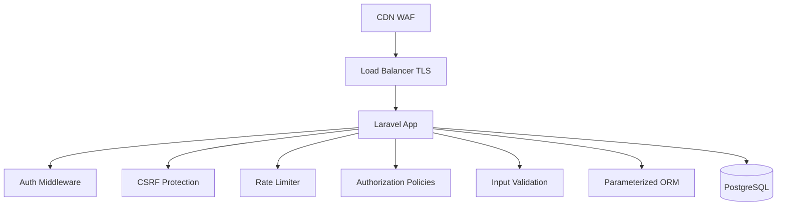

## 17.2 OWASP Mitigations

| Risk | Mitigation |
|------|------------|
| Injection | Eloquent ORM; no raw SQL without bindings |
| XSS | API JSON only; CMS escapes output; CSP headers |
| CSRF | Sanctum SPA + token for state-changing requests |
| Broken access | RBAC policies on every command |
| Security misconfig | Hardened Docker images; secrets in env |
| Sensitive data | Encrypt MFA secrets; hash passwords bcrypt/argon2 |
| Rate limiting | Redis sliding window |
| AI prompt injection | Input sanitization; corpus-only retrieval; output filter |

## 17.3 Secrets Management

| Secret | Storage |
|--------|---------|
| DB credentials | Environment variables / secrets manager |
| OpenAI API key | Environment variables |
| S3 keys | IAM role preferred; else env |
| App key | Laravel APP_KEY |

## 17.4 Signed URLs

S3 presigned URLs for temporary document access; short expiry (15 min).

## 17.5 API Security

| Measure | Detail |
|---------|--------|
| HTTPS only | HSTS enabled |
| CORS | Whitelist frontend origins |
| Token abilities | Least privilege scopes |
| No internal IDs | UUID only in API responses |

---

# 18. Performance Strategy

## 18.1 Application Performance

| Technique | Application |
|-----------|-------------|
| Eager loading | Entity + profile + localizations in one query |
| Lazy loading prohibition | N+1 detection in tests |
| DTO projection | Select only needed columns |
| Chunk processing | Bulk reindex in batches of 100 |
| Streaming | AI responses streamed to client |
| Pagination | All list endpoints paginated |
| Connection pooling | PgBouncer |

## 18.2 Caching

See Section 15. Entity public views are primary cache target.

## 18.3 Database

Leverage indexes from Database Design Section 15. Read replica for analytics queries.

## 18.4 Concurrency

| Concern | Approach |
|---------|----------|
| Publish race | Optimistic locking via `updated_at` check |
| Duplicate jobs | Unique job middleware per entity_uuid |
| Distributed lock | Redis lock for sitemap generation |

## 18.5 Memory

| Rule | Limit |
|------|-------|
| Export/bulk jobs | Chunk 100 records |
| AI context | Token budget in ContextBuilder |
| Worker memory | 512MB per worker default |

## 18.6 Horizontal Scaling

| Component | Scale |
|-----------|-------|
| Web containers | Stateless; scale on CPU/latency |
| Queue workers | Scale per queue depth |
| PostgreSQL | Vertical first; read replicas |
| Redis | Cluster if memory exceeds single node |

---

# 19. Testing Strategy

## 19.1 Testing Pyramid

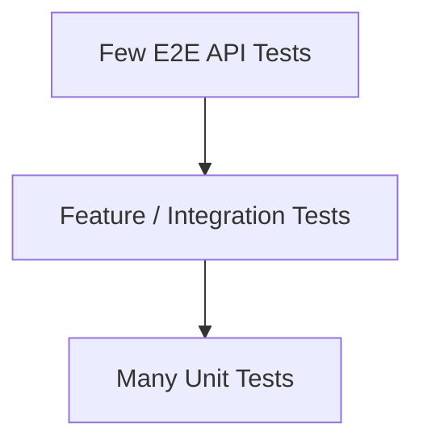

## 19.2 Unit Tests

| Target | Examples |
|--------|----------|
| Domain services | PublishIntegrityValidator, RelationshipValidator |
| Value objects | Slug, HijriDate, WorkflowState transitions |
| Policies | PublishPolicy, AIPolicy refusal |
| DTOs mappers | EntityPublicDTO mapping |

## 19.3 Feature Tests

| Target | Examples |
|--------|----------|
| Command handlers | PublishEntity with insufficient sources fails |
| Workflow | Full draft → publish flow |
| Authorization | Editor cannot publish |
| API endpoints | Public cannot see draft |

## 19.4 Integration Tests

| Target | Examples |
|--------|----------|
| Repository | KnowledgeEntity persistence round-trip |
| Search sync | Publish triggers search document |
| Event listeners | EntityPublished enqueues jobs |
| S3 gateway | Upload mock |

## 19.5 API Tests

Contract tests for public, editorial, admin surfaces. Error envelope validation. Pagination bounds.

## 19.6 Architecture Tests

| Rule | Enforcement |
|------|-------------|
| Domain does not import infrastructure | Static analysis |
| Commands don't call HTTP | Layer boundary |
| Policies on all handlers | Convention test |

## 19.7 Performance Tests

| Scenario | Target |
|----------|--------|
| Entity public GET | p95 < 200ms |
| Search | p95 < 1s |
| Publish | < 2s transaction (excl. async) |

## 19.8 Security Tests

| Test | Detail |
|------|--------|
| IDOR | Cannot access draft by UUID guessing |
| Privilege escalation | Editor cannot access admin |
| Rate limits | AI limit enforced |
| SQL injection | Fuzz search params |

## 19.9 AI Tests

| Test | Detail |
|------|--------|
| Refusal | Fatwa request returns refusal |
| Citation | Mock LLM response validated against references |
| Corpus boundary | Draft entities not in retrieval |

---

# 20. Deployment Readiness

## 20.1 Environments

| Environment | Purpose |
|-------------|---------|
| local | Docker Compose development |
| staging | Pre-production; full integrations |
| production | Live traffic |

## 20.2 Docker Services

| Container | Image / Role |
|-----------|--------------|
| app | PHP 8.4 FPM + Laravel |
| web | Nginx reverse proxy |
| worker | Queue worker (multi-queue) |
| scheduler | Cron runner |
| postgres | PostgreSQL 16+ |
| redis | Redis 7+ |
| meilisearch | Meilisearch (staging/prod) |

## 20.3 Environment Variables (Categories)

| Category | Examples |
|----------|----------|
| App | APP_ENV, APP_KEY, APP_URL |
| Database | DB_HOST, DB_DATABASE, DB_USERNAME, DB_PASSWORD |
| Redis | REDIS_HOST, REDIS_PASSWORD |
| S3 | AWS_BUCKET, AWS_REGION |
| Mail | MAIL_MAILER, MAIL_HOST |
| OpenAI | OPENAI_API_KEY |
| Meilisearch | MEILISEARCH_HOST, MEILISEARCH_KEY |
| Feature flags | Defaults; overrides in site_settings |

## 20.4 Production Configuration

| Setting | Value |
|---------|-------|
| APP_DEBUG | false |
| LOG_LEVEL | info |
| Queue | Redis with Horizon |
| Session | Redis |
| Cache | Redis |
| Opcache | Enabled |

## 20.5 Scaling Checklist

- [ ] Web containers behind load balancer  
- [ ] Worker containers scaled per queue  
- [ ] PgBouncer connection pooling  
- [ ] Read replica for reporting  
- [ ] Redis persistence (AOF)  
- [ ] S3 + CDN  
- [ ] Meilisearch dedicated instance  

## 20.6 Backups

Per Database Design Section 17: daily pg_dump + WAL; S3 versioning.

## 20.7 Maintenance Mode

`feature_toggles` + middleware returns 503 with localized message. Editorial API remains accessible.

## 20.8 Observability

| Tool | Purpose |
|------|---------|
| APM | Request traces |
| Horizon | Queue dashboard |
| Log aggregator | ELK / CloudWatch / Datadog |
| Uptime monitor | External health ping |
| Error tracking | Sentry or equivalent |

---

# Appendix A: Module Dependency Matrix

| Module | Depends On |
|--------|------------|
| Authentication | Users, Notifications, Redis |
| Users | Authentication, Knowledge Core |
| Roles | Users, Audit |
| Knowledge Core | Publishing, Localization, Sources |
| Articles | Knowledge Core, Sources, Media, Publishing |
| Quran | Knowledge Core, Sources, Localization, Search |
| Ahlulbayt | Knowledge Core, Timeline, Sources |
| Books | Knowledge Core, Sources, Media |
| Sources | Knowledge Core |
| Media | Knowledge Core, S3 |
| Timeline | Knowledge Core |
| Search | Knowledge Core, Localization, Analytics |
| AI | Knowledge Core, Sources, Search, OpenAI |
| Localization | Knowledge Core, Settings |
| Publishing | Knowledge Core, Audit, Notifications |
| Analytics | Knowledge Core, Search |
| SEO | Knowledge Core, Localization, Publishing |
| Settings | Audit |
| Audit | Users |
| Notifications | Users, Publishing |

---

# Appendix B: Event Catalog

See Section 10.2 for complete MVP event list. All events implement:

| Field | Type |
|-------|------|
| occurred_at | timestamp |
| actor_user_id | optional |
| correlation_id | request trace |

---

# Appendix C: Queue Job Catalog

See Section 11.3 for complete job list with queues and retries.

---

# Appendix D: Architecture Decision Log

| ID | Decision | Rationale | Alternatives Rejected |
|----|----------|-----------|----------------------|
| BA-01 | Modular monolith | Team size; transactional publish | Microservices |
| BA-02 | Clean Architecture + DDD | Complex domain rules | MVC only |
| BA-03 | Selective CQRS | Search/analytics read optimization | Full event sourcing |
| BA-04 | Sanctum | Laravel-native SPA + API | Pure JWT |
| BA-05 | Event-driven side effects | Decouple publish from index | Sync index in transaction |
| BA-06 | OpenAI adapter interface | Provider swap | Direct SDK calls in handlers |
| BA-07 | Meilisearch + PG fallback | Resilience | PG FTS only |
| BA-08 | Redis for all ephemeral | Operational simplicity | Multiple cache stores |
| BA-09 | Repository for aggregates only | Avoid over-abstraction | Repository per table |
| BA-10 | UUID public IDs | Security + API stability | BIGINT in URLs |
| BA-11 | Locale in URL path | SEO hreflang alignment | Accept-Language only |
| BA-12 | Editorial API namespace | Clear security boundary | Single API with role checks only |
| BA-13 | Streaming AI responses | UX per PRD | Buffered only |
| BA-14 | Horizon for queues | Laravel ecosystem | Raw workers only |
| BA-15 | No public write API MVP | PRD scope | GraphQL mutations |

---

# Appendix E: Public API Resource Map (Conceptual)

Resources are grouped by surface. Methods indicate HTTP verbs — not route definitions.

## E.1 Public Read Resources

| Resource | Operations | Notes |
|----------|------------|-------|
| `/entities/{type}/{uuid}` | GET | Localized entity public view |
| `/entities/{uuid}/relationships` | GET | Explore connections |
| `/articles` | GET | List/filter published |
| `/persons` | GET | Browse persons |
| `/events` | GET | List events |
| `/concepts` | GET | Browse concepts |
| `/books` | GET | Library catalog |
| `/books/{uuid}/chapters` | GET | Chapter list |
| `/sources/{uuid}` | GET | Bibliographic detail |
| `/quran/surahs` | GET | Surah index |
| `/quran/surahs/{n}` | GET | Surah detail |
| `/quran/verses/{surah}:{ayah}` | GET | Ayah detail |
| `/ahlulbayt` | GET | Module landing data |
| `/ahlulbayt/browse` | GET | Filtered browse |
| `/timeline` | GET | Chronological events |
| `/search` | GET | Knowledge search |
| `/search/suggestions` | GET | Autocomplete |
| `/sitemap.xml` | GET | SEO sitemap |
| `/robots.txt` | GET | Crawler rules |

## E.2 Public Auth Resources

| Resource | Operations |
|----------|------------|
| `/auth/register` | POST |
| `/auth/login` | POST |
| `/auth/logout` | POST |
| `/auth/verify-email` | GET |
| `/auth/forgot-password` | POST |
| `/auth/reset-password` | POST |

## E.3 Registered User Resources

| Resource | Operations |
|----------|------------|
| `/me` | GET, PATCH |
| `/me/bookmarks` | GET, POST, DELETE |
| `/me/history` | GET, DELETE |
| `/me/saved-searches` | GET, POST, DELETE |
| `/me/ai/conversations` | GET, DELETE |
| `/ai/chat` | POST (streaming) |

## E.4 Editorial Resources

| Resource | Operations |
|----------|------------|
| `/editorial/entities` | GET, POST |
| `/editorial/entities/{uuid}` | GET, PATCH |
| `/editorial/entities/{uuid}/submit` | POST |
| `/editorial/entities/{uuid}/versions` | GET |
| `/editorial/entities/{uuid}/preview` | GET |
| `/editorial/submissions` | GET |
| `/editorial/submissions/{id}/review` | POST |
| `/editorial/media` | POST |
| `/editorial/ai-flags` | GET, PATCH |

## E.5 Admin Resources

| Resource | Operations |
|----------|------------|
| `/admin/users` | GET, POST, PATCH |
| `/admin/roles` | GET, POST |
| `/admin/settings` | GET, PATCH |
| `/admin/feature-toggles` | GET, PATCH |
| `/admin/analytics` | GET |
| `/admin/audit-logs` | GET |
| `/admin/search/zero-results` | GET |

---

# Appendix F: Infrastructure Adapter Catalog

| Interface | Implementation | Swappable |
|-----------|----------------|-----------|
| `KnowledgeEntityRepository` | EloquentKnowledgeEntityRepository | Yes |
| `SearchIndexGateway` | MeilisearchGateway, PostgresFTSGateway | Yes |
| `LLMProviderGateway` | OpenAIGateway | Yes |
| `EmbeddingProviderGateway` | OpenAIEmbeddingGateway | Yes |
| `StorageGateway` | S3StorageGateway | Yes |
| `MailGateway` | LaravelMailGateway | Yes |
| `CacheGateway` | RedisCacheGateway | Yes |
| `RateLimiterGateway` | RedisRateLimiterGateway | Yes |
| `AuditLogger` | DatabaseAuditLogger | Yes |
| `ClockInterface` | SystemClock | Yes (testing) |

---

**End of Document**

*ويكي العالمية — Wiki World Backend Architecture v1.0*  
*Governing references: [PRD.md](./PRD.md), [KNOWLEDGE_DOMAIN_BLUEPRINT.md](./KNOWLEDGE_DOMAIN_BLUEPRINT.md), [DATABASE_DESIGN.md](./DATABASE_DESIGN.md)*
