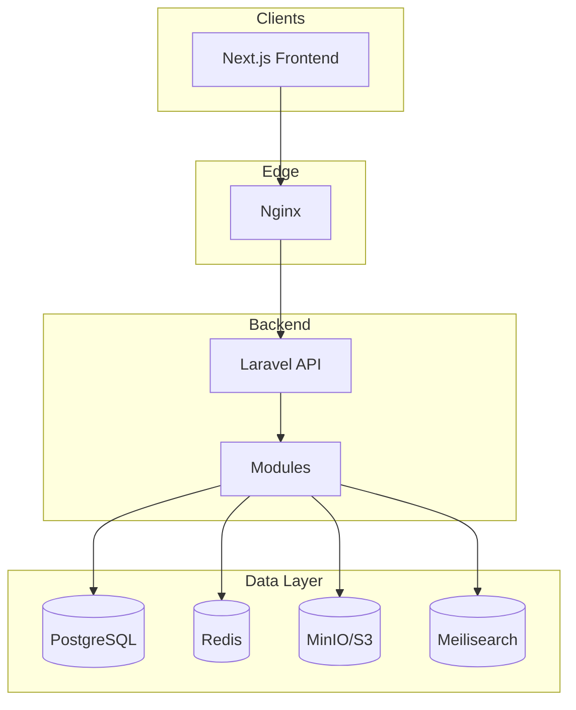
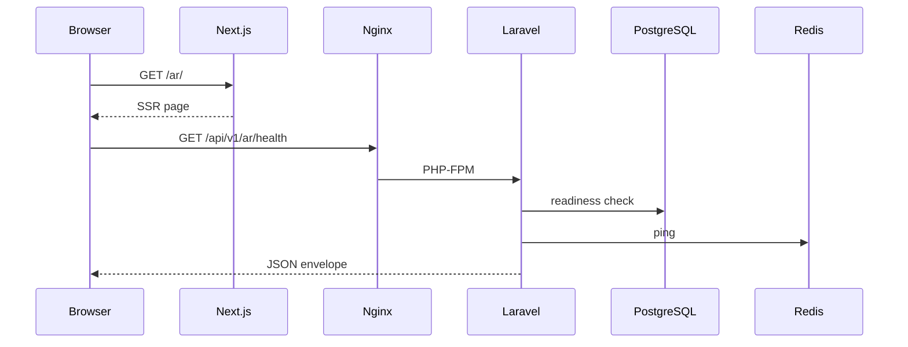
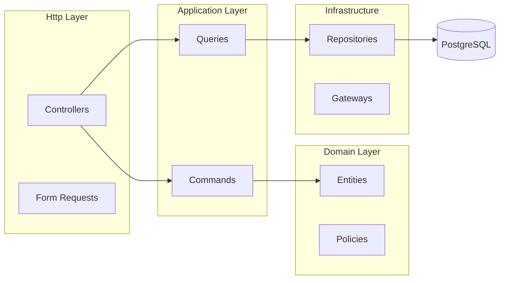
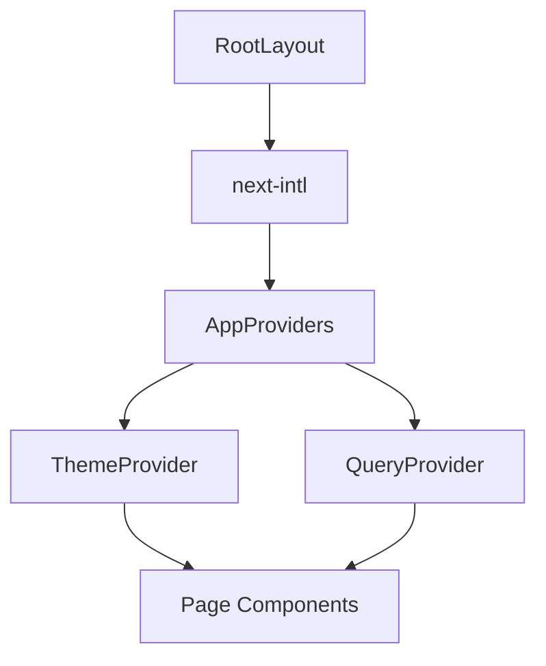
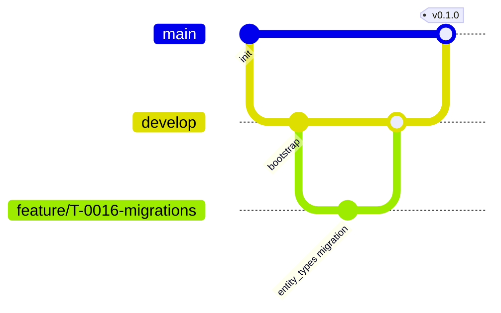

# Wiki World — Bootstrap Guide

# ويكي العالمية

**Version:** 1.0  
**Status:** Foundation Complete — Ready for Sprint 1  
**Date:** July 7, 2026

This document describes the **production-ready foundation** bootstrapped for Wiki World. No business features are implemented — only infrastructure.

---

## Bootstrap Checklist

| # | Item | Status |
|---|------|--------|
| 1 | Monorepo structure (`backend/`, `frontend/`, `docker/`, `docs/`) | ✅ |
| 2 | Laravel modular monolith scaffold (21 modules) | ✅ |
| 3 | Next.js 16 + React 19 + TypeScript | ✅ |
| 4 | Tailwind v4 + design tokens | ✅ |
| 5 | next-intl (ar/en, RTL/LTR) | ✅ |
| 6 | API error envelope + health endpoints | ✅ |
| 7 | Sanctum + auth foundation stubs | ✅ |
| 8 | Docker Compose (full stack) | ✅ |
| 9 | GitHub Actions CI | ✅ |
| 10 | PHPUnit + Vitest + Playwright config | ✅ |
| 11 | ESLint + Prettier + Pint | ✅ |
| 12 | Environment templates | ✅ |
| 13 | `php artisan test` passes | ✅ |
| 14 | `npm run build` passes | ✅ |

---

## 1. Repository Structure

```
wikiworld/
├── backend/                    # Laravel API — modular monolith
│   ├── app/
│   │   ├── Http/Controllers/   # Thin HTTP adapters
│   │   ├── Models/             # Eloquent (infrastructure)
│   │   ├── Modules/            # Bounded contexts (DDD)
│   │   │   ├── Shared/         # Cross-cutting: API envelope, middleware
│   │   │   ├── Authentication/
│   │   │   ├── Users/
│   │   │   ├── RolesPermissions/
│   │   │   ├── KnowledgeCore/
│   │   │   ├── Publishing/
│   │   │   ├── Quran/
│   │   │   ├── Ahlulbayt/
│   │   │   ├── Search/
│   │   │   ├── AI/
│   │   │   └── ...             # 21 modules total
│   │   └── Providers/
│   ├── config/wikiworld.php    # Platform configuration
│   ├── lang/ar|en/             # API error messages
│   ├── routes/api.php          # /api/v1/* route groups
│   └── tests/Architecture/     # Layer boundary tests
├── frontend/                   # Next.js App Router
│   └── src/
│       ├── app/[locale]/       # Locale-prefixed routes (ar, en)
│       ├── components/ui/      # Design system primitives
│       ├── i18n/               # next-intl routing
│       ├── lib/api/            # Typed API client
│       ├── messages/           # UI translations
│       └── providers/          # Theme, Query, i18n
├── docker/
│   ├── backend/Dockerfile      # PHP 8.4-FPM
│   ├── frontend/Dockerfile     # Node 22
│   └── nginx/default.conf
├── docs/                       # Governing specifications
├── .github/workflows/ci.yml
├── docker-compose.yml
├── package.json                # Root orchestration scripts
└── PROJECT_TASKS.md            # Vibe Coding task tracker
```

### Why This Structure

| Folder | Rationale |
|--------|-----------|
| `backend/app/Modules/` | Bounded contexts per BACKEND_ARCHITECTURE — enables future extraction |
| `frontend/src/app/[locale]/` | Arabic-first URL routing per PRD (`/ar/`, `/en/`) |
| `frontend/src/lib/api/` | Single API client — no scattered `fetch` |
| `docker/` | Reproducible dev/prod parity |
| `docs/` | Single source of truth — not duplicated in code comments |



---

## 2. Backend Bootstrap

### Framework

- **Laravel 13** (installed via Composer — successor to Laravel 12 in architecture docs)
- **PHP 8.3+** locally; **PHP 8.4** in Docker
- **Sanctum** for API tokens + SPA sessions

### Module Architecture

Each module contains:

```
Modules/{Name}/
├── Domain/          # Entities, enums, policies (no framework imports)
├── Application/     # Commands, queries, contracts
├── Infrastructure/  # Repositories, gateways
├── Http/            # Controllers, requests, resources
└── Providers/       # ModuleServiceProvider
```

`WikiWorldServiceProvider` registers all module providers.

### API Foundation

| Component | Location |
|-----------|----------|
| Version prefix | `/api/v1/` |
| Error envelope | `ApiResponse::error()` per API_SPECIFICATION |
| Request ID | `RequestIdMiddleware` |
| Locale validation | `LocaleMiddleware` (`ar`, `en`) |
| Health | `GET /api/health`, `GET /api/health/ready` |

### Route Groups (prepared, empty)

- `/api/v1/{locale}/` — public localized
- `/api/v1/auth/` — authentication (Phase 2)
- `/api/v1/editorial/` — CMS (Phase 5)
- `/api/v1/admin/` — administration (Phase 15)

---

## 3. Frontend Bootstrap

### Framework

- **Next.js 16.2** App Router + Turbopack
- **React 19**
- **TypeScript** strict mode

### Routing

| Route | Purpose |
|-------|---------|
| `/` | Redirects to `/ar` |
| `/[locale]/` | Foundation homepage |
| `/[locale]/loading.tsx` | Loading UI |
| `/[locale]/error.tsx` | Error boundary |
| `/[locale]/not-found.tsx` | 404 |

### Providers

| Provider | Responsibility |
|----------|----------------|
| `ThemeProvider` | light / dark / system (`data-theme`) |
| `QueryProvider` | TanStack Query |
| `AppProviders` | Composes all client providers |

**No business pages** — only foundation shell.

---

## 4. Shared Architecture

### Frontend (`frontend/src/lib/`)

| Path | Purpose |
|------|---------|
| `api/client.ts` | Typed fetch, error parsing, retry |
| `constants.ts` | API URL, locales |
| `utils.ts` | `cn()`, RTL helpers |

### Backend (`app/Modules/Shared/`)

| Path | Purpose |
|------|---------|
| `Support/ApiResponse.php` | Standard JSON envelope |
| `Http/Middleware/` | Request ID, locale |

### Validation

- **Zod** on frontend for API error schema
- **Laravel Form Requests** (Phase 2+) on backend

---

## 5. Environment Configuration

| Environment | Backend | Frontend | Infrastructure |
|-------------|---------|----------|----------------|
| Development | `backend/.env` | `frontend/.env.local` | `docker-compose.yml` + root `.env` |
| Testing | `phpunit.xml` env | Vitest config | SQLite in-memory |
| Staging | Secrets manager | Vercel/host env | Managed Postgres |
| Production | Secrets manager | CDN env | HA Postgres, Redis |

### Secrets Strategy

- Never commit `.env` files
- `.env.example` documents all keys with placeholders
- Production: environment injection (Docker secrets / CI vars)
- `OPENAI_API_KEY`, `MEILISEARCH_KEY` — server-side only

---

## 6. Docker

### Services

| Service | Image | Port |
|---------|-------|------|
| postgres | postgres:16-alpine | 5432 |
| redis | redis:7-alpine | 6379 |
| meilisearch | meilisearch:v1.12 | 7700 |
| minio | minio:latest | 9000, 9001 |
| mailpit | axllent/mailpit | 1025, 8025 |
| backend | PHP 8.4-FPM (custom) | 9000 |
| nginx | nginx:1.27 | 8080 |
| worker | queue:work | — |
| scheduler | schedule:run loop | — |
| frontend | Node 22 (custom) | 3000 |

---

## 7. Git Strategy

| Element | Convention |
|---------|------------|
| Branches | `main`, `develop`, `feature/*`, `fix/*` |
| Commits | Conventional Commits (`feat:`, `fix:`, `chore:`) |
| PRs | Focused; CI must pass |
| Releases | `release/*` → production tags |

`commitlint.config.js` enforces conventional commits.

---

## 8. Code Quality

| Tool | Scope |
|------|-------|
| Laravel Pint | PHP formatting |
| ESLint | Frontend lint |
| Prettier | TS/CSS/JSON format |
| EditorConfig | Cross-editor consistency |
| Architecture tests | Module boundary enforcement |

---

## 9. CI/CD

GitHub Actions (`.github/workflows/ci.yml`):

1. **Backend:** PHP 8.4, Composer, Pint, PHPUnit (Postgres + Redis services)
2. **Frontend:** Node 22, lint, typecheck, build

---

## 10. Authentication Foundation

| Component | Status |
|-----------|--------|
| Sanctum installed + migrations published | ✅ |
| `User` model uses `HasApiTokens` | ✅ |
| `statefulApi()` middleware enabled | ✅ |
| `AuthorizationServiceInterface` stub | ✅ |
| `Permission` + `Role` enums | ✅ |
| Auth routes | Empty — Phase 2 (T-0036+) |

---

## 11. Localization Foundation

| Layer | Implementation |
|-------|----------------|
| Frontend URLs | `/ar/`, `/en/` via next-intl |
| RTL/LTR | `dir` on `<html>` |
| UI strings | `messages/ar.json`, `messages/en.json` |
| API errors | `lang/ar/errors.php`, `lang/en/errors.php` |
| API content locale | `{locale}` path segment middleware |

---

## 12. Theme System

Design tokens in `frontend/src/app/globals.css` per DESIGN_SYSTEM.md:

- Scholar teal primary
- Warm off-white surfaces
- `[data-theme="dark"]` overrides
- `prefers-reduced-motion` respected

`ThemeProvider` supports light / dark / system.

---

## 13. Error Handling

| Layer | Behavior |
|-------|----------|
| API | `{ error: { code, message, details }, meta: { request_id } }` |
| Laravel | Validation → 400, NotFound → 404, HttpException mapped |
| Frontend | `ApiClientError` with code + request_id |
| UI | `error.tsx` boundary with retry |

---

## 14. Logging

| Channel | Purpose |
|---------|---------|
| `stack` | Application logs (Monolog) |
| `single` | Local development |
| Future | `security`, `ai`, `search`, `audit` channels per module |

Structured JSON logging — Phase 16.

---

## 15. Health Monitoring

| Endpoint | Checks |
|----------|--------|
| `GET /api/health` | Liveness |
| `GET /api/health/ready` | DB, Redis, queue, storage, search, AI config |

---

## 16. File Storage

| Disk | Use |
|------|-----|
| `s3` | Production + MinIO dev (`AWS_ENDPOINT`) |
| `local` | Tests |

`FILESYSTEM_DISK=s3` in `.env.example`. Media module implements upload — Phase 5.

---

## 17. API Foundation (Frontend)

`lib/api/client.ts`:

- Standard error envelope parsing (Zod)
- `credentials: include` for Sanctum cookies
- Retry on 5xx (configurable)
- `AbortSignal` support

---

## 18. State Management

| State | Solution |
|-------|----------|
| Server data | TanStack Query |
| Theme | React context (client) |
| Locale | URL + next-intl |
| Auth (future) | Query + httpOnly cookies |

**Avoid** unnecessary global stores.

---

## 19. Testing Foundation

| Stack | Config |
|-------|--------|
| Backend | PHPUnit — Feature, Unit, Architecture suites |
| Frontend | Vitest + jsdom |
| E2E | Playwright (`frontend/playwright.config.ts`) |

Run: `npm run test:backend`, `npm run test:frontend`

---

## 20. Developer Experience

| Tool | Location |
|------|----------|
| VSCode extensions | `.vscode/extensions.json` |
| VSCode settings | `.vscode/settings.json` |
| Root scripts | `package.json` |
| Task tracker | `PROJECT_TASKS.md` |

### Daily Workflow

1. Pick task from `PROJECT_TASKS.md`
2. Implement per `EXECUTION_ROADMAP.md` prompt template
3. Run tests + lint
4. Mark task Done

---

## Technology Decisions

| ID | Decision | Rationale |
|----|----------|-----------|
| BOOT-01 | Monorepo (backend + frontend) | Shared docs, atomic PRs, single CI |
| BOOT-02 | Laravel 13 (not pinned to 12) | Current Composer stable; same patterns |
| BOOT-03 | Modular monolith | BACKEND_ARCHITECTURE — extractable modules |
| BOOT-04 | next-intl over custom i18n | Industry standard; RTL support |
| BOOT-05 | TanStack Query | Server state; avoids Redux for API data |
| BOOT-06 | MinIO for local S3 | Production parity without AWS |
| BOOT-07 | PHPUnit over Pest | Pest conflicts with Laravel 13 `pao` package |
| BOOT-08 | Empty route groups | API contract ready; features in roadmap tasks |

---

## Execution Roadmap Alignment

This bootstrap completes **Phase 0** and most of **Phase 1** foundation tasks:

| Task Range | Status |
|------------|--------|
| T-0001 – T-0015 | ✅ Foundation |
| T-0010 – T-0035 | 🟡 Partial — module scaffold, health, middleware; migrations in T-0016+ |

**Next task:** T-0016 — Core database migrations (`entity_types`)

---

## Appendix A: Complete Project Tree

```
wikiworld/
├── .github/workflows/ci.yml
├── .husky/                      # Git hooks (requires git init)
│   ├── pre-commit               # lint-staged
│   └── commit-msg               # commitlint
├── .vscode/
│   ├── extensions.json
│   └── settings.json
├── backend/
│   ├── app/
│   │   ├── Http/Controllers/HealthController.php
│   │   ├── Models/User.php
│   │   ├── Modules/             # 21 bounded contexts
│   │   │   ├── Shared/          # ApiResponse, middleware, WikiWorldServiceProvider
│   │   │   ├── Authentication/
│   │   │   ├── Users/
│   │   │   ├── RolesPermissions/
│   │   │   ├── KnowledgeCore/
│   │   │   ├── Publishing/
│   │   │   ├── Articles/
│   │   │   ├── Books/
│   │   │   ├── Sources/
│   │   │   ├── Timeline/
│   │   │   ├── Quran/
│   │   │   ├── Ahlulbayt/
│   │   │   ├── Search/
│   │   │   ├── AI/
│   │   │   ├── Media/
│   │   │   ├── Localization/
│   │   │   ├── SEO/
│   │   │   ├── Analytics/
│   │   │   ├── Audit/
│   │   │   ├── Settings/
│   │   │   └── Notifications/
│   │   └── Providers/
│   ├── bootstrap/app.php
│   ├── config/wikiworld.php
│   ├── lang/ar/errors.php
│   ├── lang/en/errors.php
│   ├── routes/api.php
│   └── tests/
│       ├── Feature/HealthEndpointTest.php
│       └── Architecture/ModuleBoundaryTest.php
├── docker/
│   ├── backend/Dockerfile
│   ├── frontend/Dockerfile
│   └── nginx/default.conf
├── docs/                        # Governing specifications
├── frontend/
│   ├── e2e/smoke.spec.ts
│   └── src/
│       ├── app/[locale]/        # Locale routes
│       ├── components/ui/
│       ├── i18n/
│       ├── lib/api/
│       ├── messages/
│       └── providers/
├── .editorconfig
├── .env.example
├── commitlint.config.js
├── docker-compose.yml
├── package.json
└── README.md
```

---

## Appendix B: Environment Variables

### Backend (`backend/.env.example`)

| Variable | Purpose | Dev Default |
|----------|---------|-------------|
| `APP_URL` | Application URL | `http://localhost:8080` |
| `DB_*` | PostgreSQL connection | Docker service `postgres` |
| `REDIS_*` | Cache, queue, sessions | Docker service `redis` |
| `QUEUE_CONNECTION` | Async jobs | `redis` |
| `FILESYSTEM_DISK` | Storage driver | `s3` |
| `AWS_*` | S3 / MinIO credentials | MinIO defaults |
| `MEILISEARCH_*` | Search (prepared) | Docker service `meilisearch` |
| `OPENAI_API_KEY` | AI (prepared) | Empty |
| `SANCTUM_STATEFUL_DOMAINS` | SPA cookie auth | `localhost:3000` |

### Frontend (`frontend/.env.example`)

| Variable | Purpose | Dev Default |
|----------|---------|-------------|
| `NEXT_PUBLIC_API_URL` | Backend API base | `http://localhost:8080/api` |
| `NEXT_PUBLIC_APP_URL` | Public site URL | `http://localhost:3000` |

### Root (`.env.example`)

Docker Compose overrides for ports and credentials.

---

## Appendix C: Architecture Diagrams

### Request Flow (Public API)



### Backend Module Layers



### Frontend Provider Stack



---

## Appendix D: Dependency Rationale

| Package | Version | Why |
|---------|---------|-----|
| `next` | 16.x | App Router, RSC, production SSR |
| `next-intl` | 4.x | Locale routing, RTL, message catalogs |
| `@tanstack/react-query` | 5.x | Server state, cache, retries |
| `zod` | 4.x | Runtime validation, API error parsing |
| `motion` | 12.x | Accessible animations per DESIGN_SYSTEM |
| `laravel/sanctum` | latest | SPA + token authentication |
| `meilisearch/meilisearch-php` | (prepared) | Full-text search Phase 12 |

---

## Appendix E: Git Workflow



| Branch | Purpose |
|--------|---------|
| `main` | Production releases |
| `develop` | Integration branch |
| `feature/T-XXXX-*` | Task-scoped features |
| `fix/T-XXXX-*` | Bug fixes |
| `release/v*` | Release stabilization |

**Commit format:** `feat(backend): add entity_types migration (T-0016)`

---

## Appendix F: Developer Workflow

### First-Time Setup

```bash
git init                    # Required for Husky hooks
cp .env.example .env
cd backend && cp .env.example .env && composer install
cd ../frontend && cp .env.example .env.local && npm install
cd .. && npm install        # Root hooks (husky, lint-staged)
docker compose up -d        # Requires Docker Desktop
```

### Before Every PR

```bash
npm run pint
npm run test:backend
npm run lint:frontend
npm run test:frontend
npm run build:frontend
```

### Playwright E2E (optional)

```bash
cd frontend
npm run dev                 # Terminal 1
npm run test:e2e            # Terminal 2
```

---

## Appendix G: Bootstrap Beyond Phase 0

The bootstrap intentionally delivered **additional Phase 1 infrastructure** ahead of the roadmap to avoid rework:

| Extra Deliverable | Roadmap Task | Notes |
|-------------------|--------------|-------|
| Full Docker stack (MinIO, Mailpit, Meilisearch, worker, scheduler) | T-0014+ | Production parity |
| next-intl + RTL | T-0129+ | Foundation requires locale from day one |
| Theme tokens + provider | T-0114+ | DESIGN_SYSTEM alignment |
| API client + Zod errors | T-0129+ | Public shell dependency |
| 21 module folders | T-0010 | Full BACKEND_ARCHITECTURE map |
| Sanctum + RBAC stubs | T-0036+ | Auth infrastructure only |

---

## Appendix H: Known Limitations

| Item | Status | Resolution |
|------|--------|------------|
| Docker not verified on host | Config ready | Run `docker compose up` when Docker available |
| Git not initialized | By design | Run `git init` before first commit |
| Pest unavailable | PHPUnit only | Revisit when Laravel Pest conflict resolved |
| Playwright E2E | Config + smoke test | Run manually with dev server |
| `PROJECT_CONSTITUTION.md` | Not published | Use PRD + AI_ENGINEERING_CONSTITUTION |
| Business migrations | Not started | T-0016 onward |

---

**End of Document**

*ويكي العالمية — Wiki World Bootstrap v1.0*
