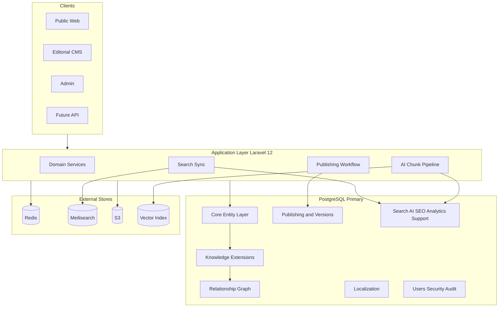
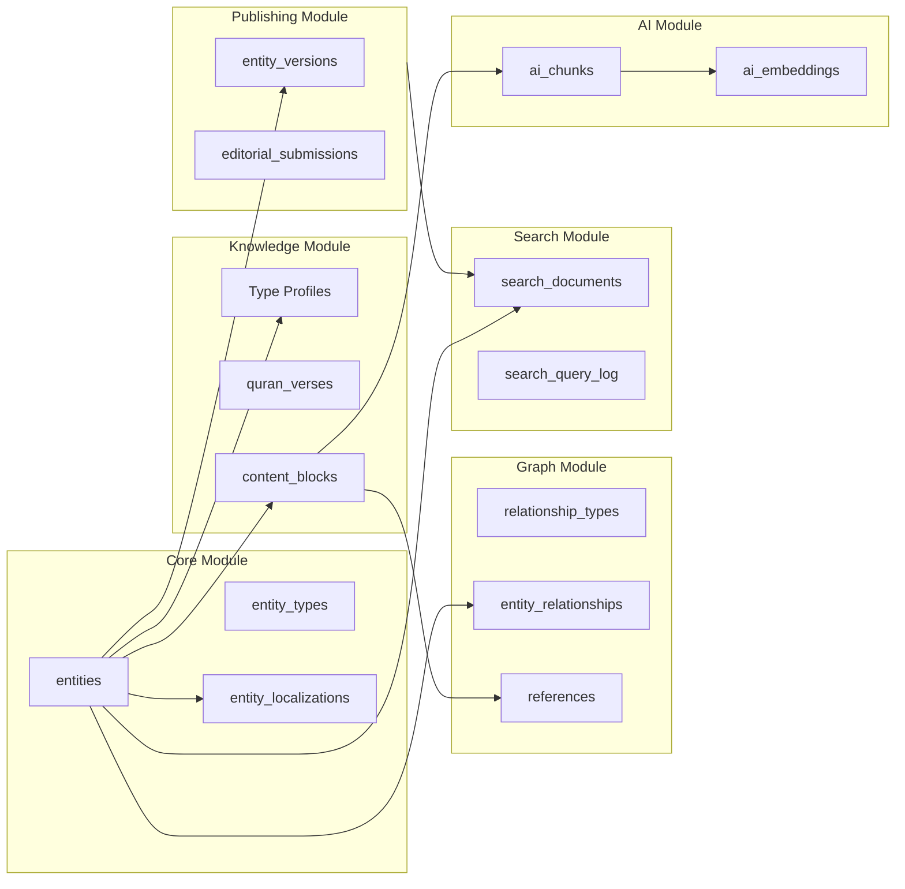
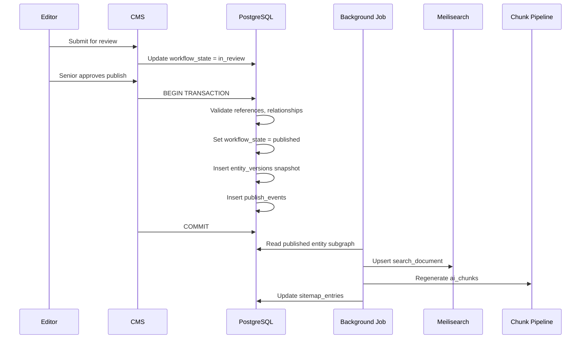
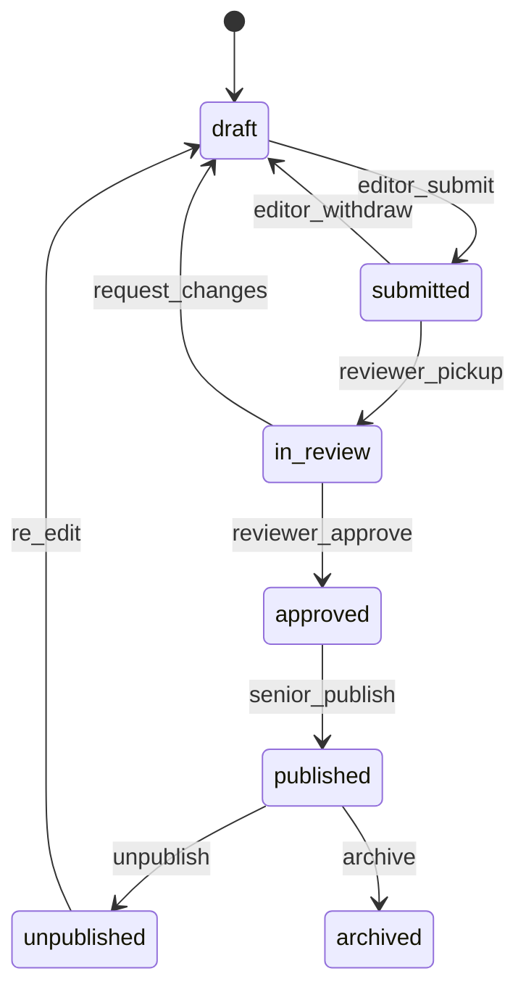
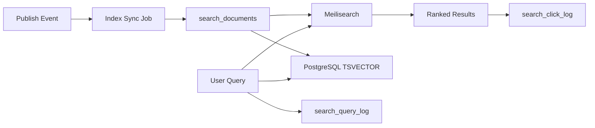
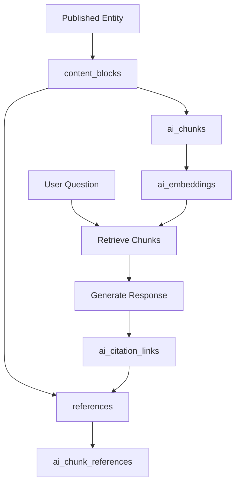

# Database Design Document

# ويكي العالمية — Wiki World

**Document Version:** 1.0  
**Status:** Authoritative Database Architecture Reference  
**Date:** July 7, 2026  
**Classification:** Internal — Engineering & Architecture  
**Database Engine:** PostgreSQL  
**Document Type:** Conceptual Database Design (No SQL / No Migrations)

---

## Document Control

| Field | Value |
|-------|-------|
| Product Name (Arabic) | ويكي العالمية |
| Product Name (English) | Wiki World |
| Document Owner | Chief Database Architect |
| Governing References | [PRD.md](./PRD.md), [KNOWLEDGE_DOMAIN_BLUEPRINT.md](./KNOWLEDGE_DOMAIN_BLUEPRINT.md), PROJECT_CONSTITUTION.md (when published) |
| Assumed Stack | PostgreSQL, Laravel 12, Redis, Meilisearch (future), Vector Search (future), S3, Docker |

### Revision History

| Version | Date | Author | Changes |
|---------|------|--------|---------|
| 1.0 | 2026-07-07 | Database Architecture | Initial complete database design |

### Alignment Statement

This document derives **all** structural decisions from the Knowledge Domain Blueprint and PRD. Where implementation choices are required, this document specifies the architecture. **No SQL, migrations, or framework code** appear in this document. A senior Laravel team should implement from this specification without making unresolved architectural database decisions.

---

## Table of Contents

1. [Database Philosophy](#1-database-philosophy)
2. [Database Overview](#2-database-overview)
3. [Entity Storage Strategy](#3-entity-storage-strategy)
4. [Database Modules](#4-database-modules)
5. [Complete Table Registry](#5-complete-table-registry)
6. [Relationship Tables](#6-relationship-tables)
7. [Publishing System Tables](#7-publishing-system-tables)
8. [Localization Tables](#8-localization-tables)
9. [Search Architecture](#9-search-architecture)
10. [AI Support](#10-ai-support)
11. [SEO Storage](#11-seo-storage)
12. [Media Storage](#12-media-storage)
13. [Analytics](#13-analytics)
14. [Security](#14-security)
15. [Performance Strategy](#15-performance-strategy)
16. [Data Integrity](#16-data-integrity)
17. [Backup & Disaster Recovery](#17-backup--disaster-recovery)
18. [Migration Strategy](#18-migration-strategy)
19. [Naming Conventions](#19-naming-conventions)
20. [Future Expansion](#20-future-expansion)
- [Appendix A: Complete Table Index](#appendix-a-complete-table-index)
- [Appendix B: Enum Registry](#appendix-b-enum-registry)
- [Appendix C: Index Strategy Summary](#appendix-c-index-strategy-summary)
- [Appendix D: Decision Log](#appendix-d-decision-log)

---

# 1. Database Philosophy

## 1.1 Purpose of This Database

The Wiki World database is the **persistent foundation** for an Entity-First Knowledge Graph serving millions of entities, multilingual content, editorial workflow, semantic search, and RAG-based AI — without schema redesign as modules expand.

The database must answer four questions for every piece of knowledge:

1. **What is it?** — Entity type and identity
2. **How is it known?** — Localized presentation and metadata
3. **How does it connect?** — Typed relationships and references
4. **Why is it trusted?** — Sources, workflow state, and audit trail

## 1.2 Why Entity-First

Per the Knowledge Domain Blueprint (ADN-01), knowledge is stored as **entities** with typed relationships — not as a tree of documents.

| Document-Centric DB | Entity-First DB (Wiki World) |
|-------------------|------------------------------|
| `articles` table is central | `entities` table is central |
| Links are URL strings | Links are `entity_relationships` rows |
| Categories are strings | Categories are graph annotations |
| i18n = duplicate rows per article | i18n = `entity_localizations` per identity |
| AI chunks orphan from graph | AI chunks bind to `entity_id` + `reference_id` |

**Consequence:** Every knowledge-bearing record either **is** an entity (`entities` row) or **belongs to** an entity (content blocks, profiles, media attachments).

## 1.3 Why PostgreSQL

| Capability | Wiki World Need |
|------------|-----------------|
| **ACID transactions** | Publish workflow atomically updates entity, relationships, search docs, sitemap |
| **Rich constraints** | FK integrity, CHECK enums, exclusion constraints for slug uniqueness |
| **JSONB** | Flexible block content, relationship metadata, structured data cache |
| **Full-text search** | Arabic/English tsvector as DB fallback and Meilisearch source |
| **pgvector (future)** | Embedding storage co-located with chunk metadata |
| **Partitioning** | Analytics, audit logs, search query logs at scale |
| **Materialized views** | Popularity, orphan reports, graph statistics |
| **Mature replication** | Read replicas for search indexing and reporting |
| **Extensions** | `uuid-ossp`, `pg_trgm` (fuzzy), `unaccent`, future `pgvector` |

PostgreSQL is the **system of record**. Redis caches hot entities; Meilisearch indexes search; S3 stores blobs; PostgreSQL holds truth.

## 1.4 Why Relational + Graph Relationships

Wiki World is **not** a native graph database (Neo4j). It is a **relational database modeling a property graph**:

- **Nodes** = `entities`
- **Edge types** = `relationship_types`
- **Edges** = `entity_relationships`
- **Edge attributes** = JSONB metadata columns + subtype fields

**Why not pure graph DB?** Editorial workflow, ACL, localization, and bibliographic data are inherently relational. Graph traversal is a **query pattern** over indexed join tables — sufficient for 1–2 hop UI and RAG expansion at millions of edges.

**Why not JSON document store?** Integrity constraints (orphan prevention, reference resolution, workflow) require FK enforcement at publish time.

## 1.5 Scalability Principles

| Principle | Database Expression |
|-----------|---------------------|
| **Identity stability** | `entities.id` never changes; public `uuid` for external APIs |
| **Horizontal read scale** | Read replicas; Redis cache; search engine replicas |
| **Vertical partition** | Partition analytics and audit by time |
| **Type extensibility** | `entity_types` registry + extension tables — no schema fork per module |
| **Denormalize deliberately** | `search_documents`, `entity_popularity_daily`, `source_usage_counts` |
| **Avoid premature sharding** | Single primary PostgreSQL to 1M+ entities with partitioning |
| **Async denormalization** | Background jobs refresh search docs and materialized views |

## 1.6 Data Integrity Principles

| Principle | Enforcement |
|-----------|-------------|
| **Sources before claims** | `references` FK to `sources`; publish validation |
| **No orphan events** | CHECK/trigger: Event must have ≥1 relationship to Person or Place at publish |
| **Workflow gate** | `workflow_state` on entity; only `published` in corpus tables |
| **Immutable Quran text** | `quran_verses.text` update restricted; apparatus tables versioned separately |
| **Soft delete** | `deleted_at` on entities; hard delete admin-only |
| **Audit everything editorial** | `audit_logs` append-only |
| **Locale identity unity** | One `entity_id`, many `entity_localizations` |

## 1.7 Technology Boundaries

| System | Responsibility | Not Stored In PG |
|--------|----------------|------------------|
| **PostgreSQL** | Entities, relationships, workflow, references, metadata | — |
| **Redis** | Sessions, rate limits, hot entity cache, job queues | Session payload |
| **Meilisearch** | Search index (future primary) | Full index duplicate |
| **S3** | Media bytes | File binary |
| **Vector index** | Embedding similarity (future) | May mirror in pgvector |

PostgreSQL remains authoritative even when caches exist — rebuild from PG on cache loss.

---

# 2. Database Overview

## 2.1 High-Level Architecture



## 2.2 Schema Layer Model

| Layer | Schema Prefix (logical) | Purpose |
|-------|-------------------------|---------|
| **L0 — Core** | `core` | entities, entity_types, entity_localizations |
| **L1 — Knowledge** | `knowledge` | Type extension tables (person_profiles, events, …) |
| **L2 — Graph** | `graph` | relationship_types, entity_relationships |
| **L3 — Content** | `content` | content_blocks, references, quotes |
| **L4 — Publishing** | `publish` | versions, submissions, reviews, audit |
| **L5 — Taxonomy** | `taxonomy` | categories, tags, collections |
| **L6 — Platform** | `platform` | users, roles, permissions, languages |
| **L7 — Support** | `support` | search, ai, seo, analytics, media metadata |

**Note:** Logical prefixes guide organization. Implementation may use single PostgreSQL schema `public` with table naming conventions (Section 19).

## 2.3 Module Interaction Diagram



## 2.4 Data Flow: Publish Pipeline



## 2.5 Corpus Boundary

Only entities with `workflow_state = published` and `deleted_at IS NULL` appear in:

- Public read APIs
- `search_documents` (active flag)
- `ai_chunks` (corpus flag)
- `sitemap_entries`
- Materialized popularity views

Draft data resides in same tables with state filter — **not** a separate draft database.

---

# 3. Entity Storage Strategy

## 3.1 Identity Model

Every knowledge object has **three identity layers**:

| Layer | Field | Visibility | Purpose |
|-------|-------|------------|---------|
| **Internal primary key** | `entities.id` (BIGINT) | Internal only | Join performance; sequential |
| **Public identifier** | `entities.uuid` (UUID v7) | URLs, APIs, exports | Stable external reference |
| **Registry type** | `entities.entity_type_id` | Internal + facet | Ontology classification |

**Why BIGINT + UUID?** BIGINT for fast joins and indexes at millions of rows. UUID for public exposure without enumeration attacks and for distributed job idempotency.

**Why UUID v7?** Time-ordered UUIDs improve index locality vs v4 random.

## 3.2 Entity Registry

`entity_types` is the **ontology registry** mirroring Knowledge Blueprint Appendix A.

| Concept | Storage |
|---------|---------|
| Type code (`person`, `verse`) | `entity_types.code` UNIQUE |
| Type class (canonical, composed, …) | `entity_types.class` |
| MVP flag | `entity_types.is_mvp` |
| Domain scope | `entity_types.primary_domain` |
| Extension table name | `entity_types.profile_table` — metadata for ORM |

New modules register rows in `entity_types` — no alteration to `entities` table structure.

## 3.3 Slug Strategy

| Rule | Implementation |
|------|----------------|
| Slugs are **per locale** | `entity_localizations.slug` |
| Uniqueness | UNIQUE (`locale`, `entity_type_id`, `slug`) — or global per locale+slug with type in path |
| URL pattern | `/{locale}/{type_code}/{slug}` |
| History | `url_redirects` stores old slug → entity mapping |
| Arabic slugs | Unicode allowed; normalized NFC |

Slugs are **not** on `entities` — they are localized presentation.

## 3.4 Localization Strategy

| Data | Table | Localized? |
|------|-------|------------|
| Identity | `entities` | No |
| Title, summary, slug | `entity_localizations` | Yes |
| Prose body | `content_blocks` + locale column | Yes |
| Type-specific display fields | `*_profile` tables or JSONB locale keys | Mixed |
| Dates, verse numbers | Profile columns | No (formatted per locale in app) |
| SEO metadata | `entity_localizations` or `seo_metadata` | Yes |

**Fallback:** `entity_localizations.fallback_locale` chain resolved in application; DB stores `translation_status` per locale.

## 3.5 Soft Deletes

| Column | Table | Behavior |
|--------|-------|----------|
| `deleted_at` | `entities` | Entity hidden from public; relationships inactive |
| `deleted_at` | `entity_relationships` | Edge removed from traversal |
| `deleted_at` | `users` | Account deactivated |

Soft-deleted entities remain for audit and redirect integrity. Hard delete requires Super Admin with cascade rules (Section 6).

## 3.6 Versioning Strategy

| Mechanism | Table | Purpose |
|-----------|-------|---------|
| **Edit history** | `entity_versions` | Full snapshot per save |
| **Publish marker** | `entity_versions.is_published_snapshot` | Known-good public version |
| **Content immutability** | `content_blocks.entity_version_id` | Blocks bound to version |
| **Relationship versioning** | `entity_relationships.valid_from`, `valid_to` | Optional temporal edges |

Rollback creates new draft from `entity_versions` row — never mutates published snapshot in place.

## 3.7 Extension Table Pattern

Type-specific attributes live in **extension tables** (1:1 with `entities.id`):

```
entities (1) ─── (1) person_profiles
entities (1) ─── (1) event_profiles
entities (1) ─── (1) quran_verses
```

**Why extension tables vs EAV?** Queryability and CHECK constraints on critical fields (dates, tiers, surah:ayah). JSONB used for **variable** metadata only (`attributes JSONB` on profiles for forward extension).

## 3.8 Denormalization Strategy

| Denormalized Artifact | Source | Refresh |
|-----------------------|--------|---------|
| `search_documents` | entities + localizations + blocks | On publish job |
| `source_usage_counts` | references | On publish / reference change |
| `entity_relationship_counts` | entity_relationships | Periodic or on publish |
| `entity_popularity_daily` | analytics events | Nightly job |
| `structured_data_cache` | entity + profiles | On publish |

Denormalization is **derived** — always rebuildable from normalized core.

---

# 4. Database Modules

## 4.1 Module Catalog

| Module | Tables (primary) | Responsibility |
|--------|------------------|----------------|
| **Core** | entities, entity_types, entity_localizations | Identity and locale shell |
| **Knowledge** | person_profiles, event_profiles, place_profiles, concept_profiles, source_profiles, book_profiles, organization_profiles, quran_surahs, quran_verses, quran_corpus | Type-specific canonical data |
| **Content** | content_blocks, quotes | Composed presentation |
| **Graph** | relationship_types, entity_relationships, references | Knowledge graph edges |
| **Quran** | quran_corpus, quran_surahs, quran_verses, translation_profiles, tafsir_profiles | Scripture and apparatus |
| **Ahlulbayt** | person_profiles (flags), ahlulbayt_memberships | Module metadata on Person |
| **Books** | book_profiles, book_chapters | Library structure |
| **Sources** | source_profiles, references | Bibliographic integrity |
| **Media** | media_files, media_variants, entity_media | Asset metadata (bytes on S3) |
| **Taxonomy** | categories, tags, collections, series + pivot tables | Organization |
| **Publishing** | entity_versions, editorial_submissions, editorial_reviews, editorial_comments, publish_events | Workflow |
| **Localization** | languages, entity_localizations, translation_statuses | i18n |
| **Users** | users, roles, permissions, pivots, editor_domain_scopes | Identity and ACL |
| **Search** | search_documents, search_query_log, search_click_log | DB support for search |
| **AI** | ai_chunks, ai_embeddings, ai_conversations, ai_messages, ai_citation_links | RAG support |
| **SEO** | seo_metadata, url_redirects, sitemap_entries, robots_rules | Discovery |
| **Analytics** | analytics_events, entity_popularity_daily, reading_history | Engagement |
| **Audit** | audit_logs | Accountability |
| **Security** | sessions (optional PG backup), personal_access_tokens, rate_limit_counters | Access control |
| **Future** | hadith_profiles, narrator_profiles, manuscript_profiles | Phase 2+ extensions |

## 4.2 Core Module

**Purpose:** Universal entity shell for all knowledge types.

**Key decisions:**
- All knowledge types share `entities` row
- `entity_type_id` determines extension table
- `workflow_state` governs corpus eligibility
- `module_flags` JSONB for domain membership (quran, ahlulbayt, …)

## 4.3 Knowledge Module

**Purpose:** Type-specific canonical attributes.

**Key decisions:**
- 1:1 extension table per major type
- `quran_verses` seeded from canonical corpus — not editor-created
- `person_profiles` includes `is_masum`, `ahlulbayt_generation` for Ahlulbayt module

## 4.4 Graph Module

**Purpose:** Typed relationships and citations.

**Key decisions:**
- `entity_relationships` is the universal edge table
- `relationship_types` validates source/target type pairs
- `references` is specialized edge from content to Source entity

## 4.5 Publishing Module

**Purpose:** Editorial workflow per PRD FR-CMS-002.

**States stored in** `entities.workflow_state`: draft, submitted, in_review, approved, published, unpublished, archived.

## 4.6 Localization Module

**Purpose:** Arabic-primary, English-secondary, unlimited future locales.

**Key decisions:**
- `languages` table drives locale registry
- `translation_statuses`: missing, draft, published, fallback_only

## 4.7 Search Module

**Purpose:** PostgreSQL as source; Meilisearch as index.

**Key decisions:**
- `search_documents` denormalized for sync and PG FTS fallback
- Query logs partitioned monthly

## 4.8 AI Module

**Purpose:** RAG chunk storage and citation mapping.

**Key decisions:**
- Chunks keyed by `entity_id` + `content_block_id`
- `ai_citation_links` maps message segments to `reference_id`
- Embeddings in `ai_embeddings` (pgvector future)

## 4.9 Cross-Module Rules

| Rule | Modules Involved |
|------|------------------|
| Publish atomically updates entity + graph + search queue | Core, Graph, Publishing, Search |
| Reference count updates source_profiles | Sources, Content, Graph |
| Locale publish independent per `entity_localizations` | Core, Localization, Publishing |
| Media attachable to any entity | Media, Core |
| Users never in search corpus | Users, Search, AI |

---
# 5. Complete Table Registry

This section defines **every table** in the Wiki World database. Tables are grouped by module. Column types are PostgreSQL conceptual types (no DDL).

**Column type legend:** `BIGINT`, `UUID`, `VARCHAR(n)`, `TEXT`, `BOOLEAN`, `TIMESTAMPTZ`, `DATE`, `JSONB`, `INT`, `SMALLINT`, `NUMERIC`, `INET`, `TSVECTOR`

---

## 5.1 Core Module Tables

### 5.1.1 `entity_types`

| Attribute | Value |
|-----------|-------|
| **Purpose** | Ontology registry of all entity types |
| **Description** | Mirrors Knowledge Blueprint Appendix A; drives validation and extension table routing |
| **Primary Key** | `id` BIGINT |
| **Lifecycle** | Seeded at deploy; extended via migration for new modules |

| Column | Type | Nullable | Default | Description |
|--------|------|----------|---------|-------------|
| id | BIGINT | NO | sequence | Internal PK |
| code | VARCHAR(64) | NO | — | Stable code: `person`, `verse` |
| class | VARCHAR(32) | NO | — | canonical, composed, bibliographic, taxonomic, platform |
| profile_table | VARCHAR(128) | YES | — | Extension table name |
| primary_domain | VARCHAR(64) | YES | — | quran, ahlulbayt, general |
| is_mvp | BOOLEAN | NO | true | MVP inclusion flag |
| is_active | BOOLEAN | NO | true | Disable without delete |
| sort_order | INT | NO | 0 | Admin UI ordering |
| created_at | TIMESTAMPTZ | NO | now() | — |
| updated_at | TIMESTAMPTZ | NO | now() | — |

**Unique:** `code`  
**Indexes:** `code` (unique), `class`, `is_active`  
**Relationships:** One-to-many `entities`  
**Validation:** `code` lowercase snake_case; immutable after entities exist  
**Future:** New rows for hadith, manuscript, etc.

---

### 5.1.2 `entities`

| Attribute | Value |
|-----------|-------|
| **Purpose** | Universal identity row for every knowledge object |
| **Description** | Central node table; all graph and content hangs off this row |
| **Primary Key** | `id` BIGINT |
| **Lifecycle** | Created draft → published → optionally soft-deleted |

| Column | Type | Nullable | Default | Description |
|--------|------|----------|---------|-------------|
| id | BIGINT | NO | sequence | Internal PK |
| uuid | UUID | NO | gen v7 | Public identifier |
| entity_type_id | BIGINT | NO | — | FK → entity_types |
| workflow_state | VARCHAR(32) | NO | draft | draft, submitted, in_review, approved, published, unpublished, archived |
| module_flags | JSONB | NO | {} | {ahlulbayt: true, quran: false} |
| is_indexable | BOOLEAN | NO | true | SEO index toggle |
| published_at | TIMESTAMPTZ | YES | — | First publish timestamp |
| published_version_id | BIGINT | YES | — | FK → entity_versions |
| created_by_user_id | BIGINT | YES | — | FK → users |
| updated_by_user_id | BIGINT | YES | — | FK → users |
| deleted_at | TIMESTAMPTZ | YES | — | Soft delete |
| created_at | TIMESTAMPTZ | NO | now() | — |
| updated_at | TIMESTAMPTZ | NO | now() | — |

**Unique:** `uuid`  
**Foreign Keys:** `entity_type_id` → `entity_types`, `created_by_user_id` → `users`  
**Indexes:** `uuid` (unique), `entity_type_id`, `workflow_state`, `published_at`, `deleted_at` (partial WHERE NULL), composite (`workflow_state`, `entity_type_id`)  
**Validation:** `workflow_state` enum; type immutable after insert  
**Corpus rule:** AI and search include WHERE `workflow_state = published AND deleted_at IS NULL`

---

### 5.1.3 `entity_localizations`

| Attribute | Value |
|-----------|-------|
| **Purpose** | Locale-specific presentation metadata per entity |
| **Description** | Title, slug, summary, SEO fields per language |
| **Primary Key** | `id` BIGINT |

| Column | Type | Nullable | Default | Description |
|--------|------|----------|---------|-------------|
| id | BIGINT | NO | sequence | — |
| entity_id | BIGINT | NO | — | FK → entities |
| language_id | BIGINT | NO | — | FK → languages |
| title | VARCHAR(512) | NO | — | Display title |
| slug | VARCHAR(512) | NO | — | URL slug |
| summary | TEXT | YES | — | Lead paragraph |
| meta_title | VARCHAR(255) | YES | — | SEO title |
| meta_description | VARCHAR(320) | YES | — | SEO description |
| og_image_media_id | BIGINT | YES | — | FK → media_files |
| translation_status | VARCHAR(32) | NO | draft | draft, published, fallback |
| workflow_state | VARCHAR(32) | NO | draft | Locale-level publish state |
| published_at | TIMESTAMPTZ | YES | — | Locale publish time |
| created_at | TIMESTAMPTZ | NO | now() | — |
| updated_at | TIMESTAMPTZ | NO | now() | — |

**Unique:** (`entity_id`, `language_id`), (`language_id`, `slug`, `entity_type_id` via join) — slug unique per locale+type  
**Indexes:** `entity_id`, `language_id`, `slug`, `translation_status`  
**Validation:** Arabic `ar` required for Ma'sumin before publish (app-level + integrity job)

---

## 5.2 Knowledge Extension Tables

### 5.2.1 `person_profiles`

| Column | Type | Nullable | Description |
|--------|------|----------|-------------|
| entity_id | BIGINT | NO | PK/FK → entities |
| kunya | VARCHAR(255) | YES | — |
| titles | JSONB | YES | Array of title strings |
| birth_date_hijri | VARCHAR(32) | YES | Partial dates allowed |
| birth_date_gregorian | DATE | YES | — |
| death_date_hijri | VARCHAR(32) | YES | — |
| death_date_gregorian | DATE | YES | — |
| is_masum | BOOLEAN | NO | false | Ahlulbayt flag |
| ahlulbayt_generation | SMALLINT | YES | — |
| imam_order | SMALLINT | YES | 1–12 for Imams |
| gender | VARCHAR(16) | YES | — |
| attributes | JSONB | NO | {} | Forward-compatible |
| created_at | TIMESTAMPTZ | NO | — |
| updated_at | TIMESTAMPTZ | NO | — |

**Indexes:** `is_masum`, `ahlulbayt_generation`, `imam_order`  
**Relationships:** Lineage via `entity_relationships` (not duplicated here)

---

### 5.2.2 `event_profiles`

| Column | Type | Nullable | Description |
|--------|------|----------|-------------|
| entity_id | BIGINT | NO | PK/FK → entities |
| start_date_hijri | VARCHAR(32) | NO | Required |
| end_date_hijri | VARCHAR(32) | YES | — |
| start_date_gregorian | DATE | YES | — |
| end_date_gregorian | DATE | YES | — |
| date_precision | VARCHAR(16) | NO | year, month, day |
| era_code | VARCHAR(64) | YES | prophetic, imamate_1, … |
| significance | TEXT | YES | Localized in content_blocks |
| attributes | JSONB | NO | {} |

**Validation:** At publish — ≥1 `entity_relationship` to Person or Place

---

### 5.2.3 `place_profiles`

| Column | Type | Nullable | Description |
|--------|------|----------|-------------|
| entity_id | BIGINT | NO | PK/FK |
| place_type | VARCHAR(64) | NO | city, region, holy_site, … |
| latitude | NUMERIC(10,7) | YES | — |
| longitude | NUMERIC(10,7) | YES | — |
| modern_country_code | VARCHAR(8) | YES | ISO 3166-1 |
| historical_names | JSONB | YES | — |
| attributes | JSONB | NO | {} |

**Indexes:** `place_type`, (`latitude`, `longitude`) for future maps

---

### 5.2.4 `concept_profiles`

| Column | Type | Nullable | Description |
|--------|------|----------|-------------|
| entity_id | BIGINT | NO | PK/FK |
| arabic_term | VARCHAR(255) | NO | Canonical Arabic |
| concept_category | VARCHAR(64) | NO | theology, ethics, … |
| pronunciation | VARCHAR(255) | YES | — |
| attributes | JSONB | NO | {} |

**Validation:** Min 2 `defined_by` relationships to Source at publish

---

### 5.2.5 `source_profiles`

| Column | Type | Nullable | Description |
|--------|------|----------|-------------|
| entity_id | BIGINT | NO | PK/FK |
| source_type | VARCHAR(32) | NO | primary, classical, contemporary, secondary, digital |
| reliability_tier | SMALLINT | NO | 1–5 |
| publication_year | INT | YES | — |
| isbn | VARCHAR(20) | YES | — |
| url | TEXT | YES | Digital location |
| page_count | INT | YES | — |
| usage_count | INT | NO | 0 | Denormalized from references |
| copyright_status | VARCHAR(64) | YES | — |
| attributes | JSONB | NO | {} |

**Indexes:** `source_type`, `reliability_tier`, `usage_count` DESC

---

### 5.2.6 `book_profiles`

| Column | Type | Nullable | Description |
|--------|------|----------|-------------|
| entity_id | BIGINT | NO | PK/FK |
| publication_year | INT | YES | — |
| isbn | VARCHAR(20) | YES | — |
| primary_language_id | BIGINT | YES | FK → languages |
| copyright_status | VARCHAR(64) | NO | — |
| license_type | VARCHAR(64) | YES | — |
| attributes | JSONB | NO | {} |

---

### 5.2.7 `book_chapters`

| Column | Type | Nullable | Description |
|--------|------|----------|-------------|
| id | BIGINT | NO | PK |
| book_entity_id | BIGINT | NO | FK → entities (book) |
| chapter_number | INT | NO | Order |
| entity_id | BIGINT | YES | FK → entities if chapter is entity |
| title | VARCHAR(512) | NO | — |
| slug | VARCHAR(512) | NO | Per-book unique |
| created_at | TIMESTAMPTZ | NO | — |
| updated_at | TIMESTAMPTZ | NO | — |

**Unique:** (`book_entity_id`, `chapter_number`), (`book_entity_id`, `slug`)  
**Content:** Chapter body in `content_blocks` linked to chapter entity or book+locale

---

### 5.2.8 `organization_profiles`

| Column | Type | Nullable | Description |
|--------|------|----------|-------------|
| entity_id | BIGINT | NO | PK/FK |
| organization_type | VARCHAR(64) | NO | publisher, hawza, university, … |
| website_url | TEXT | YES | — |
| founded_year | INT | YES | — |
| attributes | JSONB | NO | {} |

---

### 5.2.9 `quote_profiles`

| Column | Type | Nullable | Description |
|--------|------|----------|-------------|
| entity_id | BIGINT | NO | PK/FK |
| quote_text | TEXT | NO | Original text |
| attribution_entity_id | BIGINT | YES | FK → entities (person) |
| source_entity_id | BIGINT | NO | FK → entities (source) |
| context | TEXT | YES | — |

---

## 5.3 Quran Module Tables

### 5.3.1 `quran_corpus`

| Column | Type | Nullable | Description |
|--------|------|----------|-------------|
| id | SMALLINT | NO | PK — single row |
| entity_id | BIGINT | NO | FK → entities (quran type) |
| script_edition | VARCHAR(128) | NO | Uthmani edition ref |
| total_surahs | SMALLINT | NO | 114 |
| total_verses | INT | NO | 6236 |
| seeded_at | TIMESTAMPTZ | NO | — |

**Rule:** Immutable text policy — updates require advisory approval audit

---

### 5.3.2 `quran_surahs`

| Column | Type | Nullable | Description |
|--------|------|----------|-------------|
| surah_number | SMALLINT | NO | PK 1–114 |
| entity_id | BIGINT | NO | FK → entities |
| verse_count | SMALLINT | NO | — |
| revelation_type | VARCHAR(16) | NO | meccan, medinan |
| bismillah_prefix | BOOLEAN | NO | true |

---

### 5.3.3 `quran_verses`

| Column | Type | Nullable | Description |
|--------|------|----------|-------------|
| id | BIGINT | NO | PK |
| entity_id | BIGINT | NO | FK → entities (verse) |
| surah_number | SMALLINT | NO | FK → quran_surahs |
| ayah_number | SMALLINT | NO | — |
| text_uthmani | TEXT | NO | Canonical Arabic |
| text_normalized | TEXT | NO | Search-normalized |
| juz_number | SMALLINT | YES | — |
| hizb_number | SMALLINT | YES | — |

**Unique:** (`surah_number`, `ayah_number`)  
**Indexes:** `entity_id`, `surah_number`, `text_normalized` (GIN trgm future)  
**Immutable:** `text_uthmani` — apparatus in separate tables

---

### 5.3.4 `translation_profiles`

| Column | Type | Nullable | Description |
|--------|------|----------|-------------|
| entity_id | BIGINT | NO | PK/FK |
| verse_entity_id | BIGINT | NO | FK → entities |
| language_id | BIGINT | NO | FK → languages |
| source_entity_id | BIGINT | NO | FK → source entity |
| translated_text | TEXT | NO | — |

**Unique:** (`verse_entity_id`, `language_id`, `source_entity_id`)

---

### 5.3.5 `tafsir_profiles`

| Column | Type | Nullable | Description |
|--------|------|----------|-------------|
| entity_id | BIGINT | NO | PK/FK |
| verse_entity_id | BIGINT | NO | FK |
| source_entity_id | BIGINT | NO | FK |
| excerpt_text | TEXT | NO | — |
| language_id | BIGINT | NO | FK |

---

## 5.4 Content Module Tables

### 5.4.1 `content_blocks`

| Attribute | Value |
|-----------|-------|
| **Purpose** | Structured composed content for articles, chapters, profiles |
| **Description** | Block-based editor storage mirroring PRD FR-CMS-001 |

| Column | Type | Nullable | Description |
|--------|------|----------|-------------|
| id | BIGINT | NO | PK |
| entity_id | BIGINT | NO | FK → entities |
| entity_version_id | BIGINT | NO | FK → entity_versions |
| language_id | BIGINT | NO | FK → languages |
| sort_order | INT | NO | Block sequence |
| block_type | VARCHAR(32) | NO | heading, paragraph, quote, list, citation, entity_link, image, divider |
| content | JSONB | NO | Block payload |
| heading_level | SMALLINT | YES | 2 or 3 for headings |
| created_at | TIMESTAMPTZ | NO | — |
| updated_at | TIMESTAMPTZ | NO | — |

**Indexes:** (`entity_id`, `language_id`, `entity_version_id`, `sort_order`)  
**block_type=citation** → `content` contains `reference_id`  
**block_type=entity_link** → `content` contains `target_entity_id`

---

## 5.5 Graph Module Tables

### 5.5.1 `relationship_types`

| Column | Type | Nullable | Description |
|--------|------|----------|-------------|
| id | BIGINT | NO | PK |
| code | VARCHAR(64) | NO | participated_in, … |
| label_en | VARCHAR(128) | NO | — |
| label_ar | VARCHAR(128) | NO | — |
| inverse_code | VARCHAR(64) | YES | For bidirectional |
| is_symmetric | BOOLEAN | NO | false |
| is_active | BOOLEAN | NO | true |

**Unique:** `code`

---

### 5.5.2 `relationship_type_allowed_pairs`

| Column | Type | Nullable | Description |
|--------|------|----------|-------------|
| id | BIGINT | NO | PK |
| relationship_type_id | BIGINT | NO | FK |
| source_entity_type_id | BIGINT | NO | FK → entity_types |
| target_entity_type_id | BIGINT | NO | FK → entity_types |

**Purpose:** Validates edge creation in CMS

---

### 5.5.3 `entity_relationships`

| Attribute | Value |
|-----------|-------|
| **Purpose** | Universal knowledge graph edge table |
| **Primary Key** | `id` BIGINT |

| Column | Type | Nullable | Description |
|--------|------|----------|-------------|
| id | BIGINT | NO | PK |
| relationship_type_id | BIGINT | NO | FK |
| source_entity_id | BIGINT | NO | FK → entities |
| target_entity_id | BIGINT | NO | FK → entities |
| metadata | JSONB | NO | {} | subtype, dates, notes |
| sort_order | INT | YES | UI ordering |
| valid_from | TIMESTAMPTZ | YES | Temporal edges |
| valid_to | TIMESTAMPTZ | YES | — |
| created_by_user_id | BIGINT | YES | FK |
| deleted_at | TIMESTAMPTZ | YES | Soft delete edge |
| created_at | TIMESTAMPTZ | NO | — |
| updated_at | TIMESTAMPTZ | NO | — |

**Unique:** (`relationship_type_id`, `source_entity_id`, `target_entity_id`, `metadata` hash) — prevent exact duplicates  
**Indexes:** `source_entity_id`, `target_entity_id`, `relationship_type_id`, composite both directions  
**Cascade:** Soft delete on entity → soft delete relationships  
**CHECK:** `source_entity_id != target_entity_id` except symmetric types

---

### 5.5.4 `references`

| Attribute | Value |
|-----------|-------|
| **Purpose** | Citation edge from claim to Source — ADN-03 |
| **Description** | First-class integrity object for AI and publish validation |

| Column | Type | Nullable | Description |
|--------|------|----------|-------------|
| id | BIGINT | NO | PK |
| source_entity_id | BIGINT | NO | FK → entities (source) |
| referencer_type | VARCHAR(32) | NO | content_block, entity, quote |
| referencer_id | BIGINT | NO | Polymorphic id |
| entity_id | BIGINT | NO | FK → entities being cited about |
| page_reference | VARCHAR(128) | YES | Pinpoint |
| volume | VARCHAR(32) | YES | — |
| quote_excerpt | TEXT | YES | — |
| sort_order | INT | YES | — |
| created_at | TIMESTAMPTZ | NO | — |

**Indexes:** `source_entity_id`, `entity_id`, (`referencer_type`, `referencer_id`)  
**Validation:** `source_entity_id` must be published Source at publish time

---

## 5.6 Taxonomy Module Tables

### 5.6.1 `categories`

| Column | Type | Nullable | Description |
|--------|------|----------|-------------|
| id | BIGINT | NO | PK |
| parent_id | BIGINT | YES | FK → categories |
| entity_id | BIGINT | YES | FK if category is also entity |
| code | VARCHAR(64) | YES | Stable code |
| sort_order | INT | NO | 0 |
| is_active | BOOLEAN | NO | true |

### 5.6.2 `category_translations`

| Column | Type | Nullable | Description |
|--------|------|----------|-------------|
| id | BIGINT | NO | PK |
| category_id | BIGINT | NO | FK |
| language_id | BIGINT | NO | FK |
| name | VARCHAR(255) | NO | — |
| slug | VARCHAR(255) | NO | — |

**Unique:** (`category_id`, `language_id`)

### 5.6.3 `tags`

| Column | Type | Nullable | Description |
|--------|------|----------|-------------|
| id | BIGINT | NO | PK |
| normalized_name | VARCHAR(128) | NO | Unique normalized |
| tag_type | VARCHAR(32) | YES | subject, audience, format |

### 5.6.4 `tag_translations`

| Column | Type | Nullable | Description |
|--------|------|----------|-------------|
| id | BIGINT | NO | PK |
| tag_id | BIGINT | NO | FK |
| language_id | BIGINT | NO | FK |
| display_name | VARCHAR(128) | NO | — |

### 5.6.5 `entity_categories`

| Column | Type | Nullable | Description |
|--------|------|----------|-------------|
| entity_id | BIGINT | NO | FK |
| category_id | BIGINT | NO | FK |
| PRIMARY KEY | (entity_id, category_id) | | |

### 5.6.6 `entity_tags`

| Column | Type | Nullable | Description |
|--------|------|----------|-------------|
| entity_id | BIGINT | NO | FK |
| tag_id | BIGINT | NO | FK |
| PRIMARY KEY | (entity_id, tag_id) | | |

### 5.6.7 `collections`

| Column | Type | Nullable | Description |
|--------|------|----------|-------------|
| id | BIGINT | NO | PK |
| entity_id | BIGINT | YES | FK → entities |
| collection_type | VARCHAR(32) | NO | editorial, user |
| curator_user_id | BIGINT | YES | FK → users |
| is_featured | BOOLEAN | NO | false |
| sort_order | INT | NO | 0 |

### 5.6.8 `collection_items`

| Column | Type | Nullable | Description |
|--------|------|----------|-------------|
| id | BIGINT | NO | PK |
| collection_id | BIGINT | NO | FK |
| entity_id | BIGINT | NO | FK |
| sort_order | INT | NO | — |

**Unique:** (`collection_id`, `entity_id`)

### 5.6.9 `series` / `series_translations` / `series_items`

Same pattern as collections with `series_number` on items for ordering.

### 5.6.10 `topics`

| Column | Type | Nullable | Description |
|--------|------|----------|-------------|
| id | BIGINT | NO | PK |
| entity_id | BIGINT | YES | FK |
| code | VARCHAR(64) | NO | UNIQUE |

### 5.6.11 `topic_translations`

Standard translation table for topic name and description.

---
## 5.7 Publishing Module Tables

### 5.7.1 `entity_versions`

| Column | Type | Nullable | Description |
|--------|------|----------|-------------|
| id | BIGINT | NO | PK |
| entity_id | BIGINT | NO | FK → entities |
| version_number | INT | NO | Incrementing per entity |
| change_summary | TEXT | YES | Editor note |
| snapshot | JSONB | NO | Full entity+profile+blocks snapshot |
| is_published_snapshot | BOOLEAN | NO | false |
| created_by_user_id | BIGINT | NO | FK → users |
| created_at | TIMESTAMPTZ | NO | — |

**Unique:** (`entity_id`, `version_number`)  
**Indexes:** `entity_id`, `created_at`

---

### 5.7.2 `editorial_submissions`

| Column | Type | Nullable | Description |
|--------|------|----------|-------------|
| id | BIGINT | NO | PK |
| entity_id | BIGINT | NO | FK |
| entity_version_id | BIGINT | NO | FK |
| submitted_by_user_id | BIGINT | NO | FK |
| status | VARCHAR(32) | NO | pending, withdrawn, accepted, rejected |
| checklist_completed | JSONB | NO | Checklist state |
| submitted_at | TIMESTAMPTZ | NO | — |
| withdrawn_at | TIMESTAMPTZ | YES | — |

---

### 5.7.3 `editorial_reviews`

| Column | Type | Nullable | Description |
|--------|------|----------|-------------|
| id | BIGINT | NO | PK |
| submission_id | BIGINT | NO | FK → editorial_submissions |
| reviewer_user_id | BIGINT | NO | FK → users |
| decision | VARCHAR(32) | NO | approve, reject, request_changes |
| decision_notes | TEXT | YES | — |
| reviewed_at | TIMESTAMPTZ | NO | — |

---

### 5.7.4 `editorial_comments`

| Column | Type | Nullable | Description |
|--------|------|----------|-------------|
| id | BIGINT | NO | PK |
| entity_id | BIGINT | NO | FK |
| submission_id | BIGINT | YES | FK |
| user_id | BIGINT | NO | FK |
| comment_text | TEXT | NO | — |
| is_resolved | BOOLEAN | NO | false |
| created_at | TIMESTAMPTZ | NO | — |

---

### 5.7.5 `publish_events`

| Column | Type | Nullable | Description |
|--------|------|----------|-------------|
| id | BIGINT | NO | PK |
| entity_id | BIGINT | NO | FK |
| entity_version_id | BIGINT | NO | FK |
| action | VARCHAR(32) | NO | publish, unpublish, archive |
| performed_by_user_id | BIGINT | NO | FK |
| performed_at | TIMESTAMPTZ | NO | — |
| metadata | JSONB | YES | — |

**Indexes:** `entity_id`, `performed_at`

---

## 5.8 Localization Module Tables

### 5.8.1 `languages`

| Column | Type | Nullable | Description |
|--------|------|----------|-------------|
| id | BIGINT | NO | PK |
| code | VARCHAR(16) | NO | ar, en, ur |
| name_en | VARCHAR(128) | NO | — |
| name_native | VARCHAR(128) | NO | — |
| direction | VARCHAR(3) | NO | rtl, ltr |
| numeral_system | VARCHAR(16) | NO | arabic, western |
| is_primary | BOOLEAN | NO | false |
| is_active | BOOLEAN | NO | true |
| fallback_language_id | BIGINT | YES | FK → languages |
| sort_order | INT | NO | 0 |

**Unique:** `code`  
**Seed:** `ar` (primary), `en`

---

### 5.8.2 `translation_statuses`

| Column | Type | Nullable | Description |
|--------|------|----------|-------------|
| id | BIGINT | NO | PK |
| entity_id | BIGINT | NO | FK |
| language_id | BIGINT | NO | FK |
| status | VARCHAR(32) | NO | missing, draft, in_review, published |
| completeness_percent | SMALLINT | YES | 0–100 |
| last_updated_at | TIMESTAMPTZ | YES | — |

**Unique:** (`entity_id`, `language_id`)

---

## 5.9 Media Module Tables

### 5.9.1 `media_files`

| Column | Type | Nullable | Description |
|--------|------|----------|-------------|
| id | BIGINT | NO | PK |
| uuid | UUID | NO | Public id |
| media_type | VARCHAR(32) | NO | image, audio, video, document |
| storage_disk | VARCHAR(32) | NO | s3 |
| storage_path | TEXT | NO | S3 key |
| original_filename | VARCHAR(512) | YES | — |
| mime_type | VARCHAR(128) | NO | — |
| file_size_bytes | BIGINT | NO | — |
| checksum_sha256 | VARCHAR(64) | YES | Integrity |
| uploaded_by_user_id | BIGINT | YES | FK |
| created_at | TIMESTAMPTZ | NO | — |

---

### 5.9.2 `media_variants`

| Column | Type | Nullable | Description |
|--------|------|----------|-------------|
| id | BIGINT | NO | PK |
| media_file_id | BIGINT | NO | FK |
| variant_type | VARCHAR(32) | NO | thumbnail, webp, medium, large |
| storage_path | TEXT | NO | — |
| width | INT | YES | — |
| height | INT | YES | — |
| file_size_bytes | BIGINT | YES | — |

---

### 5.9.3 `media_metadata`

| Column | Type | Nullable | Description |
|--------|------|----------|-------------|
| id | BIGINT | NO | PK |
| media_file_id | BIGINT | NO | FK |
| language_id | BIGINT | YES | FK |
| title | VARCHAR(512) | YES | — |
| alt_text | TEXT | YES | Required for images |
| caption | TEXT | YES | — |
| attribution | TEXT | YES | — |

---

### 5.9.4 `media_licenses`

| Column | Type | Nullable | Description |
|--------|------|----------|-------------|
| id | BIGINT | NO | PK |
| media_file_id | BIGINT | NO | FK |
| license_type | VARCHAR(64) | NO | public_domain, cc_by, platform, fair_use |
| license_url | TEXT | YES | — |
| rights_holder | VARCHAR(255) | YES | — |
| expires_at | DATE | YES | — |

---

### 5.9.5 `entity_media`

| Column | Type | Nullable | Description |
|--------|------|----------|-------------|
| id | BIGINT | NO | PK |
| entity_id | BIGINT | NO | FK |
| media_file_id | BIGINT | NO | FK |
| role | VARCHAR(32) | NO | primary, gallery, attachment |
| sort_order | INT | NO | 0 |

---

## 5.10 Users & Security Tables

### 5.10.1 `users`

| Column | Type | Nullable | Description |
|--------|------|----------|-------------|
| id | BIGINT | NO | PK |
| uuid | UUID | NO | Public id |
| email | VARCHAR(255) | NO | UNIQUE |
| email_verified_at | TIMESTAMPTZ | YES | — |
| password_hash | VARCHAR(255) | YES | Editorial users |
| display_name | VARCHAR(255) | YES | — |
| preferred_language_id | BIGINT | YES | FK → languages |
| is_active | BOOLEAN | NO | true |
| mfa_enabled | BOOLEAN | NO | false |
| last_login_at | TIMESTAMPTZ | YES | — |
| deleted_at | TIMESTAMPTZ | YES | — |
| created_at | TIMESTAMPTZ | NO | — |
| updated_at | TIMESTAMPTZ | NO | — |

---

### 5.10.2 `roles`

| Column | Type | Nullable | Description |
|--------|------|----------|-------------|
| id | BIGINT | NO | PK |
| code | VARCHAR(64) | NO | editor, senior_editor, admin, … |
| name | VARCHAR(128) | NO | — |
| description | TEXT | YES | — |

---

### 5.10.3 `permissions`

| Column | Type | Nullable | Description |
|--------|------|----------|-------------|
| id | BIGINT | NO | PK |
| code | VARCHAR(128) | NO | entity:publish, … |
| description | TEXT | YES | — |

---

### 5.10.4 `role_permissions`

| role_id | BIGINT | PK part |
| permission_id | BIGINT | PK part |

---

### 5.10.5 `user_roles`

| user_id | BIGINT | PK part |
| role_id | BIGINT | PK part |
| assigned_at | TIMESTAMPTZ | — |
| assigned_by_user_id | BIGINT | FK |

---

### 5.10.6 `editor_domain_scopes`

| Column | Type | Nullable | Description |
|--------|------|----------|-------------|
| id | BIGINT | NO | PK |
| user_id | BIGINT | NO | FK |
| domain_code | VARCHAR(64) | NO | quran, ahlulbayt, general, books_sources |

**Unique:** (`user_id`, `domain_code`)

---

### 5.10.7 `personal_access_tokens`

| Column | Type | Nullable | Description |
|--------|------|----------|-------------|
| id | BIGINT | NO | PK |
| user_id | BIGINT | NO | FK |
| name | VARCHAR(255) | NO | — |
| token_hash | VARCHAR(255) | NO | — |
| abilities | JSONB | YES | — |
| last_used_at | TIMESTAMPTZ | YES | — |
| expires_at | TIMESTAMPTZ | YES | — |

---

### 5.10.8 `mfa_credentials`

| Column | Type | Nullable | Description |
|--------|------|----------|-------------|
| id | BIGINT | NO | PK |
| user_id | BIGINT | NO | FK |
| type | VARCHAR(32) | NO | totp |
| secret_encrypted | TEXT | NO | Encrypted at rest |
| confirmed_at | TIMESTAMPTZ | YES | — |

---

## 5.11 Personalization Tables

### 5.11.1 `bookmarks`

| Column | Type | Nullable | Description |
|--------|------|----------|-------------|
| id | BIGINT | NO | PK |
| user_id | BIGINT | NO | FK |
| entity_id | BIGINT | NO | FK |
| created_at | TIMESTAMPTZ | NO | — |

**Unique:** (`user_id`, `entity_id`)  
**Limit:** 500 per user (application enforced)

---

### 5.11.2 `reading_history`

| Column | Type | Nullable | Description |
|--------|------|----------|-------------|
| id | BIGINT | NO | PK |
| user_id | BIGINT | NO | FK |
| entity_id | BIGINT | NO | FK |
| viewed_at | TIMESTAMPTZ | NO | — |

**Indexes:** (`user_id`, `viewed_at` DESC)  
**Retention:** Last 200 per user (job trim)

---

### 5.11.3 `saved_searches`

| Column | Type | Nullable | Description |
|--------|------|----------|-------------|
| id | BIGINT | NO | PK |
| user_id | BIGINT | NO | FK |
| name | VARCHAR(255) | NO | — |
| query_payload | JSONB | NO | Query + facets |
| created_at | TIMESTAMPTZ | NO | — |

---

## 5.12 Search Support Tables

### 5.12.1 `search_documents`

| Attribute | Value |
|-----------|-------|
| **Purpose** | Denormalized document for Meilisearch sync and PG FTS fallback |

| Column | Type | Nullable | Description |
|--------|------|----------|-------------|
| id | BIGINT | NO | PK |
| entity_id | BIGINT | NO | FK UNIQUE |
| language_id | BIGINT | NO | FK |
| entity_type_code | VARCHAR(64) | NO | Denormalized |
| title | TEXT | NO | — |
| body_text | TEXT | YES | Aggregated searchable text |
| module_flags | JSONB | NO | — |
| facets | JSONB | NO | Precomputed facet fields |
| popularity_score | NUMERIC | NO | 0 |
| tsv | TSVECTOR | YES | PG full-text |
| meilisearch_id | VARCHAR(128) | YES | External id |
| is_active | BOOLEAN | NO | true |
| indexed_at | TIMESTAMPTZ | YES | — |
| updated_at | TIMESTAMPTZ | NO | — |

**Indexes:** `entity_id`, `language_id`, `entity_type_code`, GIN(`tsv`), `is_active`

---

### 5.12.2 `search_query_log`

| Column | Type | Nullable | Description |
|--------|------|----------|-------------|
| id | BIGINT | NO | PK |
| query_text | TEXT | NO | — |
| language_id | BIGINT | YES | FK |
| result_count | INT | NO | — |
| user_id | BIGINT | YES | FK nullable |
| session_hash | VARCHAR(64) | YES | Anonymized |
| queried_at | TIMESTAMPTZ | NO | — |

**Partition:** Monthly range on `queried_at`  
**Retention:** 12 months

---

### 5.12.3 `search_click_log`

| Column | Type | Nullable | Description |
|--------|------|----------|-------------|
| id | BIGINT | NO | PK |
| query_log_id | BIGINT | YES | FK |
| entity_id | BIGINT | NO | FK |
| position | SMALLINT | YES | Result rank |
| clicked_at | TIMESTAMPTZ | NO | — |

---

### 5.12.4 `search_suggestions`

| Column | Type | Nullable | Description |
|--------|------|----------|-------------|
| id | BIGINT | NO | PK |
| phrase | VARCHAR(512) | NO | — |
| language_id | BIGINT | NO | FK |
| suggestion_type | VARCHAR(32) | NO | popular, editorial, entity_name |
| entity_id | BIGINT | YES | FK |
| weight | NUMERIC | NO | Ranking |
| is_active | BOOLEAN | NO | true |

---

## 5.13 AI Support Tables

### 5.13.1 `ai_chunks`

| Column | Type | Nullable | Description |
|--------|------|----------|-------------|
| id | BIGINT | NO | PK |
| entity_id | BIGINT | NO | FK |
| content_block_id | BIGINT | YES | FK |
| language_id | BIGINT | NO | FK |
| chunk_index | INT | NO | Order within entity |
| chunk_text | TEXT | NO | — |
| token_count | INT | YES | — |
| entity_version_id | BIGINT | NO | FK |
| is_corpus_active | BOOLEAN | NO | true |
| created_at | TIMESTAMPTZ | NO | — |

**Indexes:** `entity_id`, `is_corpus_active`, (`entity_id`, `language_id`)

---

### 5.13.2 `ai_embeddings`

| Column | Type | Nullable | Description |
|--------|------|----------|-------------|
| id | BIGINT | NO | PK |
| ai_chunk_id | BIGINT | NO | FK UNIQUE |
| model_code | VARCHAR(64) | NO | embedding model id |
| dimensions | SMALLINT | NO | — |
| embedding | VECTOR / BYTEA | NO | pgvector future |
| created_at | TIMESTAMPTZ | NO | — |

---

### 5.13.3 `ai_chunk_references`

| Column | Type | Nullable | Description |
|--------|------|----------|-------------|
| ai_chunk_id | BIGINT | PK part | FK |
| reference_id | BIGINT | PK part | FK → references |

**Purpose:** Precomputed chunk-to-citation map for RAG

---

### 5.13.4 `ai_conversations`

| Column | Type | Nullable | Description |
|--------|------|----------|-------------|
| id | BIGINT | NO | PK |
| uuid | UUID | NO | — |
| user_id | BIGINT | YES | FK nullable for anon |
| language_id | BIGINT | NO | FK |
| title | VARCHAR(512) | YES | Auto-generated |
| created_at | TIMESTAMPTZ | NO | — |
| deleted_at | TIMESTAMPTZ | YES | — |

---

### 5.13.5 `ai_messages`

| Column | Type | Nullable | Description |
|--------|------|----------|-------------|
| id | BIGINT | NO | PK |
| conversation_id | BIGINT | NO | FK |
| role | VARCHAR(16) | NO | user, assistant, system |
| content | TEXT | NO | — |
| created_at | TIMESTAMPTZ | NO | — |

---

### 5.13.6 `ai_citation_links`

| Column | Type | Nullable | Description |
|--------|------|----------|-------------|
| id | BIGINT | NO | PK |
| message_id | BIGINT | NO | FK → ai_messages |
| reference_id | BIGINT | YES | FK |
| entity_id | BIGINT | YES | FK |
| segment_start | INT | YES | Char offset |
| segment_end | INT | YES | — |
| sort_order | INT | NO | — |

---

### 5.13.7 `ai_response_flags`

| Column | Type | Nullable | Description |
|--------|------|----------|-------------|
| id | BIGINT | NO | PK |
| message_id | BIGINT | NO | FK |
| flagged_by_user_id | BIGINT | YES | FK |
| comment | TEXT | YES | — |
| status | VARCHAR(32) | NO | open, resolved, dismissed |
| resolved_by_user_id | BIGINT | YES | FK |
| resolved_at | TIMESTAMPTZ | YES | — |

---

## 5.14 SEO Tables

### 5.14.1 `url_redirects`

| Column | Type | Nullable | Description |
|--------|------|----------|-------------|
| id | BIGINT | NO | PK |
| language_id | BIGINT | NO | FK |
| from_path | VARCHAR(1024) | NO | Old path |
| entity_id | BIGINT | NO | FK |
| redirect_type | SMALLINT | NO | 301 |
| is_active | BOOLEAN | NO | true |
| created_at | TIMESTAMPTZ | NO | — |

**Unique:** (`language_id`, `from_path`)

---

### 5.14.2 `sitemap_entries`

| Column | Type | Nullable | Description |
|--------|------|----------|-------------|
| id | BIGINT | NO | PK |
| entity_id | BIGINT | NO | FK |
| language_id | BIGINT | NO | FK |
| loc_path | VARCHAR(1024) | NO | — |
| lastmod | TIMESTAMPTZ | NO | — |
| changefreq | VARCHAR(16) | YES | — |
| priority | NUMERIC(2,1) | YES | — |
| is_active | BOOLEAN | NO | true |

**Unique:** (`entity_id`, `language_id`)

---

### 5.14.3 `structured_data_cache`

| Column | Type | Nullable | Description |
|--------|------|----------|-------------|
| id | BIGINT | NO | PK |
| entity_id | BIGINT | NO | FK |
| language_id | BIGINT | NO | FK |
| schema_type | VARCHAR(64) | NO | Person, Article, … |
| json_ld | JSONB | NO | Precomputed |
| generated_at | TIMESTAMPTZ | NO | — |

---

### 5.14.4 `robots_rules`

| Column | Type | Nullable | Description |
|--------|------|----------|-------------|
| id | BIGINT | NO | PK |
| path_pattern | VARCHAR(512) | NO | — |
| rule | VARCHAR(16) | NO | allow, disallow |
| sort_order | INT | NO | — |

---

## 5.15 Analytics Tables

### 5.15.1 `analytics_events`

| Column | Type | Nullable | Description |
|--------|------|----------|-------------|
| id | BIGINT | NO | PK |
| event_type | VARCHAR(64) | NO | page_view, ai_query, … |
| entity_id | BIGINT | YES | FK |
| user_id | BIGINT | YES | FK |
| session_hash | VARCHAR(64) | YES | — |
| metadata | JSONB | YES | — |
| occurred_at | TIMESTAMPTZ | NO | — |

**Partition:** Monthly  
**PII:** No raw IP stored — session_hash only

---

### 5.15.2 `entity_popularity_daily`

| Column | Type | Nullable | Description |
|--------|------|----------|-------------|
| entity_id | BIGINT | PK part | FK |
| date | DATE | PK part | — |
| view_count | INT | NO | 0 |
| unique_sessions | INT | NO | 0 |
| bookmark_adds | INT | NO | 0 |

**Materialized:** Nightly rollup from analytics_events

---

## 5.16 Audit & Platform Tables

### 5.16.1 `audit_logs`

| Column | Type | Nullable | Description |
|--------|------|----------|-------------|
| id | BIGINT | NO | PK |
| user_id | BIGINT | YES | FK |
| action | VARCHAR(128) | NO | entity.publish, role.assign, … |
| auditable_type | VARCHAR(64) | YES | — |
| auditable_id | BIGINT | YES | — |
| old_values | JSONB | YES | — |
| new_values | JSONB | YES | — |
| ip_address | INET | YES | — |
| user_agent | TEXT | YES | — |
| created_at | TIMESTAMPTZ | NO | — |

**Append-only:** No UPDATE/DELETE  
**Partition:** Monthly  
**Indexes:** `user_id`, `action`, `created_at`, (`auditable_type`, `auditable_id`)

---

### 5.16.2 `site_settings`

| Column | Type | Nullable | Description |
|--------|------|----------|-------------|
| key | VARCHAR(128) | PK | — |
| value | JSONB | NO | — |
| updated_by_user_id | BIGINT | YES | FK |
| updated_at | TIMESTAMPTZ | NO | — |

---

### 5.16.3 `feature_toggles`

| Column | Type | Nullable | Description |
|--------|------|----------|-------------|
| key | VARCHAR(128) | PK | registration_enabled, ai_enabled, … |
| is_enabled | BOOLEAN | NO | — |
| updated_at | TIMESTAMPTZ | NO | — |

---

### 5.16.4 `editorial_policy_documents`

| Column | Type | Nullable | Description |
|--------|------|----------|-------------|
| id | BIGINT | NO | PK |
| code | VARCHAR(64) | NO | style_guide, sourcing_standards |
| language_id | BIGINT | NO | FK |
| version | INT | NO | — |
| content | TEXT | NO | — |
| published_at | TIMESTAMPTZ | NO | — |

---

## 5.17 Future Module Tables (Registered, Not MVP)

### 5.17.1 `hadith_profiles`

| Column | Type | Nullable | Description |
|--------|------|----------|-------------|
| entity_id | BIGINT | NO | PK/FK |
| collection_entity_id | BIGINT | YES | FK → book/source |
| hadith_number | VARCHAR(64) | YES | — |
| grading | VARCHAR(64) | YES | Sourced grading |
| chain_summary | TEXT | YES | — |

### 5.17.2 `narrator_profiles`

| Column | Type | Nullable | Description |
|--------|------|----------|-------------|
| entity_id | BIGINT | NO | PK/FK — extends person |
| reliability_grade | VARCHAR(32) | YES | — |
| era | VARCHAR(64) | YES | — |

### 5.17.3 `manuscript_profiles`

| Column | Type | Nullable | Description |
|--------|------|----------|-------------|
| entity_id | BIGINT | NO | PK/FK |
| shelfmark | VARCHAR(128) | YES | — |
| repository_org_id | BIGINT | YES | FK → organization |

**Expansion rule:** New profile table + `entity_types` row + `relationship_type_allowed_pairs` — no change to `entities` structure.

---

# 6. Relationship Tables

## 6.1 Design Summary

Wiki World uses a **single universal edge table** (`entity_relationships`) plus a **specialized citation table** (`references`). This avoids per-relationship join tables (person_event, article_person, …) that would explode with module growth.

## 6.2 Relationship Metadata

`entity_relationships.metadata` JSONB stores edge attributes:

| Relationship | Metadata Fields |
|--------------|-----------------|
| `related_to` (person) | `subtype`: parent, child, spouse, sibling |
| `participated_in` | `role`: leader, companion, witness |
| `mentions` | `context`: paragraph reference |
| `member_of` | `order`: series position |

## 6.3 Relationship History

| Approach | When |
|----------|------|
| `valid_from` / `valid_to` | Optional temporal modeling for historical uncertainty |
| `entity_relationship_versions` | Future: snapshot edges per `entity_version` if audit requires |

**MVP:** Soft delete + `publish_events` audit; full edge versioning Phase 2 if needed.

## 6.4 Cascade and Deletion Rules

| Action | Behavior |
|--------|----------|
| Soft delete entity | Soft delete all outgoing/incoming `entity_relationships` |
| Hard delete entity | Admin-only; blocked if published without unpublish first |
| Delete Source | Blocked if `references` exist |
| Unpublish entity | Remove from `search_documents.is_active`, `ai_chunks.is_corpus_active` |
| Merge duplicate entities | Redirect relationships to survivor; audit log merge event |

## 6.5 Inverse Relationship Resolution

| Type | Inverse Strategy |
|------|------------------|
| Symmetric (`related_to`) | Single row; query both directions |
| Asymmetric (`participated_in`) | `relationship_types.inverse_code` maps to inverse label; UI synthesizes reverse nav |
| `belongs_to` (verse→surah) | Implicit inverse on surah page via index |

---

# 7. Publishing System Tables

## 7.1 Workflow State Machine

Stored in `entities.workflow_state` and mirrored in `entity_localizations.workflow_state` for locale-independent publish.



## 7.2 Revision and Rollback

| Operation | Tables Affected |
|-----------|-----------------|
| Save draft | `entity_versions`, `content_blocks`, profiles |
| Submit | `editorial_submissions` |
| Publish | `entities`, `publish_events`, `entity_versions.is_published_snapshot`, search/AI queue |
| Rollback | New `entity_versions` from snapshot; workflow → draft |

## 7.3 Editorial Comments and Reviews

Threaded on `entity_id` + `submission_id`. Resolved comments tracked via `is_resolved`.

## 7.4 Audit Integration

Every state transition writes `audit_logs` with `action = workflow.transition`.

---

# 8. Localization Tables

## 8.1 Language Registry

`languages` drives all FK `language_id` columns. Adding Urdu = one row + translation workflow — no schema change.

## 8.2 Localized Slugs and Redirects

Slug change on `entity_localizations` triggers insert into `url_redirects`.

## 8.3 Translation Status Workflow

`translation_statuses` tracks per-entity per-locale completeness for editorial dashboard.

## 8.4 Fallback Resolution Order

1. Requested locale published content  
2. `languages.fallback_language_id` chain  
3. `entity_localizations` with `translation_status = fallback`  
4. Missing translation UI indicator  

## 8.5 hreflang Data Model

`entity_localizations` rows for same `entity_id` with different `language_id` provide hreflang alternates. `sitemap_entries` includes all published locales.

---
# 9. Search Architecture

## 9.1 Search Data Flow



## 9.2 Keyword Search Support

| Component | Role |
|-----------|------|
| `search_documents.body_text` | Denormalized full text |
| `search_documents.tsv` | PostgreSQL `tsvector` with `arabic` and `english` configs |
| Meilisearch | Primary search engine (future deployment) |
| `search_suggestions` | Autocomplete and zero-result alternatives |

**Arabic morphology:** Application-level normalization before index; `text_normalized` on verses; trigram index (`pg_trgm`) for fuzzy transliteration.

## 9.3 Semantic Search Support

| Phase | Storage |
|-------|---------|
| MVP | Meilisearch semantic / hybrid when available |
| Future | `ai_embeddings` joined to `search_documents.entity_id` for vector similarity |

**DB responsibility:** Store embeddings linked to chunks; vector index may be external or pgvector.

## 9.4 Entity Search Support

Facets stored in `search_documents.facets` JSONB:

```json
{
  "entity_type": "person",
  "module": "ahlulbayt",
  "era": "imamate_1",
  "source_tier_max": 5,
  "date_hijri_year": 61
}
```

## 9.5 Ranking Data

| Signal | Source |
|--------|--------|
| Text relevance | Search engine score |
| `popularity_score` | `entity_popularity_daily` rollup |
| `source_profiles.reliability_tier` | Boost in facet queries |
| Editorial boost | `collections.is_featured` / manual weight in `search_suggestions` |

## 9.6 Search Analytics Tables

`search_query_log` + `search_click_log` power zero-result reports (PRD FR-ANAL-002). No PII — `session_hash` only.

---

# 10. AI Support

## 10.1 RAG Pipeline Data Model



## 10.2 Chunking Strategy

| Rule | Value |
|------|-------|
| Chunk source | `content_blocks` for composed; profile fields for structured |
| Chunk boundary | Block-aligned; headings included with following paragraph |
| Max tokens | Configurable in `site_settings` |
| Version binding | `entity_version_id` — invalidate on new publish |
| Corpus flag | `is_corpus_active = false` when unpublished |

## 10.3 Citation Mapping

`ai_citation_links` must reference `references.id` or `entities.id` (Source/Person). Post-generation validation ensures every factual segment has a link.

## 10.4 Knowledge Graph Traversal for AI

Retrieval procedure (conceptual):

1. Semantic search on `ai_embeddings` → seed `entity_id`s  
2. Expand via `entity_relationships` (depth 1–2)  
3. Load `references` + `source_profiles` for tier filtering  
4. Assemble prompt context from `ai_chunks`  
5. Store result citations in `ai_citation_links`  

## 10.5 Conversation Storage

`ai_conversations` + `ai_messages` for registered users only. Anonymous sessions not persisted (or ephemeral Redis only).

## 10.6 Future AI Improvements

| Feature | Table Impact |
|---------|--------------|
| pgvector | `ai_embeddings.embedding` as `vector(1536)` |
| Chunk quality scores | `ai_chunks.quality_score` column |
| Feedback learning | `ai_response_flags` analytics |
| Multi-turn graph context | `ai_messages.metadata` stores retrieved entity IDs |

---

# 11. SEO Storage

## 11.1 Metadata Model

Primary SEO fields on `entity_localizations` (`meta_title`, `meta_description`, `og_image_media_id`). Extended fields in `structured_data_cache`.

## 11.2 Canonical URLs

Canonical path computed from `language_id` + `entity_types.code` + `slug`. Stored in `sitemap_entries.loc_path` and `structured_data_cache.json_ld.url`.

## 11.3 Redirects

`url_redirects` maintains 301 history for slug changes per locale.

## 11.4 Open Graph

`og_image_media_id` → `media_files` + `media_variants` (large). Title/description from localizations.

## 11.5 Robots and Sitemap

| Artifact | Table |
|----------|-------|
| robots.txt rules | `robots_rules` |
| XML sitemap rows | `sitemap_entries` WHERE `is_active` |
| noindex | `entities.is_indexable = false` |

## 11.6 Structured Data

`structured_data_cache` regenerated on publish — Schema.org types per entity type (PRD FR-SEO-003).

---

# 12. Media Storage

## 12.1 Storage Architecture

| Layer | Location |
|-------|----------|
| Binary | S3 (`media_files.storage_path`) |
| Metadata | PostgreSQL |
| Variants | S3 + `media_variants` |
| CDN | Fronts S3 URLs |

## 12.2 Image Variants

| Variant | Purpose |
|---------|---------|
| thumbnail | Lists, cards |
| medium | Article inline |
| large | OG image, hero |
| webp | Primary delivery format |
| original | Archival |

## 12.3 Audio (Quran Recitation)

`media_files.media_type = audio` linked via `entity_media` to `quran_verses` entity. License in `media_licenses`.

## 12.4 Documents

PDF `media_type = document` attached to Source entities. Page count in `media_files` metadata JSONB.

## 12.5 Optimization Tracking

`media_variants` records dimensions and file sizes for CDN cache headers.

---

# 13. Analytics

## 13.1 Event Model

`analytics_events` captures discrete actions. Raw events partitioned monthly; rolled into aggregates.

## 13.2 Popularity and Trending

| View | Source |
|------|--------|
| Daily popularity | `entity_popularity_daily` |
| Trending | Materialized view: compare 7-day vs prior 7-day view_count |
| Top searches | Aggregate `search_query_log` |

## 13.3 Engagement Metrics

| Metric | Derivation |
|--------|------------|
| Reading time | `analytics_events` duration metadata on page_view |
| Session depth | Count distinct entity_id per session_hash |
| Bookmark rate | `bookmarks` / registered users |
| AI usage | `analytics_events` event_type = ai_query |

## 13.4 Editorial Analytics

| Report | Query |
|--------|-------|
| Zero-result searches | `search_query_log WHERE result_count = 0` |
| Content gaps | High search volume + few entities in facet |
| Publish throughput | `publish_events` count per week |

## 13.5 Future Recommendations

`entity_popularity_daily` + `entity_relationships` + user `reading_history` (privacy-internal) to suggest related entities — Phase 2.

---

# 14. Security

## 14.1 Roles and Permissions Model

RBAC via `roles` → `role_permissions` → `permissions`. Users receive roles through `user_roles`. Domain scoping via `editor_domain_scopes`.

| Role | DB Expression |
|------|---------------|
| Editor | role `editor` + domain scopes |
| Senior Editor | role `senior_editor` |
| Admin | role `admin` |
| Super Admin | role `super_admin` |

## 14.2 Sessions

**Primary:** Redis session store (Laravel default).  
**Optional:** `sessions` table for database session driver backup.

## 14.3 API Tokens

`personal_access_tokens` for future API — token_hash only, never plaintext.

## 14.4 Rate Limits

| Limit | Storage |
|-------|---------|
| AI queries | Redis counters keyed by user_id / IP hash |
| Login attempts | Redis + `audit_logs` |
| Search abuse | Redis sliding window |

`rate_limit_counters` table optional for audit persistence.

## 14.5 Audit Logs

Append-only `audit_logs` for all editorial and admin actions (PRD FR-ROLE-001, NFR-SEC-005).

## 14.6 Sensitive Data

| Data | Protection |
|------|------------|
| `password_hash` | bcrypt/argon2 |
| `mfa_credentials.secret_encrypted` | Application encryption |
| PII in analytics | Session hash only; no email in `analytics_events` |
| AI conversations | User-scoped; deleted with account |

## 14.7 Encryption

- TLS in transit  
- PostgreSQL volume encryption at rest (infrastructure)  
- S3 server-side encryption  
- Application-level encryption for MFA secrets  

---

# 15. Performance Strategy

## 15.1 Indexing Strategy

| Table | Critical Indexes |
|-------|------------------|
| entities | workflow_state, entity_type_id, uuid, published_at |
| entity_relationships | source_entity_id, target_entity_id, composite both |
| entity_localizations | slug, entity_id + language_id |
| references | source_entity_id, entity_id |
| search_documents | GIN(tsv), entity_type_code, is_active |
| audit_logs | created_at, action |
| analytics_events | occurred_at, entity_id |

## 15.2 Partitioning

| Table | Strategy |
|-------|----------|
| analytics_events | RANGE (occurred_at) monthly |
| audit_logs | RANGE (created_at) monthly |
| search_query_log | RANGE (queried_at) monthly |

## 15.3 Caching (Redis)

| Key Pattern | Content | TTL |
|-------------|---------|-----|
| `entity:{uuid}:{locale}` | Serialized public entity | 15 min |
| `entity:rels:{id}` | Relationship list | 15 min |
| `settings:site` | site_settings | 5 min |
| `rate:ai:{user}` | Query count | 1 hour |

Invalidate on publish via cache tags.

## 15.4 Materialized Views

| View | Purpose | Refresh |
|------|---------|---------|
| mv_entity_popularity_7d | Trending | Nightly |
| mv_orphan_entities | Editorial QA | Daily |
| mv_source_usage | Source analytics | On publish job |
| mv_graph_degree | Relationship counts | Daily |

## 15.5 Connection Pooling

PgBouncer between Laravel and PostgreSQL in transaction mode. Read replicas for reporting and search sync workers.

## 15.6 Query Optimization Principles

- Avoid N+1: eager load profiles and localizations  
- Graph traversal: recursive CTE limited to depth 2 for UI  
- Bulk publish: batch search document upserts  
- Use `EXPLAIN` budgets for queries > 50ms  

## 15.7 Archiving

Move partitions older than retention to cold storage. `archived` entities excluded from hot indexes.

## 15.8 Background Jobs

| Job | Trigger |
|-----|---------|
| SyncSearchDocument | publish_events |
| RegenerateAiChunks | publish_events |
| RefreshMaterializedViews | cron |
| TrimReadingHistory | cron |
| PartitionMaintenance | cron |

## 15.9 Read Replicas

Read replicas serve: search sync, analytics dashboards, and AI embedding generation. Primary handles all writes.

## 15.10 Future Horizontal Scaling

| Scale | Strategy |
|-------|----------|
| 1M+ entities | Partitioning + replicas sufficient |
| 10M+ entities | Consider relationship table partitioning by hash |
| Multi-region | Read replicas per region; single write primary |

---

# 16. Data Integrity

## 16.1 Database Constraints

| Constraint Type | Examples |
|-----------------|----------|
| FOREIGN KEY | All entity_id references → entities |
| UNIQUE | uuid, slugs, surah:ayah |
| CHECK | reliability_tier BETWEEN 1 AND 5 |
| NOT NULL | Critical identity fields |
| Exclusion | Prevent overlapping slug redirects (optional) |

## 16.2 Business Rules (Application + DB)

| Rule ID | Enforcement |
|---------|-------------|
| BR-01 | Publish requires minimum references — application validator |
| BR-02 | Event orphan check — application at publish |
| BR-03 | Ma'sumin bilingual — application + integrity job |
| BR-04 | Quran text immutable — DB trigger or role-restricted UPDATE |
| BR-05 | workflow_state transitions — state machine service |

## 16.3 Duplicate Detection

| Entity | Detection Query Pattern |
|--------|-------------------------|
| Person | Normalized name + lineage match |
| Source | title + author entity + year |
| Place | name + coordinates proximity |
| Concept | arabic_term exact |

Store merge proposals in editorial queue — merges update `entity_relationships` and `url_redirects`.

## 16.4 Consistency Jobs

| Job | Frequency | Checks |
|-----|-----------|--------|
| IntegrityScan | Daily | Orphans, broken references, missing localizations |
| SearchSyncCheck | Hourly | Published entities missing search_documents |
| AiCorpusCheck | Hourly | Published entities missing ai_chunks |
| SourceUsageRecount | Daily | Reconcile usage_count |

## 16.5 Transaction Boundaries

Publish operation = single transaction:
- Update entity workflow_state  
- Create publish_event  
- Mark version snapshot  
- Queue async search/AI (outbox pattern via `jobs` table or Redis)  

---

# 17. Backup & Disaster Recovery

## 17.1 Backup Strategy

| Type | Frequency | Retention |
|------|-----------|---------|
| Logical backup (pg_dump) | Daily | 30 days |
| WAL archiving | Continuous | 7 days PITR window |
| S3 media | Versioning enabled | Per lifecycle policy |

## 17.2 Recovery Objectives

| Metric | Target (per PRD NFR-REL) |
|--------|--------------------------|
| RPO | ≤ 24 hours (target 1 hour with WAL) |
| RTO | ≤ 4 hours public site |

## 17.3 Restore Strategy

1. Restore PostgreSQL from backup + WAL to target time  
2. Rebuild Redis cache (cold)  
3. Reindex Meilisearch from `search_documents`  
4. Regenerate `ai_embeddings` from chunks  
5. Verify integrity jobs pass  

## 17.4 DR Testing

Quarterly restore drill to staging environment.

---

# 18. Migration Strategy

## 18.1 Schema Evolution Principles

| Principle | Rule |
|-----------|------|
| Additive first | New columns/tables nullable with defaults |
| No breaking renames | Use views or dual-write period |
| Registry-driven types | New entity types via seed + profile table |
| Backfill jobs | Populate new columns from existing data |
| Deprecation window | 2 releases before column removal |

## 18.2 Entity Type Addition Procedure

1. Add `entity_types` row  
2. Create `*_profiles` table  
3. Add `relationship_type_allowed_pairs`  
4. Register in application entity resolver  
5. Seed if needed  
6. Deploy CMS fields  

## 18.3 Version Compatibility

Application version N must read schema version N and N-1 during rolling deploys.

## 18.4 Deprecation Rules

- Mark column `deprecated` in docs  
- Log access warnings  
- Remove only after zero reads for 30 days  

---

# 19. Naming Conventions

## 19.1 Tables

| Rule | Example |
|------|---------|
| Plural snake_case | `entities`, `person_profiles` |
| Profile suffix | `{type}_profiles` |
| Pivot tables | `{a}_{b}` alphabetical: `entity_tags` |
| Log tables | `{domain}_{action}_log` |

## 19.2 Columns

| Rule | Example |
|------|---------|
| snake_case | `created_at`, `entity_type_id` |
| FK suffix `_id` | `entity_id` |
| Booleans | `is_*`, `has_*` |
| Timestamps | `*_at` |
| JSON | `metadata`, `attributes`, `snapshot` |

## 19.3 Indexes

`idx_{table}_{columns}` — e.g., `idx_entities_workflow_state`

## 19.4 Foreign Keys

`fk_{child_table}_{parent_table}`

## 19.5 Enums

Stored as `VARCHAR` with CHECK constraints or PostgreSQL ENUM types — values in Appendix B.

## 19.6 S3 Paths

`{media_type}/{year}/{month}/{uuid}/{variant}.{ext}`

---

# 20. Future Expansion

## 20.1 Expansion Without Redesign

The **entities + entity_types + entity_relationships + references** core remains constant. Each new module adds:

1. Profile table  
2. Entity type registry row  
3. Relationship types  
4. Search facet fields in `search_documents.facets`  
5. CMS forms  

## 20.2 Module Expansion Matrix

| Future Module | New Tables | Reused Tables |
|---------------|------------|---------------|
| Hadith | hadith_profiles, isnad_chains (optional) | entities, references, person_profiles |
| Fiqh | fiqh_ruling_profiles | concepts, sources, articles |
| Scholars | (person_profiles flags) | persons, books |
| Fatwa Archive | fatwa_document_profiles | sources, references |
| Research Papers | paper_profiles | sources, organizations |
| Digital Library | manuscript_profiles, digitization_jobs | books, media |
| Maps | (place_profiles coordinates) | places, media |
| Genealogy | (person relationships subtypes) | person_profiles, entity_relationships |
| Institutional API | api_clients, api_usage_log | personal_access_tokens pattern |
| Mobile Apps | device_tokens, push_preferences | users, bookmarks |

## 20.3 Isnad Chain (Hadith Future)

Optional normalized table:

`isnad_chain_links` (id, hadith_entity_id, order, narrator_entity_id)

Supports chain traversal without new graph engine.

## 20.4 Public API Tables (Future)

| Table | Purpose |
|-------|---------|
| api_clients | Institutional consumers |
| api_keys | Hashed keys with scopes |
| api_usage_log | Rate and billing analytics |

## 20.5 Multi-Tenant Institutions (Phase 3)

`institution_profiles` (organization extension) + `institution_collections` — not separate database.

---

# Appendix A: Complete Table Index

| # | Table | Module |
|---|-------|--------|
| 1 | entity_types | Core |
| 2 | entities | Core |
| 3 | entity_localizations | Core |
| 4 | person_profiles | Knowledge |
| 5 | event_profiles | Knowledge |
| 6 | place_profiles | Knowledge |
| 7 | concept_profiles | Knowledge |
| 8 | source_profiles | Knowledge |
| 9 | book_profiles | Knowledge |
| 10 | book_chapters | Knowledge |
| 11 | organization_profiles | Knowledge |
| 12 | quote_profiles | Knowledge |
| 13 | quran_corpus | Quran |
| 14 | quran_surahs | Quran |
| 15 | quran_verses | Quran |
| 16 | translation_profiles | Quran |
| 17 | tafsir_profiles | Quran |
| 18 | content_blocks | Content |
| 19 | relationship_types | Graph |
| 20 | relationship_type_allowed_pairs | Graph |
| 21 | entity_relationships | Graph |
| 22 | references | Graph |
| 23 | categories | Taxonomy |
| 24 | category_translations | Taxonomy |
| 25 | tags | Taxonomy |
| 26 | tag_translations | Taxonomy |
| 27 | entity_categories | Taxonomy |
| 28 | entity_tags | Taxonomy |
| 29 | collections | Taxonomy |
| 30 | collection_items | Taxonomy |
| 31 | series | Taxonomy |
| 32 | series_translations | Taxonomy |
| 33 | series_items | Taxonomy |
| 34 | topics | Taxonomy |
| 35 | topic_translations | Taxonomy |
| 36 | entity_versions | Publishing |
| 37 | editorial_submissions | Publishing |
| 38 | editorial_reviews | Publishing |
| 39 | editorial_comments | Publishing |
| 40 | publish_events | Publishing |
| 41 | languages | Localization |
| 42 | translation_statuses | Localization |
| 43 | media_files | Media |
| 44 | media_variants | Media |
| 45 | media_metadata | Media |
| 46 | media_licenses | Media |
| 47 | entity_media | Media |
| 48 | users | Security |
| 49 | roles | Security |
| 50 | permissions | Security |
| 51 | role_permissions | Security |
| 52 | user_roles | Security |
| 53 | editor_domain_scopes | Security |
| 54 | personal_access_tokens | Security |
| 55 | mfa_credentials | Security |
| 56 | bookmarks | Personalization |
| 57 | reading_history | Personalization |
| 58 | saved_searches | Personalization |
| 59 | search_documents | Search |
| 60 | search_query_log | Search |
| 61 | search_click_log | Search |
| 62 | search_suggestions | Search |
| 63 | ai_chunks | AI |
| 64 | ai_embeddings | AI |
| 65 | ai_chunk_references | AI |
| 66 | ai_conversations | AI |
| 67 | ai_messages | AI |
| 68 | ai_citation_links | AI |
| 69 | ai_response_flags | AI |
| 70 | url_redirects | SEO |
| 71 | sitemap_entries | SEO |
| 72 | structured_data_cache | SEO |
| 73 | robots_rules | SEO |
| 74 | analytics_events | Analytics |
| 75 | entity_popularity_daily | Analytics |
| 76 | audit_logs | Audit |
| 77 | site_settings | Platform |
| 78 | feature_toggles | Platform |
| 79 | editorial_policy_documents | Platform |
| 80 | hadith_profiles | Future |
| 81 | narrator_profiles | Future |
| 82 | manuscript_profiles | Future |

**Total: 82 tables** (79 MVP + 3 future registered)

---

# Appendix B: Enum Registry

| Enum | Values |
|------|--------|
| workflow_state | draft, submitted, in_review, approved, published, unpublished, archived |
| translation_status | missing, draft, in_review, published, fallback |
| source_type | primary, classical, contemporary, secondary, digital |
| reliability_tier | 1, 2, 3, 4, 5 |
| block_type | heading, paragraph, quote, list, citation, entity_link, image, divider |
| media_type | image, audio, video, document |
| license_type | public_domain, cc_by, cc_by_sa, platform_licensed, fair_use |
| revelation_type | meccan, medinan |
| editorial_decision | approve, reject, request_changes |
| publish_action | publish, unpublish, archive |
| ai_message_role | user, assistant, system |
| analytics_event_type | page_view, ai_query, search, bookmark_add |

---

# Appendix C: Index Strategy Summary

See Section 15.1 for per-table indexes. Global principles:

- All FK columns indexed  
- Partial indexes on `WHERE deleted_at IS NULL`  
- GIN indexes for JSONB facets and tsvector  
- BRIN on time-series partition keys  
- Avoid over-indexing write-heavy tables (`analytics_events`)  

---

# Appendix D: Decision Log

| ID | Decision | Rationale |
|----|----------|-----------|
| DB-01 | Single `entities` table | Entity-first architecture |
| DB-02 | Extension profile tables | Queryability vs pure JSONB |
| DB-03 | Universal `entity_relationships` | Scales with modules without pivot explosion |
| DB-04 | Separate `references` table | Citation integrity for AI and publish |
| DB-05 | BIGINT + UUID | Performance + public safety |
| DB-06 | Locale on `entity_localizations` | ADN-07 identity unity |
| DB-07 | `search_documents` denormalized | Meilisearch sync + PG FTS fallback |
| DB-08 | Chunk-reference precomputation | RAG citation speed |
| DB-09 | Monthly partitioning for logs | Scale analytics and audit |
| DB-10 | Soft delete on entities | Redirect and audit preservation |
| DB-11 | Quran verses immutable | ADN-06 sacred text |
| DB-12 | Redis primary cache | PG is system of record |
| DB-13 | No graph database | Relational sufficient at 1M edges |
| DB-14 | Future tables pre-registered | Hadith/manuscript without redesign |

---

**End of Document**

*ويكي العالمية — Wiki World Database Design v1.0*  
*Governing references: [PRD.md](./PRD.md), [KNOWLEDGE_DOMAIN_BLUEPRINT.md](./KNOWLEDGE_DOMAIN_BLUEPRINT.md)*
