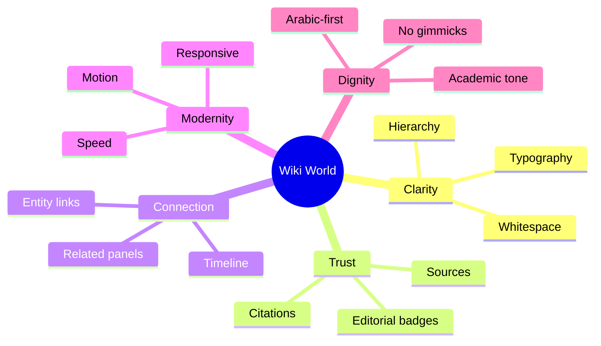
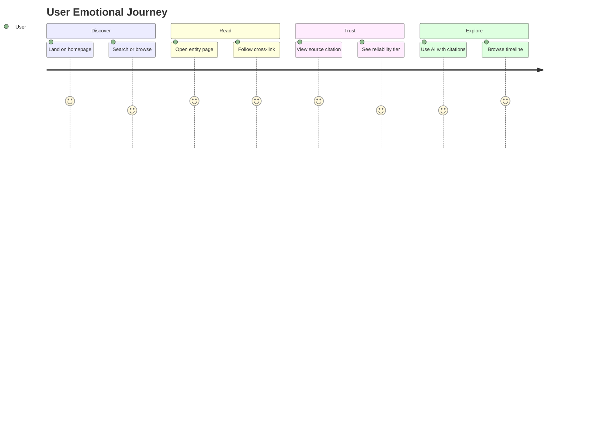
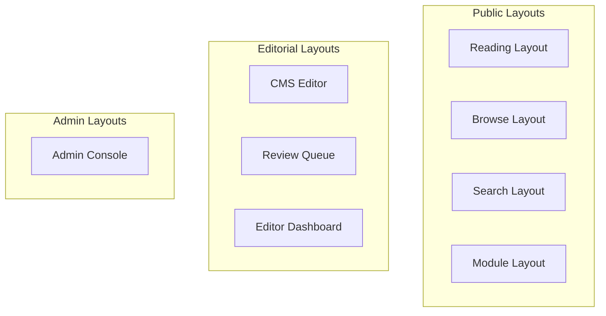

# Design System

# ويكي العالمية — Wiki World

**Document Version:** 1.0  
**Status:** Authoritative — Single Source of Truth for All Interfaces  
**Date:** July 7, 2026  
**Classification:** Internal — Design, Engineering, Product  
**Document Type:** Complete Design System Specification  
**Primary Locale:** Arabic (RTL)

---

## Document Control

| Field | Value |
|-------|-------|
| Product Name (Arabic) | ويكي العالمية |
| Product Name (English) | Wiki World |
| Document Owner | Lead Product Designer / Design System Architect |
| Governing References | [PRD.md](./PRD.md), [KNOWLEDGE_DOMAIN_BLUEPRINT.md](./KNOWLEDGE_DOMAIN_BLUEPRINT.md), [AI_ENGINEERING_CONSTITUTION.md](./AI_ENGINEERING_CONSTITUTION.md), [API_SPECIFICATION.md](./API_SPECIFICATION.md) |
| Companion Documents | Frontend Architecture (future), Component Library (future) |

### Revision History

| Version | Date | Author | Changes |
|---------|------|--------|---------|
| 1.0 | 2026-07-07 | Design Architecture | Initial complete design system |

### Alignment Statement

This document is the **single design authority** for Wiki World. All pages, components, animations, and layouts must comply. It must not contradict the PRD, Knowledge Domain Blueprint, or AI Engineering Constitution. When engineering tokens are implemented, they must map 1:1 to Section 20 (Design Tokens).

---

## Table of Contents

1. [Brand Identity](#1-brand-identity)
2. [Visual Language](#2-visual-language)
3. [Color System](#3-color-system)
4. [Typography](#4-typography)
5. [Spacing System](#5-spacing-system)
6. [Layout System](#6-layout-system)
7. [Grid System](#7-grid-system)
8. [Iconography](#8-iconography)
9. [Illustration Style](#9-illustration-style)
10. [Component Principles](#10-component-principles)
11. [Motion System](#11-motion-system)
12. [Reading Experience](#12-reading-experience)
13. [Knowledge Experience](#13-knowledge-experience)
14. [CMS Experience](#14-cms-experience)
15. [AI Experience](#15-ai-experience)
16. [Accessibility](#16-accessibility)
17. [Responsive Strategy](#17-responsive-strategy)
18. [Dark Mode](#18-dark-mode)
19. [Empty States](#19-empty-states)
20. [Design Tokens](#20-design-tokens)
21. [Design Principles](#21-design-principles)
- [Appendix A: Component State Matrix](#appendix-a-component-state-matrix)
- [Appendix B: Entity Type Visual Treatment](#appendix-b-entity-type-visual-treatment)
- [Appendix C: Design Decision Log](#appendix-c-design-decision-log)
- [Appendix D: Homepage & Global Navigation](#appendix-d-homepage--global-navigation)
- [Appendix E: Content Block Specifications](#appendix-e-content-block-specifications)
- [Appendix F: Form Patterns](#appendix-f-form-patterns)
- [Appendix G: Complete CSS Token Reference](#appendix-g-complete-css-token-reference)
- [Appendix H: Infobox Field Specifications](#appendix-h-infobox-field-specifications)
- [Appendix I: Print & Export Styles](#appendix-i-print--export-styles)
- [Appendix J: Quality Assurance Checklist](#appendix-j-quality-assurance-checklist)
- [Appendix K: Figma & Design Handoff](#appendix-k-figma--design-handoff)

---

# 1. Brand Identity

## 1.1 Mission

**ويكي العالمية** exists to make Ja'fari Islamic knowledge accessible, trustworthy, and interconnected — presented with the clarity of world-class reference products and the dignity the subject deserves.

The design system serves this mission by making **knowledge the hero** and **interface the servant**.

## 1.2 Visual Personality

Wiki World is **not** a traditional Islamic website. It does not use heavy ornaments, gold gradients, geometric borders as decoration, or dense calligraphic headers.

Wiki World **is**:

| Attribute | Expression |
|-----------|------------|
| **Calm** | Generous whitespace; no visual noise |
| **Readable** | Typography optimized for long-form Arabic and English |
| **Modern** | Contemporary layout patterns from Apple, Notion, Linear |
| **Academic** | Structured hierarchy, citations visible, infobox discipline |
| **Premium** | Refined details: spacing, motion, micro-interactions |
| **Trustworthy** | Source attribution, reliability indicators, editorial badges |
| **Minimal** | Every element earns its place |
| **Timeless** | No trend-chasing; system built for 10+ years |

## 1.3 Brand Values (Design Translation)

| Value | PRD Principle | Design Expression |
|-------|---------------|-------------------|
| Knowledge First | Content is primary UI | 70%+ viewport for content on reading pages |
| Everything Connected | Graph navigation | Relationship panels, cross-links, explore UI |
| Sources Before Claims | Scholarly integrity | Citation blocks, source cards, reliability tiers |
| Modern UX | No legacy wiki aesthetics | Card-based layouts, clean search, no cluttered sidebars |
| AI Assists Knowledge | RAG with citations | AI panel with mandatory source chips |
| Arabic First | RTL primary | RTL-native grid, mirrored chrome, Arabic typography lead |

## 1.4 Tone of Voice (UI Copy)

| Context | Arabic Tone | English Tone |
|---------|-------------|--------------|
| Navigation | Clear, concise | Clear, concise |
| Errors | Respectful, helpful | Respectful, helpful |
| AI disclaimer | Formal, educational | Formal, educational |
| Empty states | Encouraging, not cute | Encouraging, not cute |
| CMS | Efficient, professional | Efficient, professional |

**Avoid:** Excessive honorifics in UI chrome (save for content), preachy language, exclamation marks, emoji in product UI.

## 1.5 Emotional Goals

| User Moment | Desired Emotion | Design Response |
|-------------|-----------------|-----------------|
| First visit | Confidence, calm | Clean homepage, clear search, no overwhelm |
| Reading article | Focus, comprehension | Optimal line length, minimal distractions |
| Exploring connections | Curiosity, discovery | Related entities, timeline, graph hints |
| Using AI | Informed caution | Citations prominent, disclaimer visible |
| Editorial work | Efficiency, control | Linear-inspired CMS, keyboard shortcuts |
| Mobile reading | Comfort | Dark mode, comfortable type, thumb zones |

## 1.6 Brand Characteristics



## 1.7 Logo & Wordmark (Guidelines)

| Element | Rule |
|---------|------|
| Wordmark (Arabic) | ويكي العالمية — primary lockup |
| Wordmark (English) | Wiki World — secondary, bilingual contexts |
| Symbol | Abstract knowledge node / connected graph — minimal, no mosque clipart |
| Clear space | Minimum 1× symbol height on all sides |
| Minimum size | 24px height digital |
| Color | `ink` on light; `text-primary` on dark — never gradient logo |

*Detailed logo assets to be delivered separately. This document governs usage rules only.*

---

# 2. Visual Language

## 2.1 Philosophy

Wiki World visual language follows three laws:

1. **Deference to content** — Interface recedes; knowledge advances (Apple HIG).
2. **Structure through hierarchy** — Not decoration (Notion blocks, Wikipedia infoboxes).
3. **Speed as aesthetics** — Fast perceived performance is part of beauty (Linear).

## 2.2 How Knowledge Should Be Presented

| Content Type | Presentation Model |
|--------------|-------------------|
| Entity (Person, Event) | Hero title + infobox + structured body + relationships |
| Article | Block-based narrative + inline citations + TOC |
| Quran verse | Distinct Uthmanic typography + translation layer + tafsir tabs |
| Source | Bibliographic card + reliability tier + usage count |
| Book | Cover + metadata + chapter reader |
| Timeline | Chronological spine + era filters |
| Search result | Scannable cards with highlight + entity type badge |
| AI answer | Answer prose + citation chips + related entities |

Knowledge is never presented as an undifferentiated wall of text.

## 2.3 Emotional Experience Journey



## 2.4 What We Reject

| Rejected Pattern | Why | Alternative |
|------------------|-----|-------------|
| Gold domes, arabesque borders | Cliché, dated, decorative | Subtle geometric accent only in marketing |
| Full-width busy headers | Steals focus from content | Compact sticky header |
| Multiple font families | Visual chaos | 2 families max (Arabic + Latin) |
| Stock photos of mosques | Generic, not knowledge | Entity imagery, maps, diagrams |
| Blinking, autoplay | Distracting, inaccessible | User-initiated motion only |
| Dense 3-column wiki sidebars | Overwhelming | Progressive disclosure panels |

## 2.5 Design North Star References

| Reference | What We Take | What We Do Not Copy |
|-----------|--------------|---------------------|
| Apple HIG | Clarity, depth via elevation, SF-style spacing | iOS-specific chrome |
| Notion | Block editor, clean reading, toggle hierarchy | Generic blank canvas feel |
| Linear | CMS speed, keyboard UX, status badges | Dark-only aesthetic |
| Wikipedia | Infobox, article structure, neutral tone | Dated visual design |
| Stripe | Documentation readability, code blocks | Payment UI patterns |
| Vercel | Marketing minimalism, Geist typography | Developer-tool focus |
| GitHub | Clean tables, diff/review patterns | Code-centric layout |
| Arc Browser | Calm color, spatial tabs (concept) | Browser-specific UI |

## 2.6 Islamic Identity Without Cliché

Elegance is expressed through:

- **Arabic typography excellence** — Not decorative calligraphy in UI chrome
- **Calm, dignified color** — Deep ink and scholarly blue, not emerald/gold
- **Precision and order** — Reflecting ilm (knowledge) through structure
- **Generous margins** — Traditional manuscript breathing room, modern execution
- **Citation prominence** — Islamic scholarly tradition of sourcing, modern UI

---

# 3. Color System

## 3.1 Color Philosophy

Colors exist to **organize**, **communicate hierarchy**, and **signal meaning** — never to decorate.

| Principle | Application |
|-----------|-------------|
| Restraint | 90% neutral surfaces; color used intentionally |
| No gold overload | Gold/amber reserved for `reliability-gold` tier badge only |
| Academic trust | Deep ink text on warm white — evokes quality print |
| Modern accent | Scholarly blue-teal — calm, not corporate bright blue |
| Semantic clarity | Success/warning/error used only for status |

## 3.2 Primary Palette

### Ink (Primary Neutral)

| Token | Light Mode | Dark Mode | Purpose |
|-------|------------|-----------|---------|
| `--color-ink` | `#1A1D26` | `#F4F4F5` | Primary text, headings |
| `--color-ink-secondary` | `#4B5563` | `#A1A1AA` | Body text, descriptions |
| `--color-ink-tertiary` | `#6B7280` | `#71717A` | Captions, metadata |
| `--color-ink-disabled` | `#9CA3AF` | `#52525B` | Disabled text |

**Why:** Deep warm charcoal (not pure black) reduces eye strain for long Arabic reading sessions while maintaining authority. Mirrors premium editorial products (Notion, Linear).

### Scholar (Primary Brand Accent)

| Token | Light Mode | Dark Mode | Purpose |
|-------|------------|-----------|---------|
| `--color-scholar` | `#1B6B6B` | `#4ECDC4` | Primary actions, links, focus |
| `--color-scholar-hover` | `#155656` | `#6ED9D2` | Hover state |
| `--color-scholar-subtle` | `#E8F4F4` | `#0D2E2E` | Selected backgrounds, chips |
| `--color-scholar-muted` | `#B2D8D8` | `#1A4545` | Borders on scholar-tinted surfaces |

**Why:** Teal-green evokes knowledge (`علم`), tranquility, and Islamic geometric tradition without using literal green/gold website clichés. Distinct from generic SaaS blue while remaining professional.

### Surface (Backgrounds)

| Token | Light Mode | Dark Mode | Purpose |
|-------|------------|-----------|---------|
| `--color-surface-base` | `#FAFAF8` | `#0F1117` | Page background — warm off-white |
| `--color-surface-raised` | `#FFFFFF` | `#181B24` | Cards, panels |
| `--color-surface-sunken` | `#F4F4F1` | `#0A0C10` | Input backgrounds, code blocks |
| `--color-surface-overlay` | `rgba(26,29,38,0.4)` | `rgba(0,0,0,0.6)` | Modal backdrop |

**Why:** Warm `#FAFAF8` base (not clinical `#FFF` page) references quality paper; reduces glare. Cards on pure white create subtle depth without shadows-heavy design.

## 3.3 Secondary & Accent Colors

### Accent — Wisdom (Sparingly)

| Token | Light | Dark | Purpose |
|-------|-------|------|---------|
| `--color-wisdom` | `#8B5E3C` | `#C49A6C` | Quran module accent, special highlights |
| `--color-wisdom-subtle` | `#F5EDE6` | `#2A1F18` | Quran section backgrounds |

**Why:** Warm terracotta/sepia references manuscript tradition — used **only** in Quran context, not globally. Avoids gold while adding warmth.

### Entity Type Accents (Subtle)

| Entity | Token | Color | Usage |
|--------|-------|-------|-------|
| Person | `--color-entity-person` | `#6366F1` | Badge, icon tint |
| Event | `--color-entity-event` | `#EC4899` | Badge, icon tint |
| Place | `--color-entity-place` | `#10B981` | Badge, icon tint |
| Concept | `--color-entity-concept` | `#8B5CF6` | Badge, icon tint |
| Source | `--color-entity-source` | `#F59E0B` | Badge, icon tint |
| Book | `--color-entity-book` | `#3B82F6` | Badge, icon tint |
| Article | `--color-entity-article` | `#64748B` | Badge, icon tint |
| Verse | `--color-entity-verse` | `#8B5E3C` | Badge — ties to wisdom |

**Why:** Distinct hues enable instant entity recognition in search and graphs. Muted enough to not compete with content.

## 3.4 Semantic Colors

| Role | Token | Light | Dark | Usage |
|------|-------|-------|------|-------|
| Success | `--color-success` | `#059669` | `#34D399` | Published, saved, verified |
| Warning | `--color-warning` | `#D97706` | `#FBBF24` | Draft, pending review |
| Error | `--color-error` | `#DC2626` | `#F87171` | Errors, destructive actions |
| Info | `--color-info` | `#2563EB` | `#60A5FA` | Informational alerts |

### Reliability Tiers (Source System)

| Tier | Token | Color | Meaning |
|------|-------|-------|---------|
| Primary | `--color-tier-primary` | `#059669` | Canonical, highest reliability |
| Secondary | `--color-tier-secondary` | `#2563EB` | Strong scholarly source |
| Tertiary | `--color-tier-tertiary` | `#6B7280` | Supporting reference |
| Disputed | `--color-tier-disputed` | `#D97706` | Scholarly disagreement noted |

**Why:** Aligns with Knowledge Domain Blueprint reliability model. Color + label + icon — never color alone (accessibility).

## 3.5 Borders & Dividers

| Token | Light | Dark | Usage |
|-------|-------|------|-------|
| `--color-border-default` | `#E5E5E0` | `#2A2D38` | Card borders, dividers |
| `--color-border-strong` | `#D1D1C7` | `#3F4250` | Input borders |
| `--color-border-focus` | `#1B6B6B` | `#4ECDC4` | Focus rings |

## 3.6 Typography Colors

| Token | Usage |
|-------|-------|
| `--color-text-primary` | Maps to `--color-ink` |
| `--color-text-secondary` | Maps to `--color-ink-secondary` |
| `--color-text-link` | Maps to `--color-scholar` |
| `--color-text-link-hover` | Maps to `--color-scholar-hover` |
| `--color-text-inverse` | White on dark buttons |
| `--color-text-quran` | `#1A1D26` light / `#F4F4F5` dark — verse text always high contrast |

## 3.7 High Contrast Mode

| Element | Adjustment |
|---------|------------|
| Text | `#000000` on `#FFFFFF` |
| Links | `#004D4D` underlined |
| Focus | 3px solid `#000000` |
| Borders | `#000000` 2px |
| Entity badges | Icon + text label required |

Triggered by `prefers-contrast: more` or user setting.

## 3.8 Color Usage Guidelines

| Do | Don't |
|----|-------|
| Use scholar for primary CTA | Use scholar for large background areas |
| Use entity colors for badges/icons | Use entity colors for paragraph text |
| Pair color with icon + label | Rely on color alone for meaning |
| Test in dark mode | Assume light-only |
| Maintain 4.5:1 text contrast | Use light gray on white for body text |

## 3.9 Accessibility Rules

| Rule | Standard |
|------|----------|
| Body text contrast | ≥ 4.5:1 (WCAG AA) |
| Large text (18px+) | ≥ 3:1 |
| UI components | ≥ 3:1 against adjacent |
| Focus indicators | ≥ 3:1; 2px minimum ring |
| Color blindness | Never sole indicator; use pattern/icon |

---

# 4. Typography

## 4.1 Font Stack

### Arabic

| Role | Font | Fallback | Why |
|------|------|----------|-----|
| UI & Headings | **IBM Plex Sans Arabic** | Noto Sans Arabic, system-ui | Modern, excellent UI clarity, full weight range |
| Long-form reading | **Noto Naskh Arabic** | Amiri, serif | Naskh tradition optimized for extended reading |
| Quran verses | **KFGQPC Uthmanic Script HAFS** | Amiri Quran | Standard Uthmanic rendering |

### English / Latin

| Role | Font | Fallback | Why |
|------|------|----------|-----|
| UI & Headings | **Inter** | system-ui, sans-serif | Industry standard; pairs with IBM Plex |
| Long-form reading | **Source Serif 4** | Georgia, serif | Academic reading comfort |
| Code | **JetBrains Mono** | ui-monospace | API keys, slugs, technical |

### Font Loading

- `font-display: swap` for all web fonts
- Subset Arabic and Latin per locale
- Preload primary UI font per locale route

## 4.2 Type Scale

Base: `16px` (1rem) body. Scale ratio: **1.250** (Major Third).

| Token | Size | Line Height | Weight | Usage |
|-------|------|-------------|--------|-------|
| `--text-display` | 48px / 3rem | 1.1 | 700 | Marketing hero only |
| `--text-h1` | 36px / 2.25rem | 1.2 | 700 | Entity page title |
| `--text-h2` | 28px / 1.75rem | 1.25 | 600 | Section headings |
| `--text-h3` | 22px / 1.375rem | 1.3 | 600 | Subsections |
| `--text-h4` | 18px / 1.125rem | 1.4 | 600 | Card titles |
| `--text-body-lg` | 18px / 1.125rem | 1.7 | 400 | Long-form reading |
| `--text-body` | 16px / 1rem | 1.6 | 400 | Default body |
| `--text-body-sm` | 14px / 0.875rem | 1.5 | 400 | Secondary content |
| `--text-caption` | 12px / 0.75rem | 1.4 | 400 | Metadata, timestamps |
| `--text-overline` | 11px / 0.6875rem | 1.3 | 600 | Labels, badges (uppercase LTR only) |

### Arabic Adjustments

| Adjustment | Rule |
|------------|------|
| Line height | +0.1 over Latin equivalent (diacritics) |
| Heading weight | 600 default (700 feels heavy in Arabic UI) |
| Letter spacing | Never add tracking to Arabic |
| Overline | Not uppercase in Arabic — use caption style |

## 4.3 Numerals

| Locale | Numeral Style | Example |
|--------|---------------|---------|
| `ar` | Eastern Arabic (٠١٢٣) | `١٤٤٧ هـ` |
| `en` | Western Arabic (0123) | `2026 CE` |
| Mixed content | `dir="ltr"` on Western numbers in Arabic | ISBN, URLs |

Implementation: `font-variant-numeric` + locale-aware formatting.

## 4.4 Quran Typography

| Element | Font | Size | Line Height |
|---------|------|------|-------------|
| Verse text (Uthmanic) | KFGQPC Uthmanic | 28px mobile / 32px desktop | 2.0 |
| Verse reference | IBM Plex Sans Arabic | 14px | 1.4 |
| Translation | Noto Naskh Arabic / Source Serif | 18px | 1.8 |
| Tafsir excerpt | Noto Naskh Arabic | 16px | 1.7 |

**Rules:**
- Verse text always center-aligned in verse block
- Adequate padding — verses breathe (minimum `--space-8`)
- Bismillah styled distinctly (not body text)
- Sajdah indicator via icon + label, not color alone

## 4.5 Citation Typography

| Element | Style |
|---------|-------|
| Inline citation | `--text-body-sm`, `--color-scholar`, superscript number or bracket |
| Citation block | `--text-body-sm`, left/right border 3px `--color-scholar-muted` |
| Source title | `--text-body-sm`, weight 600 |
| Locator (page) | `--text-caption`, `--color-ink-tertiary` |

## 4.6 Quote Typography

| Type | Font | Style |
|------|------|-------|
| Blockquote | Reading serif | Italic (LTR only); indent + border |
| Hadith quote | Noto Naskh Arabic | Distinguished block with sanad styling |
| Scholarly excerpt | Source Serif / Noto Naskh | Quotation marks + citation |

## 4.7 Code Typography

| Context | Font | Size | Background |
|---------|------|------|------------|
| Inline code | JetBrains Mono | 0.9em | `--color-surface-sunken` |
| Code block | JetBrains Mono | 14px | `--color-surface-sunken` |
| Slug/UUID | JetBrains Mono | 12px | Truncate with copy button |

## 4.8 Tables

| Element | Style |
|---------|-------|
| Header | `--text-body-sm`, weight 600, `--color-surface-sunken` bg |
| Cell | `--text-body-sm`, padding `--space-3` |
| Border | `--color-border-default` |
| Zebra | Optional `--color-surface-sunken` on even rows |
| Responsive | Horizontal scroll or card collapse on mobile |

## 4.9 Responsive Typography

| Breakpoint | H1 | Body | Quran |
|------------|-----|------|-------|
| Mobile (<768px) | 28px | 16px | 28px |
| Tablet (768–1023px) | 32px | 16px | 30px |
| Desktop (≥1024px) | 36px | 16–18px | 32px |

Use `clamp()` for fluid scaling between breakpoints.

---

# 5. Spacing System

## 5.1 Base Grid

**8-point grid** with 4px half-steps for fine tuning.

| Token | Value | Usage |
|-------|-------|-------|
| `--space-0` | 0 | Reset |
| `--space-1` | 4px | Tight inline gaps |
| `--space-2` | 8px | Icon-text gap, compact padding |
| `--space-3` | 12px | Input padding, small card padding |
| `--space-4` | 16px | Default component padding |
| `--space-5` | 20px | Medium gaps |
| `--space-6` | 24px | Card padding, section gaps |
| `--space-8` | 32px | Section spacing |
| `--space-10` | 40px | Large section gaps |
| `--space-12` | 48px | Page section breaks |
| `--space-16` | 64px | Hero spacing |
| `--space-20` | 80px | Marketing sections |
| `--space-24` | 96px | Maximum section break |

## 5.2 Margin & Padding Rules

| Context | Padding | Margin |
|---------|---------|--------|
| Button (md) | `--space-2` `--space-4` | — |
| Card | `--space-6` | — |
| Page container | `--space-4` mobile, `--space-6` desktop | — |
| Section | — | `--space-12` bottom |
| Stack gap (default) | — | `--space-4` between items |
| Inline elements | — | `--space-2` gap |

## 5.3 Container Widths

| Token | Width | Usage |
|-------|-------|-------|
| `--container-sm` | 640px | Narrow forms, AI chat |
| `--container-md` | 768px | Reading column max |
| `--container-lg` | 1024px | Standard content |
| `--container-xl` | 1280px | Entity pages with sidebar |
| `--container-2xl` | 1440px | Maximum content width |
| `--container-full` | 100% | Edge-to-edge (timeline, CMS) |

## 5.4 Density Modes

| Mode | Context | Adjustment |
|------|---------|------------|
| Comfortable (default) | Public reading | Standard spacing |
| Compact | CMS tables, admin | −25% vertical spacing |
| Spacious | Quran, long articles | +reading line-height |

## 5.5 Responsive Spacing

| Breakpoint | Page Padding | Section Gap |
|------------|--------------|-------------|
| Mobile | `--space-4` | `--space-8` |
| Tablet | `--space-6` | `--space-10` |
| Desktop | `--space-6` | `--space-12` |

---

# 6. Layout System

## 6.1 Layout Philosophy

Layouts serve **content type**, not arbitrary templates.



## 6.2 Global Shell

| Region | Height | Behavior |
|--------|--------|----------|
| Header | 56px (mobile 48px) | Sticky; shrinks on scroll (optional) |
| Main | flex 1 | Scrollable |
| Footer | auto | Minimal; links + language |
| AI panel | 400px drawer / bottom sheet | Overlay, not permanent sidebar |

### Header Contents (Public)

| Slot | Content |
|------|---------|
| Start (RTL: right) | Logo, module nav |
| Center | Global search (desktop) |
| End (RTL: left) | Language, account, AI trigger |

**Chrome budget:** Header + any breadcrumb ≤ 120px total before content.

## 6.3 Reading Layout

For articles, entity pages, book chapters.

```
┌─────────────────────────────────────────────────────┐
│ Header                                              │
├────────────────────────────────┬────────────────────┤
│                                │                    │
│  Main Content (max 720px)      │  Sidebar (280px)   │
│  - Title                       │  - Infobox         │
│  - Summary                     │  - TOC (sticky)    │
│  - Body blocks                 │  - Related         │
│                                │  - Sources         │
│                                │                    │
├────────────────────────────────┴────────────────────┤
│ Footer                                              │
└─────────────────────────────────────────────────────┘
```

| Rule | Value |
|------|-------|
| Reading column max | 720px (`--container-md`) |
| Sidebar width | 280px |
| Sidebar position | Logical end (left in RTL) |
| Mobile | Sidebar collapses below content or into tabs |

## 6.4 Browse Layout

For lists: persons, events, books, concepts.

- Filter bar (collapsible on mobile)
- Grid of entity cards (1 col mobile, 2 tablet, 3 desktop)
- Pagination at bottom

## 6.5 Search Layout

```
┌──────────────────────────────────────────┐
│ Search input (prominent, full width)     │
├──────────────┬───────────────────────────┤
│ Filters      │ Results                   │
│ (240px)      │ (flex 1)                  │
│ - Type       │ - Result cards            │
│ - Module     │ - Facets                  │
│ - Date       │ - Pagination              │
└──────────────┴───────────────────────────┘
```

Mobile: Filters in drawer; results full width.

## 6.6 Module Layout (Quran, Ahlulbayt)

| Module | Layout Character |
|--------|------------------|
| Quran | Surah grid + verse reader; wisdom accent |
| Ahlulbayt | Browse + genealogy tree + timeline |
| Future Hadith | Consistent module header pattern |

Module header: Title + description + module-specific nav tabs.

## 6.7 Timeline Layout

- Vertical spine (center on desktop, start-aligned on mobile)
- Era filter chips horizontal scroll
- Event cards alternate sides (desktop) / single column (mobile)
- Cursor pagination — infinite scroll with skeleton

## 6.8 CMS Layout

```
┌──────┬─────────────────────────────┬──────────┐
│ Icon │ Editor Area                 │ Panel    │
│ Nav  │ - Title                     │ - Meta   │
│ 64px │ - Block editor              │ - Sources│
│      │ - Entity links              │ - Preview│
│      │                             │ - Workflow│
└──────┴─────────────────────────────┴──────────┘
```

| Region | Width |
|--------|-------|
| Icon nav | 64px collapsed / 240px expanded |
| Editor | flex 1, max 800px content |
| Right panel | 320px, collapsible |

Inspired by Notion + Linear — keyboard-first.

## 6.9 Dashboard Layout (Editorial)

- KPI cards row (4 max)
- Activity feed + review queue split
- Quick actions prominent

## 6.10 Admin Layout

- Left sidebar navigation (240px)
- Data-dense tables
- Breadcrumb + page title
- Action bar top-right (LTR logical end)

---

# 7. Grid System

## 7.1 Breakpoints

| Token | Min Width | Target Devices |
|-------|-----------|----------------|
| `--bp-xs` | 320px | Small phones |
| `--bp-sm` | 375px | Primary mobile design target (PRD) |
| `--bp-md` | 768px | Tablets |
| `--bp-lg` | 1024px | Desktop |
| `--bp-xl` | 1280px | Large desktop |
| `--bp-2xl` | 1536px | Ultra-wide |

**Strategy:** Mobile-first CSS; enhance at breakpoints. PRD NFR-RESP-001 targets 375px as primary.

## 7.2 Column Grid

| Breakpoint | Columns | Gutter | Margin |
|------------|---------|--------|--------|
| xs–sm | 4 | 16px | 16px |
| md | 8 | 24px | 24px |
| lg+ | 12 | 24px | 24px (max 48px on 2xl) |

## 7.3 Content Width Rules

| Content Type | Max Width | Columns (12-col) |
|--------------|-----------|------------------|
| Reading prose | 720px | 7 |
| Entity page (with sidebar) | 1280px total | 8 + 4 |
| Full bleed (timeline) | 100% | 12 |
| CMS editor | 800px | — |
| Search results | 960px | 9 |

## 7.4 Card Grid

| Breakpoint | Columns |
|------------|---------|
| Mobile | 1 |
| Tablet | 2 |
| Desktop | 3 |
| Ultra-wide | 4 (max — avoid tiny cards) |

## 7.5 Knowledge Panel Grid

Related entities, sources, cross-references use **horizontal scroll** on mobile, **2-column grid** on tablet+.

---
# 8. Iconography

## 8.1 Icon Style

| Attribute | Standard |
|-----------|----------|
| Library | **Lucide Icons** (primary) — MIT, consistent stroke |
| Style | Outlined (stroke) — not filled, except active nav |
| Stroke width | 1.5px default; 2px for small (16px) |
| Corner radius | Rounded caps and joins |
| Aesthetic | Geometric, minimal — matches Linear/Notion |

**Why Lucide:** Open source, comprehensive, RTL-mirrorable, no Islamic clipart packs.

## 8.2 Icon Sizes

| Token | Size | Usage |
|-------|------|-------|
| `--icon-xs` | 14px | Inline with caption text |
| `--icon-sm` | 16px | Buttons, badges |
| `--icon-md` | 20px | Default UI |
| `--icon-lg` | 24px | Navigation, feature icons |
| `--icon-xl` | 32px | Empty states, module headers |

## 8.3 Filled vs Outlined

| State | Style |
|-------|-------|
| Default | Outlined |
| Active nav item | Filled OR outlined + `--color-scholar` |
| Entity type badge | Filled circle background + outlined icon |
| Disabled | Outlined, `--color-ink-disabled` |

## 8.4 RTL Compatibility

| Rule | Implementation |
|------|----------------|
| Directional icons | Mirror in RTL: arrows, chevrons, external link |
| Symmetric icons | No mirror: search, settings, close |
| Icon + text | Icon on logical start side |
| Implementation | `transform: scaleX(-1)` or logical properties |

### Mirror List

| Icon | Mirror RTL? |
|------|-------------|
| `chevron-left/right` | Yes |
| `arrow-left/right` | Yes |
| `external-link` | Yes |
| `log-in/out` | Yes |
| `search`, `book`, `user` | No |

## 8.5 Usage Rules

| Do | Don't |
|----|-------|
| Pair with text label for nav | Icon-only nav without tooltip |
| Use 44×44px touch target | 16px icon as only tap target |
| Use semantic entity icons | Random decorative icons |
| Provide `aria-hidden` on decorative | Leave icons unlabeled when sole content |

## 8.6 Entity Type Icons

| Entity | Icon | Color Token |
|--------|------|-------------|
| Person | `user` | `--color-entity-person` |
| Event | `calendar` | `--color-entity-event` |
| Place | `map-pin` | `--color-entity-place` |
| Concept | `lightbulb` | `--color-entity-concept` |
| Source | `book-open` | `--color-entity-source` |
| Book | `library` | `--color-entity-book` |
| Article | `file-text` | `--color-entity-article` |
| Verse | `book-marked` | `--color-entity-verse` |

---

# 9. Illustration Style

## 9.1 Philosophy

Illustrations support understanding — they do not decorate. Default state: **no illustration** unless it adds information.

## 9.2 Style Attributes

| Attribute | Standard |
|-----------|----------|
| Style | Flat, minimal geometric |
| Palette | Monochrome ink + single scholar accent |
| Line weight | 1.5–2px consistent |
| Detail | Low — readable at small size |
| 3D | Not used in product UI (marketing only, sparingly) |

## 9.3 Usage Contexts

| Context | Illustration Type |
|---------|-------------------|
| Empty states | Simple line art — search, bookmark, offline |
| Module landing | Abstract geometric pattern (not figurative) |
| Error pages | Calm, non-alarming |
| Onboarding | Step diagrams, not characters |
| Maps | Clean vector maps for places |
| Genealogy | Tree diagram (UI component, not illustration) |
| Timeline | Spine + cards — not illustrated scenes |

## 9.4 Prohibited

| Avoid | Reason |
|-------|--------|
| Figurative depictions of sacred persons | Theological sensitivity |
| Stock mosque photos | Cliché |
| Ornate arabesque backgrounds | Traditional website aesthetic |
| Cartoon mascots | Undermines academic trust |

## 9.5 Knowledge Diagrams

| Diagram | Style |
|---------|-------|
| Relationship graph | Nodes (entity cards) + edges (labeled lines) |
| Genealogy tree | Vertical tree, collapsible |
| Era timeline | Horizontal/vertical spine with era bands |
| Concept map | Minimal nodes, scholar-colored edges |

---

# 10. Component Principles

Every component follows: **Purpose → Anatomy → States → Variants → Accessibility → Responsive → Interaction**.

---

## 10.1 Buttons

### Purpose
Trigger actions. One primary action per view maximum.

### Variants

| Variant | Background | Text | Border | Usage |
|---------|------------|------|--------|-------|
| Primary | `--color-scholar` | white | none | Main CTA |
| Secondary | transparent | `--color-scholar` | `--color-scholar` | Secondary action |
| Ghost | transparent | `--color-ink-secondary` | none | Tertiary, toolbar |
| Danger | `--color-error` | white | none | Delete, unpublish |
| Link | transparent | `--color-scholar` | none | Inline navigation |

### Sizes

| Size | Height | Padding | Font |
|------|--------|---------|------|
| sm | 32px | `--space-2` `--space-3` | `--text-body-sm` |
| md | 40px | `--space-2` `--space-4` | `--text-body` |
| lg | 48px | `--space-3` `--space-6` | `--text-body` |

### States

| State | Visual |
|-------|--------|
| Default | Base variant |
| Hover | Darken 10% or `--color-scholar-hover` |
| Active | Darken 15% |
| Focus | 2px `--color-border-focus` ring, 2px offset |
| Disabled | 50% opacity, no pointer |
| Loading | Spinner replaces label; width preserved |

### Accessibility
- `<button>` element always
- `aria-busy` when loading
- `aria-disabled` when disabled
- Minimum 44×44px touch target on mobile

---

## 10.2 Inputs

### Types
Text, textarea, search, select, combobox, date, file upload.

### Anatomy
Label (above) → Input → Helper text / Error message

### States

| State | Border | Background |
|-------|--------|------------|
| Default | `--color-border-strong` | `--color-surface-raised` |
| Focus | `--color-border-focus` 2px | `--color-surface-raised` |
| Error | `--color-error` | `--color-surface-raised` |
| Disabled | `--color-border-default` | `--color-surface-sunken` |

### Search Input
- Large variant (48px) on search page
- Search icon logical start
- Clear button when value present
- `role="combobox"` with `aria-expanded` for suggestions

### Accessibility
- `<label>` associated via `for`/`id`
- `aria-invalid` + `aria-describedby` for errors
- Visible focus ring

---

## 10.3 Dropdowns & Selects

| Pattern | Usage |
|---------|-------|
| Native `<select>` | Simple enums, mobile-friendly |
| Custom combobox | Searchable entity picker (CMS) |
| Menu | Action menus, account menu |

- Keyboard: Arrow keys, Enter, Escape
- `role="listbox"` / `role="option"`
- Max height 320px, scroll

---

## 10.4 Tabs

### Variants

| Variant | Usage |
|---------|-------|
| Underline | Module nav, content sections |
| Pills | Filters, era selectors |
| Vertical | CMS panel sections |

### Behavior
- Arrow keys navigate tabs
- `role="tablist"`, `role="tab"`, `role="tabpanel"`
- Active tab: `--color-scholar` indicator
- Mobile: horizontal scroll or dropdown

---

## 10.5 Cards

### Base Card

| Property | Value |
|----------|-------|
| Background | `--color-surface-raised` |
| Border | 1px `--color-border-default` |
| Radius | `--radius-lg` (12px) |
| Padding | `--space-6` |
| Shadow | `--shadow-sm` (light mode only) |

### States

| State | Effect |
|-------|--------|
| Default | Base |
| Hover (interactive) | `--shadow-md`, border `--color-border-strong` |
| Focus | Focus ring |
| Selected | `--color-scholar-subtle` background |

---

## 10.6 Badges

| Variant | Usage |
|---------|-------|
| Entity type | Icon + label, entity color |
| Workflow | draft/warning, published/success |
| Reliability tier | Tier color + label |
| Count | Neutral, circular |

Font: `--text-caption`, padding `--space-1` `--space-2`, radius `--radius-full`.

---

## 10.7 Alerts

| Variant | Icon | Usage |
|---------|------|-------|
| Info | `info` | Neutral information |
| Success | `check-circle` | Confirmation |
| Warning | `alert-triangle` | Caution |
| Error | `alert-circle` | Failure |

Anatomy: icon + title + description + optional action + dismiss.

---

## 10.8 Dialogs & Drawers

### Dialog (Modal)
- Max width 480px (confirm) / 640px (forms)
- Centered, backdrop `--color-surface-overlay`
- Focus trap, Escape to close
- Return focus on close

### Drawer
- AI panel: logical end, 400px
- Mobile filters: bottom sheet, 80vh max
- CMS preview: logical end, 50% width

---

## 10.9 Breadcrumbs

- Separator: `/` or chevron (mirrored RTL)
- Current page not linked
- Truncate middle on mobile
- `nav` + `aria-label="Breadcrumb"`

---

## 10.10 Pagination

| Element | Style |
|---------|-------|
| Page numbers | Ghost buttons |
| Active | `--color-scholar-subtle` bg |
| Prev/Next | Icon buttons with label |
| Cursor variant | "Load more" button for timeline |

---

## 10.11 Search Components

| Component | Description |
|-----------|-------------|
| SearchBar | Global, prominent |
| SearchSuggestion | Dropdown with entity type icon |
| SearchResultCard | Title, highlight, summary, badge |
| SearchFilters | Sidebar chips + checkboxes |
| ZeroResults | Suggestions + alternate queries |

---

## 10.12 Tables (CMS/Admin)

- Sticky header
- Sortable columns (icon indicator)
- Row hover
- Bulk select checkbox column
- Compact density
- Horizontal scroll on mobile

---

## 10.13 Charts (Analytics)

| Type | Usage |
|------|-------|
| Line | Views over time |
| Bar | Content by type |
| Donut | Module distribution |

Palette: scholar + entity colors. Labels always visible. Accessible data table fallback.

---

## 10.14 Timeline Component

| Element | Style |
|---------|-------|
| Spine | 2px `--color-border-strong` |
| Era band | Subtle background tint |
| Event card | Standard card, date prominent |
| Date | Hijri primary in `ar`, Gregorian secondary |

---

## 10.15 Knowledge Panels

Container for related content on entity pages.

| Panel | Content |
|-------|---------|
| Infobox | Key facts, structured fields |
| Related Entities | Horizontal scroll cards |
| Sources | Source cards list |
| Cross References | Linked verses, events |
| Explore Connections | CTA to relationship view |

Collapsible on mobile with section headers.

---

## 10.16 Entity Card

| Element | Required |
|---------|----------|
| Entity type badge | Yes |
| Title | Yes, 2-line clamp |
| Summary | Optional, 2-line clamp |
| Metadata | Date, module |
| Thumbnail | Optional |

Sizes: `sm` (search), `md` (grid), `lg` (featured).

---

## 10.17 Citation Block

```
┌─────────────────────────────────────────┐
│ ▎ Source title (link)                   │
│ ▎ Author · Year · Reliability tier      │
│ ▎ Locator: vol. 2, p. 145              │
│ ▎ "Quote excerpt..."                    │
└─────────────────────────────────────────┘
```

- Left/right border 3px `--color-scholar-muted` (logical)
- Reliability tier badge required
- Link to source entity page

---

## 10.18 Verse Block

```
┌─────────────────────────────────────────┐
│           بِسْمِ اللَّهِ (if applicable)   │
│                                         │
│     ﴿  Verse text in Uthmanic font  ﴾     │
│                                         │
│         — Surah Name · 2:255 —          │
│                                         │
│  Translation text (reading font)        │
│                                         │
│  [Tafsir] [Cross-refs] [Related]        │
└─────────────────────────────────────────┘
```

- Distinct background: `--color-wisdom-subtle`
- Actions as tabs below
- Copy verse button (icon + label)

---

## 10.19 Hadith Block (Future Module)

| Element | Style |
|---------|-------|
| Sanad chain | Collapsible, monospace-like |
| Matn text | Noto Naskh, distinguished block |
| Grading | Badge (sahih, hassan, etc.) |
| Source | Citation block attached |

---

## 10.20 Book Card

| Element | Content |
|---------|---------|
| Cover | 3:4 ratio, placeholder if missing |
| Title | 2-line clamp |
| Author | Caption |
| Metadata | Pages, year |

---

## 10.21 Source Card

| Element | Content |
|---------|---------|
| Title | Linked |
| Authors | Caption |
| Reliability tier | Badge (required) |
| Usage count | "Cited in N entities" |

---

## 10.22 Media Card

| Element | Content |
|---------|---------|
| Thumbnail | 16:9 or 1:1 |
| Alt text | Required (displayed in CMS) |
| Caption | Optional |
| Credit | Optional |

---

## 10.23 AI Response Block

| Element | Content |
|---------|---------|
| Disclaimer banner | Non-dismissable on first use |
| Answer prose | Reading typography |
| Citation chips | Linked source/entity refs |
| Related entities | Horizontal entity cards |
| Feedback | Thumbs up/down + flag (editors) |

Streaming: token-by-token with `aria-live="polite"`.

---

# 11. Motion System

## 11.1 Animation Philosophy

Motion communicates **state change** and **spatial relationships** — never decorates.

| Principle | Application |
|-----------|-------------|
| Subtle | User notices feeling, not animation |
| Fast | UI feels responsive (Linear) |
| Purposeful | Every animation answers "what changed?" |
| Respectful | `prefers-reduced-motion` honored always |

## 11.2 Durations

| Token | Duration | Usage |
|-------|----------|-------|
| `--duration-instant` | 0ms | Reduced motion fallback |
| `--duration-fast` | 100ms | Hover, focus |
| `--duration-normal` | 200ms | Dropdowns, tooltips |
| `--duration-moderate` | 300ms | Drawers, panels |
| `--duration-slow` | 400ms | Page transitions (max) |

**Rule:** No animation exceeds 400ms except loading loops.

## 11.3 Easing

| Token | Curve | Usage |
|-------|-------|-------|
| `--ease-default` | `cubic-bezier(0.4, 0, 0.2, 1)` | General |
| `--ease-in` | `cubic-bezier(0.4, 0, 1, 1)` | Exit |
| `--ease-out` | `cubic-bezier(0, 0, 0.2, 1)` | Enter |
| `--ease-spring` | `cubic-bezier(0.34, 1.56, 0.64, 1)` | Playful micro (use sparingly) |

## 11.4 Transitions

| Interaction | Animation |
|-------------|-----------|
| Button hover | Background color 100ms |
| Card hover | Shadow + border 200ms |
| Tab switch | Underline slide 200ms |
| Drawer open | Slide + fade backdrop 300ms |
| Modal open | Scale 0.95→1 + fade 200ms |
| Toast enter | Slide up 200ms |

## 11.5 Loading

| Pattern | Usage |
|---------|-------|
| Skeleton | Content placeholders — pulse animation |
| Spinner | Button loading, inline refresh |
| Progress bar | Upload, multi-step publish |
| Streaming cursor | AI text generation |

### Skeleton Rules
- Match final layout dimensions
- `--color-surface-sunken` with shimmer
- No skeleton > 3s without progress indicator

## 11.6 Focus

- Focus ring: 2px `--color-border-focus`, 2px offset
- Never `outline: none` without replacement
- Focus visible only on keyboard (`:focus-visible`)

## 11.7 Page Transitions

- Subtle fade on route change (200ms)
- Scroll to top on navigation
- No elaborate page transitions (performance)

## 11.8 Reduced Motion

```css
@media (prefers-reduced-motion: reduce) {
  * {
    animation-duration: 0.01ms !important;
    transition-duration: 0.01ms !important;
  }
}
```

Provide non-motion alternatives: instant state change, no parallax.

---

# 12. Reading Experience

## 12.1 Reading Width

| Content | Max Width | Characters/Line |
|---------|-----------|-----------------|
| Arabic body | 720px | 50–70 characters |
| English body | 680px | 65–75 characters |
| Quran verse | 600px centered | — |
| Sidebars | 280px | — |

**Why 720px:** Optimal for Arabic Naskh readability; avoids long-line fatigue.

## 12.2 Typography in Reading

- Body: `--text-body-lg` (18px) for articles
- Paragraph spacing: `--space-6`
- Heading spacing: `--space-8` above, `--space-4` below
- First paragraph: no indent; subsequent optional

## 12.3 Footnotes & References

| Pattern | Behavior |
|---------|----------|
| Inline ref | Superscript number, link to footnote |
| Footnote section | Bottom of article, back-link |
| Hover (desktop) | Popover preview of source |
| Mobile | Tap to expand inline |

## 12.4 Quran Presentation

- Verse block component (§10.18)
- Surah header: name Arabic + translation + metadata
- Juz/Hizb indicators in margin (desktop)
- Translation toggle: show/hide per user preference
- Tafsir in tab — not inline wall of text

## 12.5 Book Presentation

| Element | Style |
|---------|-------|
| Chapter list | TOC sidebar |
| Chapter reader | Reading layout, progress bar |
| Page indicator | Bottom center |
| Font size control | A- A A+ buttons |

## 12.6 Long Article Behavior

| Feature | Implementation |
|---------|----------------|
| Sticky TOC | Sidebar, highlights current section |
| Reading progress | Thin bar below header (0–100%) |
| Estimated time | "8 min read" below title |
| Section anchors | Copy link on heading hover |
| Collapsible sections | Optional for very long articles |

## 12.7 Citation Popovers

- Trigger: click/tap on citation number
- Content: source title, excerpt, reliability, link
- Position: flip to avoid viewport exit
- Dismiss: Escape, outside click

## 12.8 Reading Progress

| Surface | Indicator |
|---------|-----------|
| Article | Top progress bar |
| Book chapter | Chapter X of Y + scroll bar |
| Account history | "Continue reading" card |

---

# 13. Knowledge Experience

## 13.1 Entity Pages

### Anatomy (Top to Bottom)

1. Breadcrumb
2. Entity type badge + title (H1)
3. Summary (lead paragraph)
4. Infobox panel (sidebar desktop, accordion mobile)
5. Body content blocks
6. Relationships section
7. Sources section
8. Related content
9. AI "Ask about this" CTA

### Person Page Specifics
- Lineage link (Ahlulbayt)
- Key dates in infobox (Hijri primary)
- Titles list
- Relationships grouped: family, companions, events

### Event Page Specifics
- Date (Hijri + Gregorian)
- Place linked
- Participants list
- Related verses

## 13.2 Relationship Panels

| View | Format |
|------|--------|
| Summary | Grouped chips by relationship type |
| Full | Filterable list with target entity cards |
| Graph (Phase 2) | Node-link diagram, zoom/pan |

Group labels localized: "شارك في", "مرتبط بـ", etc.

## 13.3 Knowledge Graph (Explore)

Phase 1: "Explore connections" list view.
Phase 2: Interactive graph.

| Rule | Detail |
|------|--------|
| Max initial nodes | 12 |
| Expand on click | Load more relationships |
| Node | Entity card miniature |
| Edge | Labeled relationship type |

## 13.4 Timeline Experience

- Era chips filter
- Infinite scroll with cursor
- Event card → entity page
- Person filter narrows timeline
- Hijri century markers on spine

## 13.5 Related Content

| Section | Algorithm Source |
|---------|------------------|
| Related entities | API `/search/related` |
| AI recommendations | API `/ai/related` |
| Popular | Analytics trending |

Display: horizontal scroll cards, max 8 visible.

## 13.6 Cross References

| Type | Presentation |
|------|--------------|
| Verse ↔ Concept | Link with verse reference format |
| Event ↔ Person | Entity cards |
| Article ↔ Entity | Inline entity links in prose |

## 13.7 Navigation Patterns

| Pattern | Usage |
|---------|-------|
| Entity link | Inline styled link with type icon on hover |
| Module nav | Top-level tabs |
| Contextual back | Return to search/timeline |
| Keyboard `j/k` | Future: navigate search results |

## 13.8 Search Experience

| Stage | UX |
|-------|-----|
| Empty | Recent searches, trending, module shortcuts |
| Typing | Debounced suggestions (300ms) |
| Results | Faceted filters, highlighted matches |
| Zero results | Spelling suggestions, broaden filters, contact editorial |
| Result click | Track analytics event |

---

# 14. CMS Experience

## 14.1 Design Philosophy

CMS is **Linear for Islamic knowledge** — fast, keyboard-first, status-clear.

| Principle | Application |
|-----------|-------------|
| Speed | Autosave, optimistic UI where safe |
| Clarity | Workflow state always visible |
| Safety | Publish checklist before action |
| Focus | Distraction-free editor mode |

## 14.2 Editor

| Feature | Pattern |
|---------|---------|
| Block editor | Notion-style `/` commands |
| Block types | paragraph, heading, quote, list, citation, image, entity link, callout |
| Slash menu | Keyboard navigable |
| Entity link | `@` mention picker |
| Source attach | Citation block with source picker |
| Autosave | Debounced 2s, status indicator "Saved" / "Saving..." |
| Fullscreen | Toggle hides nav |

## 14.3 Review Workflow

| State | Badge Color | Available Actions |
|-------|-------------|-------------------|
| Draft | `--color-warning` | Edit, Submit |
| In Review | `--color-info` | Approve, Reject (senior) |
| Approved | `--color-success` | Publish |
| Published | `--color-success` | Unpublish |
| Archived | `--color-ink-tertiary` | Restore |

Review panel: checklist status, reviewer notes, diff view (future).

## 14.4 Publishing

- Publish button disabled until checklist passes
- Checklist drawer: green/red per requirement
- Confirm dialog with summary
- Success toast + link to public preview

## 14.5 Media Library

- Grid view with filters
- Upload drag-and-drop zone
- Alt text required before publish use
- Processing state: skeleton → ready

## 14.6 Dashboard

| Widget | Content |
|--------|---------|
| My drafts | Count + recent list |
| Review queue | Assigned items |
| Domain stats | Published/draft per module |
| Alerts | Source gaps, broken links |

## 14.7 CMS Tables

- Sortable, filterable
- Status badge column
- Quick actions: edit, preview, submit
- Bulk actions: assign reviewer (future)

## 14.8 Keyboard Shortcuts

| Shortcut | Action |
|----------|--------|
| `⌘/Ctrl + S` | Save |
| `⌘/Ctrl + Enter` | Submit for review |
| `⌘/Ctrl + K` | Command palette |
| `⌘/Ctrl + /` | Block menu |
| `Esc` | Close panel |

Display shortcuts in tooltips and help panel.

---
# 15. AI Experience

## 15.1 Design Philosophy

AI is a **research assistant**, not an authority. The UI must communicate humility, sourcing, and educational purpose.

| Principle | UI Expression |
|-----------|---------------|
| Grounded | Citations visible alongside every claim |
| Transparent | Disclaimer persistent |
| Calm | No flashy "AI magic" animations |
| Useful | Related entities and suggested reading |

## 15.2 Conversation UI

### Layout Options

| Context | Pattern |
|---------|---------|
| Public site | Drawer (desktop) / bottom sheet (mobile) |
| Full page | `/ai` dedicated route (future) |
| Entity context | Pre-filled context chip |

### Message Anatomy

| Role | Style |
|------|-------|
| User | Aligned logical end, `--color-scholar-subtle` bg |
| Assistant | Aligned logical start, `--color-surface-raised` border |
| System | Centered, `--text-caption`, disclaimer |

### Input Area

- Textarea auto-grow (max 4 lines)
- Send button (disabled when empty)
- Character count near limit
- Placeholder localized: "اسأل عن أي موضوع..."

## 15.3 Citations

| Element | Style |
|---------|-------|
| Citation chip | Pill, `--color-scholar-subtle`, entity icon |
| Hover | Popover with excerpt + link |
| Inline number | Linked to citation list below answer |
| Missing citation | Should not occur — if fallback, show warning badge |

## 15.4 Confidence Indicators

| Level | Visual | Label |
|-------|--------|-------|
| High | Solid chip | "مستند إلى مصادر" |
| Medium | Outlined chip | "قد يتطلب التحقق" |
| Low / refusal | Warning alert | "لا توجد معلومات كافية في المصادر" |

Never show numeric confidence scores to users — too misleading.

## 15.5 Related Entities

Below answer: horizontal scroll of entity cards (max 6).
Label: "مواضيع ذات صلة" / "Related topics"

## 15.6 Suggested Reading

| Type | Presentation |
|------|--------------|
| Follow-up questions | Chips below input |
| Reading list | Entity cards with "Read" link |
| Module entry | "Explore Quran module" card |

## 15.7 Context Panel

When opened from entity page:
- Context chip: "Asking about: {entity title}" with remove
- Entity summary collapsed
- Links to full entity page

## 15.8 Streaming Responses

| Behavior | Implementation |
|----------|----------------|
| Token stream | Progressive text render |
| Cursor | Blinking caret at end |
| Citations | Appear as resolved (may follow text) |
| Stop button | Visible during generation |
| `aria-live` | `polite` region |
| Reduced motion | Instant display option |

## 15.9 Disclaimer

| Rule | Detail |
|------|--------|
| Text | "هذا محتوى تعليمي وليس فتوى شرعية" |
| Placement | Top of first message + footer of panel |
| Dismiss | Session only; returns next session |
| Editors | Flag button on every AI response |

## 15.10 Rate Limit UX

When limit reached:
- Clear message with retry time
- Suggest registration for higher limit
- No aggressive upsell

---

# 16. Accessibility

## 16.1 Standard

**WCAG 2.1 Level AA** minimum (PRD NFR-A11Y-001).
Target AA+ where feasible for reading interfaces.

## 16.2 Keyboard Navigation

| Requirement | Implementation |
|-------------|----------------|
| All interactive elements | Reachable via Tab |
| Logical tab order | DOM order matches visual (RTL aware) |
| Skip link | "Skip to main content" first focusable |
| Modals | Focus trap, Escape closes |
| Menus | Arrow key navigation |
| CMS | Full keyboard shortcut layer |

## 16.3 Screen Readers

| Element | Requirement |
|---------|-------------|
| Landmarks | `header`, `nav`, `main`, `footer`, `aside` |
| Headings | Logical hierarchy, one H1 per page |
| Images | `alt` text required |
| Icons | `aria-hidden` or `aria-label` |
| Live regions | AI stream, toast notifications |
| Arabic | `lang="ar"` on Arabic content blocks |
| Entity type | Announced: "Person: Imam Ali" |

## 16.4 Focus Management

- Visible focus ring on all interactive elements
- Focus moved to modal on open
- Focus returned on close
- No focus lost on route change

## 16.5 Contrast

| Element | Ratio |
|---------|-------|
| Body text | ≥ 4.5:1 |
| Large text | ≥ 3:1 |
| UI components | ≥ 3:1 |
| Focus ring | ≥ 3:1 |

Test with automated tools + manual review.

## 16.6 RTL Accessibility

| Rule | Detail |
|------|--------|
| `dir` attribute | On `<html>` per locale |
| Screen reader | NVDA/JAWS + VoiceOver Arabic testing |
| Mirrored icons | Correct announcement direction |
| Bidi text | `unicode-bidi` on mixed content |

## 16.7 Touch Accessibility

| Rule | Value |
|------|-------|
| Minimum target | 44×44px |
| Spacing between targets | 8px minimum |
| Gesture alternatives | No gesture-only actions |

## 16.8 Testing Matrix

| Tool | Purpose |
|------|---------|
| axe DevTools | Automated scan |
| Lighthouse | Accessibility score |
| VoiceOver (iOS) | Mobile RTL |
| NVDA (Windows) | Desktop |
| Keyboard only | Full journey test |

---

# 17. Responsive Strategy

## 17.1 Approach

**Mobile-first enhancement** — design for 375px, enhance for larger.

PRD NFR-RESP-001: Primary design target 375px width.

## 17.2 Breakpoint Behavior Summary

| Component | Mobile (<768) | Tablet (768–1023) | Desktop (≥1024) |
|-----------|---------------|-------------------|-----------------|
| Header | Hamburger + search icon | Partial nav | Full nav |
| Sidebar | Below content / drawer | Collapsible | Sticky |
| Entity card grid | 1 col | 2 col | 3 col |
| Search filters | Drawer | Sidebar | Sidebar |
| AI panel | Bottom sheet | Drawer | Drawer |
| CMS | Stacked panels | 2-column | 3-column |
| TOC | Accordion | Sticky sidebar | Sticky sidebar |

## 17.3 Landscape Mobile

- Reduce header height
- Verse block maintains readable font size
- AI sheet 60vh max

## 17.4 Large Displays (≥1536px)

- Content max-width capped at `--container-2xl`
- Margins increase, not content width
- Optional: wider sidebar (320px)

## 17.5 Foldables (Future)

- Dual-pane: list + detail on unfolded
- Single pane on cover screen
- CSS: `@media (horizontal-viewport-segments: 2)`

## 17.6 Responsive Images

| Context | Strategy |
|---------|----------|
| Entity hero | `srcset` 400w, 800w, 1200w |
| Card thumbnail | 200w, 400w |
| Book cover | 150w, 300w |
| Format | WebP with JPEG fallback |

---

# 18. Dark Mode

## 18.1 Philosophy

Dark mode is **first-class**, not an inversion filter. Designed for evening reading (PRD persona: Fatima reads at night).

| Principle | Application |
|-----------|-------------|
| Calm | True dark, not gray mush |
| Readable | Reduced contrast fatigue, not pure white on pure black |
| Consistent | Every component has dark tokens |
| Optional | System preference + manual toggle |

## 18.2 Contrast in Dark Mode

| Element | Background | Text |
|---------|------------|------|
| Page | `#0F1117` | `#F4F4F5` |
| Card | `#181B24` | `#F4F4F5` |
| Sunken | `#0A0C10` | `#A1A1AA` |

Body text contrast maintained ≥ 4.5:1.

## 18.3 Elevation in Dark Mode

Shadows ineffective on dark — use **lighter surface** for elevation:

| Level | Background |
|-------|------------|
| 0 (base) | `--color-surface-base` |
| 1 (card) | `--color-surface-raised` |
| 2 (dropdown) | `#1F2330` |
| 3 (modal) | `#252A38` |

## 18.4 Borders in Dark Mode

Borders more visible than light mode:
- `--color-border-default`: `#2A2D38`
- Subtle separation without harsh lines

## 18.5 Reading in Dark Mode

- Body text: `#E4E4E7` (not pure white)
- Quran verse: maintain Uthmanic clarity — test specifically
- Code blocks: darker sunken surface
- Links: `--color-scholar` light variant

## 18.6 Images in Dark Mode

- No automatic image inversion
- Optional subtle brightness reduction (0.9)
- Media cards: consistent border

## 18.7 Toggle Placement

- Header: sun/moon icon
- Options: System / Light / Dark
- Persist in `localStorage` + respect `prefers-color-scheme`

---

# 19. Empty States

## 19.1 Design Pattern

| Element | Content |
|---------|---------|
| Illustration | Minimal line art (optional) |
| Title | Clear, concise |
| Description | Helpful next step |
| Action | Primary CTA when applicable |

Tone: encouraging, not cute. No emoji.

## 19.2 State Catalog

### Loading

| Context | Pattern |
|---------|---------|
| Page | Full-page skeleton matching layout |
| Card grid | 6 skeleton cards |
| Search | Skeleton result cards |
| AI | Pulsing message bubble |

### Errors

| Error | Message Pattern | Action |
|-------|-----------------|--------|
| 500 | "Something went wrong" | Retry button |
| Network | "Connection lost" | Retry + offline note |
| 403 | "You don't have access" | Login / Home |
| 404 | "Page not found" | Search + Home |

### No Search Results

- Title: "No results for '{query}'"
- Suggestions: alternate spelling, broaden filters, try Arabic/English
- Editorial link: "Request content" (future)

### Offline

- Icon: cloud-off
- Message: "You're offline"
- Show cached content if available (future PWA)

### Maintenance

- Distinct illustration
- Message from admin settings
- CMS remains accessible (PRD FR-PLAT)

### First Use (Account)

| Feature | Empty State |
|---------|-------------|
| Bookmarks | "Save articles to read later" + CTA |
| History | "Your reading history will appear here" |
| AI conversations | "Ask your first question" + suggestions |

### Permission Denied (CMS)

- Explain required role
- Contact admin link
- No technical error codes exposed

---

# 20. Design Tokens

All visual values are tokenized. **No hardcoded values in components.**

## 20.1 Token Architecture

```
primitive → semantic → component
```

| Layer | Example |
|-------|---------|
| Primitive | `--primitive-teal-600: #1B6B6B` |
| Semantic | `--color-scholar: var(--primitive-teal-600)` |
| Component | `--button-primary-bg: var(--color-scholar)` |

## 20.2 Color Tokens (Complete)

See Section 3 for semantic mapping. Implementation file: `tokens/colors.css`

## 20.3 Spacing Tokens

See Section 5. Implementation: `tokens/spacing.css`

## 20.4 Radius Tokens

| Token | Value | Usage |
|-------|-------|-------|
| `--radius-none` | 0 | Tables |
| `--radius-sm` | 4px | Badges, chips |
| `--radius-md` | 8px | Inputs, buttons |
| `--radius-lg` | 12px | Cards |
| `--radius-xl` | 16px | Modals |
| `--radius-full` | 9999px | Pills, avatars |

## 20.5 Elevation / Shadows

| Token | Light Mode | Usage |
|-------|------------|-------|
| `--shadow-none` | none | Flat |
| `--shadow-sm` | `0 1px 2px rgba(26,29,38,0.05)` | Cards |
| `--shadow-md` | `0 4px 12px rgba(26,29,38,0.08)` | Dropdowns |
| `--shadow-lg` | `0 8px 24px rgba(26,29,38,0.12)` | Modals |

Dark mode: prefer surface elevation over shadows.

## 20.6 Typography Tokens

See Section 4. Implementation: `tokens/typography.css`

## 20.7 Animation Tokens

See Section 11. Implementation: `tokens/motion.css`

## 20.8 Border Tokens

| Token | Value |
|-------|-------|
| `--border-width-default` | 1px |
| `--border-width-strong` | 2px |
| `--border-width-focus` | 2px |

## 20.9 Opacity Tokens

| Token | Value | Usage |
|-------|-------|-------|
| `--opacity-disabled` | 0.5 | Disabled elements |
| `--opacity-overlay` | 0.4 | Modal backdrop |
| `--opacity-hover` | 0.8 | Hover on images |

## 20.10 Z-Index Scale

| Token | Value | Usage |
|-------|-------|-------|
| `--z-base` | 0 | Default |
| `--z-dropdown` | 100 | Dropdowns, popovers |
| `--z-sticky` | 200 | Sticky header, TOC |
| `--z-drawer` | 300 | AI drawer, filter drawer |
| `--z-modal` | 400 | Modals, dialogs |
| `--z-toast` | 500 | Toast notifications |
| `--z-tooltip` | 600 | Tooltips |

## 20.11 Icon Tokens

See Section 8. Implementation: `tokens/icons.css`

## 20.12 Token Implementation

| Platform | Format |
|----------|--------|
| CSS | Custom properties in `:root` and `[data-theme="dark"]` |
| Tailwind (if used) | Extend theme from tokens |
| Figma | Variables matching token names |
| iOS/Android (future) | JSON export from tokens |

### Locale Attributes

```html
<html lang="ar" dir="rtl" data-theme="light">
```

---

# 21. Design Principles

Every designer, developer, and AI assistant must internalize these permanent principles:

| # | Principle | Meaning |
|---|-----------|---------|
| DP-01 | **Content before decoration** | If it doesn't help understanding, remove it |
| DP-02 | **Knowledge before animation** | Motion serves context, not spectacle |
| DP-03 | **Whitespace is part of the interface** | Space creates calm and hierarchy |
| DP-04 | **Every pixel must have a purpose** | No ornamental elements |
| DP-05 | **Consistency over creativity** | Use the system; extend it thoughtfully |
| DP-06 | **Accessibility is mandatory** | Not a polish step — a requirement |
| DP-07 | **Arabic is first-class** | Design in RTL; LTR is not an afterthought |
| DP-08 | **Speed is part of design** | Slow UI feels broken |
| DP-09 | **Design for millions of articles** | Patterns must scale, not break |
| DP-10 | **Trust is visual** | Citations, sources, and editorial badges are UI elements |
| DP-11 | **Connection is the product** | Related content, links, and graphs are not optional decoration |
| DP-12 | **Dark mode is not an inversion** | Design both themes intentionally |
| DP-13 | **Never imitate traditional Islamic web** | Modern premium, not gold and ornaments |
| DP-14 | **Tokens over values** | No magic numbers in components |
| DP-15 | **If unsure, read the docs** | PRD, Blueprint, API Spec, this document |
| DP-16 | **Design for the reader** | Fatima on mobile at night is our primary persona |
| DP-17 | **Design for the editor** | Maryam needs Linear-speed CMS |
| DP-18 | **AI must look humble** | Citations and disclaimers, not magic sparkles |
| DP-19 | **Systems, not pages** | Components and tokens, not one-off layouts |
| DP-20 | **Timeless over trendy** | This system must work in 2036 |

---

# Appendix A: Component State Matrix

| Component | Default | Hover | Focus | Active | Disabled | Loading | Error |
|-----------|---------|-------|-------|--------|----------|---------|-------|
| Button Primary | ✓ | ✓ | ✓ | ✓ | ✓ | ✓ | — |
| Button Danger | ✓ | ✓ | ✓ | ✓ | ✓ | ✓ | — |
| Text Input | ✓ | — | ✓ | — | ✓ | — | ✓ |
| Select | ✓ | — | ✓ | ✓ | ✓ | — | ✓ |
| Card (interactive) | ✓ | ✓ | ✓ | ✓ | — | — | — |
| Entity Card | ✓ | ✓ | ✓ | — | — | skeleton | — |
| Tab | ✓ | ✓ | ✓ | ✓ | ✓ | — | — |
| Badge | ✓ | — | — | — | — | — | — |
| AI Message | ✓ | — | — | — | — | streaming | ✓ |

---

# Appendix B: Entity Type Visual Treatment

| Entity | Badge Color | Icon | Infobox Priority Fields |
|--------|-------------|------|------------------------|
| Person | Indigo | user | Birth, death, titles, lineage |
| Event | Pink | calendar | Date, place, participants |
| Place | Emerald | map-pin | Coordinates, region, history |
| Concept | Violet | lightbulb | Arabic term, category |
| Source | Amber | book-open | Author, year, reliability |
| Book | Blue | library | Author, publisher, year |
| Article | Slate | file-text | Published date, reading time |
| Verse | Sepia | book-marked | Surah:ayah, juz, page |

---

# Appendix C: Design Decision Log

| ID | Date | Decision | Rationale | Alternatives Rejected |
|----|------|----------|-----------|----------------------|
| DS-D01 | 2026-07-07 | Scholar teal as primary accent | Calm, knowledge-associated, non-cliché | Gold (traditional), bright blue (generic SaaS) |
| DS-D02 | 2026-07-07 | IBM Plex Sans Arabic + Noto Naskh | UI clarity + reading comfort | Amiri everywhere (too traditional for UI) |
| DS-D03 | 2026-07-07 | 8pt spacing grid | Industry standard, aligns with engineering constitution | 4pt only (too granular) |
| DS-D04 | 2026-07-07 | 720px reading width | Optimal Arabic line length | 800px (too wide), 600px (too narrow for infobox) |
| DS-D05 | 2026-07-07 | Lucide icons | Consistent, OSS, RTL-mirrorable | Heroicons (fewer icons), custom set (cost) |
| DS-D06 | 2026-07-07 | Warm off-white `#FAFAF8` base | Reduces glare, premium paper feel | Pure white (clinical), cream (dated) |
| DS-D07 | 2026-07-07 | No figurative sacred imagery | Theological sensitivity | Stock photos (cliché) |
| DS-D08 | 2026-07-07 | Wisdom terracotta for Quran only | Module identity without global gold | Gold accents everywhere |
| DS-D09 | 2026-07-07 | Dark mode as first-class | Night reading persona (PRD) | Light-only + invert filter |
| DS-D10 | 2026-07-07 | AI disclaimer non-dismissable permanently | PRD US-V-053 trust requirement | Dismissable forever |

---

**End of Document**

*ويكي العالمية — Wiki World Design System v1.0*  
*Governing references: [PRD.md](./PRD.md), [KNOWLEDGE_DOMAIN_BLUEPRINT.md](./KNOWLEDGE_DOMAIN_BLUEPRINT.md), [AI_ENGINEERING_CONSTITUTION.md](./AI_ENGINEERING_CONSTITUTION.md), [API_SPECIFICATION.md](./API_SPECIFICATION.md)*

# Appendix D: Homepage & Global Navigation

## D.1 Homepage Layout

The homepage is the **discovery entry point** — search-first, not content-wall.

```
┌─────────────────────────────────────────────────────────────┐
│  Header: Logo · Modules · Search · Lang · Account · AI      │
├─────────────────────────────────────────────────────────────┤
│                                                             │
│              ويكي العالمية                                    │
│     المعرفة الإسلامية الجعفرية — مصدر موثوق ومتصل              │
│                                                             │
│         ┌─────────────────────────────────────┐             │
│         │  🔍  ابحث في المعرفة...              │             │
│         └─────────────────────────────────────┘             │
│                                                             │
├─────────────────────────────────────────────────────────────┤
│  Module Cards (2×2 mobile, 4 desktop)                       │
│  ┌──────────┐ ┌──────────┐ ┌──────────┐ ┌──────────┐     │
│  │ Quran    │ │Ahlulbayt │ │ Timeline │ │ Concepts │     │
│  └──────────┘ └──────────┘ └──────────┘ └──────────┘     │
├─────────────────────────────────────────────────────────────┤
│  Featured Collections (horizontal scroll)                   │
├─────────────────────────────────────────────────────────────┤
│  Trending / Popular (entity card grid)                      │
├─────────────────────────────────────────────────────────────┤
│  Footer: Links · Language · About · Trust statement           │
└─────────────────────────────────────────────────────────────┘
```

| Region | Content | Update Frequency |
|--------|---------|------------------|
| Hero | Title + search | Static |
| Module cards | Quran, Ahlulbayt, Timeline, Concepts | Static links |
| Featured | Editorial collections API | Daily |
| Trending | Analytics API | Hourly |

**Chrome budget:** Hero + search visible above fold on 667px viewport.

## D.2 Global Navigation

### Desktop (≥1024px)

| Item | Position (RTL) | Behavior |
|------|----------------|----------|
| Logo | Start (right) | Link to homepage |
| Module links | After logo | Quran, Ahlulbayt, Timeline, Books |
| Search | Center or expanded | Opens search page on focus |
| Language | End cluster | Toggle ar/en |
| Account | End | Login / avatar menu |
| AI | End | Opens drawer |

### Mobile (<768px)

| Item | Position |
|------|----------|
| Logo | Start |
| Search icon | End cluster |
| AI icon | End cluster |
| Menu | End — hamburger |

Hamburger contains: modules, language, account, about.

## D.3 Language Toggle

| State | Display |
|-------|---------|
| Arabic active | `العربية | English` — Arabic bold |
| English active | `العربية | English` — English bold |

Behavior:
- Switches locale route prefix
- Animates `dir` change (no flash: use `transition` on layout only)
- Persists preference in account if logged in

## D.4 Footer

| Column | Links |
|--------|-------|
| Platform | About, Methodology, Editorial standards |
| Modules | Quran, Ahlulbayt, Books, Timeline |
| Legal | Privacy, Terms, AI disclaimer |
| Connect | Contact, Institutions (future) |

Minimal height. `--color-surface-sunken` background.

## D.5 Trust Statement

Footer or homepage banner:
> "جميع المحتوى منشور بواسطة فريق تحريري ومدعوم بالمصادر الأكاديمية"

Subtle, not banner-alert style.

---

# Appendix E: Content Block Specifications

Editorial blocks for articles and entity bodies. Maps to API `blocks[]` schema.

## E.1 Block Catalog

| Block Type | Purpose | Key Fields |
|------------|---------|------------|
| `paragraph` | Body text | `content` (sanitized HTML) |
| `heading` | Section heading | `level` (2–4), `content`, `anchor` |
| `quote` | Block quotation | `content`, `attribution`, `source_uuid` |
| `list` | Bullet/numbered | `style`, `items[]` |
| `citation` | Source reference | `source_uuid`, `locator`, `excerpt` |
| `image` | Media embed | `media_uuid`, `caption`, `alt` |
| `entity_link` | Entity embed card | `entity_uuid`, `display` (card/inline) |
| `callout` | Highlighted note | `variant` (info/warning/note), `content` |
| `verse` | Quran verse embed | `surah`, `ayah`, `show_translation` |
| `divider` | Section break | — |
| `table` | Data table | `headers[]`, `rows[][]` |

## E.2 Block Visual Specs

### Paragraph
- Font: reading serif (Noto Naskh / Source Serif)
- Size: `--text-body-lg`
- Spacing: `--space-6` bottom margin
- Links: `--color-scholar`, underline on hover

### Heading

| Level | Size Token | Margin Top |
|-------|------------|------------|
| H2 | `--text-h2` | `--space-12` |
| H3 | `--text-h3` | `--space-8` |
| H4 | `--text-h4` | `--space-6` |

Anchor link icon on hover (desktop).

### Quote
- Border logical start: 4px `--color-scholar-muted`
- Padding: `--space-4` logical start
- Font: reading serif, italic (LTR only)
- Attribution: `--text-caption`, below quote

### Entity Link (Card Variant)
- Compact entity card inline
- Max width: 400px
- Non-editable on public view

### Callout

| Variant | Background | Border |
|---------|------------|--------|
| info | `--color-info` 10% | `--color-info` |
| warning | `--color-warning` 10% | `--color-warning` |
| note | `--color-scholar-subtle` | `--color-scholar-muted` |

### Verse Embed
- Full verse block component (§10.18)
- Collapsed variant: reference link only

## E.3 Block Editor (CMS)

| Interaction | Behavior |
|-------------|----------|
| Add block | `/` menu or `+` between blocks |
| Reorder | Drag handle on hover |
| Delete | Backspace on empty or menu |
| Transform | Change type via menu (paragraph → heading) |
| Entity link | `@` opens entity picker |

---

# Appendix F: Form Patterns

## F.1 Form Layout

| Pattern | Usage |
|---------|-------|
| Single column | Mobile, simple forms |
| Two column | Desktop settings (label left, input right) |
| Section groups | Fieldset with legend |

Max form width: `--container-sm` (640px) unless full-width table.

## F.2 Field Spacing

| Element | Spacing |
|---------|---------|
| Between fields | `--space-4` |
| Between sections | `--space-8` |
| Label to input | `--space-2` |
| Input to helper | `--space-1` |

## F.3 Validation Display

| Timing | Behavior |
|--------|----------|
| On blur | Validate single field |
| On submit | Validate all; focus first error |
| Inline | Error below field, `--color-error` |
| Summary | Alert at top for 3+ errors |

## F.4 Common Forms

### Login / Register

| Field | Type | Validation |
|-------|------|------------|
| Email | email | Required, format |
| Password | password | Min 12 chars, show strength |
| Display name | text | Optional, max 255 |

### Entity Editor (CMS)

| Field | Component |
|-------|-----------|
| Title | Large input, H1 styling |
| Slug | Text + auto-generate toggle |
| Summary | Textarea, 500 char count |
| Domain | Select (editor scope filtered) |
| Locale | Tab selector |

### Source Attachment

| Field | Component |
|-------|-----------|
| Source | Combobox search |
| Locator | Text input |
| Excerpt | Textarea |

### Media Upload

| State | UI |
|-------|-----|
| Empty | Drop zone dashed border |
| Uploading | Progress bar |
| Processing | Skeleton preview |
| Ready | Thumbnail + metadata form |
| Error | Retry button + message |

---

# Appendix G: Complete CSS Token Reference

Implementation-ready token file structure for engineering handoff.

```css
:root {
  /* Primitive Colors */
  --primitive-ink-900: #1A1D26;
  --primitive-ink-600: #4B5563;
  --primitive-ink-400: #9CA3AF;
  --primitive-teal-700: #155656;
  --primitive-teal-600: #1B6B6B;
  --primitive-teal-400: #4ECDC4;
  --primitive-teal-100: #E8F4F4;
  --primitive-warm-50: #FAFAF8;
  --primitive-warm-100: #F4F4F1;
  --primitive-white: #FFFFFF;
  --primitive-sepia-600: #8B5E3C;
  --primitive-sepia-100: #F5EDE6;

  /* Semantic Colors - Light */
  --color-ink: var(--primitive-ink-900);
  --color-ink-secondary: var(--primitive-ink-600);
  --color-ink-tertiary: #6B7280;
  --color-ink-disabled: var(--primitive-ink-400);
  --color-scholar: var(--primitive-teal-600);
  --color-scholar-hover: var(--primitive-teal-700);
  --color-scholar-subtle: var(--primitive-teal-100);
  --color-scholar-muted: #B2D8D8;
  --color-surface-base: var(--primitive-warm-50);
  --color-surface-raised: var(--primitive-white);
  --color-surface-sunken: var(--primitive-warm-100);
  --color-surface-overlay: rgba(26, 29, 38, 0.4);
  --color-wisdom: var(--primitive-sepia-600);
  --color-wisdom-subtle: var(--primitive-sepia-100);
  --color-border-default: #E5E5E0;
  --color-border-strong: #D1D1C7;
  --color-border-focus: var(--color-scholar);
  --color-success: #059669;
  --color-warning: #D97706;
  --color-error: #DC2626;
  --color-info: #2563EB;

  /* Entity Colors */
  --color-entity-person: #6366F1;
  --color-entity-event: #EC4899;
  --color-entity-place: #10B981;
  --color-entity-concept: #8B5CF6;
  --color-entity-source: #F59E0B;
  --color-entity-book: #3B82F6;
  --color-entity-article: #64748B;
  --color-entity-verse: var(--primitive-sepia-600);

  /* Typography */
  --font-arabic-ui: 'IBM Plex Sans Arabic', 'Noto Sans Arabic', system-ui, sans-serif;
  --font-arabic-reading: 'Noto Naskh Arabic', 'Amiri', serif;
  --font-quran: 'KFGQPC Uthmanic Script HAFS', 'Amiri Quran', serif;
  --font-latin-ui: 'Inter', system-ui, sans-serif;
  --font-latin-reading: 'Source Serif 4', Georgia, serif;
  --font-mono: 'JetBrains Mono', ui-monospace, monospace;

  --text-display: 3rem;
  --text-h1: 2.25rem;
  --text-h2: 1.75rem;
  --text-h3: 1.375rem;
  --text-h4: 1.125rem;
  --text-body-lg: 1.125rem;
  --text-body: 1rem;
  --text-body-sm: 0.875rem;
  --text-caption: 0.75rem;
  --text-overline: 0.6875rem;

  /* Spacing */
  --space-1: 0.25rem;
  --space-2: 0.5rem;
  --space-3: 0.75rem;
  --space-4: 1rem;
  --space-5: 1.25rem;
  --space-6: 1.5rem;
  --space-8: 2rem;
  --space-10: 2.5rem;
  --space-12: 3rem;
  --space-16: 4rem;
  --space-20: 5rem;
  --space-24: 6rem;

  /* Radius */
  --radius-sm: 4px;
  --radius-md: 8px;
  --radius-lg: 12px;
  --radius-xl: 16px;
  --radius-full: 9999px;

  /* Shadows */
  --shadow-sm: 0 1px 2px rgba(26, 29, 38, 0.05);
  --shadow-md: 0 4px 12px rgba(26, 29, 38, 0.08);
  --shadow-lg: 0 8px 24px rgba(26, 29, 38, 0.12);

  /* Motion */
  --duration-fast: 100ms;
  --duration-normal: 200ms;
  --duration-moderate: 300ms;
  --duration-slow: 400ms;
  --ease-default: cubic-bezier(0.4, 0, 0.2, 1);
  --ease-in: cubic-bezier(0.4, 0, 1, 1);
  --ease-out: cubic-bezier(0, 0, 0.2, 1);

  /* Layout */
  --container-sm: 640px;
  --container-md: 768px;
  --container-lg: 1024px;
  --container-xl: 1280px;
  --container-2xl: 1440px;
  --header-height: 56px;
  --sidebar-width: 280px;

  /* Z-Index */
  --z-dropdown: 100;
  --z-sticky: 200;
  --z-drawer: 300;
  --z-modal: 400;
  --z-toast: 500;
  --z-tooltip: 600;
}

[data-theme="dark"] {
  --color-ink: #F4F4F5;
  --color-ink-secondary: #A1A1AA;
  --color-ink-tertiary: #71717A;
  --color-ink-disabled: #52525B;
  --color-scholar: #4ECDC4;
  --color-scholar-hover: #6ED9D2;
  --color-scholar-subtle: #0D2E2E;
  --color-scholar-muted: #1A4545;
  --color-surface-base: #0F1117;
  --color-surface-raised: #181B24;
  --color-surface-sunken: #0A0C10;
  --color-surface-overlay: rgba(0, 0, 0, 0.6);
  --color-wisdom: #C49A6C;
  --color-wisdom-subtle: #2A1F18;
  --color-border-default: #2A2D38;
  --color-border-strong: #3F4250;
  --shadow-sm: none;
  --shadow-md: none;
  --shadow-lg: none;
}
```

---

# Appendix H: Infobox Field Specifications

## H.1 Person Infobox

| Field | Label (AR) | Format |
|-------|------------|--------|
| full_name | الاسم الكامل | Text |
| kunya | الكنية | Text |
| birth_date | الولادة | Hijri primary, Gregorian secondary |
| death_date | الوفاة | Hijri primary, Gregorian secondary |
| birth_place | مكان الولادة | Place link |
| titles | الألقاب | Tag list |
| father | الأب | Person link |
| mother | الأم | Person link |
| spouse | الزوج/ة | Person link(s) |
| is_masum | معصوم | Boolean badge |
| imam_number | رقم الإمام | Number (1–12) |

## H.2 Event Infobox

| Field | Label (AR) | Format |
|-------|------------|--------|
| date | التاريخ | Hijri date range |
| place | المكان | Place link |
| participants | المشاركون | Person links |
| significance | الأهمية | Text |
| era | العصر | Era badge |

## H.3 Source Infobox

| Field | Label (AR) | Format |
|-------|------------|--------|
| authors | المؤلف | Text |
| title | العنوان | Text |
| publisher | الناشر | Text |
| year | سنة النشر | Year |
| reliability | مستوى الموثوقية | Tier badge |
| source_type | نوع المصدر | Enum label |

## H.4 Place Infobox

| Field | Label (AR) | Format |
|-------|------------|--------|
| coordinates | الإحداثيات | Lat/long with map link |
| region | المنطقة | Text |
| modern_name | الاسم الحديث | Text |
| historical_names | الأسماء التاريخية | List |

## H.5 Infobox Layout

| Breakpoint | Position |
|------------|----------|
| Desktop | Sidebar, sticky top below header |
| Tablet | Above content, 2-column grid |
| Mobile | Accordion "معلومات سريعة", collapsed by default |

---

# Appendix I: Print & Export Styles

## I.1 Print Stylesheet

| Rule | Value |
|------|-------|
| Hide | Header, footer, nav, AI, sidebar TOC |
| Show | Full article, infobox inline, citations |
| Page breaks | Avoid inside headings, quotes, verse blocks |
| Font | Noto Naskh for Arabic, Source Serif for English |
| URLs | Print after links: `content: " (" attr(href) ")"` |
| Colors | Black on white |

## I.2 Citation Export (Future)

- APA, Chicago, custom Islamic citation formats
- Copy button on source pages
- BibTeX download for researchers

---

# Appendix J: Quality Assurance Checklist

Design review checklist before shipping any UI:

| # | Check | Pass |
|---|-------|------|
| 1 | Uses design tokens only | ☐ |
| 2 | RTL layout tested | ☐ |
| 3 | LTR layout tested | ☐ |
| 4 | Dark mode tested | ☐ |
| 5 | Mobile 375px tested | ☐ |
| 6 | Keyboard navigation works | ☐ |
| 7 | Focus indicators visible | ☐ |
| 8 | Color contrast passes AA | ☐ |
| 9 | Screen reader tested | ☐ |
| 10 | No hardcoded strings | ☐ |
| 11 | Touch targets ≥ 44px | ☐ |
| 12 | Loading states present | ☐ |
| 13 | Error states present | ☐ |
| 14 | Empty states present | ☐ |
| 15 | Citations display correctly | ☐ |
| 16 | Entity badges show type + label | ☐ |
| 17 | AI disclaimer visible | ☐ |
| 18 | `prefers-reduced-motion` respected | ☐ |
| 19 | Images have alt text | ☐ |
| 20 | Core Web Vitals considered | ☐ |

---

# Appendix K: Figma & Design Handoff

## K.1 Figma File Structure

```
Wiki World Design System
├── 🎨 Foundations
│   ├── Colors
│   ├── Typography
│   ├── Spacing
│   ├── Icons
│   └── Effects
├── 🧩 Components
│   ├── Buttons
│   ├── Inputs
│   ├── Cards
│   ├── Entity Components
│   └── CMS Components
├── 📄 Patterns
│   ├── Reading Layout
│   ├── Search
│   ├── Timeline
│   └── AI Panel
└── 📱 Screens
    ├── Public
    ├── CMS
    └── Admin
```

## K.2 Variable Naming

Figma variables must match CSS token names exactly:
- `color/scholar/default` → `--color-scholar`
- `space/4` → `--space-4`
- `radius/lg` → `--radius-lg`

## K.3 Handoff Requirements

| Deliverable | Format |
|-------------|--------|
| Specs | Figma inspect + this document |
| Icons | SVG export, 24px base |
| Tokens | CSS + JSON export |
| Components | Storybook stories matching Figma |
| Screens | Responsive frames at 375, 768, 1280 |

## K.4 Design-Engineering Sync

| Event | Action |
|-------|--------|
| New component | Add to Figma + this doc + Storybook |
| Token change | Update CSS + Figma variables + changelog |
| Breaking change | Version bump in design system |

---
