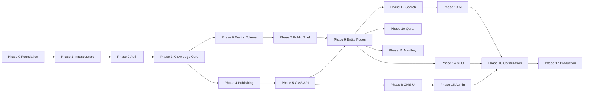
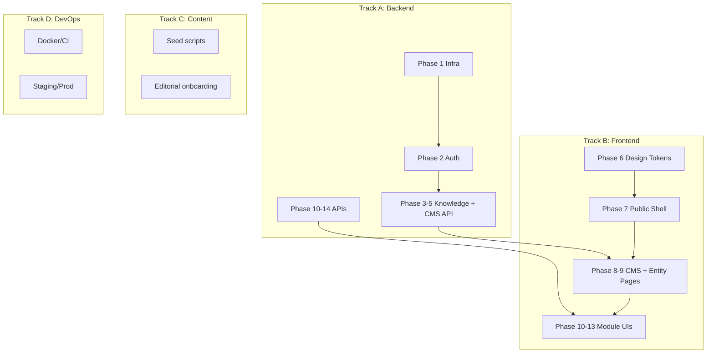
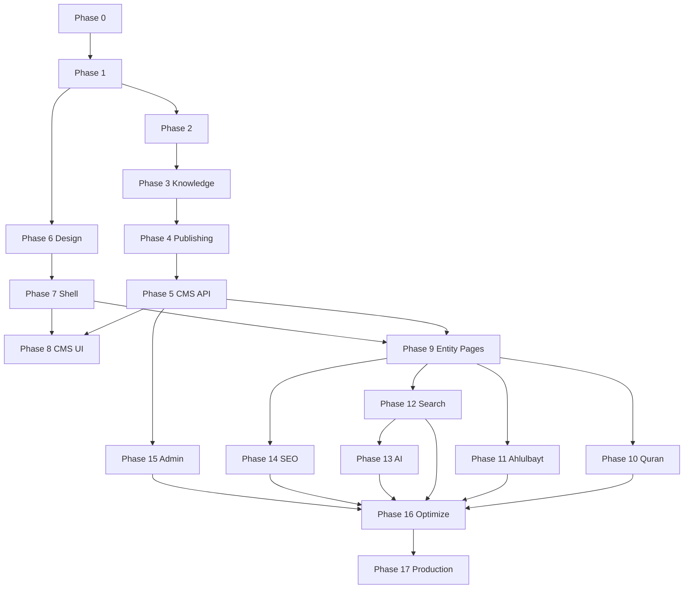
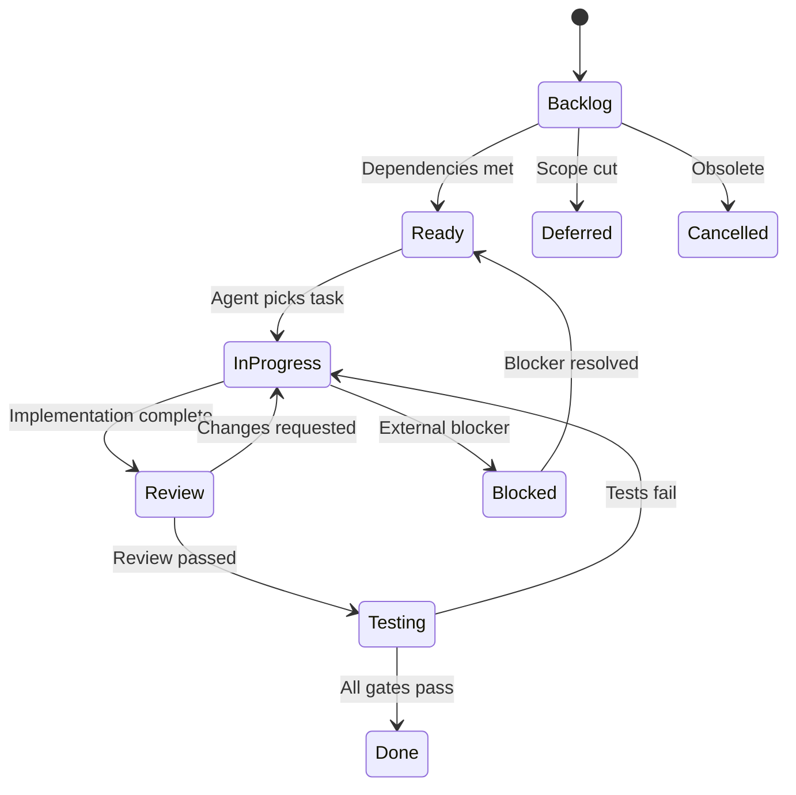

# Execution Roadmap

# ويكي العالمية — Wiki World

**Document Version:** 1.0  
**Status:** Authoritative — Master Execution Plan  
**Date:** July 7, 2026  
**Classification:** Internal — Engineering, Product, Project Management  
**Document Type:** Atomic Task Execution Blueprint  
**Methodology:** Vibe Coding — One AI-friendly task per session

---

## Document Control


| Field                  | Value                                                                                                                                                                                                                                                                                                                                              |
| ---------------------- | -------------------------------------------------------------------------------------------------------------------------------------------------------------------------------------------------------------------------------------------------------------------------------------------------------------------------------------------------- |
| Product Name (Arabic)  | ويكي العالمية                                                                                                                                                                                                                                                                                                                                      |
| Product Name (English) | Wiki World                                                                                                                                                                                                                                                                                                                                         |
| Document Owner         | CTO / Engineering Manager                                                                                                                                                                                                                                                                                                                          |
| Governing References   | [PRD.md](./PRD.md), [KNOWLEDGE_DOMAIN_BLUEPRINT.md](./KNOWLEDGE_DOMAIN_BLUEPRINT.md), [DATABASE_DESIGN.md](./DATABASE_DESIGN.md), [BACKEND_ARCHITECTURE.md](./BACKEND_ARCHITECTURE.md), [API_SPECIFICATION.md](./API_SPECIFICATION.md), [AI_ENGINEERING_CONSTITUTION.md](./AI_ENGINEERING_CONSTITUTION.md), [DESIGN_SYSTEM.md](./DESIGN_SYSTEM.md) |
| Target Task Count      | 295 atomic tasks (220 core MVP + 75 P1/P2)                                                                                                                                                                                                                                                                                                         |
| Target Task Duration   | 15–60 minutes each                                                                                                                                                                                                                                                                                                                                 |


### Revision History


| Version | Date       | Author                 | Changes                   |
| ------- | ---------- | ---------------------- | ------------------------- |
| 1.0     | 2026-07-07 | Engineering Management | Initial execution roadmap |


### How to Use This Document

1. Select **one** task with status `Ready` (dependencies met).
2. Copy the [AI Task Prompt Template](#10-ai-task-format) and fill in task details.
3. Implement, test, update docs, mark `Done`.
4. Never skip quality gates at phase boundaries.

---

## Table of Contents

1. [Project Overview](#1-project-overview)
2. [Development Phases](#2-development-phases)
3. [Sprint Planning](#3-sprint-planning)
4. [Atomic Task Breakdown](#4-atomic-task-breakdown)
5. [Parallel Development Opportunities](#5-parallel-development-opportunities)
6. [Dependency Graph](#6-dependency-graph)
7. [Milestones](#7-milestones)
8. [Quality Gates](#8-quality-gates)
9. [Risk Management](#9-risk-management)
10. [AI Task Format](#10-ai-task-format)
11. [Definition of Ready](#11-definition-of-ready)
12. [Definition of Done](#12-definition-of-done)
13. [Progress Tracking](#13-progress-tracking)
14. [Release Strategy](#14-release-strategy)
15. [Future Roadmap](#15-future-roadmap)

- [Appendix A: Task Index by Phase](#appendix-a-task-index-by-phase)
- [Appendix B: Critical Path Tasks](#appendix-b-critical-path-tasks)
- [Appendix C: Sprint Calendar (Suggested)](#appendix-c-sprint-calendar-suggested)

---

# 1. Project Overview

## 1.1 Execution Strategy

Wiki World is built **documentation-first, task-by-task**. Architecture documents define *what* to build; this roadmap defines *in what order* and *in what increments*.


| Principle             | Application                                                          |
| --------------------- | -------------------------------------------------------------------- |
| **Atomic tasks**      | Each task is 15–60 minutes, one concern, testable alone              |
| **Vibe Coding**       | AI agent implements one task per session with full context in prompt |
| **Vertical slices**   | Prefer end-to-end thin slices over horizontal "all models" layers    |
| **No big bang**       | Every completed task leaves the repo in a buildable state            |
| **Docs stay current** | Task not done until docs updated per AI Engineering Constitution     |


## 1.2 Why Atomic Tasks


| Problem with Large Tasks | Atomic Task Solution                     |
| ------------------------ | ---------------------------------------- |
| AI loses context         | Single-file or single-module focus       |
| Hard to review           | Small PRs, clear acceptance criteria     |
| Blocks parallel work     | Explicit dependencies enable parallelism |
| Regression risk          | Tests per task catch breaks early        |
| Unclear progress         | 220 checkboxes = measurable velocity     |


## 1.3 Team Model (Vibe Coding)


| Role                | Responsibility                                     |
| ------------------- | -------------------------------------------------- |
| Human architect     | Selects task, reviews output, approves phase gates |
| AI coding agent     | Implements one Ready task per session              |
| Human QA (optional) | Phase boundary testing, accessibility audit        |
| Editorial team      | Content seeding after CMS Ready milestone          |


## 1.4 Repository State (Starting Point)

Current state: **documentation only** — no application code. Task T-0001 begins greenfield implementation.

## 1.5 Success Definition (MVP)

Per PRD §9.5: Public website with Quran + Ahlulbayt modules, CMS, search, AI with citations, ar/en locales, 500+ indexed entities at 90 days.

---

# 2. Development Phases

## 2.1 Phase Map




## 2.2 Phase Definitions


| Phase | ID Range      | Name                         | Outcome                                                  |
| ----- | ------------- | ---------------------------- | -------------------------------------------------------- |
| 0     | T-0001–T-0015 | Foundation                   | Repo, Docker, CI skeleton, docs structure                |
| 1     | T-0016–T-0035 | Core Infrastructure          | Laravel 12, PostgreSQL, Redis, module scaffold           |
| 2     | T-0036–T-0053 | Authentication               | Register, login, Sanctum, roles, MFA stub                |
| 3     | T-0054–T-0078 | Knowledge Engine             | Entities, types, relationships, references, localization |
| 4     | T-0079–T-0093 | Publishing                   | Workflow state machine, versions, publish integrity      |
| 5     | T-0094–T-0113 | CMS API                      | Editorial endpoints per API Specification                |
| 6     | T-0114–T-0128 | Design System Implementation | CSS tokens, base components, Storybook                   |
| 7     | T-0129–T-0143 | Public Shell                 | Next.js app, i18n, layout, routing                       |
| 8     | T-0144–T-0163 | CMS UI                       | Editor, workflow, media library                          |
| 9     | T-0164–T-0183 | Public Entity Pages          | Article, person, event, source, book pages               |
| 10    | T-0184–T-0201 | Quran Module                 | Surah, verse, tafsir, cross-links                        |
| 11    | T-0202–T-0216 | Ahlulbayt Module             | Browse, genealogy, timeline                              |
| 12    | T-0217–T-0231 | Search                       | Meilisearch/FTS, suggestions, facets                     |
| 13    | T-0232–T-0249 | AI                           | RAG pipeline, chat UI, citations, flags                  |
| 14    | T-0250–T-0261 | SEO & Analytics              | Sitemap, structured data, view tracking                  |
| 15    | T-0262–T-0273 | Admin                        | Users, settings, audit, analytics dashboard              |
| 16    | T-0274–T-0285 | Optimization                 | Performance, a11y audit, security hardening              |
| 17    | T-0286–T-0295 | Production                   | Deploy, seed content, launch checklist                   |


**Total: 295 tasks** (220 P0 core MVP + 75 P1/P2 stretch; deferrable items in Appendix A).

## 2.3 Phase Dependencies


| Phase | Requires | Blocks                  |
| ----- | -------- | ----------------------- |
| 0     | —        | All                     |
| 1     | 0        | 2–17                    |
| 2     | 1        | 5, 8, 15                |
| 3     | 1        | 4, 5, 9, 10, 11, 12, 13 |
| 4     | 3        | 5, 8                    |
| 5     | 3, 4     | 8, 9                    |
| 6     | 0        | 7, 8, 9                 |
| 7     | 1, 6     | 9, 10, 11, 13           |
| 8     | 5, 6, 7  | 15                      |
| 9     | 5, 7     | 10, 11, 12, 13, 14      |
| 10    | 9        | 16                      |
| 11    | 9        | 16                      |
| 12    | 3, 9     | 13                      |
| 13    | 12       | 16                      |
| 14    | 9        | 16, 17                  |
| 15    | 2, 5     | 17                      |
| 16    | 10–15    | 17                      |
| 17    | 16       | Launch                  |


---

# 3. Sprint Planning

**Sprint length:** 2 weeks  
**Velocity assumption:** 40–50 tasks/sprint (Vibe Coding with AI, human review)  
**MVP timeline:** ~~5–6 sprints (~~10–12 weeks) to Production Ready

## 3.1 Sprint 1 — Foundation & Infrastructure


| Field             | Value                                                                             |
| ----------------- | --------------------------------------------------------------------------------- |
| **Objectives**    | Runnable local dev environment; Laravel modular monolith scaffold                 |
| **Tasks**         | T-0001 – T-0035                                                                   |
| **Effort**        | ~25 hours                                                                         |
| **Dependencies**  | None                                                                              |
| **Deliverables**  | Docker Compose, Laravel 12, PostgreSQL migrations base, Redis, module folders     |
| **Exit Criteria** | `docker compose up` works; `php artisan test` passes; health endpoint returns 200 |


## 3.2 Sprint 2 — Auth & Knowledge Core Start


| Field             | Value                                                        |
| ----------------- | ------------------------------------------------------------ |
| **Objectives**    | User auth complete; entity aggregate root functional         |
| **Tasks**         | T-0036 – T-0065                                              |
| **Effort**        | ~28 hours                                                    |
| **Dependencies**  | Sprint 1                                                     |
| **Deliverables**  | Register/login API, roles, entities table + create draft API |
| **Exit Criteria** | Editor can authenticate; create person draft via API         |


## 3.3 Sprint 3 — Knowledge Engine & Publishing


| Field             | Value                                                                     |
| ----------------- | ------------------------------------------------------------------------- |
| **Objectives**    | Full entity CRUD, relationships, publish workflow                         |
| **Tasks**         | T-0066 – T-0093                                                           |
| **Effort**        | ~30 hours                                                                 |
| **Dependencies**  | Sprint 2                                                                  |
| **Deliverables**  | Publish workflow, versions, references, localization                      |
| **Exit Criteria** | Senior editor can publish person entity; public API returns 404 for draft |


## 3.4 Sprint 4 — CMS API & Design System


| Field             | Value                                                               |
| ----------------- | ------------------------------------------------------------------- |
| **Objectives**    | Editorial API complete; frontend design tokens                      |
| **Tasks**         | T-0094 – T-0128                                                     |
| **Effort**        | ~32 hours                                                           |
| **Dependencies**  | Sprint 3                                                            |
| **Deliverables**  | All editorial endpoints; CSS tokens; Button, Input, Card components |
| **Exit Criteria** | API contract tests pass; Storybook runs with base components        |


## 3.5 Sprint 5 — Public Shell & CMS UI


| Field             | Value                                                          |
| ----------------- | -------------------------------------------------------------- |
| **Objectives**    | Public website shell; CMS editor functional                    |
| **Tasks**         | T-0129 – T-0163                                                |
| **Effort**        | ~35 hours                                                      |
| **Dependencies**  | Sprint 4                                                       |
| **Deliverables**  | Next.js ar/en routes, header/footer, block editor, workflow UI |
| **Exit Criteria** | Editor creates article in CMS; preview works                   |


## 3.6 Sprint 6 — Entity Pages & Modules


| Field             | Value                                                             |
| ----------------- | ----------------------------------------------------------------- |
| **Objectives**    | Public entity pages; Quran + Ahlulbayt modules                    |
| **Tasks**         | T-0164 – T-0216                                                   |
| **Effort**        | ~38 hours                                                         |
| **Dependencies**  | Sprint 5                                                          |
| **Deliverables**  | Person, article, event pages; Quran surah/verse; Ahlulbayt browse |
| **Exit Criteria** | Seed person page renders RTL; Quran 2:255 loads                   |


## 3.7 Sprint 7 — Search, AI, SEO


| Field             | Value                                               |
| ----------------- | --------------------------------------------------- |
| **Objectives**    | Search, AI chat, SEO infrastructure                 |
| **Tasks**         | T-0217 – T-0261                                     |
| **Effort**        | ~35 hours                                           |
| **Dependencies**  | Sprint 6                                            |
| **Deliverables**  | Search with facets; AI chat with citations; sitemap |
| **Exit Criteria** | AI answers include citations; sitemap.xml valid     |


## 3.8 Sprint 8 — Admin, Optimization, Production


| Field             | Value                                                 |
| ----------------- | ----------------------------------------------------- |
| **Objectives**    | Admin panel; performance; production deploy           |
| **Tasks**         | T-0262 – T-0295                                       |
| **Effort**        | ~30 hours                                             |
| **Dependencies**  | Sprint 7                                              |
| **Deliverables**  | Admin users/settings; Lighthouse pass; staging deploy |
| **Exit Criteria** | PRD §9.5 release criteria met                         |


---

# 4. Atomic Task Breakdown

## Task Record Format

Each task follows this schema:


| Field                   | Description                            |
| ----------------------- | -------------------------------------- |
| **ID**                  | `T-NNNN`                               |
| **Title**               | Imperative verb phrase                 |
| **Description**         | What to build                          |
| **Priority**            | P0 (blocker) / P1 (MVP) / P2 (stretch) |
| **Time**                | Estimated minutes                      |
| **Dependencies**        | Task IDs                               |
| **Acceptance Criteria** | Testable outcomes                      |
| **Files**               | Likely paths                           |
| **Tests**               | Required test type                     |
| **Docs**                | Docs to update                         |
| **Risk**                | Low / Medium / High                    |


---

## Phase 0: Foundation (T-0001 – T-0015)

### T-0001 — Initialize Git Repository and Monorepo Structure


| Field                   | Value                                                                                                                    |
| ----------------------- | ------------------------------------------------------------------------------------------------------------------------ |
| **Priority**            | P0                                                                                                                       |
| **Time**                | 30 min                                                                                                                   |
| **Dependencies**        | —                                                                                                                        |
| **Description**         | Create repo with `backend/`, `frontend/`, `docs/`, `docker/`, `.github/` folders. Add README, .gitignore, .editorconfig. |
| **Acceptance Criteria** | Repo structure matches Backend Architecture; docs/ preserved; README links governing docs                                |
| **Files**               | `README.md`, `.gitignore`, folder structure                                                                              |
| **Tests**               | —                                                                                                                        |
| **Docs**                | README only                                                                                                              |
| **Risk**                | Low                                                                                                                      |


### T-0002 — Docker Compose Base Services


| Field                   | Value                                                                                    |
| ----------------------- | ---------------------------------------------------------------------------------------- |
| **Priority**            | P0                                                                                       |
| **Time**                | 45 min                                                                                   |
| **Dependencies**        | T-0001                                                                                   |
| **Description**         | Docker Compose with postgres, redis, nginx placeholder. Volumes, networks, env template. |
| **Acceptance Criteria** | `docker compose up -d postgres redis` succeeds; postgres accepts connections             |
| **Files**               | `docker-compose.yml`, `docker/.env.example`                                              |
| **Tests**               | Manual connectivity                                                                      |
| **Docs**                | README setup section                                                                     |
| **Risk**                | Low                                                                                      |


### T-0003 — Laravel 12 Backend Scaffold


| Field                   | Value                                                                             |
| ----------------------- | --------------------------------------------------------------------------------- |
| **Priority**            | P0                                                                                |
| **Time**                | 45 min                                                                            |
| **Dependencies**        | T-0002                                                                            |
| **Description**         | Install Laravel 12 in `backend/`. PHP 8.4. Configure PostgreSQL, Redis in `.env`. |
| **Acceptance Criteria** | `php artisan serve` works; DB connection verified                                 |
| **Files**               | `backend/`*                                                                       |
| **Tests**               | Default Laravel tests pass                                                        |
| **Docs**                | README                                                                            |
| **Risk**                | Low                                                                               |


### T-0004 — Next.js Frontend Scaffold


| Field                   | Value                                                                     |
| ----------------------- | ------------------------------------------------------------------------- |
| **Priority**            | P0                                                                        |
| **Time**                | 30 min                                                                    |
| **Dependencies**        | T-0001                                                                    |
| **Description**         | Initialize Next.js App Router in `frontend/` with TypeScript strict mode. |
| **Acceptance Criteria** | `npm run dev` serves default page                                         |
| **Files**               | `frontend/`*                                                              |
| **Tests**               | Default build passes                                                      |
| **Docs**                | README                                                                    |
| **Risk**                | Low                                                                       |


### T-0005 — CI Pipeline Skeleton (GitHub Actions)


| Field                   | Value                                                  |
| ----------------------- | ------------------------------------------------------ |
| **Priority**            | P1                                                     |
| **Time**                | 45 min                                                 |
| **Dependencies**        | T-0003, T-0004                                         |
| **Description**         | CI workflow: backend tests, frontend lint/build on PR. |
| **Acceptance Criteria** | Push triggers CI; fails on lint error                  |
| **Files**               | `.github/workflows/ci.yml`                             |
| **Tests**               | CI self-test                                           |
| **Docs**                | README                                                 |
| **Risk**                | Low                                                    |


### T-0006 — Health Check Endpoints


| Field                   | Value                                               |
| ----------------------- | --------------------------------------------------- |
| **Priority**            | P0                                                  |
| **Time**                | 20 min                                              |
| **Dependencies**        | T-0003                                              |
| **Description**         | `GET /health` and `GET /health/ready` per API Spec. |
| **Acceptance Criteria** | Returns 200 JSON; ready checks DB + Redis           |
| **Files**               | `backend/routes/`, health controller                |
| **Tests**               | Feature test                                        |
| **Docs**                | —                                                   |
| **Risk**                | Low                                                 |


### T-0007 — API Route Prefix and Versioning


| Field                   | Value                                                             |
| ----------------------- | ----------------------------------------------------------------- |
| **Priority**            | P0                                                                |
| **Time**                | 20 min                                                            |
| **Dependencies**        | T-0003                                                            |
| **Description**         | Mount all routes under `/api/v1/`. Route service provider config. |
| **Acceptance Criteria** | All API routes prefixed; version constant defined                 |
| **Files**               | `backend/routes/api.php`, `RouteServiceProvider`                  |
| **Tests**               | Route list test                                                   |
| **Docs**                | —                                                                 |
| **Risk**                | Low                                                               |


### T-0008 — Standard API Error Envelope


| Field                   | Value                                                                         |
| ----------------------- | ----------------------------------------------------------------------------- |
| **Priority**            | P0                                                                            |
| **Time**                | 30 min                                                                        |
| **Dependencies**        | T-0007                                                                        |
| **Description**         | Global exception handler returning API Spec error envelope with `request_id`. |
| **Acceptance Criteria** | 404/422/500 return correct JSON shape                                         |
| **Files**               | `backend/app/Exceptions/Handler.php`                                          |
| **Tests**               | Feature tests per status code                                                 |
| **Docs**                | —                                                                             |
| **Risk**                | Low                                                                           |


### T-0009 — Request ID Middleware


| Field                   | Value                                                                   |
| ----------------------- | ----------------------------------------------------------------------- |
| **Priority**            | P1                                                                      |
| **Time**                | 20 min                                                                  |
| **Dependencies**        | T-0008                                                                  |
| **Description**         | Generate `X-Request-Id`; include in `meta.request_id` on all responses. |
| **Acceptance Criteria** | Every response has request_id; matches header                           |
| **Files**               | Middleware                                                              |
| **Tests**               | Feature test                                                            |
| **Docs**                | —                                                                       |
| **Risk**                | Low                                                                     |


### T-0010 — Module Directory Structure


| Field                   | Value                                                                                                     |
| ----------------------- | --------------------------------------------------------------------------------------------------------- |
| **Priority**            | P0                                                                                                        |
| **Time**                | 30 min                                                                                                    |
| **Dependencies**        | T-0003                                                                                                    |
| **Description**         | Create `app/Modules/` with KnowledgeCore, Authentication, Users folder skeleton per Backend Architecture. |
| **Acceptance Criteria** | PSR-4 autoload registered; empty module boots                                                             |
| **Files**               | `backend/app/Modules/`*                                                                                   |
| **Tests**               | Autoload test                                                                                             |
| **Docs**                | —                                                                                                         |
| **Risk**                | Low                                                                                                       |


### T-0011 — PHPUnit and Pest Configuration


| Field                   | Value                                                                 |
| ----------------------- | --------------------------------------------------------------------- |
| **Priority**            | P1                                                                    |
| **Time**                | 20 min                                                                |
| **Dependencies**        | T-0003                                                                |
| **Description**         | Configure test suites: Unit, Feature, Architecture. SQLite for tests. |
| **Acceptance Criteria** | `php artisan test` runs all suites                                    |
| **Files**               | `phpunit.xml`, `tests/`                                               |
| **Tests**               | Meta                                                                  |
| **Docs**                | —                                                                     |
| **Risk**                | Low                                                                   |


### T-0012 — Frontend ESLint and Prettier Config


| Field                   | Value                                        |
| ----------------------- | -------------------------------------------- |
| **Priority**            | P1                                           |
| **Time**                | 20 min                                       |
| **Dependencies**        | T-0004                                       |
| **Description**         | Strict ESLint, Prettier, import order rules. |
| **Acceptance Criteria** | `npm run lint` passes on scaffold            |
| **Files**               | `frontend/.eslintrc`, `prettier.config`      |
| **Tests**               | Lint in CI                                   |
| **Docs**                | —                                            |
| **Risk**                | Low                                          |


### T-0013 — Environment Variable Templates


| Field                   | Value                                                                      |
| ----------------------- | -------------------------------------------------------------------------- |
| **Priority**            | P0                                                                         |
| **Time**                | 20 min                                                                     |
| **Dependencies**        | T-0003, T-0004                                                             |
| **Description**         | `.env.example` for backend and frontend with all required keys documented. |
| **Acceptance Criteria** | No secrets; all vars documented inline                                     |
| **Files**               | `.env.example` files                                                       |
| **Tests**               | —                                                                          |
| **Docs**                | README                                                                     |
| **Risk**                | Low                                                                        |


### T-0014 — Docker App Container (PHP-FPM + Nginx)


| Field                   | Value                                             |
| ----------------------- | ------------------------------------------------- |
| **Priority**            | P1                                                |
| **Time**                | 45 min                                            |
| **Dependencies**        | T-0002, T-0003                                    |
| **Description**         | App and web containers; nginx proxies to PHP-FPM. |
| **Acceptance Criteria** | Full stack runs via `docker compose up`           |
| **Files**               | `docker/Dockerfile`, `docker/nginx.conf`          |
| **Tests**               | Manual                                            |
| **Docs**                | README                                            |
| **Risk**                | Medium                                            |


### T-0015 — Task Tracking File Setup


| Field                   | Value                                                                      |
| ----------------------- | -------------------------------------------------------------------------- |
| **Priority**            | P1                                                                         |
| **Time**                | 15 min                                                                     |
| **Dependencies**        | T-0001                                                                     |
| **Description**         | Create `PROJECT_TASKS.md` with task status table synced from this roadmap. |
| **Acceptance Criteria** | All T-0001–T-0295 listed with Backlog status                               |
| **Files**               | `PROJECT_TASKS.md`                                                         |
| **Tests**               | —                                                                          |
| **Docs**                | Self                                                                       |
| **Risk**                | Low                                                                        |


---

## Phase 1: Core Infrastructure (T-0016 – T-0035)

### T-0016 — Core Database Migrations: entity_types


| Field                   | Value                                                                    |
| ----------------------- | ------------------------------------------------------------------------ |
| **Priority**            | P0                                                                       |
| **Time**                | 30 min                                                                   |
| **Dependencies**        | T-0003                                                                   |
| **Description**         | Migration for `entity_types` per Database Design §5.2.1. Seed MVP types. |
| **Acceptance Criteria** | Table exists; 8+ entity types seeded                                     |
| **Files**               | `database/migrations/`, `seeders/`                                       |
| **Tests**               | Migration test                                                           |
| **Docs**                | —                                                                        |
| **Risk**                | Low                                                                      |


### T-0017 — Core Migration: entities


| Field                   | Value                                                     |
| ----------------------- | --------------------------------------------------------- |
| **Priority**            | P0                                                        |
| **Time**                | 30 min                                                    |
| **Dependencies**        | T-0016                                                    |
| **Description**         | `entities` table with uuid, workflow_state, soft deletes. |
| **Acceptance Criteria** | Matches Database Design; UUID v7 generated                |
| **Files**               | migrations                                                |
| **Tests**               | Unit test UUID generation                                 |
| **Docs**                | —                                                         |
| **Risk**                | Low                                                       |


### T-0018 — Core Migration: entity_localizations


| Field                   | Value                                         |
| ----------------------- | --------------------------------------------- |
| **Priority**            | P0                                            |
| **Time**                | 30 min                                        |
| **Dependencies**        | T-0017                                        |
| **Description**         | Localized title, slug, summary, blocks JSONB. |
| **Acceptance Criteria** | Unique slug per locale; FK to entities        |
| **Files**               | migrations                                    |
| **Tests**               | Migration test                                |
| **Docs**                | —                                             |
| **Risk**                | Low                                           |


### T-0019 — Profile Migrations: person_profiles


| Field                   | Value                                                |
| ----------------------- | ---------------------------------------------------- |
| **Priority**            | P0                                                   |
| **Time**                | 30 min                                               |
| **Dependencies**        | T-0017                                               |
| **Description**         | person_profiles extension table per Database Design. |
| **Acceptance Criteria** | FK to entities; Hijri date fields                    |
| **Files**               | migrations                                           |
| **Tests**               | Migration test                                       |
| **Docs**                | —                                                    |
| **Risk**                | Low                                                  |


### T-0020 — Profile Migrations: event, place, concept, source, book


| Field                   | Value                                                |
| ----------------------- | ---------------------------------------------------- |
| **Priority**            | P0                                                   |
| **Time**                | 45 min                                               |
| **Dependencies**        | T-0019                                               |
| **Description**         | Remaining MVP profile tables in one migration batch. |
| **Acceptance Criteria** | All profile tables per Database Design exist         |
| **Files**               | migrations                                           |
| **Tests**               | Migration test                                       |
| **Docs**                | —                                                    |
| **Risk**                | Medium                                               |


### T-0021 — Relationship Tables Migration


| Field                   | Value                                                                |
| ----------------------- | -------------------------------------------------------------------- |
| **Priority**            | P0                                                                   |
| **Time**                | 30 min                                                               |
| **Dependencies**        | T-0017                                                               |
| **Description**         | `relationship_types`, `entity_relationships` per Database Design §6. |
| **Acceptance Criteria** | Relationship type codes seeded                                       |
| **Files**               | migrations, seeders                                                  |
| **Tests**               | Migration test                                                       |
| **Docs**                | —                                                                    |
| **Risk**                | Low                                                                  |


### T-0022 — Reference Tables Migration


| Field                   | Value                              |
| ----------------------- | ---------------------------------- |
| **Priority**            | P0                                 |
| **Time**                | 25 min                             |
| **Dependencies**        | T-0017                             |
| **Description**         | `entity_references` for citations. |
| **Acceptance Criteria** | FK to entity and source            |
| **Files**               | migrations                         |
| **Tests**               | Migration test                     |
| **Docs**                | —                                  |
| **Risk**                | Low                                |


### T-0023 — Users and Roles Migrations


| Field                   | Value                                                       |
| ----------------------- | ----------------------------------------------------------- |
| **Priority**            | P0                                                          |
| **Time**                | 30 min                                                      |
| **Dependencies**        | T-0017                                                      |
| **Description**         | users, roles, permissions, role_user, editor_domain_scopes. |
| **Acceptance Criteria** | 6 MVP roles seeded                                          |
| **Files**               | migrations, seeders                                         |
| **Tests**               | Seeder test                                                 |
| **Docs**                | —                                                           |
| **Risk**                | Low                                                         |


### T-0024 — Publishing Tables Migration


| Field                   | Value                                           |
| ----------------------- | ----------------------------------------------- |
| **Priority**            | P0                                              |
| **Time**                | 30 min                                          |
| **Dependencies**        | T-0017                                          |
| **Description**         | entity_versions, workflow_history, submissions. |
| **Acceptance Criteria** | Version immutability enforced                   |
| **Files**               | migrations                                      |
| **Tests**               | Migration test                                  |
| **Docs**                | —                                               |
| **Risk**                | Low                                             |


### T-0025 — Media Tables Migration


| Field                   | Value                             |
| ----------------------- | --------------------------------- |
| **Priority**            | P1                                |
| **Time**                | 25 min                            |
| **Dependencies**        | T-0017                            |
| **Description**         | media_assets, entity_media pivot. |
| **Acceptance Criteria** | UUID, status enum, S3 path fields |
| **Files**               | migrations                        |
| **Tests**               | Migration test                    |
| **Docs**                | —                                 |
| **Risk**                | Low                               |


### T-0026 — Redis Cache Gateway


| Field                   | Value                                                                   |
| ----------------------- | ----------------------------------------------------------------------- |
| **Priority**            | P1                                                                      |
| **Time**                | 30 min                                                                  |
| **Dependencies**        | T-0002, T-0003                                                          |
| **Description**         | CacheGateway interface + Redis implementation per Backend Architecture. |
| **Acceptance Criteria** | get/set/delete with TTL; swappable interface                            |
| **Files**               | `Infrastructure/Cache/`                                                 |
| **Tests**               | Unit test with Redis fake                                               |
| **Docs**                | —                                                                       |
| **Risk**                | Low                                                                     |


### T-0027 — Queue Configuration and Worker Container


| Field                   | Value                                                   |
| ----------------------- | ------------------------------------------------------- |
| **Priority**            | P1                                                      |
| **Time**                | 30 min                                                  |
| **Dependencies**        | T-0014                                                  |
| **Description**         | Redis queue driver; worker container in Docker Compose. |
| **Acceptance Criteria** | Test job processes in worker                            |
| **Files**               | `docker-compose.yml`, queue config                      |
| **Tests**               | Job dispatch test                                       |
| **Docs**                | README                                                  |
| **Risk**                | Medium                                                  |


### T-0028 — S3 Storage Gateway (Local MinIO Dev)


| Field                   | Value                                                    |
| ----------------------- | -------------------------------------------------------- |
| **Priority**            | P1                                                       |
| **Time**                | 45 min                                                   |
| **Dependencies**        | T-0014                                                   |
| **Description**         | StorageGateway interface; MinIO in Docker for local dev. |
| **Acceptance Criteria** | Upload/download works in tests                           |
| **Files**               | `Infrastructure/Storage/`, docker                        |
| **Tests**               | Integration test                                         |
| **Docs**                | README                                                   |
| **Risk**                | Medium                                                   |


### T-0029 — Audit Log Migration and Logger


| Field                   | Value                                      |
| ----------------------- | ------------------------------------------ |
| **Priority**            | P1                                         |
| **Time**                | 30 min                                     |
| **Dependencies**        | T-0023                                     |
| **Description**         | audit_logs table + AuditLogger interface.  |
| **Acceptance Criteria** | Log entry created with actor, action, diff |
| **Files**               | migrations, `Infrastructure/Audit/`        |
| **Tests**               | Unit test                                  |
| **Docs**                | —                                          |
| **Risk**                | Low                                        |


### T-0030 — Feature Toggles Migration and Service


| Field                   | Value                                        |
| ----------------------- | -------------------------------------------- |
| **Priority**            | P2                                           |
| **Time**                | 25 min                                       |
| **Dependencies**        | T-0023                                       |
| **Description**         | feature_toggles table; FeatureToggleService. |
| **Acceptance Criteria** | Toggle read from DB; cached in Redis         |
| **Files**               | migrations, service                          |
| **Tests**               | Unit test                                    |
| **Docs**                | —                                            |
| **Risk**                | Low                                          |


### T-0031 — Settings Migration and Service


| Field                   | Value                                  |
| ----------------------- | -------------------------------------- |
| **Priority**            | P1                                     |
| **Time**                | 25 min                                 |
| **Dependencies**        | T-0023                                 |
| **Description**         | site_settings key-value store.         |
| **Acceptance Criteria** | Get/set settings; maintenance mode key |
| **Files**               | migrations, service                    |
| **Tests**               | Unit test                              |
| **Docs**                | —                                      |
| **Risk**                | Low                                    |


### T-0032 — Standard Pagination Macro


| Field                   | Value                                              |
| ----------------------- | -------------------------------------------------- |
| **Priority**            | P0                                                 |
| **Time**                | 20 min                                             |
| **Dependencies**        | T-0008                                             |
| **Description**         | API Spec pagination format helper for collections. |
| **Acceptance Criteria** | Returns data + meta.pagination + links             |
| **Files**               | `Support/Pagination/`                              |
| **Tests**               | Unit test                                          |
| **Docs**                | —                                                  |
| **Risk**                | Low                                                |


### T-0033 — Locale Middleware


| Field                   | Value                                                      |
| ----------------------- | ---------------------------------------------------------- |
| **Priority**            | P0                                                         |
| **Time**                | 30 min                                                     |
| **Dependencies**        | T-0007                                                     |
| **Description**         | Validate `{locale}` path segment (ar, en); set app locale. |
| **Acceptance Criteria** | Invalid locale returns 400; sets Content-Language header   |
| **Files**               | Middleware                                                 |
| **Tests**               | Feature test                                               |
| **Docs**                | —                                                          |
| **Risk**                | Low                                                        |


### T-0034 — Rate Limiter Gateway


| Field                   | Value                                    |
| ----------------------- | ---------------------------------------- |
| **Priority**            | P1                                       |
| **Time**                | 30 min                                   |
| **Dependencies**        | T-0026                                   |
| **Description**         | Redis rate limiter per API Spec limits.  |
| **Acceptance Criteria** | 429 with correct headers after threshold |
| **Files**               | `Infrastructure/RateLimit/`              |
| **Tests**               | Feature test                             |
| **Docs**                | —                                        |
| **Risk**                | Low                                      |


### T-0035 — Architecture Layer Boundary Test


| Field                   | Value                                               |
| ----------------------- | --------------------------------------------------- |
| **Priority**            | P1                                                  |
| **Time**                | 30 min                                              |
| **Dependencies**        | T-0010                                              |
| **Description**         | Static test: Domain does not import Infrastructure. |
| **Acceptance Criteria** | Test fails if boundary violated                     |
| **Files**               | `tests/Architecture/`                               |
| **Tests**               | Self                                                |
| **Docs**                | —                                                   |
| **Risk**                | Low                                                 |


---

## Phase 2: Authentication (T-0036 – T-0053)


| ID     | Title                         | Time | Deps           | Priority | Acceptance Criteria (summary)                            |
| ------ | ----------------------------- | ---- | -------------- | -------- | -------------------------------------------------------- |
| T-0036 | User model and repository     | 30m  | T-0023         | P0       | User CRUD; UUID; no BIGINT in API                        |
| T-0037 | Register API endpoint         | 30m  | T-0036         | P0       | POST /auth/register per API Spec; validation             |
| T-0038 | Login API endpoint            | 30m  | T-0036         | P0       | POST /auth/login; Sanctum token returned                 |
| T-0039 | Logout API endpoint           | 15m  | T-0038         | P0       | POST /auth/logout revokes token                          |
| T-0040 | Email verification flow       | 45m  | T-0037         | P0       | Verify email link; 403 if unverified on protected routes |
| T-0041 | Password reset flow           | 45m  | T-0036         | P0       | Forgot + reset endpoints; token expiry                   |
| T-0042 | Sanctum configuration         | 30m  | T-0038         | P0       | SPA cookie + API token modes                             |
| T-0043 | Role seeder and RoleResolver  | 30m  | T-0023         | P0       | 6 roles; permission matrix resolves                      |
| T-0044 | AuthorizationService          | 45m  | T-0043         | P0       | hasPermission(), hasRole(), checkDomainScope()           |
| T-0045 | Auth middleware for editorial | 20m  | T-0044         | P0       | editorial routes require editor+ role                    |
| T-0046 | Auth middleware for admin     | 20m  | T-0044         | P0       | admin routes require admin+ role                         |
| T-0047 | GET /me endpoint              | 30m  | T-0038         | P0       | Returns UserProfileDTO per API Spec                      |
| T-0048 | PATCH /me endpoint            | 25m  | T-0047         | P0       | Update display_name, preferred_locale                    |
| T-0049 | Account deletion endpoint     | 30m  | T-0047         | P1       | DELETE /me anonymizes user                               |
| T-0050 | Login rate limiting           | 20m  | T-0034, T-0038 | P0       | 5/15min per email                                        |
| T-0051 | MFA migration stub            | 25m  | T-0023         | P2       | mfa_secrets table; challenge endpoint stub               |
| T-0052 | Auth feature tests suite      | 45m  | T-0037–T-0048  | P0       | Full auth flow coverage                                  |
| T-0053 | Bookmarks migration           | 25m  | T-0023         | P1       | user_bookmarks table                                     |


---

## Phase 3: Knowledge Engine (T-0054 – T-0078)


| ID     | Title                                  | Time | Deps           | Priority | Acceptance Criteria (summary)               |
| ------ | -------------------------------------- | ---- | -------------- | -------- | ------------------------------------------- |
| T-0054 | Entity domain model                    | 45m  | T-0017         | P0       | Entity aggregate; workflow states enum      |
| T-0055 | EntityType value object                | 20m  | T-0016         | P0       | Type registry; immutable after create       |
| T-0056 | KnowledgeEntityRepository              | 45m  | T-0054         | P0       | findByUuid, save, soft delete               |
| T-0057 | CreateEntityDraft command/handler      | 45m  | T-0054, T-0044 | P0       | POST editorial/entities; domain scope check |
| T-0058 | SaveEntityDraft command/handler        | 45m  | T-0057         | P0       | PATCH editorial/entities/{uuid}             |
| T-0059 | Entity localization service            | 45m  | T-0018         | P0       | Add/update locale variant                   |
| T-0060 | Person profile service                 | 30m  | T-0019         | P0       | Type-specific profile CRUD                  |
| T-0061 | Event profile service                  | 30m  | T-0020         | P0       | Event profile fields                        |
| T-0062 | Place, concept, source, book profiles  | 45m  | T-0020         | P0       | All MVP profile types                       |
| T-0063 | RelationshipService                    | 45m  | T-0021         | P0       | Create/list/delete relationships            |
| T-0064 | Relationship type validation           | 30m  | T-0063         | P0       | 422 on invalid type combo                   |
| T-0065 | ReferenceService                       | 30m  | T-0022         | P0       | Attach citations to entities                |
| T-0066 | Alias migration and service            | 30m  | T-0017         | P1       | entity_aliases CRUD                         |
| T-0067 | EntityPublicDTO mapper                 | 30m  | T-0054         | P0       | Corpus-safe public view                     |
| T-0068 | EntityEditorialDTO mapper              | 30m  | T-0054         | P0       | Includes workflow, versions                 |
| T-0069 | GET public entity by UUID              | 30m  | T-0067, T-0033 | P0       | Published only; 404 for draft               |
| T-0070 | GET public entity relationships        | 30m  | T-0063, T-0069 | P0       | Per API Spec shape                          |
| T-0071 | GET editorial entity                   | 30m  | T-0068, T-0045 | P0       | Draft visible to authorized editor          |
| T-0072 | Entity list editorial                  | 30m  | T-0071         | P0       | Filters: type, state, domain                |
| T-0073 | Content block validator                | 30m  | T-0058         | P0       | Whitelist HTML tags per API Spec            |
| T-0074 | Slug uniqueness validator              | 25m  | T-0059         | P0       | 409 on conflict                             |
| T-0075 | Entity cache layer                     | 30m  | T-0026, T-0069 | P1       | entity:{uuid}:{locale} 15min TTL            |
| T-0076 | Public articles endpoints              | 30m  | T-0069         | P0       | GET /articles, /articles/{uuid}             |
| T-0077 | Public persons/events/places endpoints | 45m  | T-0069         | P0       | Type-specific public routes                 |
| T-0078 | Knowledge core feature tests           | 45m  | T-0057–T-0077  | P0       | CRUD + corpus safety tests                  |


---

## Phase 4: Publishing (T-0079 – T-0093)


| ID     | Title                        | Time | Deps           | Priority | Acceptance Criteria (summary)             |
| ------ | ---------------------------- | ---- | -------------- | -------- | ----------------------------------------- |
| T-0079 | PublishingWorkflowService    | 45m  | T-0054         | P0       | State machine per Database Design         |
| T-0080 | PublishIntegrityValidator    | 45m  | T-0065         | P0       | Min sources, slug, required fields        |
| T-0081 | SubmitForReview command      | 30m  | T-0079         | P0       | draft → submitted                         |
| T-0082 | ReviewSubmission command     | 30m  | T-0079, T-0044 | P0       | Senior editor approve/reject              |
| T-0083 | PublishEntity command        | 45m  | T-0079, T-0080 | P0       | Sets published_at; creates version        |
| T-0084 | UnpublishEntity command      | 25m  | T-0083         | P0       | published → unpublished                   |
| T-0085 | ArchiveEntity command        | 25m  | T-0083         | P1       | published → archived                      |
| T-0086 | Entity version snapshots     | 45m  | T-0024         | P0       | Immutable version on each save            |
| T-0087 | Version list and restore     | 45m  | T-0086         | P1       | GET versions; restore creates new version |
| T-0088 | EntityPublished domain event | 20m  | T-0083         | P0       | Event dispatched on publish               |
| T-0089 | Publish audit logging        | 20m  | T-0029, T-0083 | P0       | Audit entry on publish/unpublish          |
| T-0090 | Publish readiness endpoint   | 30m  | T-0080         | P0       | GET publish-readiness checklist           |
| T-0091 | Preview endpoint             | 30m  | T-0067, T-0071 | P0       | Public-shaped draft preview               |
| T-0092 | Workflow API routes          | 30m  | T-0081–T-0085  | P0       | submit, review, publish, unpublish        |
| T-0093 | Publishing workflow tests    | 45m  | T-0079–T-0092  | P0       | All transitions + invalid transition 409  |


---

## Phase 5: CMS API (T-0094 – T-0113)


| ID     | Title                              | Time | Deps           | Priority | Acceptance Criteria (summary)           |
| ------ | ---------------------------------- | ---- | -------------- | -------- | --------------------------------------- |
| T-0094 | Editorial dashboard endpoint       | 30m  | T-0072, T-0045 | P0       | GET /editorial/dashboard                |
| T-0095 | Editorial drafts shortcut endpoint | 20m  | T-0072         | P1       | GET /editorial/drafts                   |
| T-0096 | Submissions list endpoint          | 30m  | T-0081         | P0       | GET /editorial/submissions              |
| T-0097 | Review history endpoint            | 25m  | T-0082         | P1       | GET /editorial/reviews/history          |
| T-0098 | Editorial activity feed            | 25m  | T-0029         | P1       | GET /editorial/activity                 |
| T-0099 | Editorial entity search            | 30m  | T-0072         | P0       | GET /editorial/search/entities          |
| T-0100 | Editorial SEO fields endpoints     | 30m  | T-0071         | P0       | GET/PATCH editorial/entities/{uuid}/seo |
| T-0101 | Media upload endpoint              | 45m  | T-0028, T-0025 | P0       | POST /editorial/media multipart         |
| T-0102 | Media library list endpoint        | 25m  | T-0101         | P0       | GET /editorial/media with filters       |
| T-0103 | Media metadata PATCH               | 20m  | T-0101         | P0       | alt_text required validation            |
| T-0104 | Media attach to entity             | 30m  | T-0101, T-0058 | P0       | POST entity media attach                |
| T-0105 | Image variant queue job            | 45m  | T-0027, T-0101 | P1       | thumbnail, medium, large WebP           |
| T-0106 | Signed URL endpoint                | 25m  | T-0101         | P1       | POST signed-url for drafts              |
| T-0107 | Editorial settings endpoint        | 20m  | T-0031         | P1       | GET /editorial/settings                 |
| T-0108 | Translations queue endpoint        | 25m  | T-0059         | P1       | GET /editorial/translations/queue       |
| T-0109 | Editorial analytics endpoint       | 30m  | T-0083         | P1       | GET /editorial/analytics                |
| T-0110 | Account bookmarks API              | 30m  | T-0053, T-0047 | P1       | GET/POST/DELETE /me/bookmarks           |
| T-0111 | Reading history API                | 30m  | T-0047         | P1       | GET/DELETE /me/history                  |
| T-0112 | Saved searches API                 | 30m  | T-0047         | P1       | CRUD /me/saved-searches                 |
| T-0113 | CMS API contract tests             | 60m  | T-0094–T-0112  | P0       | All editorial endpoints tested          |


---

## Phase 6: Design System Implementation (T-0114 – T-0128)


| ID     | Title                        | Time | Deps           | Priority | Acceptance Criteria (summary)           |
| ------ | ---------------------------- | ---- | -------------- | -------- | --------------------------------------- |
| T-0114 | CSS design tokens file       | 30m  | T-0004         | P0       | All tokens from DESIGN_SYSTEM §20       |
| T-0115 | Dark mode theme toggle       | 30m  | T-0114         | P0       | data-theme attribute; system preference |
| T-0116 | Typography base styles       | 30m  | T-0114         | P0       | Arabic + Latin font loading             |
| T-0117 | Button component             | 30m  | T-0114         | P0       | All variants per DESIGN_SYSTEM §10.1    |
| T-0118 | Input component              | 30m  | T-0114         | P0       | States, error, label                    |
| T-0119 | Card component               | 25m  | T-0114         | P0       | Base + interactive variants             |
| T-0120 | Badge component              | 20m  | T-0114         | P0       | Entity type + workflow badges           |
| T-0121 | Alert component              | 25m  | T-0114         | P0       | info/success/warning/error              |
| T-0122 | Dialog and Drawer components | 45m  | T-0114         | P0       | Focus trap, Escape close                |
| T-0123 | Tabs component               | 30m  | T-0114         | P0       | Keyboard navigable                      |
| T-0124 | Skeleton loader component    | 20m  | T-0114         | P0       | Pulse animation; reduced motion         |
| T-0125 | EntityCard component         | 45m  | T-0119, T-0120 | P0       | sm/md/lg variants                       |
| T-0126 | CitationBlock component      | 30m  | T-0119         | P0       | Per DESIGN_SYSTEM §10.17                |
| T-0127 | Storybook setup              | 45m  | T-0117–T-0126  | P1       | All base components documented          |
| T-0128 | i18n file structure          | 30m  | T-0004         | P0       | ar.json, en.json; no hardcoded strings  |


---

## Phase 7: Public Shell (T-0129 – T-0143)


| ID     | Title                           | Time | Deps           | Priority | Acceptance Criteria (summary)                      |
| ------ | ------------------------------- | ---- | -------------- | -------- | -------------------------------------------------- |
| T-0129 | Next.js locale routing [locale] | 45m  | T-0004, T-0128 | P0       | /ar/, /en/ routes; dir attribute                   |
| T-0130 | API client with typed responses | 45m  | T-0007         | P0       | Error envelope parsing; snake_case                 |
| T-0131 | Root layout with header/footer  | 45m  | T-0129, T-0116 | P0       | RTL/LTR; design tokens                             |
| T-0132 | Global header component         | 30m  | T-0131         | P0       | Logo, nav, search, lang, AI trigger                |
| T-0133 | Global footer component         | 25m  | T-0131         | P0       | Links, trust statement                             |
| T-0134 | Language toggle component       | 30m  | T-0129         | P0       | Switches locale route                              |
| T-0135 | Homepage layout                 | 45m  | T-0131         | P0       | Hero, search, module cards per DESIGN_SYSTEM App D |
| T-0136 | Homepage API integration        | 30m  | T-0135, T-0130 | P0       | Featured, trending from API                        |
| T-0137 | Breadcrumb component            | 25m  | T-0131         | P0       | RTL-aware separators                               |
| T-0138 | Pagination component            | 25m  | T-0117         | P0       | Offset + cursor variants                           |
| T-0139 | Empty state component           | 25m  | T-0114         | P0       | Per DESIGN_SYSTEM §19                              |
| T-0140 | Error boundary and error pages  | 30m  | T-0131         | P0       | 404, 500 pages                                     |
| T-0141 | Maintenance mode page           | 20m  | T-0031         | P1       | Shown when maintenance enabled                     |
| T-0142 | Auth pages (login/register)     | 45m  | T-0130, T-0117 | P0       | Forms call auth API                                |
| T-0143 | Account settings page           | 30m  | T-0142, T-0047 | P1       | PATCH /me                                          |


---

## Phase 8: CMS UI (T-0144 – T-0163)


| ID     | Title                           | Time | Deps           | Priority | Acceptance Criteria (summary)   |
| ------ | ------------------------------- | ---- | -------------- | -------- | ------------------------------- |
| T-0144 | CMS layout shell                | 45m  | T-0131         | P0       | Icon nav + editor + panel       |
| T-0145 | Editorial auth guard            | 30m  | T-0142, T-0045 | P0       | Redirect if not editor          |
| T-0146 | CMS dashboard page              | 45m  | T-0094, T-0144 | P0       | Drafts, reviews, stats widgets  |
| T-0147 | Entity list page (CMS)          | 45m  | T-0072, T-0144 | P0       | Filters, sort, status badges    |
| T-0148 | Block editor component          | 60m  | T-0118         | P0       | paragraph, heading, quote, list |
| T-0149 | Block editor: citation block    | 30m  | T-0148, T-0126 | P0       | Source picker integration       |
| T-0150 | Block editor: entity link block | 30m  | T-0148, T-0099 | P0       | @ mention picker                |
| T-0151 | Block editor: image block       | 30m  | T-0148, T-0101 | P0       | Media picker                    |
| T-0152 | Entity editor page              | 60m  | T-0058, T-0148 | P0       | Title, slug, summary, blocks    |
| T-0153 | Autosave with debounce          | 30m  | T-0152         | P0       | 2s debounce; status indicator   |
| T-0154 | Workflow action buttons         | 30m  | T-0092, T-0152 | P0       | Submit, publish per role        |
| T-0155 | Publish checklist drawer        | 30m  | T-0090, T-0154 | P0       | Green/red checklist items       |
| T-0156 | Preview panel                   | 30m  | T-0091, T-0152 | P0       | iframe or API preview           |
| T-0157 | Review queue page               | 45m  | T-0096, T-0144 | P0       | Approve/reject UI               |
| T-0158 | Media library page              | 45m  | T-0102, T-0144 | P0       | Grid, upload, filters           |
| T-0159 | Entity relationship editor      | 45m  | T-0063, T-0152 | P0       | Add/remove relationships        |
| T-0160 | Source reference editor         | 30m  | T-0065, T-0152 | P0       | Attach citations                |
| T-0161 | SEO fields panel                | 25m  | T-0100, T-0152 | P0       | Meta title, description         |
| T-0162 | Version history panel           | 30m  | T-0086, T-0152 | P1       | List versions; view snapshot    |
| T-0163 | CMS keyboard shortcuts          | 30m  | T-0152         | P1       | Cmd+S, Cmd+K per DESIGN_SYSTEM  |


---

## Phase 9: Public Entity Pages (T-0164 – T-0183)


| ID     | Title                               | Time | Deps           | Priority | Acceptance Criteria (summary)   |
| ------ | ----------------------------------- | ---- | -------------- | -------- | ------------------------------- |
| T-0164 | Entity page layout template         | 45m  | T-0131         | P0       | Reading layout + sidebar        |
| T-0165 | Infobox component                   | 45m  | T-0164         | P0       | Per DESIGN_SYSTEM App H         |
| T-0166 | Content block renderer              | 45m  | T-0164         | P0       | Renders all public block types  |
| T-0167 | Person public page                  | 45m  | T-0077, T-0164 | P0       | RTL; infobox; relationships     |
| T-0168 | Article public page                 | 45m  | T-0076, T-0164 | P0       | TOC, reading time, citations    |
| T-0169 | Event public page                   | 30m  | T-0077, T-0164 | P0       | Date, place, participants       |
| T-0170 | Place public page                   | 30m  | T-0077, T-0164 | P0       | Map link, coordinates           |
| T-0171 | Concept public page                 | 30m  | T-0077, T-0164 | P0       | Arabic term, definition         |
| T-0172 | Source public page                  | 30m  | T-0077, T-0164 | P0       | Reliability tier badge          |
| T-0173 | Book public page + chapters         | 45m  | T-0077, T-0164 | P0       | TOC, chapter reader             |
| T-0174 | Related entities panel              | 30m  | T-0070, T-0164 | P0       | Horizontal scroll cards         |
| T-0175 | Sticky TOC component                | 30m  | T-0168         | P0       | Highlights current section      |
| T-0176 | Reading progress bar                | 20m  | T-0168         | P1       | Top of viewport                 |
| T-0177 | Citation popover                    | 30m  | T-0126, T-0168 | P0       | Click citation → source preview |
| T-0178 | Entity SEO metadata injection       | 30m  | T-0164         | P0       | JSON-LD, hreflang, canonical    |
| T-0179 | Browse/list pages (persons, events) | 45m  | T-0077, T-0138 | P0       | Filters, pagination             |
| T-0180 | Bookmarks UI (registered)           | 30m  | T-0110, T-0143 | P1       | Add/remove bookmark             |
| T-0181 | Reading history UI                  | 25m  | T-0111         | P1       | Recent views list               |
| T-0182 | Public entity page tests (E2E)      | 45m  | T-0167–T-0173  | P0       | Playwright: page loads, RTL     |
| T-0183 | Corpus safety E2E test              | 30m  | T-0167         | P0       | Draft UUID returns 404 public   |


---

## Phase 10: Quran Module (T-0184 – T-0201)


| ID     | Title                          | Time | Deps           | Priority | Acceptance Criteria (summary)           |
| ------ | ------------------------------ | ---- | -------------- | -------- | --------------------------------------- |
| T-0184 | Quran corpus migrations        | 45m  | T-0017         | P0       | quran_surahs, quran_verses, corpus seed |
| T-0185 | Quran verse entity seed        | 60m  | T-0184         | P0       | 6236 verses linked to entities          |
| T-0186 | Translation profiles migration | 30m  | T-0184         | P0       | translation_profiles table              |
| T-0187 | Tafsir profiles migration      | 30m  | T-0184         | P0       | tafsir_profiles table                   |
| T-0188 | GET /quran/surahs API          | 30m  | T-0184, T-0033 | P0       | 114 surahs index                        |
| T-0189 | GET /quran/surahs/{n} API      | 30m  | T-0188         | P0       | Surah detail                            |
| T-0190 | GET /quran/verses/{s}:{a} API  | 30m  | T-0185         | P0       | Compound key + UUID                     |
| T-0191 | GET surah verses list API      | 30m  | T-0190         | P0       | All ayahs in surah                      |
| T-0192 | Quran translations API         | 30m  | T-0186         | P0       | Per API Spec                            |
| T-0193 | Quran tafsir API               | 30m  | T-0187         | P0       | Per API Spec                            |
| T-0194 | Quran topics migration + API   | 45m  | T-0185         | P1       | Topics index                            |
| T-0195 | Quran cross-references         | 45m  | T-0190         | P1       | Cross-ref table + API                   |
| T-0196 | Quran module landing page      | 45m  | T-0188, T-0135 | P0       | /ar/quran                               |
| T-0197 | Surah list page                | 30m  | T-0196         | P0       | 114 grid                                |
| T-0198 | Surah reader page              | 45m  | T-0191         | P0       | Verse blocks, Uthmanic font             |
| T-0199 | Verse detail page              | 45m  | T-0190         | P0       | Translation, tafsir tabs                |
| T-0200 | VerseBlock component           | 30m  | T-0116, T-0198 | P0       | Per DESIGN_SYSTEM §10.18                |
| T-0201 | Quran module tests             | 45m  | T-0188–T-0199  | P0       | API + E2E 2:255                         |


---

## Phase 11: Ahlulbayt Module (T-0202 – T-0216)


| ID     | Title                           | Time | Deps           | Priority | Acceptance Criteria (summary) |
| ------ | ------------------------------- | ---- | -------------- | -------- | ----------------------------- |
| T-0202 | Ahlulbayt module landing API    | 30m  | T-0077         | P0       | GET /ahlulbayt                |
| T-0203 | Ahlulbayt browse API            | 30m  | T-0077         | P0       | Filters: generation, masum    |
| T-0204 | Genealogy API                   | 45m  | T-0063         | P0       | Tree structure                |
| T-0205 | Person lineage API              | 30m  | T-0063         | P0       | Ancestors/descendants         |
| T-0206 | Ahlulbayt timeline API          | 30m  | T-0077         | P1       | Module-scoped timeline        |
| T-0207 | Module landing page UI          | 45m  | T-0202         | P0       | Featured persons, events      |
| T-0208 | Browse page UI                  | 30m  | T-0203         | P0       | Filters, entity grid          |
| T-0209 | Genealogy tree component        | 60m  | T-0204         | P0       | Collapsible tree              |
| T-0210 | Person lineage panel            | 30m  | T-0205, T-0167 | P0       | On person pages               |
| T-0211 | Timeline component              | 45m  | T-0206         | P0       | Vertical spine, era chips     |
| T-0212 | Timeline page                   | 45m  | T-0211         | P0       | /ar/timeline                  |
| T-0213 | Ahlulbayt person filter         | 20m  | T-0179         | P0       | filter[module]=ahlulbayt      |
| T-0214 | 14 Ma'sumin seed content script | 60m  | T-0167         | P0       | Seed data for launch          |
| T-0215 | Key events seed content         | 45m  | T-0169         | P0       | Karbala, Ghadir, etc.         |
| T-0216 | Ahlulbayt module E2E tests      | 30m  | T-0207–T-0212  | P0       | Browse, person, timeline      |


---

## Phase 12: Search (T-0217 – T-0231)


| ID     | Title                             | Time | Deps           | Priority | Acceptance Criteria (summary)  |
| ------ | --------------------------------- | ---- | -------------- | -------- | ------------------------------ |
| T-0217 | search_documents migration        | 30m  | T-0017         | P0       | Search index table             |
| T-0218 | Meilisearch Docker service        | 30m  | T-0014         | P1       | Meilisearch in compose         |
| T-0219 | SearchIndexGateway interface      | 30m  | T-0218         | P0       | Swappable adapter              |
| T-0220 | MeilisearchGateway implementation | 45m  | T-0219         | P1       | Index CRUD                     |
| T-0221 | PostgresFTS fallback gateway      | 45m  | T-0217         | P0       | Works without Meilisearch      |
| T-0222 | IndexEntityOnPublish listener     | 30m  | T-0088, T-0219 | P0       | Async reindex job              |
| T-0223 | GET /search API                   | 45m  | T-0219, T-0033 | P0       | q, filters, facets, pagination |
| T-0224 | GET /search/suggestions API       | 30m  | T-0223         | P0       | Autocomplete                   |
| T-0225 | GET /search/related API           | 30m  | T-0223         | P1       | Related entities               |
| T-0226 | Search page UI                    | 45m  | T-0223, T-0131 | P0       | Filters drawer, results        |
| T-0227 | SearchBar with suggestions        | 45m  | T-0224, T-0132 | P0       | Debounced autocomplete         |
| T-0228 | Search highlight rendering        | 25m  | T-0226         | P0       | Highlight matches              |
| T-0229 | Zero results empty state          | 20m  | T-0226, T-0139 | P0       | Suggestions shown              |
| T-0230 | Quran scoped search               | 30m  | T-0223         | P1       | GET /quran/search              |
| T-0231 | Search tests                      | 45m  | T-0223–T-0229  | P0       | Arabic query, facets           |


---

## Phase 13: AI (T-0232 – T-0249)


| ID     | Title                              | Time | Deps           | Priority | Acceptance Criteria (summary)   |
| ------ | ---------------------------------- | ---- | -------------- | -------- | ------------------------------- |
| T-0232 | AI conversations migration         | 25m  | T-0023         | P0       | ai_conversations, ai_messages   |
| T-0233 | LLMProviderGateway interface       | 30m  | T-0003         | P0       | Swappable OpenAI adapter        |
| T-0234 | OpenAIGateway implementation       | 45m  | T-0233         | P0       | Chat completion                 |
| T-0235 | EmbeddingGateway interface         | 30m  | T-0233         | P1       | For semantic search             |
| T-0236 | Corpus retrieval service           | 60m  | T-0223         | P0       | Published entities only         |
| T-0237 | RAG pipeline service               | 60m  | T-0234, T-0236 | P0       | Retrieve + generate + cite      |
| T-0238 | AI refusal policy handler          | 30m  | T-0237         | P0       | Fatwa requests refused          |
| T-0239 | POST /ai/chat API                  | 45m  | T-0237, T-0034 | P0       | Citations mandatory             |
| T-0240 | AI streaming SSE response          | 45m  | T-0239         | P0       | text/event-stream               |
| T-0241 | AI rate limiting                   | 20m  | T-0034, T-0239 | P0       | 10/hr anon, 50/hr registered    |
| T-0242 | Conversation history API           | 30m  | T-0232, T-0047 | P1       | GET/DELETE /me/ai/conversations |
| T-0243 | AI flags migration + editorial API | 30m  | T-0232         | P1       | Flag resolution                 |
| T-0244 | AI recommendations API             | 30m  | T-0237         | P1       | GET /ai/recommendations         |
| T-0245 | AI drawer UI component             | 45m  | T-0122, T-0132 | P0       | Chat interface                  |
| T-0246 | AI message + citation chips UI     | 45m  | T-0245, T-0126 | P0       | Per DESIGN_SYSTEM §15           |
| T-0247 | AI disclaimer component            | 20m  | T-0245         | P0       | Non-dismissable first use       |
| T-0248 | AI streaming client                | 45m  | T-0240, T-0245 | P0       | SSE parser; aria-live           |
| T-0249 | AI tests (citation audit)          | 60m  | T-0237–T-0248  | P0       | 95% citation coverage mock      |


---

## Phase 14: SEO & Analytics (T-0250 – T-0261)


| ID     | Title                           | Time | Deps           | Priority | Acceptance Criteria (summary) |
| ------ | ------------------------------- | ---- | -------------- | -------- | ----------------------------- |
| T-0250 | SEO metadata migration          | 25m  | T-0017         | P0       | seo_fields table              |
| T-0251 | StructuredDataService           | 45m  | T-0067         | P0       | JSON-LD per entity type       |
| T-0252 | Sitemap generation job          | 45m  | T-0088         | P0       | Regenerate on publish         |
| T-0253 | GET /sitemap.xml                | 30m  | T-0252         | P0       | Valid XML                     |
| T-0254 | GET /robots.txt                 | 15m  | T-0031         | P0       | Per API Spec                  |
| T-0255 | Redirects admin migration + API | 30m  | T-0031         | P1       | 301 redirects                 |
| T-0256 | Analytics views migration       | 25m  | T-0017         | P0       | page_views table              |
| T-0257 | POST /analytics/views           | 20m  | T-0256         | P0       | Fire-and-forget 202           |
| T-0258 | Popular/trending API            | 30m  | T-0256         | P1       | GET analytics/popular         |
| T-0259 | SEO head component (Next.js)    | 30m  | T-0178         | P0       | meta, canonical, hreflang     |
| T-0260 | RegenerateStructuredData job    | 25m  | T-0251, T-0088 | P0       | On publish async              |
| T-0261 | SEO tests                       | 30m  | T-0253–T-0259  | P0       | Sitemap valid; JSON-LD valid  |


---

## Phase 15: Admin (T-0262 – T-0273)


| ID     | Title                        | Time | Deps           | Priority | Acceptance Criteria (summary) |
| ------ | ---------------------------- | ---- | -------------- | -------- | ----------------------------- |
| T-0262 | Admin layout shell           | 30m  | T-0131, T-0046 | P0       | Sidebar nav                   |
| T-0263 | Admin users list API         | 30m  | T-0046         | P0       | GET /admin/users              |
| T-0264 | Admin user create/update API | 45m  | T-0263         | P0       | POST/PATCH users              |
| T-0265 | Admin roles assignment API   | 30m  | T-0043         | P0       | POST/DELETE user roles        |
| T-0266 | Admin domain scopes API      | 30m  | T-0044         | P0       | PUT domain-scopes             |
| T-0267 | Admin settings API           | 30m  | T-0031         | P0       | GET/PATCH settings            |
| T-0268 | Admin feature toggles API    | 25m  | T-0030         | P1       | PATCH toggles                 |
| T-0269 | Admin audit logs API         | 30m  | T-0029         | P0       | GET /admin/audit-logs         |
| T-0270 | Admin analytics overview API | 45m  | T-0256         | P1       | GET /admin/analytics/overview |
| T-0271 | Admin users page UI          | 45m  | T-0263, T-0262 | P0       | Table, role assign            |
| T-0272 | Admin settings page UI       | 30m  | T-0267         | P0       | Maintenance mode toggle       |
| T-0273 | Admin audit log page UI      | 30m  | T-0269         | P1       | Filterable table              |


---

## Phase 16: Optimization (T-0274 – T-0285)


| ID     | Title                           | Time | Deps          | Priority | Acceptance Criteria (summary) |
| ------ | ------------------------------- | ---- | ------------- | -------- | ----------------------------- |
| T-0274 | Entity page Redis caching       | 30m  | T-0075        | P1       | Cache hit ratio > 80%         |
| T-0275 | Image CDN configuration         | 30m  | T-0105        | P1       | CDN URLs in responses         |
| T-0276 | Next.js ISR for public entities | 45m  | T-0167        | P1       | Revalidate on publish webhook |
| T-0277 | Font subsetting and preload     | 30m  | T-0116        | P0       | LCP < 2.5s                    |
| T-0278 | Bundle analysis and code split  | 45m  | T-0131        | P0       | CMS chunks separate           |
| T-0279 | WCAG accessibility audit fixes  | 60m  | T-0167–T-0248 | P0       | axe scan passes               |
| T-0280 | RTL cross-browser QA fixes      | 45m  | T-0131        | P0       | Safari, Firefox RTL           |
| T-0281 | Security audit fixes            | 60m  | All API       | P0       | IDOR, XSS, CSRF verified      |
| T-0282 | Performance profiling           | 45m  | T-0167        | P0       | p95 public GET < 200ms        |
| T-0283 | Load test (10k concurrent)      | 45m  | T-0282        | P1       | NFR-SCALE-002                 |
| T-0284 | AI 100-question citation audit  | 60m  | T-0249        | P0       | ≥ 95% per PRD                 |
| T-0285 | Full regression test suite      | 60m  | All           | P0       | All tests green               |


---

## Phase 17: Production (T-0286 – T-0295)


| ID     | Title                         | Time | Deps           | Priority | Acceptance Criteria (summary) |
| ------ | ----------------------------- | ---- | -------------- | -------- | ----------------------------- |
| T-0286 | Staging environment setup     | 60m  | T-0014         | P0       | Staging deploy works          |
| T-0287 | Production environment setup  | 60m  | T-0286         | P0       | Prod infra ready              |
| T-0288 | SSL, HSTS, security headers   | 30m  | T-0287         | P0       | NFR-SEC-001                   |
| T-0289 | Database backup automation    | 30m  | T-0287         | P0       | Daily backups                 |
| T-0290 | Monitoring and alerting       | 45m  | T-0287         | P0       | Error rate, latency alerts    |
| T-0291 | Seed content deployment       | 60m  | T-0214, T-0215 | P0       | Launch minimums met           |
| T-0292 | Editorial team onboarding     | 45m  | T-0163         | P0       | 2 senior editors trained      |
| T-0293 | Search Console sitemap submit | 20m  | T-0253         | P0       | Sitemap submitted             |
| T-0294 | PRD §9.5 release checklist    | 60m  | T-0285         | P0       | All criteria checked          |
| T-0295 | Public launch                 | 30m  | T-0294         | P0       | Production live               |


---

# 5. Parallel Development Opportunities

## 5.1 Parallel Tracks




## 5.2 Parallelization Matrix


| After Task | Backend (parallel)      | Frontend (parallel)         | DevOps (parallel)   |
| ---------- | ----------------------- | --------------------------- | ------------------- |
| T-0035     | T-0036 Auth             | T-0114 Design tokens        | T-0014 Docker app   |
| T-0053     | T-0054 Knowledge        | T-0117 Components           | T-0027 Queue worker |
| T-0093     | T-0094 CMS API          | T-0129 Locale routing       | —                   |
| T-0113     | T-0184 Quran migrations | T-0144 CMS UI               | —                   |
| T-0163     | T-0217 Search           | T-0184 Quran UI (after API) | —                   |
| T-0216     | T-0232 AI               | T-0226 Search UI            | T-0286 Staging      |


## 5.3 Safe Parallel Rules


| Rule                       | Detail                                          |
| -------------------------- | ----------------------------------------------- |
| API before UI              | Frontend task for an API requires API task Done |
| Tokens before components   | T-0114 before T-0117+                           |
| Migrations before services | Schema tasks before domain tasks                |
| Design before CMS UI       | Phase 6 before Phase 8                          |
| No parallel on same file   | Split by module if conflict risk                |


## 5.4 Documentation Track (Continuous)


| Activity                | When                  | Owner               |
| ----------------------- | --------------------- | ------------------- |
| Update PROJECT_TASKS.md | Every task completion | AI agent            |
| API Spec amendment      | API contract change   | Same PR as API task |
| Decision log entry      | Architectural choice  | Human review        |


---

# 6. Dependency Graph

## 6.1 Critical Path


**Critical path duration:** ~~120–140 hours (~~6–7 weeks with parallel frontend)

## 6.2 Phase Dependency Diagram




## 6.3 Blocking Dependencies (Hard)


| Task            | Blocked Until              |
| --------------- | -------------------------- |
| Any public page | T-0069 (public entity GET) |
| CMS editor      | T-0058 (save draft)        |
| Publish button  | T-0083, T-0090             |
| Search UI       | T-0223                     |
| AI UI           | T-0239                     |
| Production      | T-0294 checklist           |


---

# 7. Milestones


| Milestone                       | Tasks Complete | Criteria                                    | Target Sprint |
| ------------------------------- | -------------- | ------------------------------------------- | ------------- |
| **M0: Dev Environment Ready**   | T-0015         | Docker up; tests pass                       | Sprint 1      |
| **M1: Foundation Complete**     | T-0035         | All migrations; modules scaffold            | Sprint 1      |
| **M2: Auth Ready**              | T-0053         | Register/login; roles work                  | Sprint 2      |
| **M3: Knowledge Engine Ready**  | T-0078         | Entity CRUD; relationships                  | Sprint 2–3    |
| **M4: Publishing Ready**        | T-0093         | Full workflow to published                  | Sprint 3      |
| **M5: CMS API Ready**           | T-0113         | All editorial endpoints pass contract tests | Sprint 4      |
| **M6: Design System Ready**     | T-0128         | Tokens + base components in Storybook       | Sprint 4      |
| **M7: Public Shell Ready**      | T-0143         | Homepage, auth, i18n routing                | Sprint 5      |
| **M8: CMS UI Ready**            | T-0163         | Editor publishes article end-to-end         | Sprint 5      |
| **M9: Public Website Ready**    | T-0183         | Entity pages live; RTL; corpus safe         | Sprint 6      |
| **M10: Quran Module Ready**     | T-0201         | 2:255 loads; surah navigation               | Sprint 6      |
| **M11: Ahlulbayt Module Ready** | T-0216         | 14 Ma'sumin seeded and viewable             | Sprint 6      |
| **M12: Search Ready**           | T-0231         | Arabic search < 1s p95                      | Sprint 7      |
| **M13: AI Ready**               | T-0249         | Chat with citations; 95% audit              | Sprint 7      |
| **M14: SEO Ready**              | T-0261         | Sitemap; JSON-LD valid                      | Sprint 7      |
| **M15: Admin Ready**            | T-0273         | User management functional                  | Sprint 8      |
| **M16: Production Ready**       | T-0285         | NFRs met; security pass                     | Sprint 8      |
| **M17: LAUNCH**                 | T-0295         | PRD §9.5 complete                           | Sprint 8      |


---

# 8. Quality Gates

Run at **every milestone** before proceeding.

## 8.1 Phase Gate Checklist


| Gate              | Checks                                                       |
| ----------------- | ------------------------------------------------------------ |
| **Architecture**  | Module boundaries; no domain→infra imports; API matches spec |
| **Documentation** | PROJECT_TASKS.md updated; API/DB docs if contracts changed   |
| **Testing**       | New tests pass; no deleted failing tests                     |
| **Accessibility** | axe scan on new UI; keyboard nav; focus visible              |
| **Localization**  | No hardcoded strings; ar + en verified                       |
| **Security**      | Auth on mutations; corpus safety; no secrets in code         |
| **Performance**   | Pagination on lists; no N+1; images optimized                |
| **SEO**           | meta, canonical on new public pages                          |
| **Code Quality**  | Lint pass; no debug artifacts; no unapproved TODOs           |


## 8.2 Milestone-Specific Gates


| Milestone      | Additional Gate                            |
| -------------- | ------------------------------------------ |
| M4 Publishing  | Draft never on public API (automated test) |
| M8 CMS UI      | Editor can complete full publish workflow  |
| M13 AI         | 100-question citation audit ≥ 95%          |
| M16 Production | Lighthouse LCP < 2.5s on person page       |
| M17 Launch     | PRD §9.5 checklist 100%                    |


---

# 9. Risk Management

## 9.1 Risk Register


| ID   | Category     | Risk                                 | Likelihood | Impact   | Mitigation                                                    |
| ---- | ------------ | ------------------------------------ | ---------- | -------- | ------------------------------------------------------------- |
| R-01 | Technical    | Quran corpus seeding errors          | Medium     | High     | Verify surah:ayah against authoritative source; checksum test |
| R-02 | Technical    | Meilisearch Arabic tokenization poor | Medium     | Medium   | Postgres FTS fallback (T-0221); test early Sprint 7           |
| R-03 | Technical    | RTL bugs in Safari                   | Medium     | Medium   | T-0280 dedicated QA; logical CSS properties                   |
| R-04 | AI           | Citation hallucination               | Medium     | High     | RAG-only; mandatory citation validation; refusal policy       |
| R-05 | AI           | AI agent breaks architecture         | High       | High     | AI Engineering Constitution; one task per session; arch tests |
| R-06 | Timeline     | Scope creep                          | High       | Medium   | Strict MVP per PRD §9.2; defer P2 tasks                       |
| R-07 | Content      | Insufficient seed content            | Medium     | High     | T-0214, T-0215; editorial onboarding T-0292                   |
| R-08 | Security     | IDOR on draft entities               | Low        | Critical | Corpus safety tests every phase; 404 not 403                  |
| R-09 | Deployment   | Docker prod misconfiguration         | Medium     | High     | Staging first (T-0286); infra checklist                       |
| R-10 | Architecture | Module boundary erosion              | Medium     | High     | T-0035 arch test in CI; code review                           |


## 9.2 AI-Specific Risks


| Risk                          | Mitigation                                              |
| ----------------------------- | ------------------------------------------------------- |
| Agent implements wrong task   | Copy full task ID + acceptance criteria in prompt       |
| Agent invents APIs            | Reference API Spec appendix C in every prompt           |
| Agent skips tests             | DoD requires tests; CI blocks merge                     |
| Agent large refactors         | One task = one concern; reject scope creep              |
| Context loss between sessions | PROJECT_TASKS.md status + governing doc links in prompt |


## 9.3 Contingency Plans


| Trigger                | Action                                                 |
| ---------------------- | ------------------------------------------------------ |
| Meilisearch blocked    | Ship with Postgres FTS only; defer T-0220              |
| OpenAI API unavailable | Graceful degradation message; search/browse work       |
| Sprint slip > 1 week   | Defer P2 tasks (MFA, genealogy UI polish, Meilisearch) |
| Citation audit < 95%   | Block launch; tune retrieval; expand corpus            |


---

# 10. AI Task Format

## 10.1 Implementation Prompt Template

Copy this template for every Vibe Coding session:

```markdown
## Task: [T-NNNN] [Title]

### Context
- Project: Wiki World (ويكي العالمية)
- Governing docs: PRD, BACKEND_ARCHITECTURE, API_SPECIFICATION, DESIGN_SYSTEM, AI_ENGINEERING_CONSTITUTION
- Current phase: [Phase N]
- Dependencies completed: [list task IDs]

### Goal
[One sentence — what this task delivers]

### Requirements
- [Bullet from task description]
- [API endpoints if applicable — cite API Spec section]
- [Database tables if applicable — cite Database Design]

### Constraints
- Do NOT invent APIs or schema not in governing docs
- Do NOT modify unrelated files
- Follow module boundaries (Backend Architecture §2)
- Use design tokens (DESIGN_SYSTEM §20) for UI tasks
- Public API: published corpus only (404 for drafts)
- Arabic primary; ar + en locales for UI strings

### Files Likely Affected
- [paths from task]

### Acceptance Criteria
- [ ] [Criterion 1 — testable]
- [ ] [Criterion 2]
- [ ] [Criterion 3]

### Testing Requirements
- [Unit / Feature / E2E — from task]

### Documentation Updates
- [ ] PROJECT_TASKS.md status → Done
- [ ] [Other docs if applicable]

### Definition of Done
Per EXECUTION_ROADMAP §12 and AI_ENGINEERING_CONSTITUTION §21.
```

## 10.2 Example Filled Prompt

```markdown
## Task: T-0167 Person Public Page

### Context
- Project: Wiki World
- Phase 9: Public Entity Pages
- Dependencies: T-0077, T-0164, T-0165, T-0166

### Goal
Render published person entity at /{locale}/persons/{uuid} with infobox and relationships.

### Requirements
- Fetch GET /api/v1/{locale}/persons/{uuid}
- Use Entity page layout (T-0164)
- Infobox with Hijri dates (T-0165)
- Related entities panel (T-0174)
- SEO head from response seo object

### Constraints
- RTL for ar locale; dir attribute on html
- No hardcoded strings — use i18n
- DESIGN_SYSTEM entity-person color for badge

### Acceptance Criteria
- [ ] Person page renders in ar and en
- [ ] Infobox shows birth/death dates
- [ ] Draft person returns 404
- [ ] Lighthouse accessibility ≥ 90

### Testing
- [ ] Playwright E2E: load Imam Ali seed page
```

---

# 11. Definition of Ready

A task moves from **Backlog** → **Ready** only when:


| #   | Criterion                                       | Verified By                                |
| --- | ----------------------------------------------- | ------------------------------------------ |
| 1   | Requirements clear and unambiguous              | Task has description + acceptance criteria |
| 2   | All dependency tasks are **Done**               | PROJECT_TASKS.md                           |
| 3   | Governing architecture documented for this area | Relevant doc section exists                |
| 4   | No blocking open questions                      | Human architect sign-off if ambiguous      |
| 5   | Acceptance criteria are testable                | Each criterion has pass/fail               |
| 6   | Files/modules identified                        | Task lists likely paths                    |
| 7   | Priority assigned                               | P0/P1/P2                                   |


---

# 12. Definition of Done

A task moves to **Done** only when:


| #   | Criterion                                                                 |
| --- | ------------------------------------------------------------------------- |
| 1   | Implementation complete per acceptance criteria                           |
| 2   | Unit tests written and passing (if business logic)                        |
| 3   | Feature tests passing (if API endpoint)                                   |
| 4   | E2E tests passing (if user-facing flow)                                   |
| 5   | `php artisan test` passes (backend tasks)                                 |
| 6   | `npm run lint && npm run build` passes (frontend tasks)                   |
| 7   | No TypeScript errors                                                      |
| 8   | No hardcoded user-facing strings                                          |
| 9   | RTL and LTR verified (UI tasks)                                           |
| 10  | Dark mode verified (UI tasks)                                             |
| 11  | Responsive at 375px (UI tasks)                                            |
| 12  | Accessibility: keyboard + focus (UI tasks)                                |
| 13  | Architecture boundaries respected                                         |
| 14  | PROJECT_TASKS.md updated to Done                                          |
| 15  | Governing docs updated if contracts changed                               |
| 16  | No console.log / dd() / debug artifacts                                   |
| 17  | No unapproved TODO comments                                               |
| 18  | Code review approved (human or self-review checklist §20 AI Constitution) |


---

# 13. Progress Tracking

## 13.1 Task Statuses


| Status          | Meaning                                  |
| --------------- | ---------------------------------------- |
| **Backlog**     | Not yet ready                            |
| **Ready**       | Dependencies met; can be picked up       |
| **In Progress** | Currently being implemented              |
| **Review**      | Implementation complete; awaiting review |
| **Testing**     | In QA / CI verification                  |
| **Done**        | Meets Definition of Done                 |
| **Blocked**     | Waiting on external dependency           |
| **Deferred**    | Post-MVP (P2 stretch)                    |
| **Cancelled**   | No longer needed                         |


## 13.2 Status Workflow




## 13.3 PROJECT_TASKS.md Format

```markdown
| ID | Title | Phase | Priority | Status | Sprint | Assignee | Completed |
|----|-------|-------|----------|--------|--------|----------|-----------|
| T-0001 | Init repo | 0 | P0 | Done | 1 | AI | 2026-07-08 |
| T-0002 | Docker base | 0 | P0 | Ready | 1 | — | — |
```

## 13.4 Metrics


| Metric             | Target             | Formula                 |
| ------------------ | ------------------ | ----------------------- |
| Velocity           | 40–50 tasks/sprint | Done tasks per 2 weeks  |
| Cycle time         | < 2 days per task  | In Progress → Done      |
| Blocked rate       | < 5%               | Blocked / total         |
| Test coverage      | ≥ 80% domain       | PHPUnit coverage report |
| Defect escape rate | < 3 per sprint     | Bugs found post-Done    |
| Citation audit     | ≥ 95%              | AI test suite           |
| Build success rate | > 95%              | CI green / total runs   |


---

# 14. Release Strategy

## 14.1 Release Stages


| Stage              | Audience        | Criteria             | Tasks          |
| ------------------ | --------------- | -------------------- | -------------- |
| **Development**    | Engineering     | CI green on main     | Ongoing        |
| **Internal Alpha** | Team + advisors | M8 CMS UI Ready      | T-0163         |
| **Private Beta**   | Editorial team  | M9 + seed content    | T-0214, T-0292 |
| **Public Beta**    | Limited public  | M13 AI + M12 Search  | T-0249, T-0231 |
| **Stable**         | All users       | M16 Production Ready | T-0285         |
| **Production**     | World           | M17 Launch           | T-0295         |


## 14.2 Environment Promotion


| Environment | Branch    | Deploy Trigger             |
| ----------- | --------- | -------------------------- |
| Local       | feature/* | Manual                     |
| Staging     | main      | Merge to main              |
| Production  | release/* | Tagged release + checklist |


## 14.3 Rollback Plan


| Scenario                 | Action                                   |
| ------------------------ | ---------------------------------------- |
| Critical bug post-deploy | Revert release tag; restore DB if needed |
| AI misbehavior           | Disable feature toggle `ai_chat_enabled` |
| Search down              | Fall back to Postgres FTS                |
| Maintenance              | Enable maintenance mode; CMS stays up    |


---

# 15. Future Roadmap

Post-MVP phases (tasks not in T-0001–T-0295):

## 15.1 Phase 18 — Hadith Module (Q2 post-launch)

- Hadith entity types, sanad chains, grading
- Hadith search and browse UI
- ~25 tasks estimated

## 15.2 Phase 19 — Public Developer API (Q3)

- Partner API keys, rate limits
- Read-only endpoints per API Spec §19
- ~15 tasks

## 15.3 Phase 20 — Knowledge Graph Visualization (Q3)

- Interactive graph explorer
- Node expansion, filter by type
- ~12 tasks

## 15.4 Phase 21 — Mobile Apps (Q4)

- React Native or Flutter
- Offline manifest API
- Push notifications
- ~40 tasks

## 15.5 Phase 22 — Advanced AI (Q4)

- Comparative tafsir, study mode
- Voice query
- Multi-session research workspace
- ~20 tasks

## 15.6 Phase 23 — Digital Library Expansion (Year 2)

- Full book OCR pipeline
- Bulk import
- Citation export (BibTeX, Zotero)
- ~30 tasks

## 15.7 Phase 24 — Institution Dashboard (Year 2)

- Institutional API keys
- Usage analytics for partners
- Custom collections
- ~20 tasks

## 15.8 Phase 25 — Additional Languages

- Urdu, Persian, French locale packs
- Translation workflow enhancements
- ~15 tasks per language

## 15.9 Deferred MVP Tasks (P2)


| Task ID | Title                      | Reason                            |
| ------- | -------------------------- | --------------------------------- |
| T-0051  | MFA full implementation    | Admin MFA stub sufficient for MVP |
| T-0220  | Meilisearch                | FTS fallback acceptable           |
| T-0235  | Semantic search embeddings | Keyword search for MVP            |
| T-0276  | ISR webhook                | SSR sufficient initially          |


---

# Appendix A: Task Index by Phase


| Phase              | Task Range    | Count   | Milestone |
| ------------------ | ------------- | ------- | --------- |
| 0 Foundation       | T-0001–T-0015 | 15      | M0        |
| 1 Infrastructure   | T-0016–T-0035 | 20      | M1        |
| 2 Authentication   | T-0036–T-0053 | 18      | M2        |
| 3 Knowledge Engine | T-0054–T-0078 | 25      | M3        |
| 4 Publishing       | T-0079–T-0093 | 15      | M4        |
| 5 CMS API          | T-0094–T-0113 | 20      | M5        |
| 6 Design System    | T-0114–T-0128 | 15      | M6        |
| 7 Public Shell     | T-0129–T-0143 | 15      | M7        |
| 8 CMS UI           | T-0144–T-0163 | 20      | M8        |
| 9 Entity Pages     | T-0164–T-0183 | 20      | M9        |
| 10 Quran           | T-0184–T-0201 | 18      | M10       |
| 11 Ahlulbayt       | T-0202–T-0216 | 15      | M11       |
| 12 Search          | T-0217–T-0231 | 15      | M12       |
| 13 AI              | T-0232–T-0249 | 18      | M13       |
| 14 SEO/Analytics   | T-0250–T-0261 | 12      | M14       |
| 15 Admin           | T-0262–T-0273 | 12      | M15       |
| 16 Optimization    | T-0274–T-0285 | 12      | M16       |
| 17 Production      | T-0286–T-0295 | 10      | M17       |
| **Total**          |               | **295** |           |


*Note: 295 tasks include P2 stretch items. **Core MVP: 220 tasks** (exclude Deferred P2: T-0051, T-0220, T-0235, T-0276, and optional P1 items marked deferrable).*

---

# Appendix B: Critical Path Tasks


| Order | Task ID | Title                  | Cumulative Hours |
| ----- | ------- | ---------------------- | ---------------- |
| 1     | T-0001  | Init repo              | 0.5h             |
| 2     | T-0003  | Laravel scaffold       | 1.3h             |
| 3     | T-0017  | entities migration     | 1.8h             |
| 4     | T-0054  | Entity domain model    | 2.6h             |
| 5     | T-0057  | CreateEntityDraft      | 3.4h             |
| 6     | T-0083  | PublishEntity          | 4.2h             |
| 7     | T-0069  | Public entity GET      | 4.7h             |
| 8     | T-0113  | CMS API contract tests | 5.7h             |
| 9     | T-0152  | Entity editor page     | 6.7h             |
| 10    | T-0167  | Person public page     | 7.5h             |
| 11    | T-0223  | Search API             | 8.2h             |
| 12    | T-0239  | AI chat API            | 9.0h             |
| 13    | T-0285  | Full regression        | 10.0h            |
| 14    | T-0295  | Launch                 | 10.5h            |


---

# Appendix C: Sprint Calendar (Suggested)


| Sprint | Dates      | Focus                     | Milestones     |
| ------ | ---------- | ------------------------- | -------------- |
| 1      | Week 1–2   | Foundation + Infra        | M0, M1         |
| 2      | Week 3–4   | Auth + Knowledge start    | M2, M3 partial |
| 3      | Week 5–6   | Knowledge + Publishing    | M3, M4         |
| 4      | Week 7–8   | CMS API + Design System   | M5, M6         |
| 5      | Week 9–10  | Public Shell + CMS UI     | M7, M8         |
| 6      | Week 11–12 | Entity Pages + Modules    | M9, M10, M11   |
| 7      | Week 13–14 | Search + AI + SEO         | M12, M13, M14  |
| 8      | Week 15–16 | Admin + Optimize + Launch | M15, M16, M17  |


**Total: 16 weeks (~4 months) to production launch**

---

# Appendix D: Priority Matrix


| Priority | Meaning              | Sprint Policy                      |
| -------- | -------------------- | ---------------------------------- |
| **P0**   | MVP blocker          | Must complete before launch        |
| **P1**   | MVP important        | Complete if sprint capacity allows |
| **P2**   | Stretch / deferrable | Post-MVP or if ahead of schedule   |


---

**End of Document**

*ويكي العالمية — Wiki World Execution Roadmap v1.0*  
*Governing references: [PRD.md](./PRD.md), [KNOWLEDGE_DOMAIN_BLUEPRINT.md](./KNOWLEDGE_DOMAIN_BLUEPRINT.md), [DATABASE_DESIGN.md](./DATABASE_DESIGN.md), [BACKEND_ARCHITECTURE.md](./BACKEND_ARCHITECTURE.md), [API_SPECIFICATION.md](./API_SPECIFICATION.md), [AI_ENGINEERING_CONSTITUTION.md](./AI_ENGINEERING_CONSTITUTION.md), [DESIGN_SYSTEM.md*](./DESIGN_SYSTEM.md)