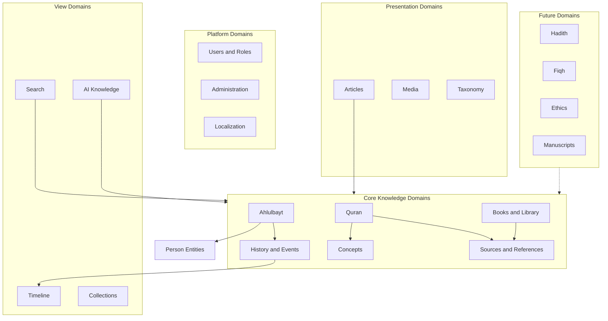
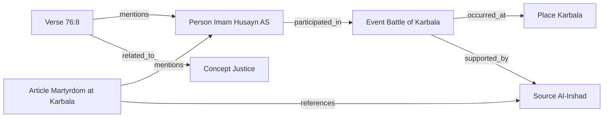
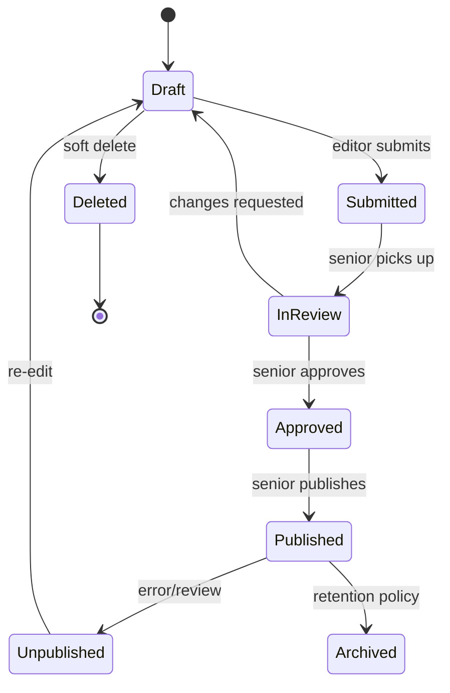
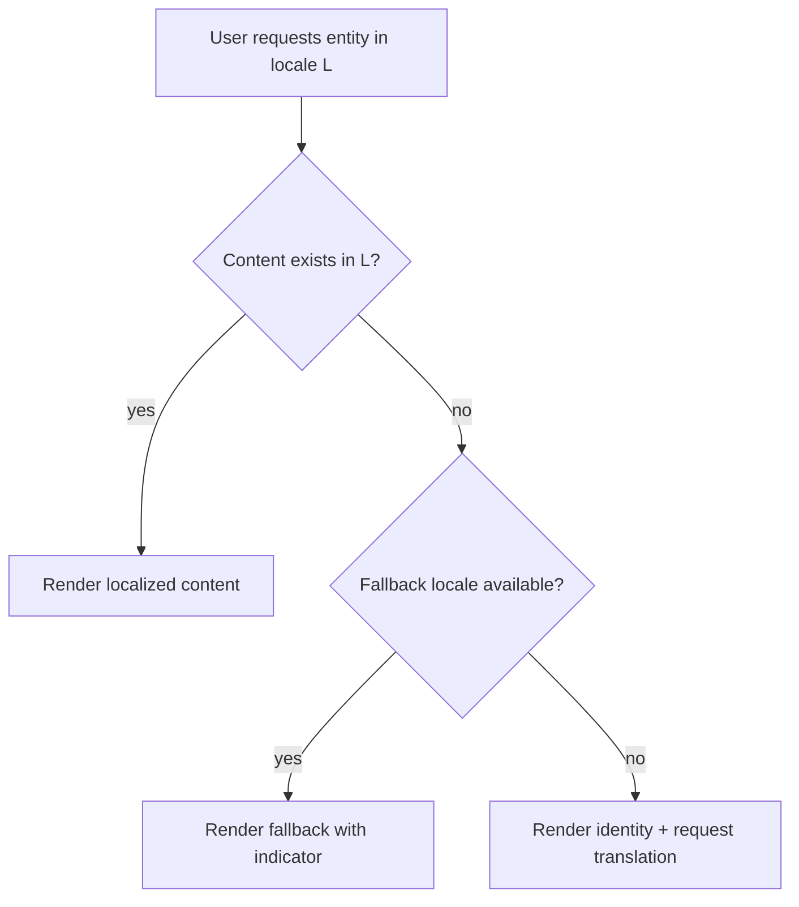
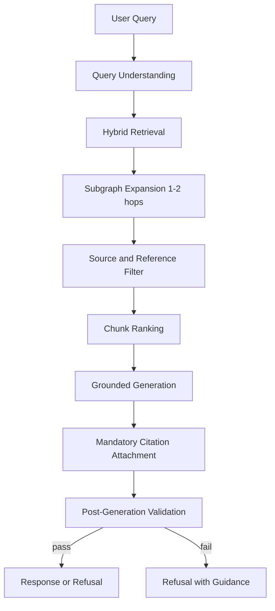
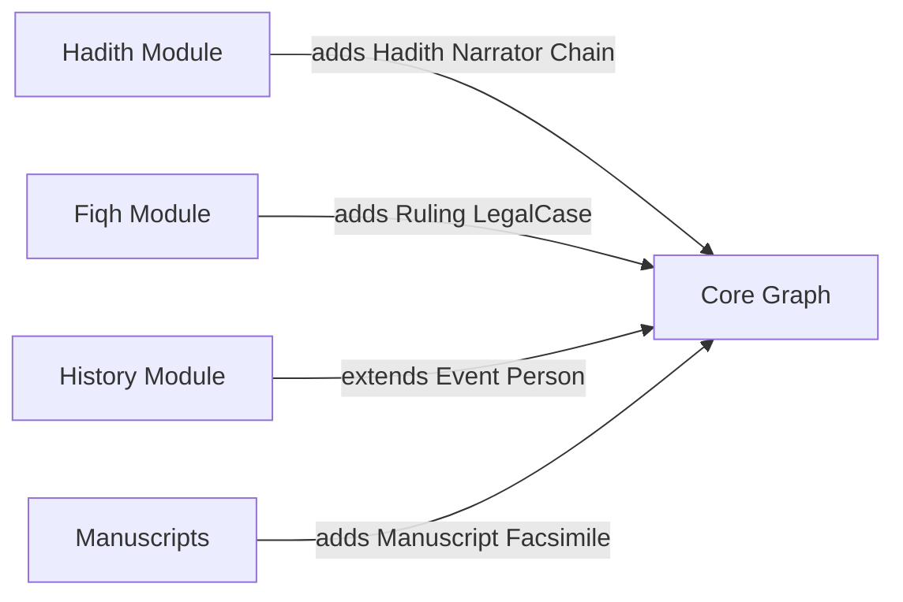

# Knowledge Domain Blueprint

# ويكي العالمية — Wiki World

**Document Version:** 1.0  
**Status:** Authoritative Architecture Reference  
**Date:** July 7, 2026  
**Classification:** Internal — Architecture, Product, Editorial  
**Document Type:** Knowledge Domain Blueprint (Conceptual Model)

---

## Document Control

| Field | Value |
|-------|-------|
| Product Name (Arabic) | ويكي العالمية |
| Product Name (English) | Wiki World |
| Document Owner | Chief Software Architect / Knowledge Engineering |
| Governing References | [PRD.md](./PRD.md) (Product Requirements); PROJECT_CONSTITUTION.md (when published) |
| Scope | Full knowledge domain model — MVP and forward-compatible expansion |
| School of Thought | Ja'fari (Shia Imamiyyah) |

### Revision History

| Version | Date | Author | Changes |
|---------|------|--------|---------|
| 1.0 | 2026-07-07 | Architecture | Initial complete Knowledge Domain Blueprint |

### Alignment Statement

This blueprint **must not contradict** decisions in [PRD.md](./PRD.md). Where this document elaborates conceptual structure beyond the PRD, the PRD governs product behavior. Where conflicts arise during implementation, **preserve PRD decisions** and escalate blueprint amendments through architecture review.

---

## Table of Contents

1. [Knowledge Philosophy](#1-knowledge-philosophy)
2. [Domain Architecture](#2-domain-architecture)
3. [Core Entity Definitions](#3-core-entity-definitions)
4. [Relationships](#4-relationships)
5. [Content Taxonomy](#5-content-taxonomy)
6. [Publishing Model](#6-publishing-model)
7. [Localization Model](#7-localization-model)
8. [Knowledge Graph Rules](#8-knowledge-graph-rules)
9. [Search Model](#9-search-model)
10. [AI Knowledge Model](#10-ai-knowledge-model)
11. [Content Integrity Rules](#11-content-integrity-rules)
12. [Scalability Strategy](#12-scalability-strategy)
13. [Future Expansion](#13-future-expansion)
- [Appendix A: Entity Type Registry](#appendix-a-entity-type-registry)
- [Appendix B: Relationship Type Registry](#appendix-b-relationship-type-registry)
- [Appendix C: Domain Interaction Matrix](#appendix-c-domain-interaction-matrix)
- [Appendix E: Architecture Decision Notes](#appendix-e-architecture-decision-notes)

---

# 1. Knowledge Philosophy

## 1.1 What Knowledge Means in Wiki World

In Wiki World, **knowledge is not documents**. Knowledge is a **network of typed entities** connected by **meaningful relationships**, supported by **verifiable sources**, expressed through **localized presentations**, and governed by **editorial integrity**.

Every fact, person, event, place, concept, verse, book, and citation is a **first-class entity** in the knowledge graph. Users do not navigate a folder of pages; they **traverse a graph of meaning**.

The platform's mission — as defined in the PRD — is to present documented Ja'fari Islamic knowledge with scholarly sourcing. The knowledge model exists to make that mission **structurally enforceable**, not merely editorially aspirational.

## 1.2 The Entity-First Principle

Wiki World adopts an **Entity-First Architecture**.

| Traditional Wiki Model | Wiki World Entity-First Model |
|------------------------|-------------------------------|
| Article is the primary unit | Entity is the primary unit |
| Links are inline hyperlinks | Links are typed relationships |
| Categories are folders | Categories are graph annotations |
| Search finds pages | Search finds entities and meanings |
| AI summarizes pages | AI traverses graph with citations |
| Content is flat | Content is connected |

**Core axiom:** *Everything is an Entity. Everything can have relationships. Everything can be searched. Everything can be localized. Everything can be cited. Everything can be versioned.*

## 1.3 Articles Are Presentation, Not Knowledge

An **Article** is a **presentation layer** — a narrative composition that **describes, contextualizes, and connects** entities. Articles are essential for human readability but are **not** the canonical representation of knowledge.

| Layer | Role | Analogy |
|-------|------|---------|
| **Entity Layer** | Canonical facts, identities, relationships | Wikidata item |
| **Source Layer** | Evidence and bibliographic grounding | Citation graph |
| **Presentation Layer** | Human-readable narrative (Articles, Book chapters) | Wikipedia article |
| **Module Layer** | Curated entry points (Quran, Ahlulbayt) | Themed portals |
| **View Layer** | Derived visualizations (Timeline, Collections) | Knowledge panel |

**Example:** Imam Husayn (AS) is a **Person entity**. The Battle of Karbala is an **Event entity**. Karbala is a **Place entity**. Martyrdom is a **Concept entity**. A scholarly **Article** narrates the relationship between these entities. **Sources** ground every claim. The **Timeline view** plots the Event chronologically. **Search** finds the Person by name or meaning. **AI** retrieves Person + Event + Sources to answer a question with citations.

Without the Person entity, the Article is an isolated essay. With the entity graph, the Article becomes one lens on interconnected knowledge.

## 1.4 Why Entity-First Was Chosen

| Driver | Entity-First Response |
|--------|----------------------|
| **Everything is Connected** (PRD principle) | Typed relationships are first-class, not emergent from prose |
| **Sources Before Claims** | Claims attach to entities via Reference objects linked to Sources |
| **AI Assists Knowledge** | RAG retrieves entity subgraphs, not arbitrary text chunks |
| **Long-term Scalability** | New modules add entity types and relationships without redesign |
| **Multilingual by design** | Entities separate identity from locale-specific presentation |
| **SEO and discovery** | Each entity is indexable with structured meaning |
| **Editorial integrity** | Validation rules apply per entity type, not per document |

## 1.5 Knowledge vs. Content vs. Data

| Term | Definition in Wiki World |
|------|--------------------------|
| **Knowledge** | The validated graph of entities, relationships, and sources representing Islamic scholarship |
| **Content** | Localized presentation material (prose, media) attached to entities |
| **Data** | Operational records (users, permissions, analytics) supporting the platform |
| **Metadata** | Describing attributes of entities (dates, tiers, types) |
| **Claims** | Asserted statements requiring source backing |

Operational entities (User, Role, Permission) exist outside the public knowledge graph but interact with it through editorial actions.

## 1.6 Canonical vs. Derived Knowledge

| Category | Description | Examples |
|----------|-------------|----------|
| **Canonical** | Authoritative entity records curated by editors | Person, Event, Verse, Source |
| **Composed** | Editor-assembled narrative built atop entities | Article, Book chapter, Tafsir excerpt |
| **Derived** | Computed from canonical graph | Timeline view, related-entity panels, knowledge panels |
| **Ephemeral** | Session-specific, not part of corpus | AI chat turns (saved optionally for registered users) |

Derived knowledge **never introduces new claims**. It only surfaces canonical and composed knowledge.

## 1.7 School of Thought as a Knowledge Boundary

All knowledge in the graph is scoped to **Ja'fari (Shia Imamiyyah)** scholarship unless explicitly labeled otherwise (e.g., comparative historical reporting). This is not a technical filter — it is an **editorial domain constraint** enforced at publish time.

The knowledge model supports **neutral representation of sourced comparative statements** without adopting multiple doctrinal authorities. Fatwa, ijtihad, and marja' rulings are **out of scope** for the knowledge graph.

## 1.8 Design Influences

| System | Influence on Wiki World Knowledge Model |
|--------|----------------------------------------|
| **Google Knowledge Graph** | Entity panels, typed relationships, disambiguation |
| **Wikidata** | Entity identity separate from labels; property graph |
| **Wikipedia** | Narrative articles as presentation; not open editing |
| **Notion** | Structured blocks within composed content |
| **Obsidian** | Bidirectional links — implemented as typed relationships |
| **Apple Knowledge Systems** | Clean entity-centric UX; minimal chrome |

## 1.9 Knowledge Philosophy Summary

> Wiki World models Islamic knowledge as a **sourced, localized, versioned entity graph**. Articles explain the graph; they do not replace it. Search, AI, SEO, and UX all consume the same canonical knowledge — ensuring consistency, traceability, and unlimited modular expansion.

---

# 2. Domain Architecture

## 2.1 Domain Overview

Wiki World organizes knowledge into **domains** — bounded areas of subject matter that share entity types, editorial standards, and entry-point experiences. Domains are **not silos**; they interact through the **shared entity graph**.



## 2.2 Domain Catalog

### 2.2.1 Quran Domain

| Attribute | Definition |
|-----------|------------|
| **Purpose** | Canonical representation of the Holy Quran and its scholarly apparatus |
| **Primary entities** | Quran (corpus), Surah, Verse, Translation, Tafsir, Quote |
| **MVP scope** | Full 114 surahs, 6,236 verses, editor-curated translations and tafsir excerpts |
| **Interacts with** | Concepts (thematic), Person (mentions), Event (historical context), Source (tafsir works), Article (explanatory) |
| **Entry points** | Surah index, ayah reference lookup, Quran-scoped search |
| **Editorial authority** | Quran domain editors; senior review for tafsir links |

### 2.2.2 Ahlulbayt Domain

| Attribute | Definition |
|-----------|------------|
| **Purpose** | Knowledge about the Prophet (S), Lady Fatima (AS), and the Twelve Imams (AS) |
| **Primary entities** | Person (Ma'sumin), Event, Place, Book, Quote, Article |
| **MVP scope** | 14 Ma'sumin profiles, lineage, key events, related concepts |
| **Interacts with** | History (events), Quran (verses), Concepts (Imamate, wilayah), Sources (classical biographies) |
| **Entry points** | Module landing, browse by generation/title/era, relationship visualization |
| **Editorial authority** | Ahlulbayt domain editors; mandatory senior review |

### 2.2.3 History and Events Domain

| Attribute | Definition |
|-----------|------------|
| **Purpose** | Chronological and contextual knowledge of historical occurrences |
| **Primary entities** | Event, Place, Person, Timeline (view) |
| **MVP scope** | Events linked to Ahlulbayt and foundational Islamic history |
| **Interacts with** | Ahlulbayt, Places, Persons, Articles, Timeline view |
| **Entry points** | Timeline, Event entity pages, filtered browse by era |
| **Editorial authority** | General and Ahlulbayt editors |

### 2.2.4 Concepts Domain

| Attribute | Definition |
|-----------|------------|
| **Purpose** | Theological, ethical, and intellectual abstractions |
| **Primary entities** | Concept, Source, Article, Verse |
| **MVP scope** | Foundational concepts (Imamate, tawhid, adl, etc.) |
| **Interacts with** | Quran (thematic links), Articles, Books, other Concepts |
| **Entry points** | Concept browse, search, AI discovery |
| **Editorial authority** | General editors; tier 4+ sources for doctrinal definitions |

### 2.2.5 Books and Library Domain

| Attribute | Definition |
|-----------|------------|
| **Purpose** | Published works as first-class knowledge containers |
| **Primary entities** | Book, Author (Person/Organization), Publisher (Organization), Source, Quote |
| **MVP scope** | Metadata + online chapter reading; copyright documented |
| **Interacts with** | Sources, Persons, Concepts, Articles |
| **Entry points** | Book catalog, chapter pages, author pages |
| **Editorial authority** | Books & Sources domain editors |

### 2.2.6 Sources and References Domain

| Attribute | Definition |
|-----------|------------|
| **Purpose** | Bibliographic grounding for all claims |
| **Primary entities** | Source, Reference, Author, Publisher, Media (documents) |
| **MVP scope** | Full bibliographic metadata, reliability tiers, usage tracking |
| **Interacts with** | Every domain — Sources underpin all claims |
| **Entry points** | Source pages, citation drill-down from any entity |
| **Editorial authority** | Books & Sources editors |

### 2.2.7 Articles Domain

| Attribute | Definition |
|-----------|------------|
| **Purpose** | Narrative presentation composing entity knowledge for readers |
| **Primary entities** | Article, Reference, Media |
| **MVP scope** | Long-form sourced articles with TOC and entity links |
| **Interacts with** | All core domains — Articles reference entities, never duplicate them |
| **Entry points** | Article browse, search, related-entity sidebars |
| **Editorial authority** | Domain-scoped editors |

### 2.2.8 Media Domain

| Attribute | Definition |
|-----------|------------|
| **Purpose** | Visual, audio, and document assets supporting knowledge |
| **Primary entities** | Media, Source (license), Person/Event (illustration) |
| **MVP scope** | Images, PDFs, optional Quran recitation audio |
| **Interacts with** | All presentation entities |
| **Entry points** | Inline in entity pages, media library (editorial) |
| **Editorial authority** | All editors; license metadata mandatory |

### 2.2.9 Taxonomy Domain

| Attribute | Definition |
|-----------|------------|
| **Purpose** | Organizational structure for browse, filter, and discovery |
| **Primary entities** | Category, Tag, Collection, Topic, Series |
| **MVP scope** | Categories, tags, featured collections, navigation trees |
| **Interacts with** | All publishable entities |
| **Entry points** | Browse navigation, filters, curated landing pages |
| **Editorial authority** | Senior editors and admins |

### 2.2.10 Timeline Domain (View)

| Attribute | Definition |
|-----------|------------|
| **Purpose** | Chronological visualization of Events |
| **Primary entities** | Event (canonical); Timeline is a **view**, not a store |
| **MVP scope** | Filterable timeline across published Events |
| **Interacts with** | History, Ahlulbayt, Places, Persons |
| **Entry points** | Global timeline, module-filtered timelines |
| **Editorial authority** | N/A — derived from Event entities |

### 2.2.11 Search Domain (Capability)

| Attribute | Definition |
|-----------|------------|
| **Purpose** | Cross-domain discovery by keyword, semantics, and entity attributes |
| **Consumes** | All published entities and composed content |
| **MVP scope** | Hybrid search, facets, suggestions, knowledge panels |
| **Interacts with** | All domains |
| **Entry points** | Global search bar, scoped module search |

### 2.2.12 AI Knowledge Domain (Capability)

| Attribute | Definition |
|-----------|------------|
| **Purpose** | Conversational retrieval and synthesis over the knowledge graph |
| **Consumes** | Published entity subgraphs with Sources |
| **MVP scope** | RAG-grounded assistant with mandatory citations |
| **Interacts with** | All domains; never writes to knowledge graph |
| **Entry points** | AI chat interface |

### 2.2.13 Users and Roles Domain (Platform)

| Attribute | Definition |
|-----------|------------|
| **Purpose** | Identity, access, and personalization |
| **Primary entities** | User, Role, Permission |
| **MVP scope** | Optional public accounts; editorial/admin roles |
| **Interacts with** | Publishing model, personalization, audit trail |
| **Not part of** | Public knowledge graph corpus |

### 2.2.14 Administration Domain (Platform)

| Attribute | Definition |
|-----------|------------|
| **Purpose** | Platform configuration, analytics, SEO governance |
| **Interacts with** | All domains via settings, feature toggles, analytics |
| **Not part of** | Public knowledge graph corpus |

### 2.2.15 Localization Domain (Cross-Cutting)

| Attribute | Definition |
|-----------|------------|
| **Purpose** | Multilingual behavior across all knowledge |
| **Primary language** | Arabic (RTL) |
| **Secondary language** | English (LTR) |
| **Future** | Unlimited locales via same model |
| **Interacts with** | Every entity and presentation layer |

## 2.3 Domain Interaction Principles

| Principle | Rule |
|-----------|------|
| **Single graph** | All domains share one entity graph; no duplicate person/event/concept records per domain |
| **Domain scoping** | Editorial permissions may be domain-scoped; knowledge is not domain-isolated |
| **Module as lens** | Quran and Ahlulbayt are **modules** — curated views over shared entities |
| **Source universal** | Sources domain serves all domains equally |
| **View purity** | Timeline, search panels, and AI responses do not create canonical claims |
| **Future plug-in** | New domains add entity types and relationships; they do not replace core types |

## 2.4 MVP vs. Future Domains

| Domain | MVP | Phase 2+ |
|--------|-----|----------|
| Quran | Full | Recitation, additional tafsir corpora |
| Ahlulbayt | Full | Extended companions, scholars |
| History | Ahlulbayt-focused events | Islamic History module |
| Concepts | Foundational set | Ethics, philosophy expansions |
| Books/Library | Limited catalog | Digital library, manuscripts |
| Sources | Full model | Automated citation parsing |
| Hadith | — | Narrator chains, collections |
| Fiqh | — | Rulings archive (presentational, not fatwa) |
| Maps/Genealogy | — | Geographic and lineage visualizations |

---
# 3. Core Entity Definitions

## 3.1 Entity Definition Template

Every entity type in Wiki World is documented using the following conceptual schema:

| Dimension | Question Answered |
|-----------|-------------------|
| **Purpose** | Why does this entity type exist? |
| **Description** | What does it represent? |
| **Business meaning** | What real-world concept does it model? |
| **Responsibilities** | What is this entity accountable for in the graph? |
| **Examples** | Concrete instances |
| **Lifecycle** | States from creation to archival |
| **Required attributes** | Must exist for validity |
| **Optional attributes** | Enrich without blocking |
| **Validation rules** | Publish-time constraints |
| **Ownership** | Who creates and maintains |
| **Visibility** | Public, editorial, or private |
| **Localization** | What is translated vs. universal |
| **Versioning** | How changes are tracked |
| **Search** | How discovery works |
| **SEO** | Indexing and structured meaning |
| **AI** | How RAG consumes this entity |

## 3.2 Entity Classification

| Class | Entity Types | In Public Corpus |
|-------|--------------|------------------|
| **Canonical Knowledge** | Person, Event, Place, Concept, Verse, Surah, Source, Book | Yes (when published) |
| **Composed Presentation** | Article, Tafsir, Translation, Quote | Yes (when published) |
| **Bibliographic** | Reference, Author, Publisher, Organization | Partial (Author/Publisher as views) |
| **Structural** | Quran (corpus), Category, Tag, Collection, Series, Topic | Mixed |
| **Media** | Media | Yes (when attached) |
| **Operational** | User, Role, Permission, Language | No |
| **Derived** | Timeline (view), Knowledge Panel | N/A |

---

## 3.3 Canonical Knowledge Entities

### 3.3.1 Person

| Dimension | Definition |
|-----------|------------|
| **Purpose** | Represent a human figure in Islamic history, scholarship, or sacred lineage |
| **Description** | A biographical node with identity, relationships, and life events |
| **Business meaning** | A real or traditionally recognized individual whose life and role are documented |
| **Responsibilities** | Anchor biographical facts; link to events, places, works, verses; support lineage graphs |
| **Examples** | Prophet Muhammad (S); Imam Ali (AS); Lady Fatima (AS); Al-Shaykh al-Mufid; Umm al-Banin |
| **Lifecycle** | Draft → Review → Published → Updated → Unpublished → Archived |
| **Required attributes** | Canonical identity; full name (localized); entity type = Person; minimum 2 Sources for publish |
| **Optional attributes** | Kunya, titles, honorifics, birth/death dates (Hijri/Gregorian), birthplace, death place, lineage links, works, portrait Media |
| **Validation rules** | Ahlulbayt persons require senior review; dates must be sourced; honorifics per style guide; no duplicate canonical identity |
| **Ownership** | Domain-scoped editor creates; senior editor publishes |
| **Visibility** | Public when published |
| **Localization** | Names, titles, biography prose localized; dates universal; Arabic name always preserved in English |
| **Versioning** | Full version history; corrections noted on significant changes |
| **Search** | Indexed by name, titles, aliases, transliterations; Arabic morphological forms |
| **SEO** | Schema.org Person; knowledge panel eligible |
| **AI** | Retrievable as node; biographical claims must cite attached Sources |

### 3.3.2 Event

| Dimension | Definition |
|-----------|------------|
| **Purpose** | Represent a historical occurrence with temporal and participatory context |
| **Description** | A dated (or date-estimated) happening involving persons and places |
| **Business meaning** | A historically documented incident, battle, treaty, birth, death, revelation milestone, etc. |
| **Responsibilities** | Provide chronological anchor; link participants and locations; feed Timeline view |
| **Examples** | Battle of Karbala; Event of Ghadir Khumm; Migration to Medina; Martyrdom of Imam Husayn (AS) |
| **Lifecycle** | Draft → Review → Published → Updated → Archived |
| **Required attributes** | Name (localized); Hijri date (at minimum year); link to ≥1 Person OR Place; minimum 2 Sources |
| **Optional attributes** | Gregorian date, end date, era/period, significance summary, related Concepts |
| **Validation rules** | No orphan events (must link Person or Place); dates must be sourced; sensitive events follow tone guide |
| **Ownership** | History / Ahlulbayt domain editors |
| **Visibility** | Public when published |
| **Localization** | Name and description localized; dates universal with locale-appropriate calendar display |
| **Versioning** | Full; date corrections flagged as significant |
| **Search** | By name, date, era, participants, place |
| **SEO** | Schema.org Event |
| **AI** | Often retrieved with linked Persons and Places; claims require Sources |

### 3.3.3 Place

| Dimension | Definition |
|-----------|------------|
| **Purpose** | Represent geographic, political, or holy locations |
| **Description** | A named location with type, significance, and event associations |
| **Business meaning** | City, region, mosque, battlefield, shrine, geographic feature |
| **Responsibilities** | Anchor spatial context; link events and persons; support map views (future) |
| **Examples** | Karbala; Najaf; Mecca; Kufa; Medina; Qom |
| **Lifecycle** | Draft → Published → Updated → Archived |
| **Required attributes** | Name (localized); place type |
| **Optional attributes** | Coordinates, modern country/region, historical names, significance, images |
| **Validation rules** | Name must be unique within disambiguation scope; holy places follow presentation standards |
| **Ownership** | General / History editors |
| **Visibility** | Public when published |
| **Localization** | Names localized; coordinates universal |
| **Versioning** | Full |
| **Search** | By name, type, region, associated events |
| **SEO** | Schema.org Place |
| **AI** | Context node for events and biographies |

### 3.3.4 Concept

| Dimension | Definition |
|-----------|------------|
| **Purpose** | Represent abstract theological, ethical, or intellectual ideas |
| **Description** | A defined term with meaning, related concepts, and scholarly sources |
| **Business meaning** | Doctrinal principles, virtues, philosophical terms, ritual concepts |
| **Responsibilities** | Provide definitional anchor; link to Quran, articles, books; support thematic discovery |
| **Examples** | Imamate; Tawhid; Adl (justice); Sabr (patience); Wilayah; Shura |
| **Lifecycle** | Draft → Review → Published → Updated → Archived |
| **Required attributes** | Name (localized); Arabic term; category; minimum 2 Sources (tier 4+ for doctrinal) |
| **Optional attributes** | Related concepts, related verses, pronunciation, scope notes |
| **Validation rules** | Doctrinal definitions require high-tier sources; disambiguation for polysemous terms |
| **Ownership** | General / Concepts editors |
| **Visibility** | Public when published |
| **Localization** | Arabic term always shown; definitions fully localized |
| **Versioning** | Full; doctrinal changes require senior review |
| **Search** | By name, Arabic root, related themes, semantic similarity |
| **SEO** | DefinedTerm / Article hybrid structured data |
| **AI** | High-value retrieval node; definitions must cite Sources |

### 3.3.5 Source

| Dimension | Definition |
|-----------|------------|
| **Purpose** | Represent a citable bibliographic work or reference artifact |
| **Description** | The canonical record of a work that supports claims across the graph |
| **Business meaning** | Book, article, manuscript, digital resource, scripture citation container |
| **Responsibilities** | Ground claims; provide bibliographic metadata; track usage; enable citation drill-down |
| **Examples** | Al-Kafi; Bihar al-Anwar; Nahj al-Balagha; a peer-reviewed journal article; King Fahd Quran edition |
| **Lifecycle** | Draft → Published → Updated (metadata corrections) → Deprecated (if retracted) |
| **Required attributes** | Title; source type; reliability tier (1–5) |
| **Optional attributes** | Author(s), publisher, year, edition, ISBN, URL, page ranges, language, Media attachment |
| **Validation rules** | Reliability tier mandatory; copyright status for excerpts; duplicate detection on title+author+year |
| **Ownership** | Books & Sources domain editors |
| **Visibility** | Public when published |
| **Localization** | Title may be localized; bibliographic facts universal |
| **Versioning** | Metadata versioned; usage count derived |
| **Search** | By title, author, type, tier, usage frequency |
| **SEO** | Schema.org CreativeWork / Book |
| **AI** | Primary citation target; tier influences confidence presentation |

### 3.3.6 Book

| Dimension | Definition |
|-----------|------------|
| **Purpose** | Represent a published work as a structured knowledge container |
| **Description** | A work with metadata, chapters, and authorship — readable online in MVP |
| **Business meaning** | Classical text, modern publication, edited volume, tafsir work |
| **Responsibilities** | Organize chapter content; link authors and sources; support library browse |
| **Examples** | Sahifa Sajjadiyya; Al-Irshad by Al-Mufid; Contemporary academic monograph |
| **Lifecycle** | Draft → Review → Published → Updated → Rights-restricted → Archived |
| **Required attributes** | Title; author(s); copyright/license status; language |
| **Optional attributes** | Publisher, year, ISBN, subject tags, cover Media, chapter structure |
| **Validation rules** | Copyright documented; chapters must link to parent Book; author must resolve to Person or Organization |
| **Ownership** | Books & Sources editors |
| **Visibility** | Public when published and licensed |
| **Localization** | Title localized; chapter content localized independently |
| **Versioning** | Full per chapter and book metadata |
| **Search** | By title, author, subject, chapter content |
| **SEO** | Schema.org Book |
| **AI** | Retrievable in chunks by chapter; citations point to Book/Source |

---

## 3.4 Quran Entities

### 3.4.1 Quran (Corpus)

| Dimension | Definition |
|-----------|------------|
| **Purpose** | Represent the Holy Quran as a unified sacred corpus |
| **Description** | Root container for 114 Surahs and 6,236 Verses |
| **Business meaning** | The complete revealed scripture — not editable content |
| **Responsibilities** | Anchor all Quranic entities; define script standard; scope Quran search |
| **Examples** | The single Quran corpus entity |
| **Lifecycle** | **Immutable text** — editorial changes only to metadata, links, and apparatus |
| **Required attributes** | Script edition reference (Source); verse count; surah count |
| **Validation rules** | Verse text changes require scholarly advisory approval; not versioned like articles |
| **Ownership** | Platform + scholarly advisory |
| **Visibility** | Always public |
| **Localization** | Arabic text universal; translations separate entities |
| **Search** | Corpus-level scope for Quran module |
| **AI** | Verse retrieval; never paraphrase scripture without citation |

### 3.4.2 Surah

| Dimension | Definition |
|-----------|------------|
| **Purpose** | Represent a chapter of the Quran |
| **Description** | Named division containing ordered Verses |
| **Business meaning** | One of 114 surahs with revelation context |
| **Responsibilities** | Group verses; provide surah-level metadata and navigation |
| **Examples** | Al-Fatiha (1); Al-Baqarah (2); Al-Kahf (18); Al-Mulk (67) |
| **Lifecycle** | Canonical — metadata and links editable; text immutable |
| **Required attributes** | Surah number (1–114); Arabic name; verse count; revelation type (Meccan/Medinan) |
| **Optional attributes** | English name, transliteration, themes, related Concepts |
| **Validation rules** | Number unique 1–114; verse count matches canonical enumeration |
| **Localization** | Names localized; number universal |
| **Search** | By name, number, theme, revelation type |
| **SEO** | Indexable surah landing pages |
| **AI** | Entry point for surah-scoped questions |

### 3.4.3 Verse (Ayah)

| Dimension | Definition |
|-----------|------------|
| **Purpose** | Represent a single verse of the Quran |
| **Description** | Atomic unit of Quranic text with unique surah:ayah address |
| **Business meaning** | One ayah — the smallest addressable Quranic unit |
| **Responsibilities** | Store canonical Arabic text; anchor translations, tafsir, and cross-links |
| **Examples** | 2:255 (Ayat al-Kursi); 33:33; 76:8 |
| **Lifecycle** | Canonical text immutable; apparatus (links, tafsir) versioned |
| **Required attributes** | Surah number; ayah number; Arabic text (Uthmani) |
| **Optional attributes** | Translation entities, Tafsir excerpts, linked Persons/Concepts/Events |
| **Validation rules** | Unique surah:ayah; cross-links require editorial source if interpretive |
| **Localization** | Arabic text not translated in-place; translations are separate entities |
| **Search** | Exact reference, Arabic text, translation text, themes |
| **SEO** | Unique URL per verse |
| **AI** | Retrieved verbatim; commentary only from linked Tafsir/Source |

### 3.4.4 Translation

| Dimension | Definition |
|-----------|------------|
| **Purpose** | Represent a scholarly translation of verse or passage text |
| **Description** | Locale-specific rendered meaning of Quranic text |
| **Business meaning** | Licensed or public-domain translation text |
| **Responsibilities** | Provide readable meaning per locale; link to Source and Verse |
| **Examples** | English translation of 2:255 per licensed edition |
| **Lifecycle** | Draft → Review → Published |
| **Required attributes** | Target Verse(s); language; Source attribution |
| **Validation rules** | Must cite translation Source; no AI-generated translations |
| **Localization** | Inherent — one Translation per target language |
| **AI** | May quote with Source; not authoritative over Arabic text |

### 3.4.5 Tafsir

| Dimension | Definition |
|-----------|------------|
| **Purpose** | Represent editor-curated exegesis excerpts for verses |
| **Description** | Composed scholarly commentary attributed to a named work |
| **Business meaning** | Passage from classical or contemporary tafsir |
| **Responsibilities** | Explain verse meaning within sourced scholarship |
| **Examples** | Excerpt from Al-Mizan for 2:255 |
| **Lifecycle** | Draft → Review → Published |
| **Required attributes** | Target Verse(s); excerpt text; Source (tafsir work) |
| **Validation rules** | No AI-generated tafsir; excerpt must link to Source; senior review for interpretive claims |
| **Localization** | Arabic tafsir on ar; English excerpts where available |
| **AI** | Retrievable with mandatory Source citation |

---

## 3.5 Composed Presentation Entities

### 3.3.7 Article

| Dimension | Definition |
|-----------|------------|
| **Purpose** | Narrative presentation explaining and connecting entities |
| **Description** | Long-form composed content with structured sections and inline citations |
| **Business meaning** | Encyclopedia-style entry — a **lens** on the graph, not the graph itself |
| **Responsibilities** | Explain; contextualize; link entities; cite sources; support reading UX |
| **Examples** | "The Event of Ghadir Khumm"; "Understanding Imamate in Ja'fari Thought" |
| **Lifecycle** | Draft → Submitted → In Review → Published → Updated → Unpublished → Archived |
| **Required attributes** | Title; summary; body blocks; minimum 3 Sources; minimum 2 entity links |
| **Optional attributes** | TOC, categories, tags, featured image, reading time |
| **Validation rules** | Per PRD FR-CMS-005; checklist before submit; no unsourced doctrinal claims |
| **Ownership** | Domain-scoped editor |
| **Visibility** | Public when published |
| **Localization** | Fully localized per locale; independent publish possible with fallback |
| **Versioning** | Full block-level history |
| **Search** | Full text + linked entity boost |
| **SEO** | Schema.org Article; primary long-form SEO target |
| **AI** | Chunked for RAG; chunks inherit entity and source links |

### 3.5.2 Quote

| Dimension | Definition |
|-----------|------------|
| **Purpose** | Represent an attributed excerpt from a Person, Book, or Source |
| **Description** | A discrete quotation with attribution and provenance |
| **Business meaning** | Hadith excerpt (future), saying, sermon passage, poetic verse |
| **Responsibilities** | Preserve exact wording; link to speaker and source |
| **Examples** | Line from Nahj al-Balagha; supplication from Sahifa Sajjadiyya |
| **Lifecycle** | Draft → Review → Published |
| **Required attributes** | Quote text; attribution (Person or Source) |
| **Optional attributes** | Context, occasion, translation, related Event |
| **Validation rules** | Must link to Source; honorifics applied |
| **Localization** | Quote text may remain Arabic; translation optional |
| **AI** | Retrievable only with Source chain |

---

## 3.6 Bibliographic and Supporting Entities

### 3.6.1 Reference

| Dimension | Definition |
|-----------|------------|
| **Purpose** | Bind a specific claim to a Source with pinpoint citation |
| **Description** | A directed knowledge link: *this statement is supported by this source at this location* |
| **Business meaning** | Footnote, endnote, inline citation — the integrity edge of the graph |
| **Responsibilities** | Enforce "sources before claims"; enable drill-down; power AI citations |
| **Examples** | "Imamate doctrine — Al-Mufid, Al-Irshad, p. 42" |
| **Lifecycle** | Created with parent content; versioned with parent |
| **Required attributes** | Target Source; parent entity or claim block |
| **Optional attributes** | Page, volume, chapter, quote excerpt, reliability override note |
| **Validation rules** | Must resolve to published Source; broken references block publish |
| **Visibility** | Public when parent is published |
| **AI** | **Primary citation artifact** — AI cites References, not free text |

### 3.6.2 Author

| Dimension | Definition |
|-----------|------------|
| **Purpose** | Identify who created a work |
| **Description** | **Specialization of Person or Organization** — not a separate canonical identity |
| **Business meaning** | Scholar, compiler, translator, institution |
| **Responsibilities** | Link Books and Sources to creators |
| **Examples** | Al-Shaykh al-Saduq (Person as Author); Hawza publication (Organization as Author) |
| **Validation rules** | Must resolve to Person or Organization entity |

### 3.6.3 Publisher

| Dimension | Definition |
|-----------|------------|
| **Purpose** | Identify publishing entity |
| **Description** | **Specialization of Organization** |
| **Business meaning** | Publishing house, institution, digital archive |
| **Examples** | Al-A'lami Foundation; Islamic Research Foundation |
| **Validation rules** | Must resolve to Organization |

### 3.6.4 Organization

| Dimension | Definition |
|-----------|------------|
| **Purpose** | Represent institutional entities |
| **Description** | Hawza, university, mosque, publisher, research center |
| **Business meaning** | Collective authority or publisher |
| **Responsibilities** | Authorship, publishing, institutional partnerships (future) |
| **Examples** | Hawza of Najaf; Qom Seminary; Partner university |
| **Lifecycle** | Draft → Published |
| **Required attributes** | Name (localized); organization type |
| **Optional attributes** | Location (Place), website, founding date |
| **Visibility** | Public when published |

---

## 3.7 Structural and Taxonomic Entities

### 3.7.1 Category

| Dimension | Definition |
|-----------|------------|
| **Purpose** | Hierarchical classification for browse and navigation |
| **Description** | Tree-structured topic grouping |
| **Business meaning** | "Biography", "Quranic Sciences", "History of Imamate" |
| **Responsibilities** | Organize browse paths; support faceted navigation |
| **Required attributes** | Name (localized); parent Category (optional) |
| **Validation rules** | No circular parent chain; unique name per parent |
| **Localization** | Fully localized labels |

### 3.7.2 Tag

| Dimension | Definition |
|-----------|------------|
| **Purpose** | Non-hierarchical labeling for flexible grouping |
| **Description** | Flat keyword-like classifier |
| **Examples** | "Karbala", "dua", "Ramadan", "beginner" |
| **Validation rules** | Normalized form; duplicate tags merged editorially |

### 3.7.3 Collection

| Dimension | Definition |
|-----------|------------|
| **Purpose** | Curated set of entities for editorial or user organization |
| **Description** | Named group with ordered or unordered members |
| **Business meaning** | "Featured Ahlulbayt", "Ramadan Reading", user reading list (future) |
| **Types** | Editorial Collection (MVP); User Collection (registered, future) |
| **Required attributes** | Name; curator (editor or user) |
| **Validation rules** | Members must be published entities |

### 3.7.4 Topic

| Dimension | Definition |
|-----------|------------|
| **Purpose** | Thematic anchor connecting disparate entities |
| **Description** | Higher-level theme spanning categories |
| **Examples** | "Justice in Islam", "Family of the Prophet" |
| **Interacts with** | Concepts, Articles, Events, search suggestions |

### 3.7.5 Series

| Dimension | Definition |
|-----------|------------|
| **Purpose** | Order related content in sequence |
| **Description** | Multi-part editorial sequence |
| **Examples** | "Imamate Series" (5 articles); "Surah Studies" |
| **Validation rules** | Members ordered; same series name unique |

---

## 3.8 Media Entity

### 3.8.1 Media

| Dimension | Definition |
|-----------|------------|
| **Purpose** | Represent image, audio, video, or document assets |
| **Description** | Binary asset with metadata and license |
| **Business meaning** | Portrait, map, recitation audio, PDF scan |
| **Responsibilities** | Illustrate entities; provide accessible alt text; document rights |
| **Lifecycle** | Uploaded → Attached → Published → Deprecated |
| **Required attributes** | Media type; title; license type; alt text (images) |
| **Optional attributes** | Attribution, dimensions, duration, transcript |
| **Validation rules** | No publish without license; no irreverent imagery for sacred figures |
| **Localization** | Alt text and title localized |
| **Search** | By title, tags, attached entity |
| **AI** | Media not cited as doctrinal evidence unless transcript is sourced |

---

## 3.9 Platform Entities (Outside Public Corpus)

### 3.9.1 User

| Dimension | Definition |
|-----------|------------|
| **Purpose** | Represent platform identity for personalization and editorial accountability |
| **Description** | Account record with credentials, preferences, and role assignments |
| **Business meaning** | A human operator or visitor using the platform |
| **Responsibilities** | Authentication; preference storage; audit attribution; optional personalization |
| **Examples** | Registered learner with bookmarks; Quran domain editor; platform administrator |
| **Lifecycle** | Invited/Registered → Active → Suspended → Deleted (anonymized) |
| **Required attributes** | Unique identifier; email (for registered); role assignment(s) |
| **Optional attributes** | Display name; locale preference; avatar; MFA enrollment |
| **Validation rules** | Email verified for registered users; editorial users require MFA at admin tier |
| **Ownership** | User owns own account; admin manages editorial users |
| **Visibility** | Private — never in public corpus or search |
| **Localization** | Preference only — does not affect knowledge content |
| **Versioning** | Audit log of account changes; not versioned like knowledge |
| **Search** | Not indexed |
| **SEO** | Not applicable |
| **AI** | Chat history optional for registered users; history not in shared corpus |

### 3.9.2 Role

| Dimension | Definition |
|-----------|------------|
| **Purpose** | Aggregate permissions into assignable editorial and access bundles |
| **Description** | Named role with composed Permission set |
| **Business meaning** | Editorial job function: editor, reviewer, administrator |
| **Responsibilities** | Govern what actions a User may perform on knowledge and platform |
| **Examples** | Editor (Quran domain); Senior Editor; Super Admin |
| **Lifecycle** | Defined at platform level; rarely changed; assignment versioned in audit |
| **Required attributes** | Role name; permission set; description |
| **Validation rules** | Publish permission only on Senior Editor+; user management only Super Admin |
| **Ownership** | Platform administration |
| **Visibility** | Internal only |

### 3.9.3 Permission

| Dimension | Definition |
|-----------|------------|
| **Purpose** | Atomic capability unit for access control |
| **Description** | Single actionable right (e.g., `entity:publish`, `domain:quran:edit`) |
| **Business meaning** | Fine-grained gate on CMS, admin, and AI flag actions |
| **Responsibilities** | Composed into Roles; may be domain-scoped |
| **Examples** | `draft:create`, `draft:submit`, `entity:publish`, `review:approve`, `analytics:view` |
| **Validation rules** | Permissions are additive; deny-by-default for editorial actions |

### 3.9.4 Language

| Dimension | Definition |
|-----------|------------|
| **Purpose** | Register a supported locale in the knowledge system |
| **Description** | Metadata for locale: code, direction (RTL/LTR), numeral system, fallback chain |
| **MVP values** | `ar` (primary), `en` (secondary) |
| **Future** | `ur`, `fa`, `fr`, `tr`, etc. |

---

## 3.10 Derived Constructs

### 3.10.1 Timeline (View)

| Dimension | Definition |
|-----------|------------|
| **Purpose** | Chronological visualization |
| **Description** | **Not a stored entity** — a query over Event entities sorted by date |
| **Responsibilities** | Present history; filter by era, person, module |
| **Rules** | Cannot introduce facts; reflects published Events only |

### 3.10.2 Knowledge Panel

| Dimension | Definition |
|-----------|------------|
| **Purpose** | Summarized entity snapshot in search results |
| **Description** | Derived from entity attributes and top relationships |
| **Rules** | Auto-generated from graph; editorial override for featured summary optional |

---

## 3.11 Entity Identity Rules

| Rule | Description |
|------|-------------|
| **EID-01** | Every entity has a stable internal identity independent of locale |
| **EID-02** | Entity type is immutable after creation (MVP) |
| **EID-03** | One canonical Person per real individual — duplicates merged, not coexisting |
| **EID-04** | Verse identity is surah:ayah — universal across locales |
| **EID-05** | Source identity is bibliographic — duplicates flagged at creation |
| **EID-06** | Article identity is editorial — may reference same entities as other articles |
| **EID-07** | Author and Publisher are roles, not duplicate Person/Organization records |

---
# 4. Relationships

## 4.1 Relationship Model Overview

Relationships are **typed, directed edges** between entities. They are **first-class knowledge** — not merely hyperlinks. Every relationship has:

| Property | Description |
|----------|-------------|
| **Type** | Semantic predicate (e.g., `participated_in`) |
| **Direction** | Source entity → target entity |
| **Cardinality** | How many connections are valid |
| **Meaning** | Human-readable definition |
| **Rules** | Constraints and validation |
| **Localization** | Label shown in UI per locale |
| **Inverse** | Reverse relationship for bidirectional navigation |

**Bidirectional navigation rule (from PRD):** If A relates to B, B must expose the inverse in its related panel.



## 4.2 Relationship Registry

### 4.2.1 Person Relationships

| Relationship | Target | Direction | Cardinality | Meaning | Rules |
|--------------|--------|-----------|-------------|---------|-------|
| `participated_in` | Event | Person → Event | M:M | Person took part in event | Requires sourced participation for publish |
| `born_at` | Place | Person → Place | M:1 | Birth location | Date should accompany if known |
| `died_at` | Place | Person → Place | M:1 | Death location | Sensitive presentation for martyrs |
| `related_to` | Person | Person → Person | M:M | Family, lineage, companionship | Subtypes: parent, child, spouse, sibling (attribute on edge) |
| `authored` | Book | Person → Book | M:M | Person wrote/compiled book | Resolves Author role |
| `quoted_in` | Quote | Person → Quote | 1:M | Person is speaker of quote | Quote must have Source |
| `mentioned_in` | Verse | Person → Verse | M:M | Person mentioned in Quran | Editor-curated; interpretive links need source |
| `member_of` | Organization | Person → Organization | M:M | Affiliation | Optional |
| `illustrated_by` | Media | Person → Media | M:M | Portrait or image | License required |

**Examples:**
- Imam Husayn (AS) `participated_in` Battle of Karbala
- Imam Ali (AS) `related_to` Prophet Muhammad (S) [subtype: cousin/son-in-law]
- Al-Mufid `authored` Book: Al-Irshad

### 4.2.2 Event Relationships

| Relationship | Target | Direction | Cardinality | Meaning | Rules |
|--------------|--------|-----------|-------------|---------|-------|
| `occurred_at` | Place | Event → Place | M:M | Where event happened | At least one Place OR Person link required |
| `involved` | Person | Event → Person | M:M | Inverse of `participated_in` | Auto-synced |
| `during_era` | Concept/Category | Event → Concept | M:1 | Historical period classification | Optional |
| `supported_by` | Source | Event → Source | M:M | Sources documenting event | Minimum 2 for publish |
| `related_to` | Event | Event → Event | M:M | Preceding, concurrent, consequential | Optional |
| `mentioned_in` | Article | Event → Article | M:M | Inverse of Article mentions |

### 4.2.3 Place Relationships

| Relationship | Target | Direction | Cardinality | Meaning |
|--------------|--------|-----------|-------------|---------|
| `location_of` | Event | Place → Event | M:M | Inverse of `occurred_at` |
| `birthplace_of` | Person | Place → Person | M:M | Inverse of `born_at` |
| `part_of` | Place | Place → Place | M:M | Geographic containment |
| `illustrated_by` | Media | Place → Media | M:M | Maps, photos |

### 4.2.4 Concept Relationships

| Relationship | Target | Direction | Cardinality | Meaning | Rules |
|--------------|--------|-----------|-------------|---------|-------|
| `related_to` | Concept | Concept → Concept | M:M | Thematic or doctrinal affinity | Symmetric display |
| `defined_by` | Source | Concept → Source | M:M | Sources defining term | Min 2 for publish |
| `mentioned_in` | Verse | Concept → Verse | M:M | Thematic Quranic connection | Curated |
| `explained_in` | Article | Concept → Article | M:M | Inverse of Article mentions |
| `parent_of` | Concept | Concept → Concept | 1:M | Hierarchical taxonomy | No cycles |

### 4.2.5 Verse Relationships

| Relationship | Target | Direction | Cardinality | Meaning | Rules |
|--------------|--------|-----------|-------------|---------|-------|
| `belongs_to` | Surah | Verse → Surah | M:1 | Structural containment | Immutable |
| `explained_by` | Tafsir | Verse → Tafsir | 1:M | Exegesis excerpts | Sourced |
| `translated_by` | Translation | Verse → Translation | 1:M | Per-locale translations | Licensed |
| `mentions` | Person | Verse → Person | M:M | Named or implied mention | Curated + sourced if interpretive |
| `related_to` | Concept | Verse → Concept | M:M | Thematic link | Curated |
| `referenced_in` | Article | Verse → Article | M:M | Article cites verse | |

### 4.2.6 Book Relationships

| Relationship | Target | Direction | Cardinality | Meaning |
|--------------|--------|-----------|-------------|---------|
| `authored_by` | Person/Organization | Book → Author | M:M | Authorship |
| `published_by` | Organization | Book → Publisher | M:1 | Publishing entity |
| `contains` | Source | Book → Source | 1:1 | Book may be its own source record |
| `has_chapter` | Article/Chapter | Book → Composed | 1:M | Chapter content |
| `references` | Concept | Book → Concept | M:M | Subject matter |

### 4.2.7 Article Relationships

| Relationship | Target | Direction | Cardinality | Meaning | Rules |
|--------------|--------|-----------|-------------|---------|-------|
| `mentions` | Person, Event, Place, Concept, Verse | Article → Entity | M:M | Editorial reference | Min 2 entity links for publish |
| `references` | Source | Article → Source | M:M | Via Reference objects | Min 3 sources |
| `illustrated_by` | Media | Article → Media | M:M | Images |
| `belongs_to` | Category, Series | Article → Taxonomic | M:M | Classification |
| `tagged_with` | Tag | Article → Tag | M:M | Flat labels |

### 4.2.8 Source Relationships

| Relationship | Target | Direction | Cardinality | Meaning |
|--------------|--------|-----------|-------------|---------|
| `supports` | Reference | Source → Reference | 1:M | Inverse — what claims this source backs |
| `authored_by` | Person | Source → Person | M:M | When source has individual author |
| `published_by` | Organization | Source → Publisher | M:1 | Publishing body |
| `cited_by` | Entity | Source → Any | M:M | Derived usage count |

### 4.2.9 Taxonomic Relationships

| Relationship | Target | Direction | Meaning |
|--------------|--------|-----------|---------|
| `parent_of` | Category | Category → Category | Tree hierarchy |
| `contains` | Entity | Collection → Any publishable | Membership |
| `member_of` | Series | Article → Series | Ordered membership |

## 4.3 Relationship Restrictions

| ID | Restriction |
|----|-------------|
| **REL-R01** | No relationship may imply unsourced doctrinal authority |
| **REL-R02** | `related_to` between Person entities requires subtype attribute for lineage |
| **REL-R03** | Verse `mentions` Person for Ahlulbayt must pass Ahlulbayt editorial review |
| **REL-R04** | Event cannot publish without `involved` Person or `occurred_at` Place |
| **REL-R05** | Concept `parent_of` chains must not cycle |
| **REL-R06** | Place `part_of` chains must not cycle |
| **REL-R07** | Source `supports` only published content |
| **REL-R08** | AI may traverse relationships but may not create them |
| **REL-R09** | Cross-domain relationships encouraged; domain boundaries do not limit linking |
| **REL-R10** | Deleting an entity soft-deprecates relationships; hard delete requires admin |

## 4.4 Relationship Cardinality Summary

| Pattern | Cardinality | Example |
|---------|-------------|---------|
| Structural containment | 1:M | Surah → Verses |
| Participation | M:M | Person ↔ Event |
| Attribution | M:M | Person ↔ Book |
| Citation | M:M | Article ↔ Source (via Reference) |
| Taxonomic | M:M | Entity ↔ Tag |
| Hierarchical | 1:M | Category → Subcategory |

---

# 5. Content Taxonomy

## 5.1 Taxonomy Philosophy

Taxonomy in Wiki World serves **discovery and organization**, not knowledge authority. Categories and tags do not replace entities — they **annotate** them.

| Mechanism | Structure | Purpose |
|-----------|-----------|---------|
| **Category** | Hierarchical tree | Browse navigation, module organization |
| **Tag** | Flat namespace | Flexible filtering, themes |
| **Topic** | Cross-cutting theme | Connect domains semantically |
| **Collection** | Curated set | Editorial and user lists |
| **Series** | Ordered sequence | Multi-part learning paths |

## 5.2 Category Hierarchy (MVP Seed)

```
Knowledge (root)
├── Quran
│   ├── Surahs
│   ├── Themes
│   └── Sciences (Ulum al-Quran) [future]
├── Ahlulbayt
│   ├── Prophet Muhammad (S)
│   ├── Lady Fatima (AS)
│   ├── Imams (AS)
│   └── Ahlulbayt Companions
├── History
│   ├── Prophetic Era
│   ├── Imamate Periods
│   └── Early Islam
├── Concepts
│   ├── Theology (Aqidah)
│   ├── Ethics (Akhlaq)
│   └── Worship (Ibadah)
├── Books
│   ├── Classical
│   └── Contemporary
└── Articles
    ├── Biography
    ├── Explainer
    └── Study Guides
```

## 5.3 Tag Strategy

| Tag Type | Examples | Rules |
|----------|----------|-------|
| **Subject** | karbala, imamate, dua | Lowercase normalized |
| **Audience** | beginner, advanced, youth | Editorial only |
| **Format** | infographic, lecture-notes | Optional |
| **Module** | quran, ahlulbayt | May duplicate category for filter convenience |

**Tag governance:** Editors propose; senior editors merge duplicates; no user-generated tags in MVP.

## 5.4 Collections

| Collection Type | Curator | Visibility | MVP |
|-----------------|---------|------------|-----|
| **Featured** | Editorial | Public homepage | Yes |
| **Module Highlights** | Domain editor | Module landing | Yes |
| **Reading Path** | Editorial | Article series | Yes |
| **User Bookmarks** | Registered user | Private | Yes (as bookmarks, not Collection entity) |
| **Institutional** | Partner org | Future | Phase 3 |

## 5.5 Navigation Structure

| Level | Mechanism | Example |
|-------|-----------|---------|
| **Global** | Primary nav | Home, Quran, Ahlulbayt, Articles, Books, Timeline, Search |
| **Module** | Domain browse | Ahlulbayt: by generation, by Imam, by era |
| **Taxonomic** | Category tree | Concepts → Theology → Imamate |
| **Entity** | Graph traversal | Person → Events → Places |
| **Search** | Query + facets | Type, module, date, language |
| **AI** | Conversational | "Explain Imamate with sources" |

## 5.6 Cross References

Cross references are **typed relationships**, not a separate system. The taxonomy layer adds:

| Cross-Reference Type | Implementation |
|---------------------|----------------|
| See also | `related_to` or `mentions` |
| Main article | Article `mentions` entity (entity has `primary_article` optional attribute) |
| Further reading | Collection or Series link |
| Quranic reference | Verse `related_to` Concept/Person |
| Primary source | `defined_by` / `supported_by` Source |

## 5.7 Featured Content Rules

| Slot | Selection | Rotation |
|------|-----------|----------|
| Homepage hero | Editorial Collection | Weekly review |
| Module featured | Domain editor picks | Per release |
| Search zero-result suggestions | Analytics-driven Topics | Monthly |

---

# 6. Publishing Model

## 6.1 Publishing Philosophy

Knowledge enters the public graph only through **governed editorial workflow**. No public editing. No anonymous contribution. Every publish action is **attributed, reviewed, and reversible**.

## 6.2 Content States



| State | Public Visible | Search Indexed | AI Corpus | Editable |
|-------|----------------|----------------|-----------|----------|
| **Draft** | No | No | No | Yes (author) |
| **Submitted** | No | No | No | Withdraw only |
| **In Review** | No | No | No | Reviewer comments |
| **Approved** | No | No | No | Awaiting publish |
| **Published** | Yes | Yes | Yes | New version draft |
| **Unpublished** | No | No | No | Yes |
| **Archived** | No | No | No | Read-only |
| **Deleted** | No | No | No | Admin restore only |

## 6.3 Revision History

| Rule | Description |
|------|-------------|
| **REV-01** | Every save creates an immutable version snapshot |
| **REV-02** | Version records: author, timestamp, change summary, diff |
| **REV-03** | Rollback creates new Draft from prior version — does not silent-restore |
| **REV-04** | Published rollback requires re-publish through workflow |
| **REV-05** | Relationship changes are versioned with entity |
| **REV-06** | Significant corrections noted on public entity page |

## 6.4 Audit Trail

| Event | Logged Fields |
|-------|---------------|
| State transition | Actor, entity, from-state, to-state, timestamp |
| Publish / Unpublish | Actor, entity, version |
| Role change | Admin, target user, old role, new role |
| Source override | Senior editor, reason, entity |
| Settings change | Admin, setting, old value, new value |
| AI flag resolution | Editor, query id, resolution notes |

## 6.5 Content Ownership

| Role | Ownership |
|------|-----------|
| **Editor** | Creates drafts in assigned domain; maintains until submission |
| **Senior Editor** | Review queue ownership; publish authority |
| **Domain Lead** (future) | Prioritization within domain |
| **Platform** | Quran text, system entities |

## 6.6 Editorial Workflow Rules

| Rule | Description |
|------|-------------|
| **WF-01** | Editors cannot self-publish (unless Senior Editor role) |
| **WF-02** | Submission requires completed editorial checklist |
| **WF-03** | Ahlulbayt and doctrinal Concept content requires senior review |
| **WF-04** | Reject returns to Draft with required comments |
| **WF-05** | Publish triggers search index and sitemap update (within 1 hour per PRD) |
| **WF-06** | Unpublish removes from AI corpus immediately |

---

# 7. Localization Model

## 7.1 Localization Philosophy

Wiki World treats **identity** and **presentation** as separate concerns:

| Layer | Localized? |
|-------|------------|
| Entity identity | Universal (stable ID) |
| Entity slug | Per locale |
| Display names | Per locale |
| Prose content | Per locale |
| Dates and numbers | Formatted per locale |
| Quranic Arabic text | Universal (not localized) |
| Relationships | Labels localized; edges universal |

## 7.2 Language Hierarchy

| Priority | Language | Code | Direction | Status |
|----------|----------|------|-----------|--------|
| 1 (Primary) | Arabic | `ar` | RTL | MVP — required for core entities |
| 2 (Secondary) | English | `en` | LTR | MVP — required for Ahlulbayt; preferred elsewhere |
| 3+ | Future languages | `ur`, `fa`, `fr`, … | Per locale | Post-MVP |

**x-default for SEO:** Arabic (per PRD).

## 7.3 Localized Slugs

| Rule | Description |
|------|-------------|
| **LOC-S01** | Each published entity may have one slug per locale |
| **LOC-S02** | Slugs are human-readable in target script |
| **LOC-S03** | Slug change creates 301 redirect per locale |
| **LOC-S04** | URL pattern: `/{locale}/{type}/{slug}` |

## 7.4 Localized SEO

| Element | Localized |
|---------|-----------|
| Meta title | Yes |
| Meta description | Yes |
| hreflang alternates | ar ↔ en |
| Open Graph locale | Per page |
| Structured data `inLanguage` | Per page |

## 7.5 Fallback Strategy



| Fallback Order | Default |
|----------------|---------|
| Requested locale | — |
| Arabic | If en missing and ar exists |
| English | If ar missing and en exists |
| None | Show entity name + "Translation not available" |

**Ahlulbayt rule:** No fallback for Ma'sumin profiles — **both ar and en required** before publish.

## 7.6 Translation Workflow

| Step | Actor | Output |
|------|-------|--------|
| 1 | Domain editor | Primary locale draft (typically Arabic) |
| 2 | Translator editor | Secondary locale draft linked to same identity |
| 3 | Reviewer | Bilingual review checklist |
| 4 | Senior editor | Publish both or gate with fallback policy |

**Translation linkage:** All locale variants share one entity identity; versions tracked per locale.

## 7.7 RTL/LTR Knowledge Implications

| Concern | Rule |
|---------|------|
| Mixed script | Bidirectional text in names and citations |
| Numerals | Eastern Arabic (٠–٩) in ar; Western (0–9) in en |
| Hijri dates | Primary in ar presentation; both calendars available |
| Relationship labels | Mirrored in RTL UI |
| Search | Arabic morphological analysis independent of direction |

---

# 8. Knowledge Graph Rules

## 8.1 Graph Topology

Wiki World knowledge graph is a **directed labeled multigraph**:

- **Nodes** = entities
- **Edges** = typed relationships
- **Labels** = localized relationship display names
- **Weights** (future) = relevance ranking for AI/search

## 8.2 Connection Rules

| Rule ID | Rule |
|---------|------|
| **KG-01** | All published knowledge entities must be reachable from at least one module entry point within 3 hops |
| **KG-02** | No duplicate canonical nodes for same real-world identity |
| **KG-03** | Relationships must use registered relationship types (Appendix B) |
| **KG-04** | Bidirectional inverse must be materialized or computed for navigation |
| **KG-05** | Subgraph for any published Article must include ≥2 non-Article entities |

## 8.3 Orphan Prevention

| Entity Type | Orphan Definition | Prevention |
|-------------|-------------------|------------|
| Event | No Person and no Place | Block publish |
| Concept | No Source and no relationship | Block publish |
| Article | No entity links | Block publish |
| Person | No relationships (warning) | Editorial flag; allowed for newly created drafts |
| Place | No relationships (warning) | Editorial analytics alert |
| Source | Not cited by any Reference | Allowed; analytics identify unused sources |
| Verse | Structural — always in Surah | Cannot orphan |

**Orphan review:** Weekly editorial report lists entities with zero relationships.

## 8.4 Circular Reference Behavior

| Circle Type | Allowed? | Handling |
|-------------|----------|----------|
| Concept `parent_of` cycle | **No** | Validation blocks |
| Place `part_of` cycle | **No** | Validation blocks |
| Person `related_to` cycle | **Yes** | Family graphs naturally cycle |
| Concept `related_to` cycle | **Yes** | Symmetric display |
| Event `related_to` cycle | **Yes** | Rare; display with caution |
| Article cross-links | **Yes** | Navigational only |

**Explore connections** limits traversal depth to prevent infinite UI loops (default 2 hops).

## 8.5 AI Graph Traversal

| Step | Behavior |
|------|----------|
| 1 | Parse user query → identify seed entity candidates |
| 2 | Retrieve semantic matches from search index |
| 3 | Expand subgraph: 1–2 hops along typed relationships |
| 4 | Fetch Sources attached to nodes and References in composed content |
| 5 | Rank nodes by relevance and source tier |
| 6 | Generate response citing only retrieved Sources |
| 7 | Refuse if subgraph lacks supporting Sources for claim |

**AI constraints:** No traversal into Draft/Unpublished; no edge creation; no inference beyond retrieved subgraph.

## 8.6 Search Indexing of Relationships

| Indexed Element | Purpose |
|-----------------|---------|
| Entity attributes | Keyword and semantic search |
| Relationship type + target | Facet filtering; "events involving Person X" |
| Relationship labels | Localized autocomplete |
| Source tier on edges | Ranking boost for well-sourced entities |
| Graph distance | Related results; knowledge panels |

## 8.7 Graph Integrity Metrics

| Metric | Target |
|--------|--------|
| Orphan rate (published) | < 5% |
| Average relationships per entity | ≥ 3 (excluding Media, Tag) |
| Source coverage | ≥ 90% entities meet minimum |
| Broken reference rate | 0% at publish time |
| Duplicate entity rate | < 1% before merge |

---
# 9. Search Model

## 9.1 Search Philosophy

Search in Wiki World is **entity-aware discovery** — not full-text grep. Search finds **meanings, identities, and relationships** across the knowledge graph.

| Principle | Description |
|-----------|-------------|
| **Unified index** | One search over all published knowledge |
| **Hybrid retrieval** | Keyword precision + semantic recall |
| **Graph-aware ranking** | Relationship density and source tier boost quality |
| **Locale-aware** | Arabic morphology and RTL queries first-class |
| **Module-scoped** | Quran and domain filters without separate indexes |

## 9.2 Search Modes

### 9.2.1 Keyword Search

| Attribute | Definition |
|-----------|------------|
| **Purpose** | Exact and stemmed matching on known terms |
| **Targets** | Entity names, titles, aliases, tags, verse text, article body |
| **Arabic behavior** | Morphological root expansion; diacritic insensitivity |
| **English behavior** | Stemming, fuzzy match for transliterations |
| **Use case** | "الإمام الحسين", "Karbala", "2:255" |

### 9.2.2 Semantic Search

| Attribute | Definition |
|-----------|------------|
| **Purpose** | Meaning-based retrieval when exact terms differ |
| **Targets** | Entity embeddings, composed content chunks, concept definitions |
| **Behavior** | Query embedding matched against corpus vectors |
| **Use case** | "What does Islam say about patience?", "صبر في القرآن" |
| **Constraint** | Results must map to published entities — no synthetic answers in search |

### 9.2.3 Entity Search

| Attribute | Definition |
|-----------|------------|
| **Purpose** | Direct lookup by entity type and attributes |
| **Targets** | Structured fields: dates, types, tiers, relationships |
| **Use case** | "Events in 61 AH", "Person: Imam", "Source tier ≥ 4" |
| **Behavior** | Structured filters + keyword |

### 9.2.4 Cross-Domain Search

| Attribute | Definition |
|-----------|------------|
| **Purpose** | Single query across all modules |
| **Behavior** | Unified result ranking with module facet |
| **Use case** | "Ghadir Khumm" returns Event, Article, Person, Verse |

## 9.3 Filters and Facets

| Facet | Values | Source |
|-------|--------|--------|
| Entity type | Person, Event, Article, Verse, … | Entity type |
| Module | Quran, Ahlulbayt, General | Domain membership |
| Language | ar, en | Content locale |
| Date range | Hijri/Gregorian | Event, Person dates |
| Source type | Primary, Classical, … | Source metadata |
| Source tier | 1–5 | Source metadata |
| Category | Tree | Taxonomy |

**Facet state** is shareable via URL encoding (per PRD).

## 9.4 Ranking Model (Conceptual)

| Signal | Weight | Description |
|--------|--------|-------------|
| Text relevance | High | Keyword/semantic match score |
| Entity prominence | Medium | Ma'sumin, core concepts boosted editorially |
| Source density | Medium | More sourced relationships = higher trust |
| Source tier | Medium | Higher tier sources boost ranking |
| Relationship centrality | Low | Well-connected nodes preferred |
| Freshness | Low | Recently updated (not favoring over relevance) |
| User locale | Medium | Boost content in user's language |

## 9.5 Suggestions

| Type | Trigger | Source |
|------|---------|--------|
| **Autocomplete** | Partial query | Entity names, tags, topics |
| **Did you mean** | Low results | Spelling, transliteration variants |
| **Zero-result** | No hits | Popular queries, module links, topics |
| **Related searches** | After results | Co-occurring query analytics |

## 9.6 Related Results

| Mechanism | Description |
|-----------|-------------|
| **Graph neighbors** | Entities 1 hop from top result |
| **Co-citation** | Entities sharing Sources |
| **Same category** | Taxonomic siblings |
| **Same module** | Module context panel |

## 9.7 Knowledge Panels

| Element | Source |
|---------|--------|
| Title, type badge | Entity attributes |
| Summary | Lead paragraph or auto-summary |
| Key facts | Infobox fields |
| Top relationships | Graph query |
| Primary image | Media |
| Top sources | Source tier sorted |

Knowledge panels appear in search results for recognized entities — similar to Google Knowledge Graph panels.

---

# 10. AI Knowledge Model

## 10.1 AI Role Boundary

The AI assistant is a **discovery and synthesis layer** over the knowledge graph. It is **not** a scholar, marja', or fatwa authority.

| AI May | AI May Not |
|--------|------------|
| Retrieve published subgraphs | Access drafts or unpublished content |
| Synthesize sourced answers | Generate unsourced doctrinal claims |
| Cite Sources and entities | Invent hadith, verses, or citations |
| Suggest follow-up questions | Issue religious rulings |
| Decline unanswerable queries | Replace scholarly consultation |
| Traverse relationships | Create or modify entities |

## 10.2 RAG Knowledge Flow



## 10.3 Retrieval Units

| Unit | Description | Citation Target |
|------|-------------|-----------------|
| **Entity summary** | Infobox + lead | Entity page |
| **Article chunk** | Section-level block | Article + References |
| **Verse** | Arabic text + translation | Verse page |
| **Tafsir excerpt** | Composed commentary | Tafsir → Source |
| **Source metadata** | Bibliographic | Source page |
| **Quote** | Attributed excerpt | Quote → Source |

Chunks inherit References from parent composed content.

## 10.4 Citation Enforcement

| Rule ID | Rule |
|---------|------|
| **AI-C01** | Every factual sentence must map to ≥1 Reference or Source |
| **AI-C02** | Quranic text quoted verbatim from Verse entity |
| **AI-C03** | No citation to AI-generated text |
| **AI-C04** | Citation links resolve to public pages |
| **AI-C05** | If retrieval confidence below threshold → refuse |
| **AI-C06** | Citation count displayed to user |

## 10.5 Unsupported Claim Prevention

| Stage | Prevention |
|-------|------------|
| **Retrieval** | Corpus limited to published entities |
| **Generation** | System prompt: sources-only policy |
| **Post-validation** | Claim-reference alignment check |
| **Human loop** | Editor flag for incorrect responses |
| **Audit** | Monthly 100-question citation audit (per PRD) |

## 10.6 Relationship-Aware AI

| Capability | Example |
|------------|---------|
| Multi-entity answers | "Who participated in Karbala?" → Person entities via Event |
| Chain reasoning | Person → Event → Place → Source |
| Concept exploration | "Explain Imamate" → Concept + Sources + related Verses |
| Comparative (sourced) | Only when corpus contains sourced comparison |

## 10.7 Related Content Recommendation

| Signal | Recommendation |
|--------|----------------|
| Shared relationships | "Related persons" |
| Shared sources | "Also documented in" |
| Same module | "Explore in Ahlulbayt" |
| Follow-up AI suggestions | Generated from subgraph gaps |

## 10.8 AI Rate and Corpus Boundaries

| User Type | Query Limit | Corpus |
|-----------|-------------|--------|
| Anonymous | 10/hour | Published only |
| Registered | 50/hour | Published only |
| Editorial | Unlimited | Published only (not drafts) |

---

# 11. Content Integrity Rules

## 11.1 Integrity Philosophy

Content integrity is **structural**, not optional. The knowledge model enforces integrity through validation rules, relationship constraints, and editorial workflow — aligning with PRD Appendix B.

## 11.2 Claim and Source Rules

| Rule ID | Rule |
|---------|------|
| **INT-01** | Every substantive claim in composed content must have a Reference to a Source |
| **INT-02** | Minimum source counts per entity type enforced at publish |
| **INT-03** | Doctrinal claims require tier 4+ Source |
| **INT-04** | Quranic claims must reference Verse entity |
| **INT-05** | Biographical claims about Ma'sumin require classical or primary Source |

## 11.3 Citation Rules

| Rule ID | Rule |
|---------|------|
| **INT-10** | Reference must resolve to published Source |
| **INT-11** | Broken Reference blocks publish |
| **INT-12** | Page/volume pinpoint required when claim is specific |
| **INT-13** | Source usage count derived from References — not manually edited |

## 11.4 Duplicate Detection

| Duplicate Type | Detection | Resolution |
|----------------|-----------|------------|
| Person (same identity) | Name similarity + lineage match | Merge entities |
| Source (same work) | Title + author + year | Merge or disambiguate |
| Place (same location) | Name + coordinates proximity | Merge |
| Concept (same term) | Arabic term match | Merge or disambiguate |
| Article (overlap) | Editorial review | Cross-link; do not merge |

## 11.5 Broken Relationship Prevention

| Check | When |
|-------|------|
| Target entity exists | On relationship create |
| Target is published | At publish time (for public relationships) |
| Relationship type valid for pair | On create |
| Cardinality respected | On create |
| No disallowed cycles | On create (taxonomy) |

## 11.6 Publishing Validation Checklist

| Validation | Entity Types |
|------------|--------------|
| Minimum sources | Article, Person, Event, Concept |
| Minimum entity links | Article |
| Orphan check | Event, Concept |
| Honorifics | Person (Ahlulbayt) |
| Media license | All with Media |
| SEO fields | All public entities |
| Bilingual completeness | Ma'sumin Person |
| Style guide | Ahlulbayt, sensitive Event |
| AI corpus eligibility | Published state only |

## 11.7 Data Quality Dimensions

| Dimension | Measure | Target |
|-----------|---------|--------|
| **Completeness** | Required fields populated | 95% |
| **Sourcing** | Meets minimum References | 90% |
| **Connectivity** | ≥3 relationships | 80% |
| **Bilingual** | ar + en for priority entities | Per content plan |
| **Freshness** | Updated within SLA for corrections | 48h triage |
| **Accuracy** | Post-publish error rate | < 0.5% entities/month |

## 11.8 Correction and Dispute Handling

| Severity | Action |
|----------|--------|
| Typo | Editor fix; minor version |
| Sourcing error | Unpublish or hotfix; note on page |
| Doctrinal dispute | Advisory board review; versioned correction |
| AI error | Flag → editorial queue; corpus gap fix |

---

# 12. Scalability Strategy

## 12.1 Scalability Philosophy

The knowledge model scales by **adding nodes and edges** — not by restructuring. Identity, relationships, localization, and publishing patterns are constant regardless of corpus size.

## 12.2 Growth Projections

| Scale | Entities | Articles | Languages | Modules |
|-------|----------|----------|-------------|---------|
| **Launch** | 500+ | 25+ | 2 | 2 |
| **Year 1** | 10,000 | 1,000 | 2–3 | 3–4 |
| **Year 3** | 100,000 | 10,000 | 5–10 | 6–8 |
| **Long-term** | 1,000,000+ | 100,000+ | 100 | 15+ |

## 12.3 Scaling Dimensions

### 12.3.1 Entity Volume

| Strategy | Description |
|----------|-------------|
| Stable type system | No new tables per entity — types are data |
| Sharded indexing | Search index partitions by module/language |
| Lazy graph expansion | Explore connections loads on demand |
| Tiered storage | Hot (published core) vs. cold (archived) |

### 12.3.2 Relationship Volume

| Strategy | Description |
|----------|-------------|
| Indexed edges | Relationship type + target indexed for traversal |
| Denormalized counts | Relationship counts cached for ranking |
| Depth limits | UI and AI cap traversal depth |

### 12.3.3 Localization Scale

| Strategy | Description |
|----------|-------------|
| Locale as dimension | Content variants per entity, not per site |
| Fallback chains | Configurable per Language entity |
| Independent publish | Locale variants publish independently with shared identity |
| Translation queue | Workflow scales with editorial capacity |

### 12.3.4 Module Expansion

| Strategy | Description |
|----------|-------------|
| Register types | New module = new entity types + relationships in registry |
| Shared Source layer | All modules use same Source/Reference model |
| Module facet | Search and nav filter without separate corpora |
| No redesign | Quran and Ahlulbayt remain; Hadith adds Hadith, Narrator, Chain types |

## 12.4 Institutional Integration (Future)

| Integration | Knowledge Model Support |
|-------------|------------------------|
| Partner content feeds | Import as Draft entities — same workflow |
| Institutional collections | Collection entity with org curator |
| Attribution | Organization entity on Sources |
| SSO for editors | User entity — no change to knowledge graph |

## 12.5 Public API (Future)

| Exposure | Model |
|----------|-------|
| Read entity by ID | Stable identity API |
| Read relationships | Typed edges |
| Read Sources | Bibliographic |
| Search | Same index as UI |
| No write | Editorial CMS only |

## 12.6 Mobile Apps (Future)

| Concern | Model Support |
|---------|---------------|
| Offline reading | Cached published entities — same graph |
| Bookmarks | User → Collection relationship |
| Deep links | Locale-aware slug URLs |
| AI | Same RAG corpus |

## 12.7 Performance Knowledge Patterns

| Pattern | Purpose |
|---------|---------|
| Entity-centric pages | Cache by entity ID + locale |
| Derived views | Compute Timeline, panels — don't store |
| Reference indirection | Update Source once — all References inherit |
| Chunk stability | Article chunks keyed for RAG cache invalidation on version |

---

# 13. Future Expansion

## 13.1 Expansion Philosophy

Future modules **extend the graph** — they do not replace it. Every new domain:

1. Registers new entity types in the Entity Type Registry
2. Registers new relationship types in the Relationship Registry
3. Defines domain-scoped editorial rules
4. Reuses Source, Reference, Media, Category, Person, Place where applicable
5. Plugs into Search, AI, Timeline, and SEO unchanged



## 13.2 Hadith Module

| New Entities | Hadith, Narrator, Chain (isnad), Collection (e.g., Al-Kafi volume) |
| New Relationships | `narrated_by`, `transmitted_through`, `collected_in`, `graded_by` |
| Reuses | Source, Person (narrator), Book, Concept, Verse |
| Integrity | Grading sourced; chain completeness rules |

## 13.3 Fiqh Module

| New Entities | Legal ruling (presentational), Legal topic, Case study |
| New Relationships | `discussed_in`, `ruled_on_by` (scholar, not live fatwa) |
| Reuses | Concept, Source, Book, Article, Person (scholar) |
| **Boundary** | Historical/archival rulings only — no live fatwa submission |

## 13.4 Islamic History Module

| New Entities | Dynasty, Period, Treaty |
| Extends | Event, Person, Place with broader scope |
| Reuses | Timeline view, Sources |
| Integration | Links to Ahlulbayt events without duplication |

## 13.5 Ethics Module

| New Entities | Virtue, Vice (as Concept subtypes) |
| Extends | Concept domain |
| Reuses | Quran verses, Articles, Sources |

## 13.6 Scholars Module

| Approach | Person entities with `scholar` role — not separate type |
| Adds | Bibliography relationships, institution affiliations |
| Reuses | Book, Source, Article |

## 13.7 Fatwa Archive (Future)

| Boundary | **Archival** documented rulings only — not a submission platform |
| Entities | Fatwa record (as sourced document), linked to Source and Scholar Person |
| Reuses | Source, Reference, Concept |

## 13.8 Research Papers

| Entities | Paper (subtype of Source or Article), Journal (Organization) |
| Relationships | `published_in`, `peer_reviewed` |
| Integration | Citation export (Phase 2) |

## 13.9 Digital Library and Manuscripts

| New Entities | Manuscript, Facsimile, Edition |
| Relationships | `manuscript_of`, `digitized_as` |
| Reuses | Book, Source, Media (scans) |

## 13.10 Maps and Genealogy

| Maps | Place entities + coordinates + Media — map view layer |
| Genealogy | Person `related_to` with subtypes — dedicated visualization view |
| No new | Core entity types required |

## 13.11 Expansion Checklist

| Step | Action |
|------|--------|
| 1 | Domain proposal and advisory review |
| 2 | Entity type registration |
| 3 | Relationship type registration |
| 4 | Editorial standards document |
| 5 | Seed content plan |
| 6 | Search facet addition |
| 7 | AI corpus inclusion rules |
| 8 | Module entry point design |
| 9 | Launch with minimum viable seed |
| 10 | Analytics and gap monitoring |

---

# Appendix A: Entity Type Registry

| Type ID | Name | Class | MVP | Domain |
|---------|------|-------|-----|--------|
| `person` | Person | Canonical | Yes | Ahlulbayt, History |
| `event` | Event | Canonical | Yes | History |
| `place` | Place | Canonical | Yes | History |
| `concept` | Concept | Canonical | Yes | Concepts |
| `source` | Source | Bibliographic | Yes | Sources |
| `book` | Book | Canonical | Yes | Library |
| `article` | Article | Composed | Yes | Articles |
| `media` | Media | Asset | Yes | Media |
| `quran` | Quran | Structural | Yes | Quran |
| `surah` | Surah | Canonical | Yes | Quran |
| `verse` | Verse | Canonical | Yes | Quran |
| `translation` | Translation | Composed | Yes | Quran |
| `tafsir` | Tafsir | Composed | Yes | Quran |
| `quote` | Quote | Composed | Partial | Library, Ahlulbayt |
| `reference` | Reference | Bibliographic | Yes | Cross-cutting |
| `organization` | Organization | Canonical | Partial | Platform |
| `category` | Category | Taxonomic | Yes | Taxonomy |
| `tag` | Tag | Taxonomic | Yes | Taxonomy |
| `collection` | Collection | Taxonomic | Yes | Taxonomy |
| `topic` | Topic | Taxonomic | Yes | Taxonomy |
| `series` | Series | Taxonomic | Partial | Articles |
| `language` | Language | Platform | Yes | Localization |
| `user` | User | Platform | Yes | Users |
| `role` | Role | Platform | Yes | Users |
| `permission` | Permission | Platform | Yes | Users |
| `hadith` | Hadith | Canonical | No | Hadith (future) |
| `narrator` | Narrator | Canonical | No | Hadith (future) |
| `manuscript` | Manuscript | Canonical | No | Library (future) |

---

# Appendix B: Relationship Type Registry

| Type ID | Label (en) | Label (ar) | Source Types | Target Types |
|---------|------------|------------|--------------|--------------|
| `participated_in` | participated in | شارك في | Person | Event |
| `occurred_at` | occurred at | وقع في | Event | Place |
| `related_to` | related to | مرتبط بـ | Person, Concept, Event | Same |
| `born_at` | born at | ولد في | Person | Place |
| `died_at` | died at | توفي في | Person | Place |
| `authored` | authored | ألف | Person, Org | Book, Source |
| `mentions` | mentions | يذكر | Article | Person, Event, Place, Concept, Verse |
| `references` | references | يستشهد بـ | Article, Event, Concept | Source |
| `explained_by` | explained by | يُفسَّر بـ | Verse | Tafsir, Article |
| `translated_by` | translated by | تُرجم بـ | Verse | Translation |
| `belongs_to` | belongs to | ينتمي إلى | Verse | Surah |
| `defined_by` | defined by | يُعرَّف بـ | Concept | Source |
| `illustrated_by` | illustrated by | يُوضَّح بـ | Any | Media |
| `tagged_with` | tagged with | مُوسوم بـ | Any publishable | Tag |
| `member_of` | member of | عضو في | Article, Person | Collection, Series, Category |
| `parent_of` | parent of | أصل لـ | Category, Concept | Same |
| `supported_by` | supported by | مدعوم بـ | Event, Concept | Source |
| `published_by` | published by | نشر بواسطة | Book, Source | Organization |
| `part_of` | part of | جزء من | Place | Place |

---

# Appendix C: Domain Interaction Matrix

|  | Quran | Ahlulbayt | History | Concepts | Books | Sources | Articles |
|--|-------|-----------|---------|----------|-------|---------|----------|
| **Quran** | — | Verse mentions Person | Verse context Event | Theme links | Tafsir in Book | Tafsir Source | Explanatory Article |
| **Ahlulbayt** | Verses | Person lineage | Events | Imamate | Biographies | Classical sources | Profiles |
| **History** | Revelation events | Ma'sumin events | Timeline | Era concepts | Chronicles | Primary sources | Narrative |
| **Concepts** | Thematic verses | Doctrinal | Historical context | Related concepts | Defined in books | Tier 4+ sources | Explainers |
| **Books** | Tafsir works | Biographies | Chronicles | Theology | Library catalog | Self-source | Citations |
| **Sources** | Quran edition | Biography refs | Event docs | Definitions | Bibliography | Citation graph | References |
| **Articles** | Quranic themes | Biographies | History | Explainers | Reviews | Citations | Cross-links |

---

# Appendix D: Glossary of Knowledge Terms

| Term | Definition in Wiki World |
|------|------------------------|
| **Canonical entity** | Authoritative graph node representing one real-world referent |
| **Composed content** | Editor-written material built on entities (Article, Tafsir) |
| **Claim** | An asserted statement requiring Reference backing |
| **Corpus** | The set of all published knowledge available to search and AI |
| **Domain** | Bounded subject area sharing editorial and entity conventions |
| **Entity-first** | Architecture where graph nodes precede documents |
| **Knowledge graph** | The network of entities and typed relationships |
| **Knowledge panel** | Derived summary card in search results |
| **Module** | Curated entry point over shared graph (Quran, Ahlulbayt) |
| **Orphan** | Published entity with insufficient relationships |
| **Presentation layer** | Human-readable rendering of entity knowledge |
| **Reference** | Citation edge linking claim to Source |
| **RAG** | Retrieval-Augmented Generation over published corpus |
| **View** | Derived visualization (Timeline) — not a stored entity |

---

# Appendix E: Architecture Decision Notes

| ID | Decision | Rationale | Status |
|----|----------|-----------|--------|
| ADN-01 | Entity-first over article-first | Enables graph traversal, AI RAG, and modular expansion | Adopted |
| ADN-02 | Article as presentation layer | Preserves canonical identity while allowing narrative | Adopted |
| ADN-03 | Reference as first-class edge | Enforces "sources before claims" structurally | Adopted |
| ADN-04 | Timeline as view not entity | Avoids duplicating Event data | Adopted |
| ADN-05 | Author/Publisher as roles on Person/Org | Prevents duplicate identity nodes | Adopted |
| ADN-06 | Quran text immutable | Sacred text integrity; apparatus versioned separately | Adopted |
| ADN-07 | Locale variants share entity identity | Enables hreflang and fallback without duplication | Adopted |
| ADN-08 | AI reads graph, never writes | Prevents corpus pollution and doctrinal drift | Adopted |
| ADN-09 | Domain-scoped editors, global graph | Editorial division without knowledge silos | Adopted |
| ADN-10 | Ja'fari scope as editorial policy | School of thought is content rule, not graph partition | Adopted |
| ADN-11 | Tag flat, Category hierarchical | Different discovery mental models | Adopted |
| ADN-12 | Future modules register types | Scalability without ontology redesign | Adopted |

## Architecture Best Practices

1. **Model the real world first** — Persons and Events exist whether or not an Article is written.
2. **Never duplicate identity** — Merge duplicates; disambiguate with attributes, not new types.
3. **Prefer relationships over prose** — If two entities are related, create an edge.
4. **Keep sacred text canonical** — Quran Arabic is data, not editorial content.
5. **Localize presentation, not truth** — Dates and verse addresses are universal; names and prose vary.
6. **Validate at publish boundary** — Drafts may be incomplete; published graph must be integral.
7. **Design for AI consumption** — If a human cannot trace a claim to a Source, neither may AI.
8. **Extend, don't fork** — New modules add to registries; they do not replace core types.

---

**End of Document**

*ويكي العالمية — Wiki World Knowledge Domain Blueprint v1.0*  
*Single source of truth for knowledge architecture. Implementation specifications are defined in separate documents.*

*Governing reference: [PRD.md](./PRD.md)*
