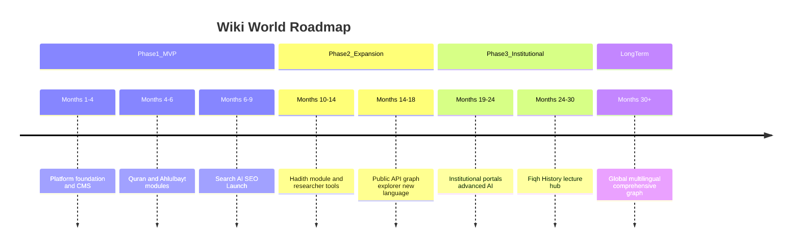
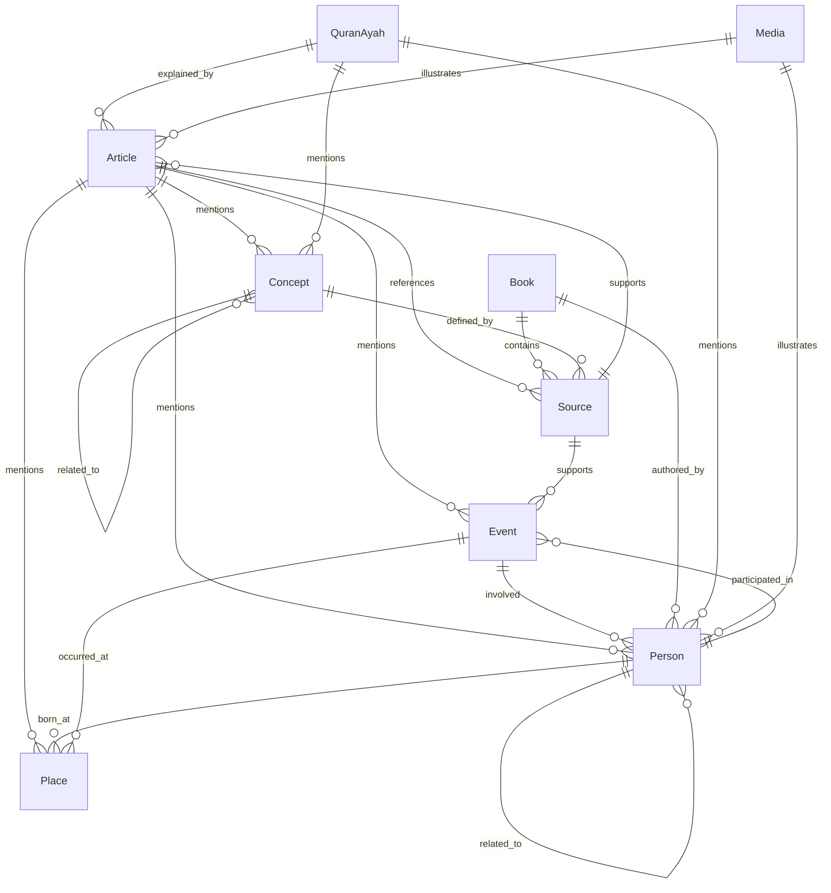

# Product Requirements Document

# ويكي العالمية — Wiki World

**Document Version:** 1.0  
**Status:** Draft for Review  
**Date:** July 7, 2026  
**Classification:** Internal — Product & Engineering  
**Primary Language:** Arabic (RTL)  
**Secondary Language:** English (LTR)

---

## Document Control

| Field                  | Value                                                              |
| ---------------------- | ------------------------------------------------------------------ |
| Product Name (Arabic)  | ويكي العالمية                                                      |
| Product Name (English) | Wiki World                                                         |
| Document Owner         | Product Management                                                 |
| Intended Audience      | Engineering, Design, Editorial, Leadership, Institutional Partners |
| Scope                  | MVP (Phase 1)                                                      |
| School of Thought      | Ja'fari (Shia Imamiyyah)                                           |

### Revision History

| Version | Date       | Author             | Changes              |
| ------- | ---------- | ------------------ | -------------------- |
| 1.0     | 2026-07-07 | Product Management | Initial complete PRD |

---

## Table of Contents

1. [Executive Summary](#1-executive-summary)
2. [Problem Statement](#2-problem-statement)
3. [Goals](#3-goals)
4. [Target Audience & Personas](#4-target-audience--personas)
5. [User Stories](#5-user-stories)
6. [Functional Requirements](#6-functional-requirements)
7. [Non-Functional Requirements](#7-non-functional-requirements)
8. [User Journeys](#8-user-journeys)
9. [MVP Scope](#9-mvp-scope)
10. [Success Metrics](#10-success-metrics)
11. [Risks](#11-risks)
12. [Product Roadmap](#12-product-roadmap)

- [Appendix A: Glossary](#appendix-a-glossary)
- [Appendix B: Editorial & Sourcing Standards](#appendix-b-editorial--sourcing-standards)
- [Appendix C: Entity Relationship Model](#appendix-c-entity-relationship-model)
- [Appendix D: Open Decisions Log](#appendix-d-open-decisions-log)
- [Appendix E: Requirement Traceability Index](#appendix-e-requirement-traceability-index)

---

# 1. Executive Summary

## 1.1 Product Vision

**ويكي العالمية (Wiki World)** is a next-generation Islamic Knowledge Platform that organizes Islamic knowledge into a structured **Knowledge Graph**. It is not a traditional wiki. It does not rely on crowdsourced, unreviewed editing. It does not generate religious opinions. It presents documented knowledge supported by scholarly sources within the Ja'fari (Shia Imamiyyah) school of thought.

Wiki World combines four capabilities that today exist only in fragmented form across the internet:

1. **Structured knowledge** — interconnected entities (persons, events, places, concepts, books, sources, articles) rather than isolated web pages.
2. **Modern discovery** — semantic search and an AI assistant that surfaces answers grounded in the platform corpus with mandatory citations.
3. **Scholarly integrity** — every substantive claim traceable to academically referenced sources; editor-only publishing with review workflows.
4. **World-class experience** — Arabic-first, RTL-native design inspired by the clarity of Apple Human Interface Guidelines, the structure of Notion, the speed of Linear, the breadth of Wikipedia, the connectedness of Google Knowledge Graph, and the conversational discovery of Perplexity AI.

The platform is architected for unlimited future expansion. The MVP establishes the foundation with two foundational modules — **Holy Quran** and **Ahlulbayt (AS)** — while the entity model, CMS, search, AI, and internationalization architecture support subsequent modules (Hadith, Fiqh, Islamic History, Ethics, and beyond).

## 1.2 Product in One Sentence

Wiki World is the authoritative, interconnected, AI-assisted digital reference for Ja'fari Islamic knowledge — beginning with the Quran and Ahlulbayt — designed Arabic-first for learners, researchers, and institutions worldwide.

## 1.3 Strategic Context

Islamic knowledge online suffers from fragmentation, weak discoverability, inconsistent sourcing, and poor Arabic user experience. Existing platforms are either encyclopedic but unstructured (Wikipedia), searchable but siloed (individual publisher sites), or AI-powered but ungrounded (generic chatbots). Wiki World occupies the intersection: **structured, sourced, discoverable, and modern**.

The platform operates under a **nonprofit / waqf / institutional funding model**. Public access is free. There is no paywall in MVP. Sustainability is achieved through institutional partnerships, grants, waqf contributions, and scholarly community support.

## 1.4 MVP Focus

The first release delivers:

| Capability         | Description                                                     |
| ------------------ | --------------------------------------------------------------- |
| Public Website     | Responsive, SEO-optimized, Arabic-primary public experience     |
| CMS                | Editor-only content management with review and publish workflow |
| Quran Module       | Surah/ayah navigation, cross-linked commentary, search          |
| Ahlulbayt Module   | Profiles, lineage, events, linked knowledge                     |
| Knowledge Entities | Articles, Books, Sources, Persons, Events, Places, Concepts     |
| Timeline           | Chronological exploration of historical events                  |
| Semantic Search    | Meaning-based discovery across the full corpus                  |
| AI Assistant       | RAG-ready conversational assistant with citation requirements   |
| Personalization    | Optional public accounts (bookmarks, history, saved searches)   |
| Administration     | Roles, analytics, SEO controls, platform settings               |

## 1.5 Core Principles

| Principle               | Meaning for Product                                                 |
| ----------------------- | ------------------------------------------------------------------- |
| Knowledge First         | Content and connections are the primary UI; chrome is minimal       |
| Everything is Connected | Every entity links to related entities; isolation is a defect       |
| Sources Before Claims   | No unsourced substantive claim is published or surfaced by AI       |
| Modern UX               | Fast, elegant, professional; no legacy wiki aesthetics              |
| Long-term Scalability   | Modular domains, unlimited languages, graph growth                  |
| AI Assists Knowledge    | AI discovers and synthesizes; it does not invent doctrine           |
| Modular Architecture    | New modules plug into shared entity, search, and CMS infrastructure |

## 1.6 Design Philosophy

Wiki World draws inspiration from established products but does not imitate them:

- **Wikipedia** — breadth of coverage and public trust in reference content
- **Google Knowledge Graph** — entity relationships, panels, and connected exploration
- **Apple Human Interface Guidelines** — clarity, deference to content, depth through hierarchy
- **Notion** — structured blocks, clean reading experience, editorial flexibility
- **Linear** — speed, keyboard-first efficiency for editorial workflows
- **Perplexity AI** — prominent search, synthesized answers with source attribution

The resulting experience must feel: **modern, minimal, elegant, fast, professional, scalable, and knowledge-first**.

## 1.7 Stakeholder Summary

| Stakeholder                | Interest                                               |
| -------------------------- | ------------------------------------------------------ |
| General Muslims            | Accessible, trustworthy knowledge in Arabic            |
| Researchers                | Deep sourcing, cross-references, citation chains       |
| Hawza students             | Structured content aligned with traditional curricula  |
| University students        | Bilingual access, essay and research support           |
| Teachers & lecturers       | Presentation-ready, reliably sourced material          |
| Authors & content creators | Authoritative reference to cite and link to            |
| Islamic institutions       | Credible digital infrastructure for their communities  |
| Editorial team             | Efficient CMS, clear standards, quality workflows      |
| Platform administrators    | Analytics, SEO, user management, system health         |
| Scholarly advisory board   | doctrinal accuracy, sourcing standards, content review |

## 1.8 Key Product Decisions (Confirmed)

| Decision         | Resolution                                                     |
| ---------------- | -------------------------------------------------------------- |
| Editing model    | Editor-only; no public wiki editing                            |
| Public accounts  | Optional; enable bookmarks, history, saved searches            |
| Monetization     | Free public access; nonprofit/waqf/institutional funding       |
| Doctrine         | Ja'fari (Shia Imamiyyah); sourced content only                 |
| Primary language | Arabic (RTL)                                                   |
| Launch languages | Arabic + English                                               |
| Future languages | Unlimited via scalable i18n; no hardcoded strings              |
| AI scope         | RAG-grounded assistant; citations required; no fatwa authority |

---

# 2. Problem Statement

## 2.1 The Problem

Islamic knowledge — particularly within the Ja'fari tradition — is abundant in books, hawza curricula, lectures, and digital archives. Yet for the average Muslim, student, researcher, or teacher, accessing this knowledge online is frustrating, unreliable, and inefficient. The digital landscape forces users to choose between breadth without depth (general search engines), depth without structure (PDF libraries), or convenience without credibility (unsourced social media and generic AI).

Wiki World exists to solve this structural failure.

## 2.2 Pain Points by Domain

### 2.2.1 Fragmented Knowledge

**Current state:** A user researching Imam Ali (AS) may consult a biography on one website, a timeline on another, Quranic references in a standalone app, and academic sources in a PDF repository. None of these sources are connected. Context is lost. Duplication is rampant.

**Impact:** Users spend excessive time assembling a complete picture. Institutions cannot point to a single authoritative digital reference. Knowledge remains siloed.

**Wiki World response:** A unified Knowledge Graph where Persons, Events, Places, Concepts, Articles, Books, and Sources are cross-linked. Navigating from a Person to their related Events, Places, Quranic mentions, and source citations is a first-class experience.

### 2.2.2 Weak Discoverability

**Current state:** Most Islamic content platforms rely on keyword search or manual browsing. Users must know the exact term (often in Arabic) to find content. Semantic relationships — e.g., "events related to Karbala" or "Quranic themes about patience" — are not discoverable without expert knowledge.

**Impact:** Learners cannot explore by meaning. Researchers miss relevant cross-references. Search engines surface generic results without scholarly filtering.

**Wiki World response:** Hybrid semantic + keyword search across the full corpus, with faceted filters by entity type, module, date, and language. AI assistant synthesizes answers with citations, enabling discovery by question rather than keyword.

### 2.2.3 Trust Gap

**Current state:** Online Islamic content ranges from excellent scholarship to sectarian polemics to AI hallucinations presented as fact. Users — especially youth — cannot easily distinguish sourced scholarship from opinion. Ja'fari-specific content is often buried within generalist platforms that lack editorial standards for this school of thought.

**Impact:** Erosion of trust in digital Islamic resources. Researchers cannot cite online content. Institutions hesitate to endorse platforms.

**Wiki World response:** Editor-curated, academically referenced content within Ja'fari scholarship. Mandatory source attachment for claims. AI grounded exclusively in the platform corpus with citation requirements. Clear disclaimers that the platform presents documented knowledge, not personal religious rulings.

### 2.2.4 Poor Arabic User Experience

**Current state:** Most knowledge platforms are designed LTR-first. Arabic is treated as a translation layer. RTL layout, Arabic typography, numeral conventions, and morphological search are afterthoughts. Reading experience on mobile is particularly poor.

**Impact:** Arabic-primary users — the majority of the target audience — experience friction, reduced comprehension, and lower engagement.

**Wiki World response:** Arabic as the primary design language. RTL-native layouts, locale-aware typography, Eastern Arabic numerals by default in Arabic locale, and search that accounts for Arabic morphology. English is fully supported as a peer language, not a fallback.

### 2.2.5 Unstructured Relationships

**Current state:** Traditional wikis and article-based sites present flat pages. Relationships between a historical event, the persons involved, the places affected, the concepts discussed, and the sources documenting them are implicit — buried in prose or absent.

**Impact:** Users cannot see the knowledge graph. Teachers cannot illustrate connections. Researchers manually reconstruct relationships.

**Wiki World response:** First-class entity types (Person, Event, Place, Concept, Source, Book, Article) with explicit relationships, infoboxes, related-entity panels, timeline views, and "explore connections" navigation.

### 2.2.6 Research Friction

**Current state:** Academic and hawza research requires manual cross-referencing across books, footnotes, and digital archives. Citation chains are labor-intensive to reconstruct. No platform provides a unified bibliography view linked to entity claims.

**Impact:** Research takes longer than necessary. Citation errors increase. Students produce work with weak sourcing.

**Wiki World response:** Source entities with bibliographic metadata, inline citations on articles, source drill-down from any claim, and related-entity exploration. AI provides synthesized entry points with verifiable citations. Phase 2 adds formal citation export.

### 2.2.7 Editorial Chaos (Lessons from Traditional Wikis)

**Current state:** Open wiki models produce edit wars, inconsistent quality, and vandalism risk — unacceptable for religious knowledge platforms.

**Impact:** Content quality is unpredictable. Scholarly institutions will not associate with crowdsourced religious content.

**Wiki World response:** Editor-only publishing with draft → review → publish workflow. Role-based permissions. Version history. Editorial standards enforced by checklist before publication.

## 2.3 Why Now

Several converging factors make Wiki World timely:

1. **Semantic search maturity** — vector and hybrid search enable meaning-based discovery in Arabic and English.
2. **RAG-ready AI** — large language models can synthesize answers from a curated corpus when constrained by citation requirements and editorial guardrails.
3. **Institutional demand** — Hawza, universities, and Islamic centers seek credible digital infrastructure post-pandemic.
4. **SEO opportunity** — high-intent Islamic queries remain underserved by structured, Ja'fari-specific, Arabic-first results.
5. **Generational shift** — younger Muslims expect modern UX comparable to consumer technology products.

## 2.4 Problem Statement Summary

> Muslims, students, researchers, and institutions lack a unified, trustworthy, interconnected, and modern digital platform for Ja'fari Islamic knowledge. Wiki World solves this by organizing knowledge into a sourced Knowledge Graph with semantic search, AI-assisted discovery, and editor-curated content — Arabic-first, free, and built to scale.

---

# 3. Goals

## 3.1 Business Goals

| ID    | Goal                       | Description                                                                                                              | Horizon      |
| ----- | -------------------------- | ------------------------------------------------------------------------------------------------------------------------ | ------------ |
| BG-01 | Authoritative reference    | Establish Wiki World as the recognized digital reference for Quran and Ahlulbayt knowledge within the Ja'fari community  | 12–18 months |
| BG-02 | Institutional partnerships | Secure partnerships with at least 5 Hawza, university, or mosque institutions for content collaboration and distribution | 12 months    |
| BG-03 | Organic discovery          | Achieve top-10 organic search rankings for 50+ high-intent Arabic and English queries in MVP domains                     | 18 months    |
| BG-04 | Sustainable funding        | Establish nonprofit funding base through waqf, grants, and institutional support sufficient for 24 months of operations  | 18 months    |
| BG-05 | Modular foundation         | Deliver architecture and content model that supports Phase 2 modules without platform redesign                           | MVP launch   |
| BG-06 | Editorial pipeline         | Build a sustainable editor and reviewer pipeline capable of publishing 20+ quality entities per week                     | 9 months     |
| BG-07 | Brand trust                | Achieve recognition among target personas as a credible, non-polemical knowledge source                                  | 12 months    |

## 3.2 User Goals

| ID    | Goal                                                                 | Primary Personas          |
| ----- | -------------------------------------------------------------------- | ------------------------- |
| UG-01 | Find accurate, sourced answers quickly                               | Fatima, Sara, Ali         |
| UG-02 | Explore connections between scripture, persons, events, and concepts | Fatima, Ali, Dr. Hassan   |
| UG-03 | Research with traceable citations                                    | Dr. Hassan, Sara, Ali     |
| UG-04 | Teach and lecture with reliable references                           | Ustadh Karim              |
| UG-05 | Save and resume reading across sessions                              | Fatima, Sara              |
| UG-06 | Study Quran with cross-linked context                                | Fatima, Ali               |
| UG-07 | Navigate Ahlulbayt knowledge by lineage, era, and event              | Fatima, Ali, Ustadh Karim |
| UG-08 | Discover content by meaning, not just keywords                       | All public personas       |
| UG-09 | Verify AI answers against primary sources                            | Dr. Hassan, Sara          |
| UG-10 | Publish quality content efficiently                                  | Maryam                    |

## 3.3 Product Goals (MVP)

| ID    | Goal                                                                  | Success Indicator                                                   |
| ----- | --------------------------------------------------------------------- | ------------------------------------------------------------------- |
| PG-01 | Launch public website with Quran and Ahlulbayt modules                | Modules live with seed content                                      |
| PG-02 | Enable semantic search across all entity types                        | Search returns relevant results for natural-language Arabic queries |
| PG-03 | Deploy AI assistant with 95%+ citation coverage on answerable queries | Measured via QA audit                                               |
| PG-04 | Support Arabic and English with full RTL/LTR parity                   | Locale audit passes                                                 |
| PG-05 | Achieve editor-only CMS with review workflow                          | Editorial team publishes via CMS exclusively                        |
| PG-06 | Deliver optional public accounts with personalization                 | Registration and bookmark flows functional                          |
| PG-07 | Meet Core Web Vitals targets on public pages                          | 75th percentile passes                                              |
| PG-08 | Index 500+ entity pages for SEO within 90 days of launch              | Search Console indexed count                                        |

## 3.4 Success Vision (12–18 Months Post-Launch)

Wiki World is the default recommendation when a Ja'fari Muslim, student, or institution needs reliable information about the Quran or Ahlulbayt online. Researchers cite it. Teachers link to it. Hawza students use it alongside traditional texts. Search engines surface it for high-intent queries in Arabic and English.

Quantitatively:

- 100,000+ monthly active users
- 2,000+ published entities with sourcing compliance above 90%
- AI citation integrity rate above 95% on audited queries
- 10+ institutional partnerships
- Organic traffic accounts for 60%+ of visits
- Registered user conversion rate of 15%+ among returning visitors

Qualitatively:

- Scholarly advisory board actively engaged in content standards
- Zero major reputational incidents related to unsourced or AI-generated doctrine
- Editorial team reports CMS efficiency gains vs. prior workflows
- User feedback describes the platform as "trustworthy," "beautiful," and "fast"

## 3.5 Non-Goals (MVP)

- Becoming a fatwa or marja' platform
- Open crowdsourced editing
- Monetization via paywall or subscription
- Replacing hawza curricula or traditional study
- Generating original religious opinions or ijtihad

---

# 4. Target Audience & Personas

## 4.1 Audience Segments

| Segment              | Description                                          | Primary Needs                                       |
| -------------------- | ---------------------------------------------------- | --------------------------------------------------- |
| General Muslims      | Everyday learners seeking reliable Islamic knowledge | Accessibility, clarity, Arabic UX, trust            |
| Researchers          | Academic and independent scholars                    | Citations, depth, cross-references, source chains   |
| Hawza students       | Seminary students in structured programs             | Primary sources, curriculum alignment, Arabic depth |
| University students  | Undergraduate and graduate students                  | Bilingual access, essay support, timelines          |
| Teachers             | School and community educators                       | Presentation-ready content, reliable references     |
| Authors & lecturers  | Content creators and public speakers                 | Citable material, accurate quotations               |
| Islamic institutions | Hawza, universities, mosques, publishers             | Credibility, partnership, distribution              |
| Editorial team       | Content editors and reviewers                        | Efficient CMS, clear standards                      |
| Administrators       | Platform operators                                   | Analytics, roles, SEO, health monitoring            |

## 4.2 Persona 1: Fatima — General Muslim Learner

| Attribute    | Detail                                    |
| ------------ | ----------------------------------------- |
| Age          | 28                                        |
| Location     | Baghdad, Iraq                             |
| Language     | Arabic-primary; basic English             |
| Device       | Smartphone (primary), occasional tablet   |
| Education    | University graduate (non-religious field) |
| Tech comfort | High; uses Instagram, YouTube, ChatGPT    |

**Context:** Fatima wants to deepen her understanding of the Ahlulbayt and Quranic themes but finds hawza texts intimidating and online content unreliable. She searches on her phone during commutes and evening reading.

**Jobs to be Done:**

- Learn about an Imam's life and significance in under 15 minutes
- Find Quranic verses related to a topic (e.g., patience, justice)
- Trust that what she reads is accurate and not sectarian polemic
- Save articles to read later
- Share links with family members

**Frustrations:**

- Too many websites with conflicting information
- English-dominated interfaces with poor Arabic typography
- Long unstructured articles without clear summaries
- No way to see how topics connect

**Behaviors:**

- Discovers content via WhatsApp shares and Google search
- Skims headings and infoboxes before reading body text
- Uses AI tools but distrusts unsourced answers
- Prefers mobile reading with dark mode

**Success Criteria:**

- Finds a clear, sourced answer within 2 minutes of searching
- Understands key facts from infobox without reading full article
- Bookmarks content and resumes on another device after registering
- Feels confident sharing links with family

**Key Features Used:** Home, Search, Ahlulbayt profiles, Quran module, AI assistant, Bookmarks, Language toggle

---

## 4.3 Persona 2: Dr. Hassan — Academic Researcher

| Attribute   | Detail                    |
| ----------- | ------------------------- |
| Age         | 45                        |
| Location    | London, UK                |
| Language    | Bilingual Arabic/English  |
| Device      | Desktop (primary), laptop |
| Education   | PhD in Islamic Studies    |
| Affiliation | University department     |

**Context:** Dr. Hassan researches early Islamic historiography with focus on Ja'fari sources. He needs precise citations, source chains, and cross-references. He may cite Wiki World in academic work if sourcing is rigorous.

**Jobs to be Done:**

- Trace a historical claim to primary and secondary sources
- Discover related persons, events, and concepts across modules
- Evaluate source reliability and scholarly tier
- Find Quranic references linked to historical events
- Identify content gaps for his own research contributions

**Frustrations:**

- Existing databases lack Ja'fari-specific curation
- Wikipedia is unreliable for sensitive biographical content
- Generic AI invents hadith and sources
- No unified bibliography view across topics

**Behaviors:**

- Enters via Google Scholar and direct search
- Opens multiple entity tabs; follows relationship links
- Verifies every claim against attached sources
- Rarely registers unless personalization adds value

**Success Criteria:**

- Every claim on an entity page links to a verifiable source
- Source entity shows full bibliographic metadata
- Related entities surface non-obvious connections
- AI answers include citations he can verify in under 30 seconds

**Key Features Used:** Search (advanced filters), Source pages, Article citations, Timeline, AI assistant (verification), Book chapters

---

## 4.4 Persona 3: Ali — Hawza Student

| Attribute    | Detail                                       |
| ------------ | -------------------------------------------- |
| Age          | 22                                           |
| Location     | Qom, Iran                                    |
| Language     | Arabic-primary; Farsi conversational         |
| Device       | Smartphone and shared hawza computer         |
| Education    | Advanced hawza studies (Bahath Kharij track) |
| Tech comfort | Moderate                                     |

**Context:** Ali studies fiqh, history, and Quranic sciences in a structured hawza program. He uses digital tools to supplement traditional texts. He needs depth, Arabic primary sources, and cross-references aligned with Ja'fari scholarship.

**Jobs to be Done:**

- Cross-reference a Quranic ayah with tafsir excerpts and related concepts
- Study Ahlulbayt biographies with lineage and succession context
- Find primary sources (books, narrations) linked to topics
- Build mental maps of historical events and participants
- Prepare for exams with structured, sourced summaries

**Frustrations:**

- Digital resources are scattered across apps and PDFs
- Many platforms lack Ja'fari editorial standards
- Search does not understand Arabic root morphology
- Shallow content that does not reference classical works

**Behaviors:**

- Uses platform during study sessions alongside physical books
- Navigates via Quran surah/ayah and Person profiles
- Follows source links to book chapters
- Uses timeline to contextualize events

**Success Criteria:**

- Quranic module links ayahs to concepts and Ahlulbayt mentions
- Person profiles include lineage, titles, and key works
- Sources reference recognized classical texts
- Search finds content by Arabic root, not just exact match

**Key Features Used:** Quran module, Ahlulbayt module, Person/Event entities, Books, Sources, Timeline, Search

---

## 4.5 Persona 4: Sara — University Student

| Attribute    | Detail                                 |
| ------------ | -------------------------------------- |
| Age          | 20                                     |
| Location     | Toronto, Canada                        |
| Language     | English-primary; functional Arabic     |
| Device       | Laptop (primary), smartphone           |
| Education    | Undergraduate — Middle Eastern Studies |
| Tech comfort | High                                   |

**Context:** Sara writes essays on Shia Islam for university courses. She needs credible, citable sources in English with access to Arabic originals. She toggles between languages depending on assignment requirements.

**Jobs to be Done:**

- Research essay topics with reliable citations
- Understand timelines of early Islamic history
- Find bilingual content (English article with Arabic terms preserved)
- Save sources and articles for bibliography
- Use AI to orient herself, then verify with primary sources

**Frustrations:**

- University libraries lack Ja'fari-specific digital resources
- Wikipedia flagged as unreliable by professors
- Arabic content she cannot fully read
- Difficulty building coherent narrative from scattered facts

**Behaviors:**

- Starts with broad AI question, narrows via search filters
- Uses English interface but reads Arabic names/terms in original
- Bookmarks articles per assignment
- Copies citation metadata for footnotes (MVP: manual copy; Phase 2: export)

**Success Criteria:**

- English articles are complete and sourced, not machine-translated stubs
- Timeline helps her structure essay chronology
- Source pages provide enough metadata for academic citation
- Language toggle preserves context (same entity, localized presentation)

**Key Features Used:** Search, Articles, Timeline, Sources, AI assistant, Bookmarks, Language toggle

---

## 4.6 Persona 5: Ustadh Karim — Teacher & Lecturer

| Attribute | Detail                                              |
| --------- | --------------------------------------------------- |
| Age       | 38                                                  |
| Location  | Dearborn, USA                                       |
| Language  | Bilingual Arabic/English                            |
| Device    | Tablet (lectures), desktop (preparation)            |
| Role      | Community center instructor; weekend Islamic school |

**Context:** Ustadh Karim prepares lectures for youth and adults. He needs presentation-ready content with accurate references he can display or distribute as links.

**Jobs to be Done:**

- Prepare lecture outlines with key facts and dates
- Find Quranic verses and Ahlulbayt stories for specific themes
- Share links with students as pre-reading
- Verify facts before presenting to avoid errors
- Discover related concepts to enrich lectures

**Frustrations:**

- Preparing lectures takes hours of cross-referencing
- Students encounter unreliable content when googling
- Existing resources are too academic or too shallow
- No single link he can trust to share

**Behaviors:**

- Browses Ahlulbayt module by era before lecture prep
- Uses Timeline to build chronological narrative
- Shares entity URLs via WhatsApp and email
- Projects article pages on screen during lectures

**Success Criteria:**

- Entity pages have clear structure suitable for projection
- Infoboxes provide at-a-glance facts for lectures
- Shared links load fast on student phones
- Content is respectful and appropriate for youth audiences

**Key Features Used:** Ahlulbayt module, Timeline, Articles, Quran module, Share links, Search

---

## 4.7 Persona 6: Maryam — Content Editor

| Attribute    | Detail                              |
| ------------ | ----------------------------------- |
| Age          | 32                                  |
| Location     | Najaf, Iraq                         |
| Language     | Arabic-native; professional English |
| Role         | Wiki World content editor           |
| Tech comfort | Moderate-high                       |

**Context:** Maryam holds a degree in Islamic history and works on the editorial team. She creates and edits articles, person profiles, and event entries. She is accountable for sourcing standards and editorial quality.

**Jobs to be Done:**

- Create draft entities with structured content blocks
- Attach and link sources to every substantive claim
- Link entities to other entities in the knowledge graph
- Submit drafts for senior editor review
- Upload and manage media with proper metadata
- Track revision history and respond to review feedback

**Frustrations:**

- Unstructured editors lead to inconsistent formatting
- Easy to publish without required sources
- Difficult to find existing entities to link (duplication risk)
- No visibility into which topics have content gaps

**Behaviors:**

- Works in CMS daily; uses entity linking picker extensively
- Follows editorial checklist before submission
- Reviews analytics for popular searches to prioritize content
- Collaborates with senior editor via review queue

**Success Criteria:**

- CMS prevents submission without mandatory source attachments
- Entity linking picker surfaces existing entities to avoid duplicates
- Draft → review → publish workflow is clear and fast
- Version history allows rollback after publish

**Key Features Used:** CMS, Source management, Media library, Entity linking, Review queue, Editorial analytics

---

## 4.8 Persona 7: Admin Yusuf — Platform Administrator

| Attribute    | Detail                 |
| ------------ | ---------------------- |
| Age          | 40                     |
| Location     | Remote (Kuwait)        |
| Language     | Bilingual              |
| Role         | Platform administrator |
| Tech comfort | High                   |

**Context:** Yusuf manages platform operations: user roles, SEO configuration, analytics, feature toggles, and system health. He does not create content but enables the editorial team and monitors platform performance.

**Jobs to be Done:**

- Invite and assign roles to editors and reviewers
- Configure site-wide settings (locale defaults, maintenance mode)
- Monitor traffic, search, and AI usage analytics
- Manage SEO metadata templates and sitemap health
- Toggle features (AI, registration) without deployment
- Review audit logs for editorial actions

**Frustrations:**

- Fragmented admin tools across systems
- No single dashboard for content + traffic + search health
- SEO issues discovered late via external tools
- Difficulty onboarding new editors with correct permissions

**Behaviors:**

- Checks admin dashboard daily
- Reviews zero-result search reports weekly
- Coordinates with editorial lead on content gap priorities
- Responds to security and access requests

**Success Criteria:**

- Single admin interface for users, settings, analytics, SEO
- Role assignment takes under 5 minutes per user
- Search zero-result report drives editorial prioritization
- Audit log captures all publish and role-change events

**Key Features Used:** Admin dashboard, User/role management, Analytics, SEO controls, Settings, Audit logs

---

## 4.9 Persona Priority Matrix (MVP)

| Persona      | Priority | Rationale                                          |
| ------------ | -------- | -------------------------------------------------- |
| Fatima       | P0       | Largest addressable audience; validates core UX    |
| Maryam       | P0       | Editorial pipeline is prerequisite for all content |
| Ali          | P0       | Validates scholarly depth and Arabic quality       |
| Dr. Hassan   | P1       | Validates sourcing rigor and research utility      |
| Sara         | P1       | Validates English parity and bilingual model       |
| Ustadh Karim | P1       | Validates shareability and lecture-ready structure |
| Admin Yusuf  | P0       | Validates operability and governance               |

---

# 5. User Stories

User stories are grouped by actor. Each story includes acceptance notes defining testable product-level outcomes. Requirement IDs in Section 6 trace to these stories.

## 5.1 Anonymous Visitor Stories

### Discovery & Navigation

| ID | User Story | Acceptance Notes |
|----|------------|------------------|
| US-V-001 | As an anonymous visitor, I want to land on a home page that highlights Quran and Ahlulbayt modules, so that I can immediately begin exploring the platform's core content. | Home displays module entry points, featured entities, and global search. Default locale is Arabic. |
| US-V-002 | As an anonymous visitor, I want to switch between Arabic and English, so that I can read content in my preferred language. | Language toggle persists for session. Layout direction changes RTL/LTR. Same entity loads localized content. |
| US-V-003 | As an anonymous visitor, I want to browse content on mobile, tablet, and desktop, so that I can access knowledge on any device. | All public pages responsive. No horizontal scroll on 320px viewport. |
| US-V-004 | As an anonymous visitor, I want to navigate via a clear global menu, so that I can reach any module or entity type without confusion. | Persistent nav includes: Home, Quran, Ahlulbayt, Search, Timeline, Articles, Books. |
| US-V-005 | As an anonymous visitor, I want to share entity URLs with others, so that I can recommend specific content. | URLs are canonical, stable, and preview correctly on social platforms (Open Graph). |

### Search

| ID | User Story | Acceptance Notes |
|----|------------|------------------|
| US-V-010 | As an anonymous visitor, I want to search using natural language in Arabic, so that I find content by meaning not just exact keywords. | Search returns relevant results for paraphrased Arabic queries. Results appear within perceived 1 second. |
| US-V-011 | As an anonymous visitor, I want to filter search results by entity type, module, and date, so that I can narrow results to my need. | Facets available: Article, Book, Person, Event, Place, Concept, Source, Quran, Module. |
| US-V-012 | As an anonymous visitor, I want to see result snippets with entity type badges, so that I can choose the most relevant result quickly. | Each result shows title, snippet, type badge, and relevance indicator. |
| US-V-013 | As an anonymous visitor, I want to see helpful suggestions when search returns zero results, so that I am not left at a dead end. | Zero-result state suggests alternate queries, popular topics, and module links. |

### Entity Consumption

| ID | User Story | Acceptance Notes |
|----|------------|------------------|
| US-V-020 | As an anonymous visitor, I want to read article pages with table of contents and inline citations, so that I can navigate long content and verify claims. | Articles display TOC, section headings, inline source links, and related entities sidebar. |
| US-V-021 | As an anonymous visitor, I want to view person profiles with infoboxes showing lineage, titles, and key dates, so that I grasp essential facts immediately. | Person page includes infobox, biography, related events, works, and sources. |
| US-V-022 | As an anonymous visitor, I want to explore related entities from any page, so that I can follow knowledge connections. | "Related" panel shows linked Persons, Events, Places, Concepts, Sources. |
| US-V-023 | As an anonymous visitor, I want to view events on a timeline, so that I understand historical chronology. | Timeline displays filterable events. Clicking event opens Event entity page. |
| US-V-024 | As an anonymous visitor, I want to read book metadata and chapters online, so that I can access referenced works. | Book page shows metadata, TOC, chapter content. Download not required in MVP. |
| US-V-025 | As an anonymous visitor, I want to view source details with bibliographic information, so that I can evaluate and cite the reference. | Source page shows author, title, year, type, reliability tier, and linked claims. |

### Quran Module

| ID | User Story | Acceptance Notes |
|----|------------|------------------|
| US-V-030 | As an anonymous visitor, I want to browse Quran by surah and ayah, so that I can read and navigate scripture. | Surah list, surah page, ayah-level URLs. Arabic Uthmani text displayed. |
| US-V-031 | As an anonymous visitor, I want to jump to a specific ayah by reference (e.g., 2:255), so that I can reach verses directly. | Reference input resolves to correct surah/ayah. URL is shareable. |
| US-V-032 | As an anonymous visitor, I want to see cross-links from ayahs to related concepts, persons, and articles, so that I understand context. | Ayah page shows linked entities. Links are editor-curated. |
| US-V-033 | As an anonymous visitor, I want to read editor-curated tafsir excerpts and English translation, so that I deepen understanding without unsourced commentary. | Tafsir/translation labeled as sourced. No AI-generated tafsir displayed. |
| US-V-034 | As an anonymous visitor, I want to search within the Quran by theme or keyword, so that I find relevant verses. | Quran-scoped search returns ayah results with surah context. |

### Ahlulbayt Module

| ID | User Story | Acceptance Notes |
|----|------------|------------------|
| US-V-040 | As an anonymous visitor, I want to browse Ahlulbayt by generation and role, so that I can explore the holy household systematically. | Module landing offers browse paths: by generation, by title, by era. |
| US-V-041 | As an anonymous visitor, I want to view family and succession relationships, so that I understand lineage and Imamate. | Person profiles show structured lineage. Relationship visualization available at product level. |
| US-V-042 | As an anonymous visitor, I want respectful presentation of Ahlulbayt content, so that the platform honors religious sensibility. | Editorial style guide enforced. Honorifics (AS) applied per standards. |

### AI Assistant

| ID | User Story | Acceptance Notes |
|----|------------|------------------|
| US-V-050 | As an anonymous visitor, I want to ask questions in Arabic or English and receive answers with citations, so that I can trust the response. | AI displays answer with linked source/entity citations. Uncited claims are not shown. |
| US-V-051 | As an anonymous visitor, I want the AI to decline questions outside the platform corpus, so that I am not misled by speculation. | Out-of-corpus questions receive clear refusal with suggestion to search or browse. |
| US-V-052 | As an anonymous visitor, I want suggested follow-up questions, so that I can explore a topic deeper. | AI offers 2–3 relevant follow-ups per answer when appropriate. |
| US-V-053 | As an anonymous visitor, I want to see a disclaimer that the AI is not a religious authority, so that I understand its role. | Disclaimer visible in AI interface. Not dismissable permanently on first use. |

## 5.2 Registered Visitor Stories

| ID | User Story | Acceptance Notes |
|----|------------|------------------|
| US-R-001 | As a registered visitor, I want to create an account with email, so that I can personalize my experience. | Registration via email. Verification required. OAuth deferred to open decisions. |
| US-R-002 | As a registered visitor, I want to bookmark entities, ayahs, and articles, so that I can return to them later. | Bookmark action on all bookmarkable entity types. Bookmarks list in account area. |
| US-R-003 | As a registered visitor, I want to view my reading history, so that I can resume prior research. | History shows recently viewed entities with timestamps. User can clear history. |
| US-R-004 | As a registered visitor, I want to save searches, so that I can repeat complex queries. | Saved searches persist by name. One-click re-run. |
| US-R-005 | As a registered visitor, I want my language preference saved, so that I return to my preferred locale. | Locale preference stored in account. Applied on login. |
| US-R-006 | As a registered visitor, I want to access AI chat history, so that I can review prior research sessions. | Chat history list per user. Individual sessions viewable. Deletable. |
| US-R-007 | As a registered visitor, I want to access my account from multiple devices, so that bookmarks sync. | Account data syncs across sessions and devices. |

## 5.3 Researcher Stories

| ID | User Story | Acceptance Notes |
|----|------------|------------------|
| US-RS-001 | As a researcher, I want to drill down from a claim to its source entity, so that I verify accuracy. | Every inline citation links to Source page with full metadata. |
| US-RS-002 | As a researcher, I want to see all entities linked to a source, so that I understand how a reference is used across the platform. | Source page lists all linked claims and entities. |
| US-RS-003 | As a researcher, I want to filter search by source type and date range, so that I narrow to primary or classical references. | Search facets include source type, date range, language. |
| US-RS-004 | As a researcher, I want to copy citation metadata, so that I can include it in academic work. | Source page provides copyable citation block (MVP: manual copy). |
| US-RS-005 | As a researcher, I want to explore multi-hop connections (person → event → place → source), so that I reconstruct context. | Entity relationship navigation supports at least 3 hops without dead ends. |

## 5.4 Editor Stories

| ID | User Story | Acceptance Notes |
|----|------------|------------------|
| US-E-001 | As an editor, I want to create draft entities using structured content blocks, so that formatting is consistent. | CMS supports heading, paragraph, quote, list, citation, image, entity link blocks. |
| US-E-002 | As an editor, I want to attach sources to claims before publishing, so that sourcing standards are met. | Publish blocked if mandatory claims lack source attachments. |
| US-E-003 | As an editor, I want to link to existing entities via typeahead search, so that I build the knowledge graph without duplication. | Entity picker searches across types. Creates link, not duplicate. |
| US-E-004 | As an editor, I want to upload media with alt text and license metadata, so that assets are accessible and compliant. | Media upload requires alt text. License field mandatory. |
| US-E-005 | As an editor, I want to submit drafts for review, so that a senior editor approves before publication. | Draft status → Submitted → In Review. Editor cannot self-publish unless senior role. |
| US-E-006 | As an editor, I want to view and restore previous versions, so that I can recover from errors. | Version history with diff view. Rollback to any prior version. |
| US-E-007 | As an editor, I want to preview the public page before submission, so that I see exactly what visitors will see. | Preview renders public template with draft content. |
| US-E-008 | As an editor, I want to see an editorial checklist before submission, so that I do not miss required steps. | Checklist includes: sources attached, entities linked, media metadata, SEO fields, honorifics. |

## 5.5 Senior Editor / Reviewer Stories

| ID | User Story | Acceptance Notes |
|----|------------|------------------|
| US-SE-001 | As a senior editor, I want to view a queue of submitted drafts, so that I can prioritize review. | Review queue sorted by submission date, priority, module. |
| US-SE-002 | As a senior editor, I want to approve, reject, or request changes on drafts, so that quality is controlled. | Actions: Approve (publish), Reject (with reason), Request Changes (with comments). |
| US-SE-003 | As a senior editor, I want to publish approved content, so that it becomes publicly visible and indexed. | Publish triggers public visibility, sitemap update, search index update. |
| US-SE-004 | As a senior editor, I want to unpublish or revert published content, so that I can correct serious errors. | Unpublish removes from public and search. Prior version restorable. |
| US-SE-005 | As a senior editor, I want to flag AI responses for review, so that incorrect answers are investigated. | Flag action in AI interface (editor role). Flagged items appear in editorial queue. |

## 5.6 Administrator Stories

| ID | User Story | Acceptance Notes |
|----|------------|------------------|
| US-A-001 | As an administrator, I want to invite users and assign roles, so that the editorial team is properly provisioned. | Invite by email. Roles: Editor, Senior Editor, Admin, Super Admin. |
| US-A-002 | As an administrator, I want to configure site-wide settings, so that I control defaults without code changes. | Settings: site name, logo, default locale, maintenance mode, feature toggles. |
| US-A-003 | As an administrator, I want to view traffic and engagement analytics, so that I measure platform health. | Dashboard: MAU, page views, search volume, AI usage, registration conversion. |
| US-A-004 | As an administrator, I want to view zero-result search reports, so that I identify content gaps. | Report lists queries with zero results, frequency, date range. |
| US-A-005 | As an administrator, I want to manage SEO defaults and verify structured data, so that search engines index content correctly. | SEO settings: meta templates, sitemap status, hreflang validation report. |
| US-A-006 | As an administrator, I want to view audit logs of editorial actions, so that I ensure accountability. | Log captures: publish, unpublish, role change, settings change. Filterable by user and action. |
| US-A-007 | As an administrator, I want to toggle AI and registration features, so that I can respond to issues without deployment. | Feature toggles take effect within 5 minutes. |

---
# 6. Functional Requirements

Functional requirements define **what** the system must do at the product level. Each requirement has a unique ID, description, and acceptance criteria. IDs use the prefix `FR-{DOMAIN}-{NNN}`.

## 6.1 Platform Foundation

### FR-PLAT-001: Home Page

**Description:** The public home page is the primary entry point for discovery.

**Behavior:**
- Displays platform identity (name, tagline in active locale)
- Highlights Quran and Ahlulbayt module entry points
- Features curated entities (editorially selected)
- Prominent global search bar
- Language toggle (Arabic default)

**Acceptance Criteria:**
- Home loads as default route for unauthenticated visitors
- Arabic locale is default for first-time visitors without preference
- Featured content is manageable via CMS/admin without code change
- Search bar accepts input and routes to search results

### FR-PLAT-002: Global Navigation

**Description:** Persistent navigation across all public pages.

**Behavior:**
- Primary links: Home, Quran, Ahlulbayt, Articles, Books, Timeline, Search
- Language toggle always visible
- Account entry (login/register) when registration enabled
- Mobile: collapsible menu with full link set

**Acceptance Criteria:**
- Navigation consistent on all public pages
- Active page indicated in nav
- Mobile nav accessible via keyboard and screen reader
- RTL: nav order mirrors appropriately

### FR-PLAT-003: RTL/LTR Layout

**Description:** Layout direction follows active locale.

**Behavior:**
- Arabic: RTL layout, right-aligned text, mirrored UI chrome
- English: LTR layout
- Typography optimized per locale
- Eastern Arabic numerals in Arabic locale; Western in English

**Acceptance Criteria:**
- No LTR leakage in Arabic mode
- Direction switches without page reload where possible
- Mixed Arabic/English content renders correctly (bidirectional text)

### FR-PLAT-004: Responsive Design

**Description:** All public and editorial interfaces adapt to viewport.

**Breakpoints:** Phone 320–767px; Tablet 768–1023px; Desktop 1024px+

**Acceptance Criteria:**
- No horizontal overflow on 320px width
- Touch targets minimum 44×44px on mobile
- Editorial CMS usable on tablet (minimum)

### FR-PLAT-005: Public Authentication (Optional)

**Description:** Visitors may create accounts for personalization without login required for reading.

**Behavior:** Registration via email + password; verification required; login, logout, password reset; account settings for language and privacy.

**Acceptance Criteria:**
- Unauthenticated users have full read access
- Registration disableable via admin toggle
- Password reset completes via email link
- Session persists 30 days default

### FR-PLAT-006: Editorial Authentication

**Description:** Editors and administrators use role-gated elevated access.

**Behavior:** MFA required for Admin and Super Admin; editorial session timeout 8 hours.

**Acceptance Criteria:**
- Non-editorial roles cannot access CMS or admin
- MFA enforced on first admin login
- Lockout after 5 failed attempts (15-minute cooldown)

### FR-PLAT-007: Maintenance Mode

**Description:** Admin enables maintenance mode for public site while CMS remains accessible.

**Acceptance Criteria:** Toggle in admin; localized message; editors retain access; 503 for public.

## 6.2 Knowledge Graph & Entity Model

### FR-GRAPH-001: Entity Types

**Description:** MVP supports eight entity types forming the knowledge graph ontology.

| Entity Type | Arabic Label | Purpose |
|-------------|--------------|---------|
| Article | مقالة | Narrative knowledge entry |
| Book | كتاب | Published work with chapters |
| Source | مصدر | Citation and bibliographic reference |
| Person | شخص | Biographical node |
| Event | حدث | Historical occurrence |
| Place | مكان | Geographic or holy site |
| Concept | مفهوم | Theological or abstract term |
| Media | وسائط | Image, audio, document asset |

**Acceptance Criteria:**
- Each entity type has a distinct public page template
- Each entity has a unique canonical URL
- Entity type is immutable after creation in MVP

### FR-GRAPH-002: Entity Relationships

**Description:** Entities connect via typed, bidirectional relationships forming the knowledge graph.

**Core relationships:** Article references Source; Article mentions Person, Event, Place, Concept; Person participated_in Event; Person related_to Person; Event occurred_at Place; Book authored_by Person; Quran Ayah mentions Person and Concept; any entity illustrated_by Media.

**Acceptance Criteria:**
- Related panel displays reverse links for all relationship types
- Relationship type labels localized in ar/en
- Users can traverse relationships without using search

### FR-GRAPH-003: Entity Page Structure

**Description:** Consistent page structure across all public entity types.

**Components:** Header (title, subtitle, type badge); infobox (type-specific metadata); body content; inline citations; related entities panel; explore connections; breadcrumb; share; bookmark (registered users).

**Acceptance Criteria:**
- All applicable components render on every published entity type
- Bilingual entities display localized content per active locale
- Infobox fields defined per type (see Appendix C)

### FR-GRAPH-004: Canonical URLs and Slugs

**Description:** Stable, human-readable, locale-aware URLs for all entities.

**Behavior:** URL pattern `/{locale}/{type}/{slug}`; slugs unique per locale and type; 301 redirect on slug change.

**Acceptance Criteria:**
- No duplicate slugs within same locale and type
- URL remains stable after minor content edits
- Slug change creates automatic redirect

### FR-GRAPH-005: Explore Connections

**Description:** Graph navigation from any entity page.

**Behavior:** One-hop relationships displayed by default; expandable to two hops; interactive navigation to related entities.

**Acceptance Criteria:**
- Explore panel loads within 1 second for entities with ≤50 relationships
- All relationship types represented in explore view

## 6.3 CMS (Editor-Only)

### FR-CMS-001: Structured Content Editor

**Description:** Editors create content using structured blocks ensuring consistency and quality.

**Block types:** Heading (H2/H3), paragraph, quote, list, citation (Source link), entity link, image, divider.

**Acceptance Criteria:**
- Blocks reorderable via drag-and-drop
- Arbitrary HTML paste cannot break structure
- Preview matches public page rendering

### FR-CMS-002: Editorial Workflow

**Description:** Content progresses through governed states before public visibility.

**States:** Draft → Submitted → In Review → Published / Unpublished / Archived.

**Acceptance Criteria:**
- Only Senior Editor+ can publish
- All state transitions logged in audit trail
- Editor can withdraw submission before review begins

### FR-CMS-003: Version History

**Description:** Complete version history for all content entities.

**Acceptance Criteria:**
- Every save creates a version with timestamp and author
- Diff view between any two versions
- Rollback creates new draft requiring re-publish

### FR-CMS-004: Entity Linking Picker

**Description:** Typeahead search to link existing entities during editing.

**Acceptance Criteria:**
- Results within 500ms for corpora up to 10,000 entities
- Duplicate entity warning when title similarity exceeds threshold
- Create-new-draft shortcut available from picker

### FR-CMS-005: Mandatory Source Attachment

**Description:** Substantive claims require linked Source entities before publication.

**Minimums:** Article 3; Person, Event, Concept 2 each.

**Acceptance Criteria:**
- Publish blocked when minimums unmet
- Senior editor override requires documented reason in audit log

### FR-CMS-006: Media Library

**Description:** Centralized asset management with compliance metadata.

**Acceptance Criteria:**
- Alt text required for images before insertion
- License type required: Public Domain, Creative Commons, Platform Licensed, Fair Use
- Upload limits: 20MB images, 50MB audio, 25MB documents

### FR-CMS-007: Editorial Checklist

**Description:** Pre-submission quality gate for editors.

**Items:** Sources attached; entities linked (min 2); media metadata complete; SEO fields filled; honorifics applied; bilingual review (if applicable); preview reviewed.

**Acceptance Criteria:**
- All items must be checked before submission
- Senior editor can override with logged reason

### FR-CMS-008: SEO Fields per Entity

**Description:** Per-entity SEO metadata managed in CMS.

**Fields:** Meta title, meta description (max 160 chars), OG image, canonical URL, index/noindex.

**Acceptance Criteria:**
- SEO preview simulates Google and social card appearance
- Indexed entities appear in sitemap within 24 hours of publish

## 6.4 Quran Module

### FR-QURAN-001: Surah and Ayah Navigation

**Description:** Full Quran browsing with ayah-level granularity.

**Behavior:** Surah index (114 surahs with metadata); surah page with full text; ayah URLs `/{locale}/quran/{surah}:{ayah}`; previous/next navigation.

**Acceptance Criteria:**
- All 6,236 ayahs accessible via unique URL
- Uthmani script displays correctly (edition per OD-001)
- Reference input (e.g., 2:255) resolves directly

### FR-QURAN-002: Translations and Tafsir

**Description:** Editor-curated translations and tafsir excerpts — never AI-generated.

**Acceptance Criteria:**
- English translation on en locale; Arabic tafsir on ar locale
- Every excerpt attributed to named Source entity
- Collapse/expand for tafsir sections; graceful empty state when absent

### FR-QURAN-003: Quranic Cross-Links

**Description:** Editor-curated links between ayahs and knowledge graph entities.

**Acceptance Criteria:**
- Links to Person, Concept, Event, Article on ayah pages
- Backlinks appear on linked entity pages
- Interpretive links require editorial source

### FR-QURAN-004: Quran Search

**Description:** Scoped search within Quran module.

**Acceptance Criteria:**
- Search Arabic text, translation, and tafsir
- Ayah reference queries resolve directly
- Theme-based semantic search returns relevant ayahs

### FR-QURAN-005: Recitation Audio (Stretch)

**Description:** Licensed audio recitation per ayah or surah.

**Acceptance Criteria:**
- Reciter attribution and license displayed
- **MVP default:** Module fully functional without audio if license not secured pre-launch

## 6.5 Ahlulbayt Module

### FR-AHL-001: Module Landing

**Description:** Dedicated entry point with multiple browse paths.

**Behavior:** Browse by generation, title (Imam, Prophet), and historical era; featured profiles; Timeline integration filtered for Ahlulbayt events.

**Acceptance Criteria:**
- All 14 Ma'sumin accessible from module
- Browse filters return correct Person sets

### FR-AHL-002: Person Profiles (Ahlulbayt)

**Description:** Comprehensive, sourced profiles for members of Ahlulbayt.

**Acceptance Criteria:**
- Infobox fields per Appendix C populated
- Honorifics applied per Appendix B
- Biography, events, teachings, and Quranic links all sourced
- Lineage navigable via linked Person entities

### FR-AHL-003: Relationship Visualization

**Description:** Family and succession diagram for Ahlulbayt.

**Acceptance Criteria:**
- Interactive nodes link to Person profiles
- Readable on mobile via scroll/zoom
- Era markers for Imamate periods

### FR-AHL-004: Respectful Presentation

**Description:** Religious and cultural standards for sacred content.

**Acceptance Criteria:**
- Style guide checklist enforced in workflow
- Senior editor reviews all Ahlulbayt profiles before first publish
- No irreverent imagery permitted

## 6.6 Content Types in Detail

### FR-ART-001: Articles

**Description:** Long-form narrative knowledge entries.

**Acceptance Criteria:**
- Auto-generated TOC from headings
- Minimum 3 source citations for publication
- Related entities sidebar; reading time; last updated date

### FR-BOOK-001: Books

**Description:** Published works with metadata and online chapter reading.

**Acceptance Criteria:**
- Full metadata and chapter TOC
- Copyright/license status documented
- View online only in MVP (no download)

### FR-SRC-001: Sources

**Description:** Bibliographic references with reliability grading.

**Acceptance Criteria:**
- Reliability tier (1–5) assigned by editor
- Usage count auto-calculated from linked claims
- Copyable citation block on source page

### FR-TIME-001: Timeline

**Description:** Chronological visualization of Event entities.

**Acceptance Criteria:**
- Hijri-primary dating with Gregorian secondary
- Era and entity filters functional
- Virtualized scrolling for 500+ events

## 6.7 Search

### FR-SRCH-001: Global Search

**Description:** Prominent hybrid keyword + semantic search across full corpus.

**Acceptance Criteria:**
- Perceived results within 1 second for 95% of queries
- Search bar in global header on all public pages

### FR-SRCH-002: Faceted Filters

**Description:** Multi-dimensional result narrowing.

**Facets:** Entity type, module, date range, language, source type.

**Acceptance Criteria:**
- Facet state encoded in URL for sharing
- Dynamic facet counts update on selection

### FR-SRCH-003: Arabic Morphological Awareness

**Description:** Root-based Arabic search beyond exact matching.

**Acceptance Criteria:**
- Diacritic-insensitive matching
- 20% recall improvement over exact match on Arabic test query set

### FR-SRCH-004: Search Analytics

**Description:** Aggregate search data for editorial gap analysis.

**Acceptance Criteria:**
- Zero-result queries flagged in editorial dashboard
- 12-month retention; no PII in reports

## 6.8 AI Assistant (RAG-Ready)

### FR-AI-001: Conversational Interface

**Description:** Natural language Q&A in Arabic and English.

**Acceptance Criteria:**
- Streaming responses; first token within 3 seconds
- 2–3 follow-up suggestions per answer when appropriate
- Fully usable on mobile viewports

### FR-AI-002: Corpus Grounding (RAG)

**Description:** AI retrieves only from published platform content.

**Acceptance Criteria:**
- 100% of factual claims map to published entities in audit
- Draft and unpublished content confirmed excluded

### FR-AI-003: Mandatory Citations

**Description:** "No source, no claim" policy for AI responses.

**Acceptance Criteria:**
- ≥95% citation coverage on 100-question audit set
- Zero tolerance for uncited factual claims in audit

### FR-AI-004: Refusal Behavior

**Description:** AI declines unanswerable or inappropriate requests.

**Refusal triggers:** Out-of-corpus questions; fatwa/ruling requests; doctrinal speculation; polemical comparisons not in corpus.

**Acceptance Criteria:**
- 100% of fatwa requests receive refusal in audit (20 test cases)
- Refusal includes helpful alternative (search, browse)

### FR-AI-005: Disclaimer

**Description:** Users understand AI is not a religious authority.

**Acceptance Criteria:**
- Localized disclaimer always visible in AI interface
- First-use acknowledgment required before first query

### FR-AI-006: Chat History

**Description:** Registered users retain conversation sessions.

**Acceptance Criteria:**
- Sessions viewable, deletable, synced across devices

### FR-AI-007: Editor Feedback Loop

**Description:** Mechanism to flag and resolve incorrect AI responses.

**Acceptance Criteria:**
- Flags appear in editorial queue
- Resolution SLA: 7 days

### FR-AI-008: Rate Limiting

**Description:** Usage limits by role to manage cost and abuse.

**Limits:** Anonymous 10/hour; registered 50/hour; editorial unlimited.

**Acceptance Criteria:**
- Clear messaging when limit reached
- Anonymous users prompted to register when limit hit

## 6.9 Personalization (Optional Accounts)

### FR-PERS-001: Bookmarks

**Acceptance Criteria:** Bookmark on all entity types and ayahs; max 500; cross-device sync.

### FR-PERS-002: Reading History

**Acceptance Criteria:** Last 200 items; clear all action; never publicly visible.

### FR-PERS-003: Saved Searches

**Acceptance Criteria:** Max 50 saved; one-click re-run against current corpus.

### FR-PERS-004: Language Preference

**Acceptance Criteria:** Stored in account; applied automatically on login.

## 6.10 Users, Roles & Permissions

### FR-ROLE-001: Role Definitions

**Description:** Six roles with enforced RBAC across all platform actions.

| Role | Publish | Admin | Personalization |
|------|---------|-------|-----------------|
| Visitor | — | — | — |
| Registered Visitor | — | — | Yes |
| Editor | Draft only | — | Yes |
| Senior Editor | Yes | — | Yes |
| Admin | Yes | Yes | Yes |
| Super Admin | Yes | Yes (+ user mgmt) | Yes |

**Acceptance Criteria:**
- Server-side authorization on every CMS/admin action
- Role changes logged in audit trail

### FR-ROLE-002: Domain-Scoped Editors

**Description:** Editors may be restricted to content domains.

**Domains:** Quran, Ahlulbayt, General, Books & Sources.

**Acceptance Criteria:**
- Scoped editors create/edit only in assigned domains
- Cross-domain entity linking permitted

## 6.11 Settings & Configuration

### FR-SET-001: Site-Wide Settings

**Acceptance Criteria:** Admin configures name, logo, default locale, maintenance mode, contact, social links; changes live within 5 minutes.

### FR-SET-002: Feature Toggles

**Acceptance Criteria:** Registration, AI, chat history, timeline toggles hide features when off; changes logged.

### FR-SET-003: Editorial Policy Documents

**Acceptance Criteria:** Style guide and sourcing standards accessible in CMS help panel; versioned; available in ar/en.

## 6.12 Analytics

### FR-ANAL-001: Admin Analytics Dashboard

**Acceptance Criteria:** MAU, DAU, page views, search volume, AI usage, registration conversion, traffic sources; daily refresh; date range selector.

### FR-ANAL-002: Editorial Analytics Dashboard

**Acceptance Criteria:** Publish rate, queue depth, zero-result queries, popular entities, content gap suggestions; CSV export without PII.

### FR-ANAL-003: Privacy Compliance

**Acceptance Criteria:** IP anonymization; no PII in aggregate exports; opt-out for non-essential tracking.

## 6.13 SEO

### FR-SEO-001: Crawlable Public Pages

**Acceptance Criteria:** Server-rendered HTML; full content available without JavaScript execution.

### FR-SEO-002: Canonical URLs and hreflang

**Acceptance Criteria:** Canonical and hreflang ar/en on every page; x-default points to Arabic.

### FR-SEO-003: Structured Data

**Acceptance Criteria:** Schema.org markup per entity type; Rich Results Test passes for samples.

### FR-SEO-004: Sitemap and robots.txt

**Acceptance Criteria:** Sitemap auto-updates within 24h of publish; robots.txt blocks CMS/admin paths.

### FR-SEO-005: Social Sharing

**Acceptance Criteria:** Open Graph and Twitter Card tags on all entity pages; default OG image when entity has none.

## 6.14 Media

### FR-MEDIA-001: Image Handling

**Acceptance Criteria:** Responsive sizes; lazy loading; alt text on 100% of published images; WebP with JPEG fallback; no layout shift.

### FR-MEDIA-002: Audio (Quran Recitation)

**Acceptance Criteria:** Streaming only; reciter attribution; loads within 3s on 4G; excluded from MVP if unlicensed.

### FR-MEDIA-003: Document Attachments

**Acceptance Criteria:** PDF viewer for Source attachments; copyright documented; 25MB maximum file size.

---

# 7. Non-Functional Requirements

Non-functional requirements define **how well** the system must perform. Each has ID prefix `NFR-{CATEGORY}-{NNN}`.

## 7.1 Performance

| ID | Requirement | Target | Measurement |
|----|-------------|--------|-------------|
| NFR-PERF-001 | Largest Contentful Paint (LCP) | < 2.5s on 4G | Core Web Vitals, 75th percentile |
| NFR-PERF-002 | First Input Delay (FID) / INP | < 200ms | Core Web Vitals |
| NFR-PERF-003 | Cumulative Layout Shift (CLS) | < 0.1 | Core Web Vitals |
| NFR-PERF-004 | Search results perceived latency | < 1s for 95% of queries | Synthetic + RUM monitoring |
| NFR-PERF-005 | AI first response token | < 3s | AI service monitoring |
| NFR-PERF-006 | Entity page Time to First Byte | < 600ms | CDN/server monitoring |
| NFR-PERF-007 | Timeline render (500 events) | < 2s | Performance profiling |
| NFR-PERF-008 | CMS editor load | < 3s | Editorial user monitoring |

**Acceptance:** 75th percentile Core Web Vitals pass rate ≥ 90% across public pages measured monthly.

## 7.2 Accessibility

| ID | Requirement | Standard |
|----|-------------|----------|
| NFR-A11Y-001 | WCAG compliance | 2.1 Level AA |
| NFR-A11Y-002 | Keyboard navigation | All interactive elements reachable and operable |
| NFR-A11Y-003 | Screen reader support | ARIA landmarks, labels, live regions for AI streaming |
| NFR-A11Y-004 | Color contrast | 4.5:1 text; 3:1 large text and UI |
| NFR-A11Y-005 | RTL accessibility | Screen readers announce Arabic content correctly in RTL |
| NFR-A11Y-006 | Focus indicators | Visible focus ring on all interactive elements |
| NFR-A11Y-007 | Reduced motion | Respect `prefers-reduced-motion` for animations |
| NFR-A11Y-008 | Alt text | 100% of published images |

**Acceptance:** Third-party accessibility audit passes with zero critical and ≤5 minor issues before launch.

## 7.3 SEO

| ID | Requirement | Target |
|----|-------------|--------|
| NFR-SEO-001 | Indexable pages | 100% of published entities |
| NFR-SEO-002 | hreflang accuracy | Zero hreflang errors in Search Console |
| NFR-SEO-003 | Structured data validity | 100% pass on sampled pages per type |
| NFR-SEO-004 | Sitemap freshness | Updated within 24h of publish |
| NFR-SEO-005 | Mobile-friendliness | Google Mobile-Friendly Test pass |
| NFR-SEO-006 | Page speed as ranking factor | Core Web Vitals pass (see 7.1) |

## 7.4 Security

| ID | Requirement | Description |
|----|-------------|-------------|
| NFR-SEC-001 | Transport encryption | HTTPS everywhere; HSTS enabled |
| NFR-SEC-002 | OWASP Top 10 | Mitigations for injection, XSS, CSRF, broken access control |
| NFR-SEC-003 | RBAC enforcement | Server-side authorization on all CMS/admin actions |
| NFR-SEC-004 | MFA | Required for Admin and Super Admin |
| NFR-SEC-005 | Audit logging | All publish, role, and settings changes logged with timestamp and actor |
| NFR-SEC-006 | Password policy | Minimum 12 characters; breach password check |
| NFR-SEC-007 | Session security | HttpOnly, Secure, SameSite cookies |
| NFR-SEC-008 | AI prompt injection mitigation | Input sanitization; corpus-only retrieval; output filtering policy |
| NFR-SEC-009 | Rate limiting | Login, search, AI, and API endpoints rate-limited |
| NFR-SEC-010 | Data privacy | GDPR-aligned data export and deletion for registered users |

## 7.5 Scalability

| ID | Requirement | Target |
|----|-------------|--------|
| NFR-SCALE-001 | Entity capacity | 1,000,000 entities without architecture change |
| NFR-SCALE-002 | Concurrent users | 10,000 simultaneous public users |
| NFR-SCALE-003 | Search index | 1,000,000 documents indexed |
| NFR-SCALE-004 | Modular expansion | New module added without redesigning existing modules |
| NFR-SCALE-005 | Language expansion | New locale added via configuration, not code fork |
| NFR-SCALE-006 | Media storage | 10TB media assets addressable |

## 7.6 Availability

| ID | Requirement | Target |
|----|-------------|--------|
| NFR-AVAIL-001 | Public site uptime | 99.9% monthly (≤43 min downtime) |
| NFR-AVAIL-002 | CMS uptime | 99.5% monthly |
| NFR-AVAIL-003 | Planned maintenance | Scheduled off-peak; advance notice on maintenance page |
| NFR-AVAIL-004 | AI service degradation | Graceful fallback message; search and browse remain functional |

## 7.7 Reliability

| ID | Requirement | Target |
|----|-------------|--------|
| NFR-REL-001 | Data backup frequency | Daily automated backups |
| NFR-REL-002 | Recovery Point Objective (RPO) | ≤ 24 hours |
| NFR-REL-003 | Recovery Time Objective (RTO) | ≤ 4 hours for public site |
| NFR-REL-004 | Content version integrity | Zero data loss on version rollback |
| NFR-REL-005 | Search index consistency | Published content searchable within 1 hour |

## 7.8 Maintainability

| ID | Requirement | Description |
|----|-------------|-------------|
| NFR-MAINT-001 | Modular product domains | Content modules independent of platform core |
| NFR-MAINT-002 | Configuration over code | Site settings, feature toggles, SEO templates admin-configurable |
| NFR-MAINT-003 | Editorial independence | Content publishing does not require engineering involvement |
| NFR-MAINT-004 | Documentation | Admin and editorial guides maintained with each release |

## 7.9 Internationalization

| ID | Requirement | Description |
|----|-------------|-------------|
| NFR-I18N-001 | No hardcoded strings | All UI text externalized to locale files |
| NFR-I18N-002 | RTL/LTR | Full layout mirroring per locale |
| NFR-I18N-003 | Date formatting | Hijri and Gregorian calendars locale-appropriate |
| NFR-I18N-004 | Number formatting | Eastern Arabic numerals in ar; Western in en |
| NFR-I18N-005 | Content fallback | If translation missing, graceful fallback with indicator |
| NFR-I18N-006 | Locale routing | URL includes locale prefix; no auto-redirect without user control |
| NFR-I18N-007 | Translation workflow | CMS supports per-locale content editing |
| NFR-I18N-008 | Future languages | New locale addable without architectural change |

## 7.10 Browser Support

| Browser | Versions |
|---------|----------|
| Chrome | Last 2 major |
| Firefox | Last 2 major |
| Safari (macOS) | Last 2 major |
| Edge | Last 2 major |
| Safari (iOS) | Last 2 major |
| Chrome (Android) | Last 2 major |

**Not supported:** Internet Explorer (all versions).

## 7.11 Responsiveness

| ID | Requirement | Description |
|----|-------------|-------------|
| NFR-RESP-001 | Mobile-first design | Primary design target: 375px width |
| NFR-RESP-002 | Tablet optimization | Two-column layouts where appropriate |
| NFR-RESP-003 | Desktop optimization | Max content width for readability (≤ 720px prose) |
| NFR-RESP-004 | Orientation | Portrait and landscape functional |
| NFR-RESP-005 | Touch and pointer | All interactions work with touch and mouse/keyboard |

---

# 8. User Journeys

## 8.1 Journey: Anonymous Discovery via Search Engine

**Persona:** Fatima  
**Goal:** Learn about Imam Husayn (AS) and the events of Karbala

| Step | Action | System Response | Success Criteria |
|------|--------|-----------------|------------------|
| 1 | Clicks Google result for "من هو الإمام الحسين" | Arabic article or Person page loads (RTL) | Page loads < 2.5s; correct locale |
| 2 | Reads infobox for key facts | Infobox shows titles, dates, lineage | Facts visible without scrolling on mobile |
| 3 | Clicks "Battle of Karbala" in related events | Event page loads with sourced description | Inline citations visible |
| 4 | Opens Timeline filtered to 61 AH | Timeline shows Karbala event in context | Event clickable and positioned correctly |
| 5 | Clicks source citation | Source page shows bibliographic details | Full metadata displayed |
| 6 | Shares Person page URL via WhatsApp | Recipient sees Open Graph preview | Preview shows title, description, image |

**Failure paths:**
- Page not found → 404 with search suggestion and module links
- Source link broken → editorial flag mechanism (editor-only)

## 8.2 Journey: Semantic Search with AI Verification

**Persona:** Sara  
**Goal:** Research the concept of Imamate for a university essay

| Step | Action | System Response | Success Criteria |
|------|--------|-----------------|------------------|
| 1 | Enters "what is Imamate in Shia Islam" in English search | Semantic results: Concept, Articles, Persons | Results < 1s; relevant Concept entity in top 3 |
| 2 | Applies filter: Entity type = Concept | Filtered results | URL reflects filter state |
| 3 | Opens Concept page "Imamate" | Full article with TOC, citations, related entities | English content complete and sourced |
| 4 | Opens AI assistant; asks follow-up question | AI responds with citations to platform sources | ≥1 citation per claim; disclaimer visible |
| 5 | Clicks AI citation link | Source entity page opens | Claim verifiable against source |
| 6 | Registers account; bookmarks Concept page | Bookmark saved | Bookmark appears in account on revisit |

**Failure paths:**
- Zero results → suggestions for alternate queries and related topics
- AI cannot answer → refusal with search/browse suggestion

## 8.3 Journey: Quran Study Session

**Persona:** Ali  
**Goal:** Study Surah Al-Kahf with cross-references

| Step | Action | System Response | Success Criteria |
|------|--------|-----------------|------------------|
| 1 | Navigates to Quran module | Surah list in Arabic (RTL) | 114 surahs listed with metadata |
| 2 | Selects Surah 18 (Al-Kahf) | Surah page with full Arabic text | Uthmani script correct |
| 3 | Taps ayah 9 | Ayah page with translation and tafsir excerpt | Tafsir sourced to named work |
| 4 | Views related concepts linked to ayah | Concept entities listed | Links open correct pages |
| 5 | Searches Quran for "أصحاب الكهف" | Returns relevant ayahs | Morphological match works |
| 6 | Follows link to related Article | Article on People of the Cave | Cross-module navigation seamless |

## 8.4 Journey: Researcher Deep Dive

**Persona:** Dr. Hassan  
**Goal:** Trace historical claims about the Event of Ghadir Khumm

| Step | Action | System Response | Success Criteria |
|------|--------|-----------------|------------------|
| 1 | Searches "Ghadir Khumm" with date filter | Event entity in results | Event page loads with date (18 Dhu al-Hijjah 10 AH) |
| 2 | Reviews involved Persons | Linked Person entities (Prophet, Imam Ali) | Bidirectional links work |
| 3 | Examines sources on Event page | 3+ Source citations | Each opens Source page |
| 4 | Views Source usage across platform | Source page lists all linked claims | Usage count accurate |
| 5 | Copies citation metadata | Copyable citation block | Sufficient for academic footnote |
| 6 | Explores connections (2 hops) | Person → Event → Place → Source chain | 3+ hops navigable without dead ends |

## 8.5 Journey: Registration and Personalization

**Persona:** Fatima  
**Goal:** Save reading progress across devices

| Step | Action | System Response | Success Criteria |
|------|--------|-----------------|------------------|
| 1 | Clicks bookmark on article (not logged in) | Prompt to register/login | Clear value proposition shown |
| 2 | Registers with email | Verification email sent | Account created after verification |
| 3 | Bookmarks article | Bookmark saved | Appears in account bookmarks |
| 4 | Reads 3 more entities | History recorded | History shows 4 items with timestamps |
| 5 | Logs in on tablet | Account syncs | Bookmarks and history present |
| 6 | Clears reading history | History emptied | Confirm action; immediate effect |

## 8.6 Journey: Editor Publish Workflow

**Persona:** Maryam (editor), Senior Editor (reviewer)  
**Goal:** Publish a new article about a historical concept

| Step | Action | System Response | Success Criteria |
|------|--------|-----------------|------------------|
| 1 | Creates new Article draft in CMS | Empty structured editor | Draft saved with timestamp |
| 2 | Writes content with headings, paragraphs, citations | Blocks render in editor | Citations link to Source entities |
| 3 | Links related Person and Event entities | Entity picker inserts links | No duplicate entities created |
| 4 | Uploads image with alt text and license | Media attached | Alt text and license stored |
| 5 | Completes editorial checklist | All items checked | Submission enabled |
| 6 | Previews public page | Preview matches public template | RTL correct |
| 7 | Submits for review | Status → Submitted; appears in review queue | Senior editor notified |
| 8 | Senior editor reviews, requests one change | Comment on draft; status → Changes Requested | Maryam sees comment |
| 9 | Maryam edits and resubmits | Status → Submitted | Re-enters queue |
| 10 | Senior editor approves and publishes | Status → Published; sitemap and search updated | Public page live within 1 hour |

**Failure paths:**
- Missing sources → publish blocked with specific error
- SEO fields empty → warning (not blocker unless admin configured)

## 8.7 Journey: Administrator Onboarding Editor

**Persona:** Admin Yusuf  
**Goal:** Onboard a new editor for the Quran domain

| Step | Action | System Response | Success Criteria |
|------|--------|-----------------|------------------|
| 1 | Invites editor by email from admin panel | Invitation email sent | Link expires in 72 hours |
| 2 | Assigns role: Editor; domain: Quran | Role and scope saved | Audit log entry created |
| 3 | Editor accepts invite, sets password | Account active | CMS access granted |
| 4 | Editor logs into CMS | Quran domain content visible | Other domains read-only or hidden per policy |
| 5 | Admin checks analytics after 1 week | Editorial dashboard shows new publishes | Throughput visible |

## 8.8 Journey: Teacher Lecture Preparation

**Persona:** Ustadh Karim  
**Goal:** Prepare a lecture on Imam Ali (AS) for youth

| Step | Action | System Response | Success Criteria |
|------|--------|-----------------|------------------|
| 1 | Opens Ahlulbayt module; browses by generation | Person list filtered | Imam Ali profile accessible |
| 2 | Reviews infobox and biography | Sourced content with honorifics | Appropriate for youth |
| 3 | Opens Timeline for era of Imam Ali's caliphate | Events plotted chronologically | Narrative structure clear |
| 4 | Finds related Quranic verses | Ayah links on Person page | Verses open in Quran module |
| 5 | Shares 3 URLs with students via WhatsApp | Links preview correctly on mobile | Students can access without login |

---

# 9. MVP Scope

## 9.1 Included in MVP

| Category | Items |
|----------|-------|
| **Public Website** | Responsive, Arabic-primary, English-supported, SEO-optimized |
| **CMS** | Structured editor, draft/review/publish, version history, media library |
| **Modules** | Quran (full navigation, search, cross-links); Ahlulbayt (profiles, relationships, browse) |
| **Entity Types** | Article, Book, Source, Person, Event, Place, Concept, Media |
| **Features** | Timeline, semantic search, AI assistant (RAG, citations required) |
| **Accounts** | Optional public registration; bookmarks, history, saved searches, AI chat history |
| **Administration** | Roles (6 levels), analytics, SEO controls, feature toggles, audit logs |
| **Languages** | Arabic (RTL) + English (LTR) |
| **Content** | Seed content: priority surahs, 14 Ma'sumin profiles, foundational concepts, key events |

## 9.2 Explicitly Excluded from MVP

| Category | Exclusion | Rationale |
|----------|-----------|-----------|
| Public editing | No crowdsourced wiki model | Editorial quality and doctrinal integrity |
| Social features | No comments, forums, follows, public profiles | Scope control; moderation burden |
| Native mobile apps | Responsive web only | Resource focus on web excellence |
| User-generated content | No visitor submissions | Editor-only publishing |
| Fatwa / Q&A | No live scholar Q&A or ruling requests | Outside platform mission |
| Monetization | No paywall, subscription, or ads | Nonprofit model confirmed |
| Public API | No third-party API | Phase 2 |
| Offline / PWA | No offline mode beyond browser caching | Complexity vs. MVP value |
| Additional modules | No Hadith, Fiqh, History modules | Phase 2+ |
| Extra languages | No Urdu, Persian, French, etc. | Phase 2+; i18n architecture ready |
| Quran audio | Excluded unless license secured pre-launch | Licensing dependency |
| Citation export | Manual copy only; no Zotero/BibTeX | Phase 2 |
| Graph visualization explorer | Basic "explore connections" only; no full graph UI | Phase 2 |
| Bulk content import | Manual CMS entry only | Phase 2 |
| Institutional portals | No separate institutional dashboards | Phase 3 |

## 9.3 Future Features (Roadmap Seeds)

- Hadith module with sourced collections and narrator chains
- Fiqh and Islamic Ethics modules
- Islamic History module (broader than Ahlulbayt events)
- Public read API for researchers and developers
- Citation export (BibTeX, Zotero, RIS)
- Full knowledge graph visualization explorer
- Third+ language support (Urdu, Persian, French, Turkish)
- Podcast and lecture media hub
- Institutional contributor portals
- Advanced AI: multi-session research, comparative source analysis
- Print-friendly and presentation modes for teachers
- Content recommendation engine

## 9.4 MVP Content Targets (Launch)

| Content Type | Launch Minimum | 90-Day Target |
|--------------|----------------|---------------|
| Person (Ahlulbayt) | 14 (all Ma'sumin) | 30+ (companions, scholars) |
| Article | 25 | 100 |
| Event | 15 | 50 |
| Concept | 20 | 75 |
| Place | 10 | 40 |
| Book (metadata + chapters) | 5 | 20 |
| Source | 50 | 200 |
| Quran ayahs with tafsir links | 100 ayahs | 500 ayahs |

## 9.5 MVP Release Criteria

All of the following must be true before public launch:

- [ ] All FR-* requirements for MVP features marked implemented and QA-passed
- [ ] All NFR-PERF, NFR-A11Y, NFR-SEO critical targets met
- [ ] AI citation audit ≥ 95% on 100-question test set
- [ ] Arabic and English locale audit complete
- [ ] Seed content targets (launch minimum) published
- [ ] Editorial team trained; at least 2 senior editors active
- [ ] Scholarly advisory board review of sourcing standards complete
- [ ] Security audit passed (no critical vulnerabilities)
- [ ] SEO: sitemap submitted; sample pages indexed in staging
- [ ] Disaster recovery tested (backup restore verified)

---

# 10. Success Metrics

## 10.1 Key Performance Indicators (KPIs)

| KPI | Definition | MVP Target (90 days) | 12-Month Target |
|-----|------------|----------------------|-----------------|
| MAU | Unique visitors per month | 10,000 | 100,000 |
| Registered users | Total accounts created | 1,500 | 15,000 |
| Registration conversion | % returning visitors who register | 10% | 15% |
| Search success rate | % searches with result click | 60% | 75% |
| AI citation coverage | % AI answers with valid citations (audited) | 95% | 98% |
| Content completeness | % published entities meeting source minimums | 90% | 95% |
| Organic traffic share | % traffic from search engines | 40% | 60% |
| Editor throughput | Published entities per week | 15 | 25 |

## 10.2 Performance Metrics

| Metric | Target | Tool |
|--------|--------|------|
| Core Web Vitals pass rate | ≥ 90% pages pass | Google Search Console / RUM |
| Search p95 latency | < 1.5s | APM monitoring |
| AI response latency (first token) | < 3s p95 | AI service monitoring |
| Uptime | 99.9% | Uptime monitoring |
| Error rate (5xx) | < 0.1% of requests | APM monitoring |
| CMS publish-to-live time | < 1 hour | Editorial workflow tracking |

## 10.3 User Metrics

| Metric | Definition | Target (12 months) |
|--------|------------|-------------------|
| Session depth | Average entities viewed per session | ≥ 3.5 |
| Bookmark rate | % registered users with ≥1 bookmark | ≥ 50% |
| Return visitor rate | % visitors returning within 30 days | ≥ 35% |
| Bounce rate (landing pages) | % single-page sessions | < 45% |
| AI engagement | % visitors using AI assistant | ≥ 20% |
| Language distribution | Arabic vs. English session ratio | Track; no target (inform roadmap) |
| Mobile share | % sessions on mobile | Track; optimize for ≥ 60% |

## 10.4 Business Metrics

| Metric | Definition | Target (12 months) |
|--------|------------|-------------------|
| Institutional partnerships | Signed MOUs or content agreements | ≥ 5 |
| Funding secured | Waqf, grants, institutional contributions | 24 months runway |
| Content licensing agreements | Licensed books/audio | ≥ 3 |
| Advisory board engagement | Quarterly review meetings held | 4 per year |
| Brand mentions | Independent citations/links from institutions | ≥ 20 |
| Editorial team size | Active editors and senior editors | ≥ 10 editors, ≥ 3 senior |

## 10.5 Content Quality Metrics

| Metric | Definition | Target |
|--------|------------|--------|
| Source compliance | % entities meeting minimum source count | ≥ 90% |
| Bilingual coverage | % core entities with ar + en content | ≥ 80% (Ahlulbayt 100%) |
| Zero-result search rate | % queries returning zero results | < 15% (decreasing monthly) |
| AI flag resolution time | Average days to resolve flagged AI responses | < 7 days |
| Correction rate | Published corrections per month | Track; quality indicator |

## 10.6 Measurement Cadence

| Report | Audience | Frequency |
|--------|----------|-----------|
| Operations dashboard | Admin | Real-time / daily |
| Product metrics review | Product + Leadership | Weekly |
| Editorial content report | Editorial lead | Weekly |
| KPI scorecard | Leadership + Board | Monthly |
| AI quality audit | Product + Editorial | Monthly |
| Accessibility / SEO audit | Engineering + Product | Quarterly |

---

# 11. Risks

## 11.1 Technical Risks

| Risk | Likelihood | Impact | Mitigation |
|------|------------|--------|------------|
| Arabic semantic search quality below expectations | Medium | High | Benchmark against test query set pre-launch; hybrid keyword fallback; iterative tuning post-launch |
| AI hallucination or unsourced claims | Medium | Critical | RAG-only architecture; mandatory citations; refusal behavior; monthly audit; editor flag loop |
| RTL rendering bugs across browsers | Medium | Medium | RTL-first design; cross-browser QA matrix; accessibility audit |
| Performance degradation at scale | Low | High | Performance budgets; CDN; load testing before marketing campaigns |
| Search index lag after publish | Low | Medium | Target <1 hour indexing; monitoring and alerting |
| AI cost overrun from traffic spikes | Medium | Medium | Rate limiting; caching frequent queries; cost monitoring alerts |

## 11.2 Business Risks

| Risk | Likelihood | Impact | Mitigation |
|------|------------|--------|------------|
| Insufficient funding for operations | Medium | Critical | Diversify funding (waqf, grants, institutions); phased hiring; MVP scope discipline |
| Low institutional adoption | Medium | High | Early partnership outreach; institutional advisory board; white-label discussions (Phase 3) |
| Slow user growth | Medium | Medium | SEO investment; content marketing; community partnerships; monitor zero-result searches |
| Competitor launches similar platform | Low | Medium | Differentiate on sourcing rigor, Ja'fari focus, and UX quality |
| Scope creep delays launch | High | High | Strict MVP boundaries (Section 9); change control process |

## 11.3 Content Risks

| Risk | Likelihood | Impact | Mitigation |
|------|------------|--------|------------|
| Scholarly disputes over content | Medium | High | Advisory board; sourcing standards; versioned corrections; clear editorial policy |
| Incomplete sourcing on published content | Medium | High | CMS enforcement of minimum sources; senior editor review; compliance audits |
| Content backlog delays launch | High | High | Seed content plan with priorities; editorial templates; phased content publication |
| Copyright infringement (books, audio) | Medium | Critical | Licensing workflow; public domain prioritization; legal review |
| Inconsistent bilingual quality | Medium | Medium | Translation workflow; bilingual review checklist; prioritize Ahlulbayt 100% bilingual |
| Outdated content after launch | Medium | Medium | Last-updated dates; editorial refresh schedule; analytics-driven prioritization |

## 11.4 Security Risks

| Risk | Likelihood | Impact | Mitigation |
|------|------------|--------|------------|
| Editor account compromise | Low | Critical | MFA for admins; strong password policy; session timeout; audit logs |
| CMS unauthorized access | Low | Critical | RBAC; server-side authorization; penetration testing |
| AI prompt injection | Medium | High | Input sanitization; corpus-only retrieval; output filtering; rate limiting |
| DDoS attack | Low | High | CDN; rate limiting; incident response plan |
| Data breach (user accounts) | Low | Critical | Encryption at rest and transit; minimal PII collection; breach notification plan |

## 11.5 Operational Risks

| Risk | Likelihood | Impact | Mitigation |
|------|------------|--------|------------|
| Editor bottleneck | High | High | Editorial templates; domain-scoped editors; senior editor capacity planning |
| Key person dependency (editorial lead) | Medium | High | Documentation; cross-training; advisory board |
| Insufficient QA before launch | Medium | High | Release criteria checklist (Section 9.5); staged beta with invited users |
| Support burden from AI misuse | Medium | Medium | Clear disclaimers; rate limits; FAQ; no fatwa positioning |
| Hosting outage | Low | High | 99.9% SLA target; DR plan; status page |

## 11.6 Reputational Risks

| Risk | Likelihood | Impact | Mitigation |
|------|------------|--------|------------|
| AI misrepresents Islamic doctrine | Medium | Critical | RAG-only; citation required; refusal for fatwa; prominent disclaimers |
| Content error on sensitive topic | Medium | High | Senior review for Ahlulbayt; correction workflow; advisory board |
| Perception as sectarian polemic | Low | High | Neutral, sourced tone; editorial style guide; interfaith respect |
| Association with low-quality AI tools | Medium | Medium | Brand AI as "discovery assistant"; emphasize source verification |

## 11.7 Risk Review Cadence

- **Weekly:** Operational and content risks (editorial standup)
- **Monthly:** Technical and security risks (engineering + product)
- **Quarterly:** Business and reputational risks (leadership review)

---

# 12. Product Roadmap

## 12.1 Phase 1 — MVP (Months 1–9)

**Objective:** Launch a credible, usable platform with Quran and Ahlulbayt modules.

| Month | Milestone |
|-------|-----------|
| 1–2 | Product design complete; entity model finalized; editorial standards drafted; advisory board convened |
| 2–4 | CMS functional; entity pages rendering; RTL/i18n foundation; editorial team onboarding |
| 4–6 | Quran module complete; Ahlulbayt module complete; search functional; Timeline live |
| 6–8 | AI assistant integrated; citation audit passing; SEO infrastructure; public account features |
| 8–9 | Seed content published; QA and security audit; beta with invited users; public launch |

**Deliverables:**
- Public website (ar/en)
- CMS with full editorial workflow
- Quran + Ahlulbayt modules
- 8 entity types
- Semantic search + AI assistant
- Optional accounts
- Admin analytics and SEO
- 第十四条 Ma'sumin + seed content per Section 9.4

**Success gate:** All MVP release criteria (Section 9.5) met.

## 12.2 Phase 2 — Expansion (Months 10–18)

**Objective:** Deepen research utility and expand content domains.

| Initiative | Description |
|------------|-------------|
| Hadith module | Sourced hadith collections with narrator chains and grading |
| Researcher tools | Citation export (BibTeX, Zotero); research collections |
| Public read API | Documented API for third-party integrations |
| Graph explorer | Interactive full knowledge graph visualization |
| Third language | Pilot Urdu or Persian locale |
| Content automation | Analytics-driven content gap reports; editorial prioritization |
| Quran audio | Licensed recitation if not in MVP |
| Performance | Scale to 100K MAU infrastructure |

**Success gate:** Hadith module live with ≥1,000 sourced entries; API documented; 100K MAU trajectory.

## 12.3 Phase 3 — Institutional Scale (Months 19–30)

**Objective:** Become infrastructure for institutions and advanced scholarship.

| Initiative | Description |
|------------|-------------|
| Institutional portals | Dedicated views for partner institutions; contributor workflows |
| Advanced AI | Multi-turn research sessions; comparative source analysis |
| Lecture/media hub | Integrate audio/video lectures with transcript search |
| Fiqh module | Sourced fiqh concepts and rulings (presentational, not fatwa) |
| Islamic History module | Broader historical coverage beyond Ahlulbayt focus |
| Scholar partnerships | Formal content contribution programs (editorial, not crowdsourced) |
| Additional languages | French, Turkish, or others based on Phase 2 data |
| Print/presentation modes | Teacher-optimized layouts |

**Success gate:** ≥10 institutional partnerships; 500K MAU; recognized academic reference.

## 12.4 Long-Term Vision (30+ Months)

Wiki World becomes the **comprehensive Ja'fari Islamic Knowledge Graph** — the default digital reference across disciplines:

- **Coverage:** Quran, Ahlulbayt, Hadith, Fiqh, History, Ethics, Philosophy, and more
- **Languages:** Global multilingual platform (10+ languages)
- **Audience:** Muslims worldwide, academic institutions, Hawza systems
- **Interoperability:** APIs and data standards enabling integration with university libraries, Hawza curricula, and citation managers
- **Scholarship:** Platform cited in academic work; advisory board includes leading scholars
- **Sustainability:** Endowed waqf fund supporting perpetual operations
- **Innovation:** AI as trusted discovery layer — never as religious authority — with industry-leading citation integrity

## 12.5 Roadmap Principles

1. **Ship credible, then expand** — MVP must be trustworthy before broadening scope
2. **Content follows platform** — Module launches paired with seed content targets
3. **Measure before building** — Phase 2+ features validated by MVP analytics
4. **Editorial capacity gates roadmap** — No module launch without editor coverage plan
5. **Architecture never blocks expansion** — Modular design from day one

---
# Appendix A: Glossary

| Term (English) | Term (Arabic) | Definition |
|----------------|---------------|------------|
| Ahlulbayt | أهل البيت | The People of the House of the Prophet (AS); includes the Prophet, Lady Fatima (AS), and the Twelve Imams (AS) |
| Ayah | آية | A verse of the Quran |
| AS | ع | Abbreviation for Alayhis Salam (عليه السلام) — peace be upon him/her |
| CMS | نظام إدارة المحتوى | Content Management System; editor-only publishing interface |
| Concept | مفهوم | An abstract theological, philosophical, or intellectual term in the knowledge graph |
| Entity | كيان | A typed node in the knowledge graph (Article, Person, Event, etc.) |
| Hadith | حديث | A reported saying or action of the Prophet (S) or Imams (AS) — Phase 2 module |
| Hawza | حوزة | Islamic seminary for advanced religious studies |
| Hijri | هجري | Islamic lunar calendar |
| hreflang | — | HTML attribute indicating language/region variants of a page for SEO |
| Imamate | إمامة | The doctrine of Islamic leadership; core Ja'fari concept |
| i18n | — | Internationalization; architecture supporting multiple languages |
| Ja'fari | جعفري | Shia Imamiyyah school of thought |
| Knowledge Graph | رسم بياني المعرفة | Structured network of entities and their relationships |
| Ma'sumin | معصومون | The fourteen infallibles in Shia Islam |
| Marja' | مرجع | A source of emulation in Shia Islam; religious authority for rulings |
| MVP | الحد الأدنى للمنتج | Minimum Viable Product; Phase 1 release scope |
| RAG | — | Retrieval-Augmented Generation; AI technique grounding responses in a corpus |
| RBAC | — | Role-Based Access Control |
| RTL | — | Right-to-Left text direction (Arabic) |
| LTR | — | Left-to-Right text direction (English) |
| Source | مصدر | A bibliographic reference entity supporting claims |
| Surah | سورة | A chapter of the Quran |
| Tafsir | تفسير | Exegesis/commentary on Quranic verses |
| Timeline | الخط الزمني | Chronological visualization of historical events |
| Uthmani | عثماني | Standard Quranic Arabic script |
| Waqf | وقف | Islamic endowment for charitable purposes |

---

# Appendix B: Editorial & Sourcing Standards

## B.1 Editorial Philosophy

Wiki World presents **documented knowledge**, not original religious opinions. Editors compile, structure, and reference established scholarship. The platform does not issue fatwas, endorse political positions, or engage in sectarian polemics.

## B.2 School of Thought

All content aligns with the **Ja'fari (Shia Imamiyyah)** school unless explicitly labeled as historical reporting (e.g., "Sunni scholars hold…" with source). Comparative presentations must be neutral in tone and fully sourced.

## B.3 Sourcing Requirements

### B.3.1 Source Types

| Type | Description | Examples |
|------|-------------|----------|
| Primary | Original texts and documents | Quran, Nahj al-Balagha, Sahifa Sajjadiyya |
| Classical | Pre-modern scholarly works | Al-Kulayni, Al-Majlisi, Al-Mufid |
| Contemporary | Modern scholarly works | Peer-reviewed publications, recognized hawza texts |
| Secondary | Academic analysis referencing primary sources | University press publications |
| Digital | Online references with verified provenance | Approved digital libraries |

### B.3.2 Reliability Tiers

| Tier | Criteria | Usage |
|------|----------|-------|
| 5 — Highest | Primary scripture; universally accepted within Ja'fari school | Quranic claims, widely accepted hadith in primary collections |
| 4 — High | Classical works of recognized scholars | Standard hawza references |
| 3 — Standard | Contemporary scholarly works with peer review or hawza endorsement | Academic articles, modern tafsir |
| 2 — Supplementary | Useful but not primary; may include minority scholarly views | Clearly labeled as supplementary |
| 1 — Reference only | Background context; not for doctrinal claims | General encyclopedic references |

### B.3.3 Minimum Source Counts

| Entity Type | Minimum Sources | Notes |
|-------------|-----------------|-------|
| Article | 3 | At least 1 tier 4+ for doctrinal claims |
| Person (Ahlulbayt) | 2 | Biographical claims require classical or primary |
| Person (other) | 2 | |
| Event | 2 | Dates must be sourced |
| Concept | 2 | Doctrinal definitions require tier 4+ |
| Book chapter | 1 | The chapter itself is the source |
| Quran tafsir excerpt | 1 | Must link to named tafsir work |

## B.4 Honorifics and Style

| Figure | Arabic | English |
|--------|--------|---------|
| Prophet Muhammad | صلى الله عليه وآله وسلم (S) | (SAWW) or (PBUH&HP) per English style guide |
| Lady Fatima | سلام الله عليها (AS) | (AS) |
| Imams | عليه السلام (AS) | (AS) |
| Other righteous figures | (AS) or (RA) as appropriate | Consistent per entity |

- Honorifics **mandatory** in Arabic locale
- Honorifics **required on first mention** in English; optional thereafter
- No irreverent or casual language for sacred figures
- Martyrdom and suffering described with appropriate gravity

## B.5 Content Prohibitions

Editors must **not** publish:

- Unsourced doctrinal claims
- Personal fatwas or rulings
- Sectarian polemics or inflammatory language
- Content plagiarized from other sources without attribution
- AI-generated religious commentary presented as scholarship
- Speculative history presented as established fact

## B.6 Correction and Update Policy

- Errors reported by users or editors are triaged within 48 hours
- Corrections are versioned; significant corrections noted on entity page
- Unpublish used for serious errors pending correction
- Advisory board consulted for doctrinal disputes

## B.7 Bilingual Content Standards

- Ahlulbayt profiles: **100% bilingual** (ar + en) at launch
- Articles: bilingual preferred; Arabic required; English required for top 25 seed articles
- Names: Arabic original preserved in English text; transliteration consistent (ISO 233 or platform standard — see Open Decisions)
- Concepts: Arabic term shown alongside English definition

---

# Appendix C: Entity Relationship Model

## C.1 Entity Type Overview

## C.2 Infobox Fields by Entity Type

### Person

| Field | Required | Localized |
|-------|----------|-----------|
| Full name | Yes | Yes |
| Common name / kunya | No | Yes |
| Titles | No | Yes |
| Birth date (Hijri/Gregorian) | If known | No |
| Death date (Hijri/Gregorian) | If known | No |
| Birthplace (Place link) | If known | Yes |
| Place of death (Place link) | If known | Yes |
| Father (Person link) | If known | Yes |
| Mother (Person link) | If known | Yes |
| Spouse(s) (Person link) | If known | Yes |
| Children (Person links) | If known | Yes |
| Role / title | If applicable | Yes |
| Major works (Book links) | If known | Yes |

### Event

| Field | Required | Localized |
|-------|----------|-----------|
| Name | Yes | Yes |
| Date (Hijri primary) | Yes | No |
| Date (Gregorian) | If known | No |
| Location (Place link) | If known | Yes |
| Participants (Person links) | If known | Yes |
| Significance | No | Yes |
| Era / period | No | Yes |

### Place

| Field | Required | Localized |
|-------|----------|-----------|
| Name | Yes | Yes |
| Type (city, region, holy site) | Yes | Yes |
| Modern country/region | If known | Yes |
| Coordinates | No | No |
| Historical significance | No | Yes |

### Concept

| Field | Required | Localized |
|-------|----------|-----------|
| Name | Yes | Yes |
| Arabic term | Yes | No |
| Category (theological, ethical, etc.) | Yes | Yes |
| Related concepts (Concept links) | No | Yes |
| Key sources (Source links) | Yes (min 2) | No |

### Book

| Field | Required | Localized |
|-------|----------|-----------|
| Title | Yes | Yes |
| Author(s) (Person links) | Yes | Yes |
| Publication year | If known | No |
| Publisher | If known | Yes |
| ISBN | No | No |
| Language | Yes | No |
| Copyright / license status | Yes | No |

### Source

| Field | Required | Localized |
|-------|----------|-----------|
| Title | Yes | Yes |
| Author(s) | If known | Yes |
| Publication year | If known | No |
| Publisher | If known | Yes |
| Source type | Yes | Yes |
| Reliability tier | Yes | No |
| URL (if digital) | If applicable | No |
| Page reference | If applicable | No |

### Article

| Field | Required | Localized |
|-------|----------|-----------|
| Title | Yes | Yes |
| Summary / lead paragraph | Yes | Yes |
| Categories / tags | No | Yes |
| Reading time | Auto | No |
| Last updated | Auto | No |

## C.3 Relationship Cardinality Rules

| Rule | Description |
|------|-------------|
| Bidirectionality | All relationships navigable in both directions |
| Source requirement | Claims must link to ≥1 Source; relationship links alone are insufficient for factual assertions |
| No orphan events | Every Event must link to ≥1 Person or Place |
| Ahlulbayt completeness | All 14 Ma'sumin must have Person entities with Ahlulbayt module membership |
| Quran ayah uniqueness | Each ayah is uniquely addressable; relationships are many-to-many |

---

# Appendix D: Open Decisions Log

Decisions deferred from MVP PRD; to be resolved before or during implementation planning.

| ID | Decision | Options | Owner | Target Date | Status |
|----|----------|---------|-------|-------------|--------|
| OD-001 | Quran script edition | King Fahd Complex Uthmani; other certified editions | Editorial + Advisory Board | Month 2 | Open |
| OD-002 | English transliteration standard | ISO 233; ALA-LC; simplified common | Editorial | Month 2 | Open |
| OD-003 | OAuth providers for public login | Google; Apple; email-only for MVP | Product | Month 4 | Open |
| OD-004 | Quran recitation license | Specific reciter(s) and licensing body | Legal + Editorial | Month 6 | Open |
| OD-005 | English Quran translation | Sahih International; other licensed translation | Editorial | Month 3 | Open |
| OD-006 | Advisory board composition | Scholars, institutions, representatives | Leadership | Month 1 | Open |
| OD-007 | Default AI response length | Concise (150 words); detailed (400 words) | Product | Month 6 | Open |
| OD-008 | Cookie consent jurisdiction | GDPR; CCPA; GCC-specific | Legal | Month 7 | Open |
| OD-009 | Hijri calendar calculation | Umm al-Qura; tabular; configurable | Product + Editorial | Month 3 | Open |
| OD-010 | Platform domain and branding | TBD | Leadership | Month 1 | Open |
| OD-011 | Seed content prioritization | Advisory board ranking of topics | Editorial | Month 2 | Open |
| OD-012 | Beta program size and duration | 50–500 users; 2–4 weeks | Product | Month 8 | Open |

---

# Appendix E: Requirement Traceability Index

Maps user stories to functional requirements for QA and release planning.

| User Story | Functional Requirements |
|------------|-------------------------|
| US-V-001 | FR-PLAT-001, FR-PLAT-002 |
| US-V-002 | FR-PLAT-003, NFR-I18N-001–008 |
| US-V-003 | FR-PLAT-004, NFR-RESP-001–005 |
| US-V-010–013 | FR-SRCH-001–004 |
| US-V-020 | FR-ART-001, FR-GRAPH-003 |
| US-V-021 | FR-AHL-002, FR-GRAPH-003 |
| US-V-030–034 | FR-QURAN-001–004 |
| US-V-040–042 | FR-AHL-001–004 |
| US-V-050–053 | FR-AI-001–005, FR-AI-008 |
| US-R-001–007 | FR-PLAT-005, FR-PERS-001–004, FR-AI-006 |
| US-RS-001–005 | FR-SRC-001, FR-GRAPH-002, FR-SRCH-002 |
| US-E-001–008 | FR-CMS-001–008 |
| US-SE-001–005 | FR-CMS-002, FR-AI-007 |
| US-A-001–007 | FR-ROLE-001, FR-SET-001–002, FR-ANAL-001–002, FR-SEO-001–004 |

## MVP Brief Compliance Checklist

| Brief Requirement | PRD Section | Status |
|-------------------|-------------|--------|
| Public Website | 6.1, 9.1 | Covered |
| CMS | 6.3, 9.1 | Covered |
| Quran Module | 6.4, 9.1 | Covered |
| Ahlulbayt Module | 6.5, 9.1 | Covered |
| Articles | 6.6 FR-ART-001 | Covered |
| Books | 6.6 FR-BOOK-001 | Covered |
| Sources | 6.6 FR-SRC-001 | Covered |
| Persons | 6.2, 6.5 | Covered |
| Events | 6.2, 6.6 FR-TIME-001 | Covered |
| Places | 6.2 | Covered |
| Concepts | 6.2 | Covered |
| Timeline | 6.6 FR-TIME-001 | Covered |
| Semantic Search | 6.7 | Covered |
| AI Assistant (RAG Ready) | 6.8 | Covered |
| SEO | 6.13, 7.3 | Covered |
| No public editing | 9.2 | Covered |
| Editors only | 6.3, FR-CMS-002 | Covered |
| Arabic RTL primary | 1, 6.1, 7.9 | Covered |
| English support | 1, 6.1, 7.9 | Covered |
| Unlimited future languages | 7.9 NFR-I18N-008 | Covered |
| Ja'fari school | 1, Appendix B | Covered |
| Academically referenced | Appendix B, FR-CMS-005 | Covered |
| Optional public accounts | 6.9, 9.1 | Covered |
| Nonprofit funding | 1.3, 3.1 BG-04 | Covered |

---

**End of Document**

*ويكي العالمية — Wiki World PRD v1.0*  
*This document defines product requirements. Implementation specifications are out of scope.*
